# Quickstart

This page takes you from a fresh install to a working bag. You can open it, fill it, drag items around in it, and
equip from it. You don't need to write any C++.

**On this page**

- [Which path is yours?](#which-path-is-yours)
- [Before you start: Where the plugin is, and which build you have](#before-you-start-where-the-plugin-is-and-which-build-you-have)
- [Path A — Lyra, or any project using Modular Gameplay Actors](#path-a--lyra-or-any-project-using-modular-gameplay-actors)
- [Path B — A blank template, or a project that is not Modular Gameplay](#path-b--a-blank-template-or-a-project-that-is-not-modular-gameplay)
- [The keys it ships with](#the-keys-it-ships-with)
- [The interaction outline](#the-interaction-outline)
- [Before you package](#before-you-package)
- [Where to go next](#where-to-go-next)

---

## Which path is yours?

There are two paths. Find your project in the left column, then go where the right column says.

| Your project is ... | Go to ... |
|---|---|
| Lyra, or derived from the **Modular Gameplay Actors** sample plugin | [Path A](#path-a--lyra-or-any-project-using-modular-gameplay-actors). A Lyra project wants the plugin in its own `Plugins/` folder, so read [Before you start](#before-you-start-where-the-plugin-is-and-which-build-you-have) first. |
| The engine's **Third Person** template | [Path B](#path-b--a-blank-template-or-a-project-that-is-not-modular-gameplay), then [Option 3](#option-3--the-third-person-template-no-playerstate-blueprint). |
| A genuinely **blank** template, with no player classes and no level | [Path B, Step 2](#step-2-check-that-you-have-player-classes). You start with the demo map. |
| Any other project, with its own GameMode, PlayerState, PlayerController and Character | [Path B](#path-b--a-blank-template-or-a-project-that-is-not-modular-gameplay), then [Option 1](#option-1--re-point-the-attachment-rows-no-blueprint-changes) or [Option 2](#option-2--add-the-components-yourself). |
| You want to try the plugin before you set up your own project | [The demo map](reference/demo-map.md): open one map and press Play. |

- **Both paths end the same way:** A working bag you can open, fill, drag items around in, and equip from.
- **No C++:** Neither path needs you to write C++.

---

## Before you start: Where the plugin is, and which build you have

Check this once, whichever path you take. Where your copy is decides which features it has.

### Where Fab installs the plugin

A Fab *Install to Engine* copy lands in the engine, not in your project.

- **The folder:** It is under the engine's `Engine/Plugins/Marketplace/`.
- **For a launcher install:** That is `C:/Program Files/Epic Games/UE_5.8/Engine/Plugins/Marketplace/`.
- **Finding it:** The plugin's folder there has a generated name. Search that folder for `SnapInventorySystem.uplugin`
  to find it.

### Which build that copy is

- An engine-installed copy is used **as it was compiled**.
- The copy Fab installs is expected to be the build **without `GameplayAbilities` and without `CommonUI`**, whatever your
  project enables.
  - For the details, see *A precompiled copy* under Known limitations in the [README](../README.md#known-limitations).

**That build has:**

- The bag, equipment slots and the containers.
- Shops, trade, crafting and loot.
- Saving, and the hotbar's consumable squares.

**That build has none of these:**

- Ability or effect grants.
- The Spells container.
- The CommonUI screen base.

**Note:** Fab's own copy has not been tested. The same package, installed in that folder by hand, has.

### Get the full build: Put the plugin in your project

To get the full build, put the plugin in your project instead. A Lyra project wants this too (see
[Path A, Step 1](#step-1-enable-the-plugin)).

1. **Close the editor.**
2. **Copy the plugin into your project.** Copy the folder that holds `SnapInventorySystem.uplugin` to
   `<YourProject>/Plugins/SnapInventorySystem/`.
   - A new project has no `Plugins/` folder. Make one next to the `.uproject` file.

   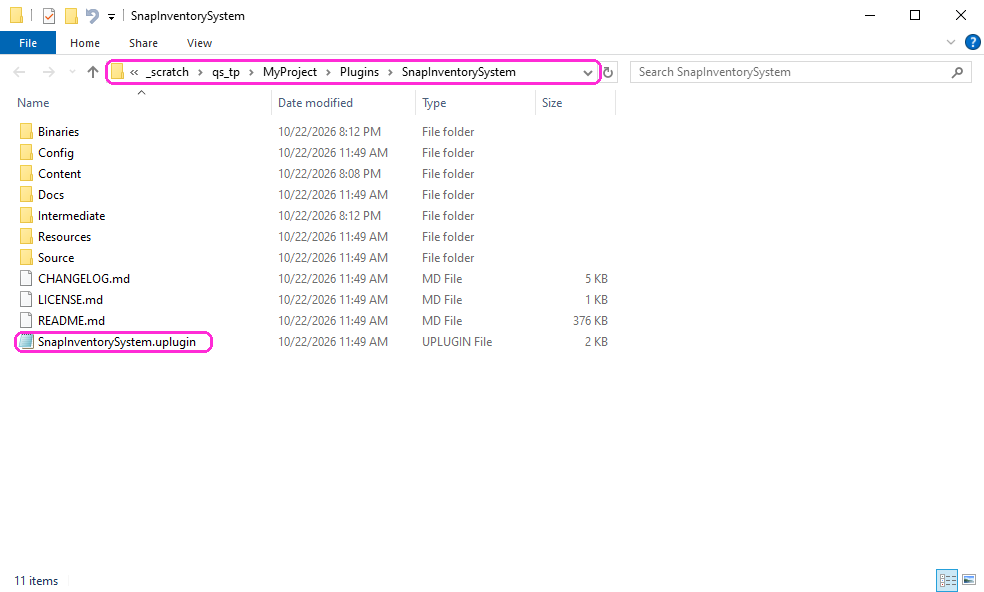
3. **Delete that copy's `Binaries/` and `Intermediate/` folders.** A copy without them has nothing to delete.

   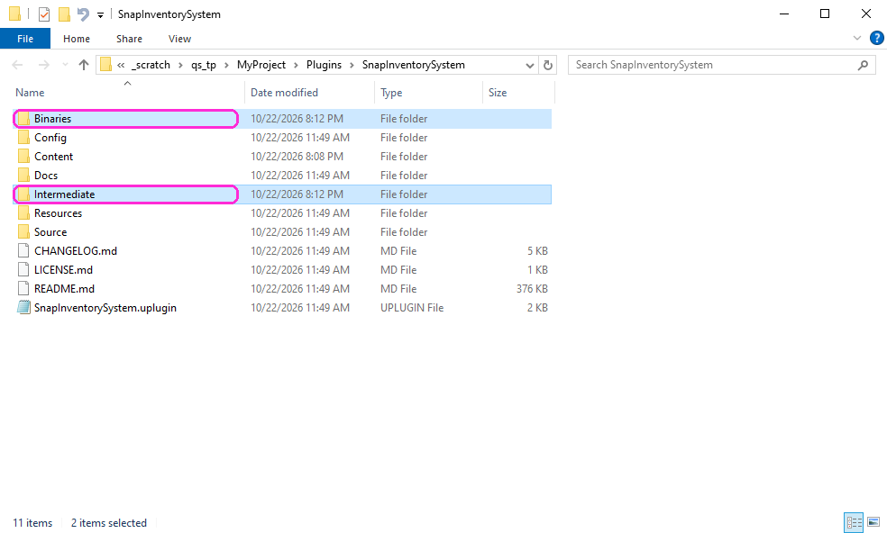
4. **Enable `GameplayAbilities` in your project.** Enable `CommonUI` too, if you use it.
   - Do this before you open the project.
   - With the editor closed, you enable them in your project's `.uproject` file. Add an entry like this one to its
     `"Plugins"` list, with a comma after the entry before it:

     ```json
     {
         "Name": "GameplayAbilities",
         "Enabled": true
     }
     ```

   - **Tip:** You can also tick them in **Edit > Plugins** before you close the editor.

   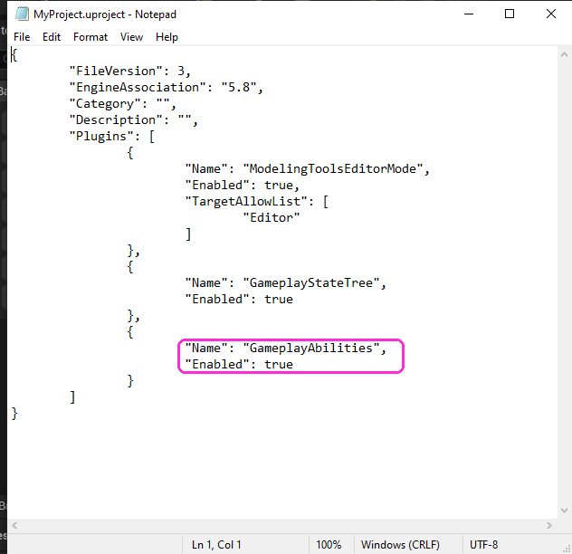

   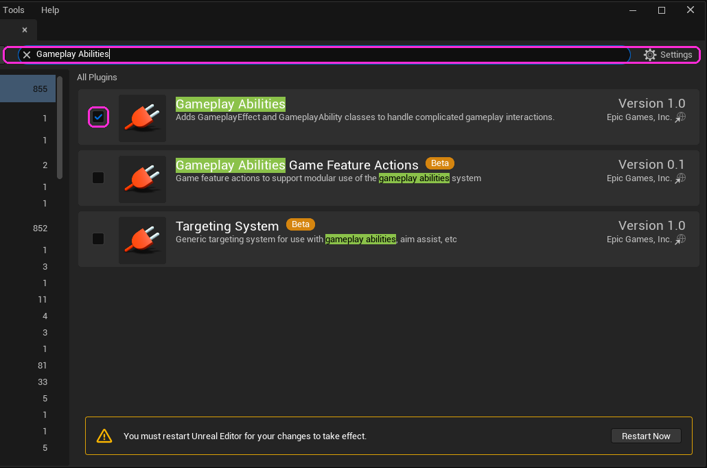
5. **Open your project.**
   - A C++ project compiles the plugin with its next build.
   - A Blueprint-only project offers to build it once the plugin is enabled. If the project already enabled it, the
     offer comes when the project opens. If not, it comes when you tick the plugin in **Edit > Plugins** and restart
     (Step 1 of either path below).
   - The offer lists the plugin's modules as missing. Click **Yes**. The build takes several minutes.
   - Either way, this needs a C++ toolchain: Visual Studio with its game-development C++ workload.

   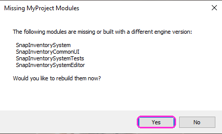

- **Result:** The project's copy is the one built and loaded, with the engine's copy still installed or not.
- **To check:** Run **Tools > Snap Inventory Setup Check**. It adds a note when your project enables
  `GameplayAbilities` or `CommonUI` and your copy was compiled without it.

---

## Path A — Lyra, or any project using Modular Gameplay Actors

**Time:** About three minutes.

Take this path if your project derives from Lyra or from the **Modular Gameplay Actors** sample plugin.

### Step 1: Enable the plugin

1. Open **Edit > Plugins**.
2. Search for **Snap Inventory System**, and tick it.
3. Restart the editor when it asks you to.
   - A copy in your project's `Plugins/` folder that is not built yet is built at this restart: click **Yes** when
     the editor offers to rebuild the missing modules. See
     [Before you start, Step 5](#get-the-full-build-put-the-plugin-in-your-project).

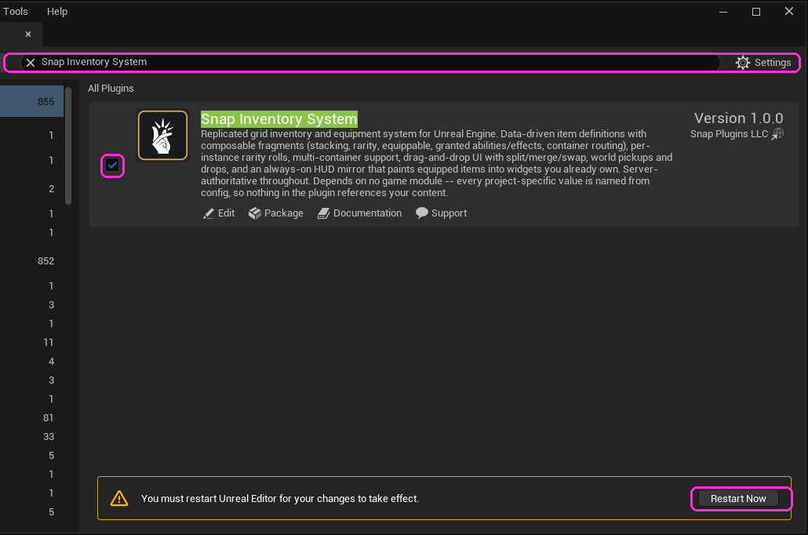

You should see **Snap Inventory System** ticked in **Edit > Plugins** after the restart.

**What else this turns on:**

- **Two engine plugins come with it:** `ModularGameplay` and `EnhancedInput`.
- **The `GameplayAbilities` plugin is optional:** It is not turned on for you.
  - Equipment grants and consumables that run an ability or an effect need it.
  - The demo runs with or without it. Without it, the map plays on its built-in route (see
    [What the demo does in each build](#on-a-blank-template-open-the-demo-map), in Path B).
  - Enable it if your project has not.
  - See [Without GameplayAbilities](../README.md#without-gameplayabilities) for what a project without it keeps.

**Important:** Lyra already has all three (`ModularGameplay`, `EnhancedInput` and `GameplayAbilities`). But an
engine-installed copy of the plugin uses neither `GameplayAbilities` nor `CommonUI`, even in Lyra (see
[Before you start](#before-you-start-where-the-plugin-is-and-which-build-you-have)). So a Lyra project wants the plugin
in its own `Plugins/` folder.

### Step 2: Press Play and open the bag

1. Click **Play** in the editor toolbar.
2. Press `I`.

You should see the bag screen open. It is empty for now.

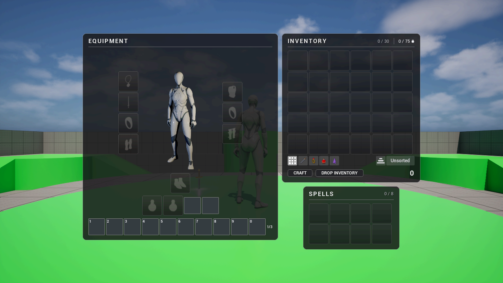

That is the whole setup.

**How it works:**

- **The plugin attaches its own components on login.**
- **It uses attachment rows:** Each row names one component and the actor class that receives it.
- **The rows it ships:** There are seven (six without `GameplayAbilities`). They are matched by class path, so nothing
  has to be linked.

| Component | Attaches to |
|---|---|
| `USnapInventoryComponent` | `ModularPlayerState` |
| `BP_Example_SpellsContainer` (a custom container, attached only with `GameplayAbilities`) | `ModularPlayerState` |
| `USnapEquipmentComponent` | `ModularPlayerState` |
| `USnapHotbarComponent` | `ModularPlayerState` |
| `USnapInventoryHUDComponent` | `ModularPlayerController` |
| `USnapInteractionDetectorComponent` | `ModularPlayerController` |
| `USnapInteractableComponent` | `ModularCharacter` |

- **How `I` reaches the bag:** Through `IA_Inventory_Toggle` in `IMC_SnapInventorySystem`.
  - The plugin applies that mapping context (a set of key mappings) for you, at priority 0.
  - Because it is a real mapping context, the key shows up in a rebinding screen like any other.

### Step 3: Put something in the bag

Nothing is in the bag yet. There are three ways to fix that, cheapest first.

#### Drop a pickup in the level

1. Place an `ASnapPickupActor` in the level.
   - **Tip:** In the **Place Actors** panel, search for **Snap Pickup Actor**.

   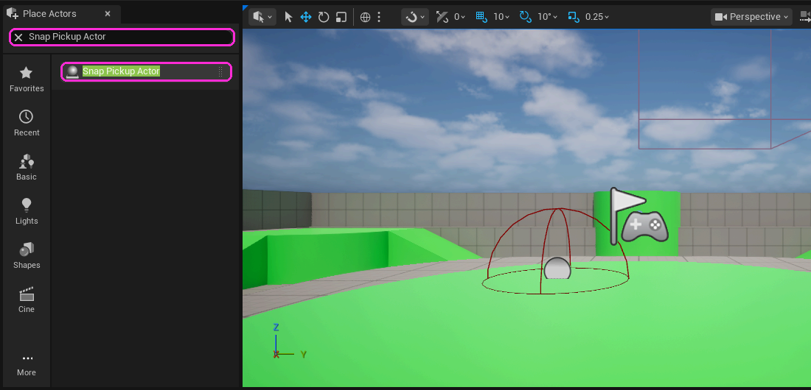
2. In the **Details** panel, find **Item Def** (`ItemDef`) under **Pickup**.
3. Set it to `/SnapInventorySystem/Examples/Items/ID_Sword_Iron`.
   - **Tip:** If you can't see the plugin's folders in the Content Browser, open the Content Browser's **Settings**
     menu and tick **Plugin Content** (under **Show**).

   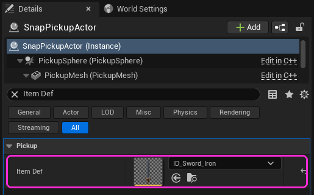
4. Press **Play** and walk over the pickup.
5. Press `I`.

You should see the sword in your character's hand, and in the bag screen's main-hand slot.

- **Why not in the grid:** **Auto Equip on Pickup** (`bAutoEquipOnPickup`, on by default) puts on an item that fits
  a free equipment slot as you pick it up.
- **To have pickups land in the bag instead:** Untick it in **Project Settings > Plugins > Snap Inventory System - Inventory >
  Pickups**.

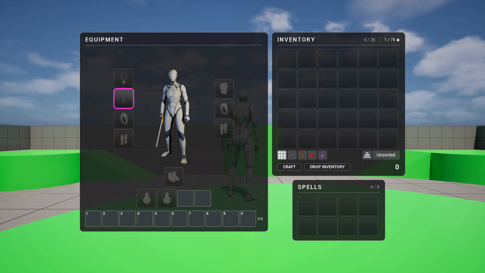

#### Grant it from Blueprint

- **The call:** `USnapCollectionLibrary::GrantItemToActor(Actor, Definition, Count)`. In a Blueprint graph it
  is the **Grant Item To Actor** node.
- **Why this one:** It is the one call that works from anywhere.

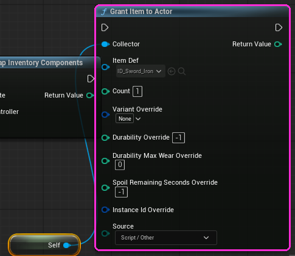

#### Turn the test spawner on

Use this while you are experimenting.

1. Tick **Project Settings > Plugins > Snap Inventory System - World > Examples > Enable Example Item Spawner**.

   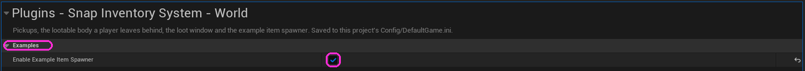
2. Press **Play**, then press `L`.

You should see a ring of every item definition in a folder spawn around you.

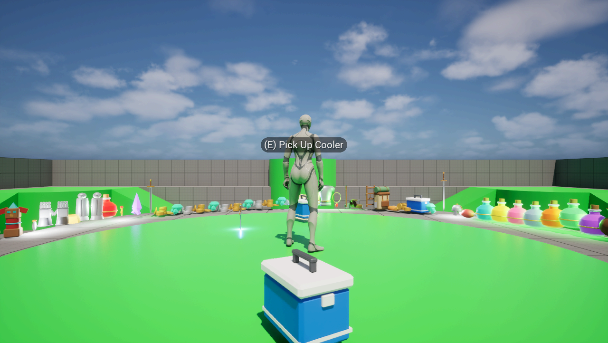

- **Press `L` again:** It clears the previous ring first, so you always end up with exactly one.
- **Important:** Untick it before you package. It is a cheat key.

### Step 4: Try what you now have

| To ... | Do this |
|---|---|
| Open or close the screen | Press `I` (or `Tab`). |
| Move an item | Drag it between squares. |
| Wear an item | Drag it onto an equipment slot. |
| Open the context menu | Right-click an item. |
| Quick-move an item | Shift-click it. |
| Split a stack | Hold and drag the stack onto an empty square. |
| Drop an item in the world | Drag it out of the window and release. |

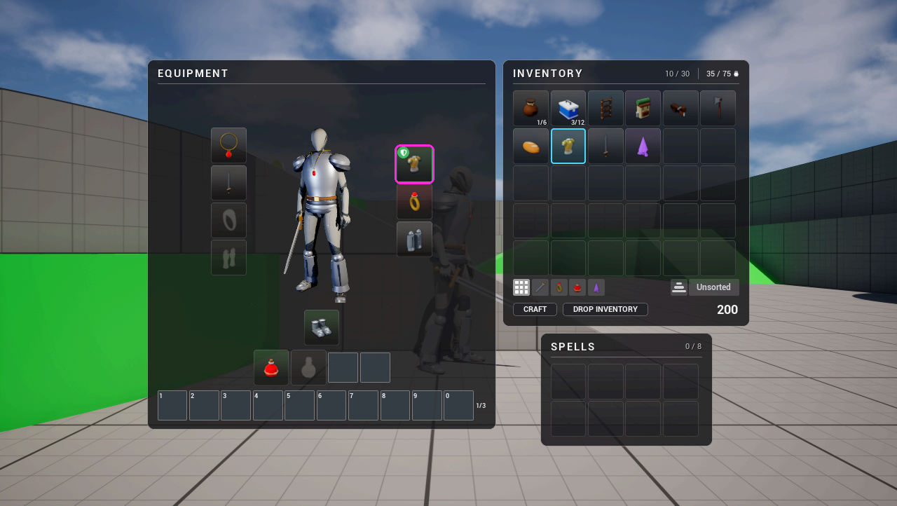

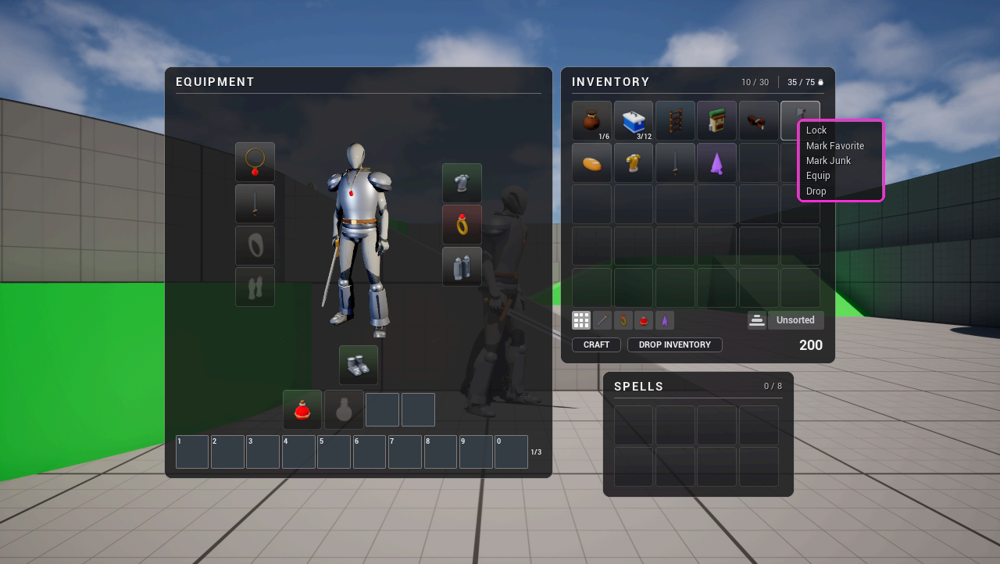

Every key and button is in [The keys it ships with](#the-keys-it-ships-with).

---

## Path B — A blank template, or a project that is not Modular Gameplay

**Time:** About eight minutes of steps, plus the plugin's first build (about 9 minutes) and the first shader compile (up to about 10 minutes).

**Why this path is different:**

- The plugin's default attachment rows name `ModularPlayerState`, `ModularPlayerController` and `ModularCharacter`.
- If your project has none of those classes, every row is inert, and you get no inventory.
- The plugin then logs one Warning on first login, saying exactly that:

```
LogSnapInventorySystem: Warning: Automatic attachment did not reach PlayerController_0 -- missing:
SnapInventoryComponent on PlayerState, ... Its actors are not Modular Gameplay receivers for the
receiver classes in Project Settings -> Plugins -> Snap Inventory System - Foundation -> Attachment.
```

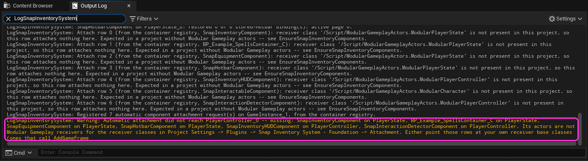

### Step 1: Enable the plugin (as in Path A)

Follow [Path A, Step 1](#step-1-enable-the-plugin): open **Edit > Plugins**, tick **Snap Inventory System**, and
restart the editor.

### Step 2: Check that you have player classes

Options 1 and 2 in Step 3 need player classes to attach things to. They both assume you already have a GameMode, a
PlayerState, a PlayerController and a Character.

| What your project has | What to do |
|---|---|
| A GameMode, a PlayerState, a PlayerController and a Character | Go to [Step 3](#step-3-attach-the-components), and use Option 1 or Option 2. |
| The engine's **Third Person** template: a GameMode, a PlayerController and a Character, but no PlayerState Blueprint | Take [Option 3](#option-3--the-third-person-template-no-playerstate-blueprint). |
| A genuinely **blank** template: none of them, and no level either | Neither option has anywhere to start. Take the demo map route below, then come back. |

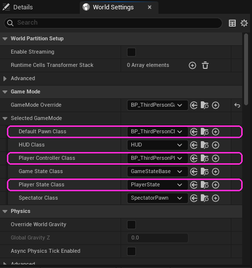

#### On a blank template: Open the demo map

This is the shortest route.

1. **Find the map.** In the **Content Browser**, select **All** and search for `L_SnapInventoryDemo`.
   - A copy in your project's `Plugins/` folder is under **Plugins**.
   - A copy installed into the engine is under **Engine > Plugins**. It is listed only after you tick
     **Settings > Engine Content** in the Content Browser.
   - **Tip:** If you can't see the plugin's folders in the Content Browser, open the Content Browser's **Settings**
     menu and tick **Plugin Content** (under **Show**).

   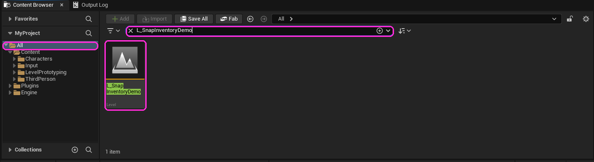

   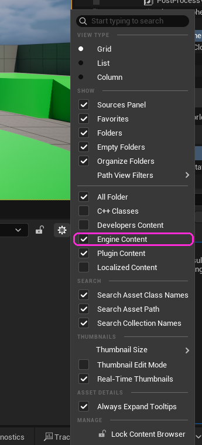
2. **Open it.** Its full path is `/SnapInventorySystem/Demo/Maps/L_SnapInventoryDemo`.
3. **Press Play, click Start playing, then press `I`.** The demo opens with a welcome panel that lists its keys.
   The bag does not open while that panel is up.

You should see the bag open. There is nothing else to set up: the map already names `BP_SnapDemoGameMode` as its
GameMode override.

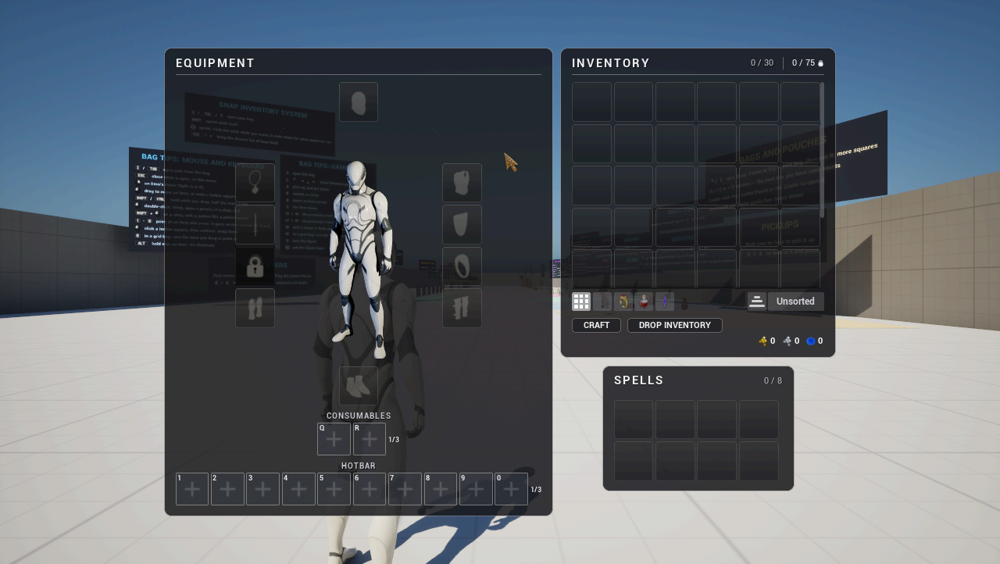

**Or use a level of your own:**

1. Set **World Settings > GameMode Override** to `BP_SnapDemoGameMode`.
2. Make sure the level has a `Player Start`. Without one, you spawn at the origin.
3. Press **Play**.

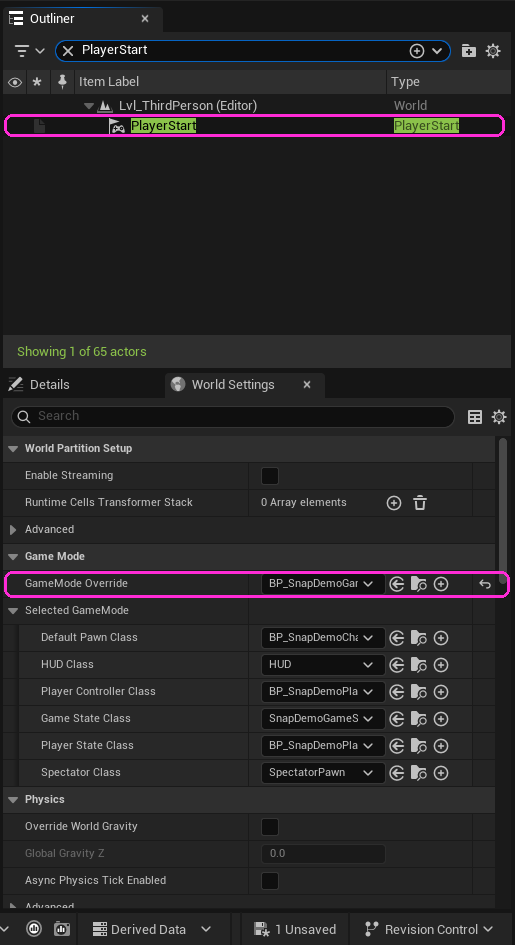

**What these demo classes are:**

- **Five classes:** That GameMode and the four classes it names are the plugin's own demo classes, on plain engine
  bases.
- **They do the setup for you:** They call `EnsureSnapInventoryComponents`, so Steps 3 and 4 below are already done.
- **Use them as a working reference:** Then copy the one call into your own classes. See
  [the demo map](reference/demo-map.md#the-classes-and-the-recipe-they-are).

**What the demo does in each build:**

- **Either build:** The demo's classes are compiled with or without `GameplayAbilities`.
- **Compiled with it:** That is the plugin in your project's own `Plugins/` folder, compiled with `GameplayAbilities`
  enabled.
  - Everything in the map works.
  - The DEMO RUNS ON pad in its FEATURES area switches the whole demo to its built-in route and back.
  - A Blueprint-only project compiles it when the editor offers to, on opening the project. So enable
    `GameplayAbilities` first.
- **Compiled without it:** The map plays on that built-in route.
  - The route has health, damage, death and respawn, the pads, `K` and the training dummies.
  - It has your attacks, worn items' stats, the potions, the passives and the spells. The demo attaches a Spells
    container of its own there.
  - It also has the shops, the bank and the forge.
  - Opening the map logs five expected load warnings. They are for the ability system that the demo's player state and
    training dummies make in a build with it. This was measured with the plugin in a project's own `Plugins/` folder.
- **An *Install to Engine* copy:** It is always compiled without it, whatever your project enables.
- **More:** See [Without GameplayAbilities](../README.md#without-gameplayabilities).

### Step 3: Attach the components

Once you do have your own player classes, pick one option. Option 2 is usually less work than Option 1. Option 3 is for
the Third Person template.

| Option | Use it when |
|---|---|
| [Option 1](#option-1--re-point-the-attachment-rows-no-blueprint-changes): Re-point the attachment rows | Your player classes are component receivers (see Option 1). No Blueprint changes. |
| [Option 2](#option-2--add-the-components-yourself): Add the components yourself | You have your own PlayerState, PlayerController and Character Blueprints. Usually less work than Option 1. |
| [Option 3](#option-3--the-third-person-template-no-playerstate-blueprint): Call **Ensure Snap Inventory Components** | You use the Third Person template, which has no PlayerState Blueprint. |

#### Option 1 — Re-point the attachment rows (no Blueprint changes)

**Important:** This route needs your classes to be `UGameFrameworkComponentManager` **receivers**.

- **What a receiver is:** A class that calls `AddGameFrameworkComponentReceiver`, so the manager can add components
  to it.
- **Where it comes from:** That is what `ModularPlayerState` and friends actually add.
- **If your classes are not receivers:** Use [Option 2](#option-2--add-the-components-yourself).

1. Open **Project Settings > Plugins > Snap Inventory System - Foundation > Attachment**.
2. Open the container registry asset that `ContainerRegistry` names.
   - The plugin ships `DA_SnapContainerRegistry`, at `/SnapInventorySystem/Core/Attachment/DA_SnapContainerRegistry`.
   - **Tip:** If you can't see the plugin's folders in the Content Browser, open the Content Browser's **Settings**
     menu and tick **Plugin Content** (under **Show**).
   - Edit the rows there. The `ComponentAttachSpecs` rows on **Snap Inventory System - Foundation → Attachment** are read
     only when `ContainerRegistry` is cleared, or names an asset that does not load (a Warning says so).

   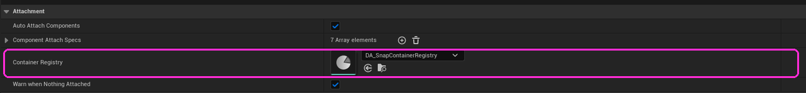
3. In each row, change `ReceiverClass` to your own class, as in the table below.
   - In a project without the Modular Gameplay Actors plugin, the field reads **None**: the class the row names is
     not in your project.

   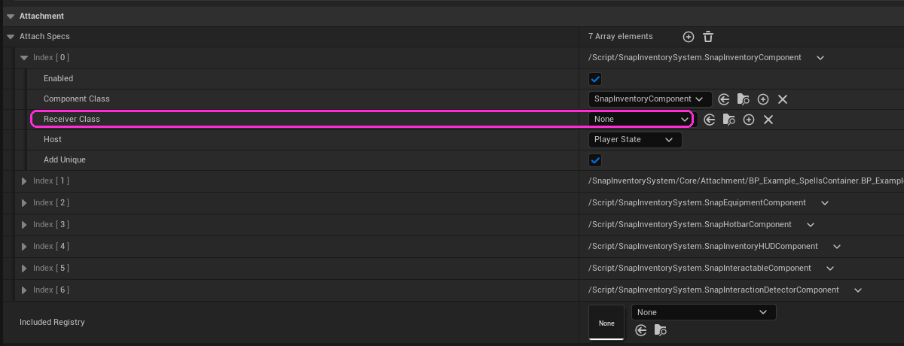
4. Save the registry asset.

| Row's component | Point `ReceiverClass` at |
|---|---|
| The inventory component, the Spells container (with `GameplayAbilities`), equipment, hotbar | Your **PlayerState** class |
| `USnapInventoryHUDComponent`, `USnapInteractionDetectorComponent` | Your **PlayerController** class |
| `USnapInteractableComponent` | Your **Character/Pawn** class |

#### Option 2 — Add the components yourself

In each Blueprint, open the **Components** panel, click **Add**, and add the components below. Search for each by
its class name. The list shows it without `Component`: **Snap Inventory**, **Snap Equipment**, **Snap Interactable**,
and so on.

1. **On your PlayerState:** Add `SnapInventoryComponent`, `SnapEquipmentComponent` and `SnapHotbarComponent`.
   - Add `SnapInventoryComponent` first. See **Order matters**, below.
   - Add `BP_Example_SpellsContainer` and `BP_Example_ShardsContainer` only if you want those extra containers. Or
     add containers of your own: see [custom containers](reference/custom-containers.md).

   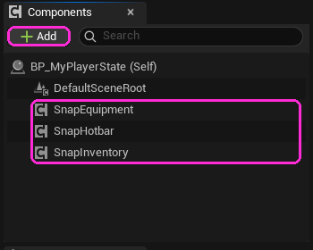
2. **On your PlayerController:** Add `SnapInventoryHUDComponent`.
   - Add `SnapInteractionDetectorComponent` too, if you want the interact key.

   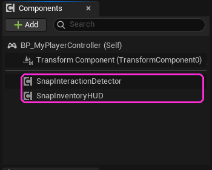
3. **On your Character:** Add `SnapInteractableComponent`, if you want the character itself to be interactable.

   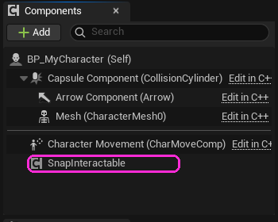
4. **Turn the automatic rows off, so they cannot double up.** In
   **Project Settings > Plugins > Snap Inventory System - Foundation > Attachment**, untick `bAutoAttachComponents`.

   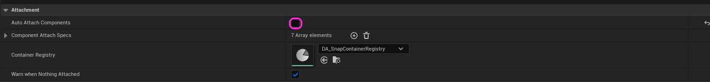

**Important: Order matters if you add more than one inventory component.**

- **Add the base one first:** Every custom container derives from `USnapInventoryComponent`, so add the base one
  **first**.
- **Mark exactly one as the main bag:** Leave `bIsMainInventory` ticked on exactly one of them. That is the marker the
  hotbar, the saving path and pad focus use to find your bag.
- **More:** See [extending](reference/extending.md).

#### Option 3 — The Third Person template (no PlayerState Blueprint)

- **Why it works:** The Third Person template's game mode spawns the engine's plain `PlayerState`. So a player state
  exists at run time, even though there is no Blueprint to add components to.
- **What you do:** Call **Ensure Snap Inventory Components** (`USnapFoundationLibrary`) from three
  places (the demo's own classes use four: its character also calls it on `PossessedBy`, for a respawn).
- **Calling it twice is fine:** Each call adds only the components still missing, so calling it more than once is
  harmless.

1. **In your GameMode** (*BP_ThirdPersonGameMode* in the template), on **Event OnPostLogin**, call
   **Ensure Snap Inventory Components** with:
   - Player State = the new player's **Get Player State**
   - Player Controller = the new player
   - Pawn = none
   - **The template's GameMode opens with only its class defaults.** Click **Open Full Blueprint Editor** to reach its
     Event Graph.

   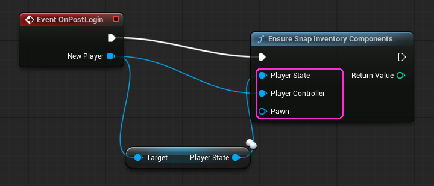
2. **In your PlayerController** (*BP_ThirdPersonPlayerController*), on **Event BeginPlay**, call it with:
   - Player State = **Get Player State** (it can still be none on a client)
   - Player Controller = self
   - Pawn = none
   - **The template's controller already has an Event BeginPlay**, which adds the template's input mapping context.
     Drag from its execution pin and search for the node. The editor puts the call first; the template's own nodes
     still run after it.
   - **Pick the Get Player State under Class > Controller** in the search results. The one under **Game**, which the
     list highlights first, looks a player state up by index.

   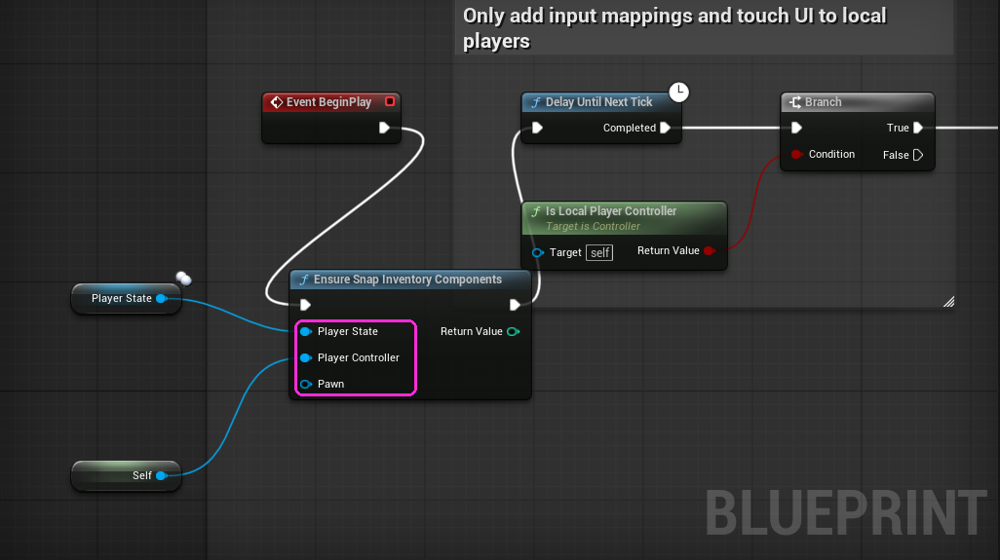
3. **In your Character** (*BP_ThirdPersonCharacter*), on **Event BeginPlay**, call it with:
   - Player State = none
   - Player Controller = none
   - Pawn = self

   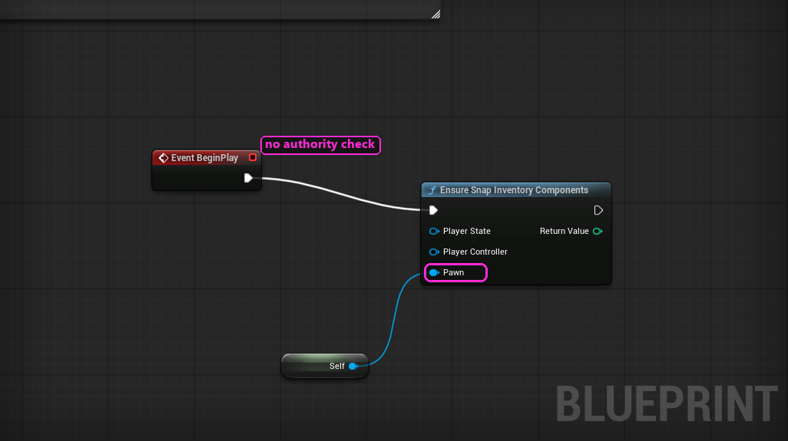
4. **Leave `bAutoAttachComponents` on.** Its rows simply attach nothing in this template.

**Important:** Make the Character call on **every machine, for every pawn**, with no authority check. The character's
interactable is local-only. So a client that does not add its own to other players' pawns never sees an option on
them.

- **Compile and save** the three Blueprints.
- **To check it:** Press **Play**, then press `I`. You should see the bag open. With two players on a listen server,
  each player sees **Trade with** over the other player's character.
- **The template has no ability system,** so two Warnings are expected:
  - Equipping an item logs that its grants were skipped. See
    [A note on the Gameplay Ability System](#a-note-on-the-gameplay-ability-system).
  - About 15 seconds into play, a Warning says damage-driven durability wear found no ability system. It names its
    switch, `bEnableDamageDurabilityWear`: set it to false if your project has no ability system.

See [How the components reach your player](../README.md#how-the-components-reach-your-player).

### Step 4: Check the input

By default there is nothing to do here.

- **The plugin applies its own keys:** It applies `IMC_SnapInventorySystem` itself, at priority 0, as long as
  `bAddInventoryMappingContext` is on. It is on by default.
- **To check it:** Press **Play**, then press `I`. You should see the bag open. `Y` on a gamepad opens it too.

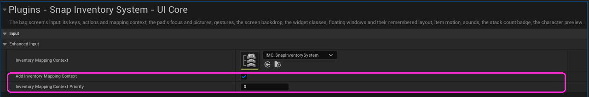

**If your project drives input its own way:**

1. Clear the `bAddInventoryMappingContext` setting.
2. Add `/SnapInventorySystem/Core/Input/IMC_SnapInventorySystem` to your own mapping contexts instead.

Every action in it is a normal `UInputAction`, and can be rebound.

### Step 5: Fill the bag and try it

1. Put something in the bag. Any of the three ways in [Path A, Step 3](#step-3-put-something-in-the-bag) works.
2. Try the moves in [Path A, Step 4](#step-4-try-what-you-now-have).

### A note on the Gameplay Ability System

- **Equipment uses GAS:** Equipment grants abilities and effects through GAS (the Gameplay Ability System, the
  `GameplayAbilities` plugin).
- **How it finds one:** The equipment component resolves an ability system component (ASC) from its owning actor, via
  `UAbilitySystemGlobals::GetAbilitySystemComponentFromActor`. So it works with any `IAbilitySystemInterface` actor.
- **With no ASC:** It degrades gracefully. Equipping still works, and the grants are skipped with a warning.
- **Without `GameplayAbilities`:** In a project built without it, the grants are not compiled at all.

---

## The keys it ships with

The plugin's two mapping contexts, `IMC_SnapInventorySystem` and `IMC_SnapHotbar`, and three settings give these keys
in any project.

- A rebinding screen lists the mapped ones.
- See [Input](reference/input.md) for every action.

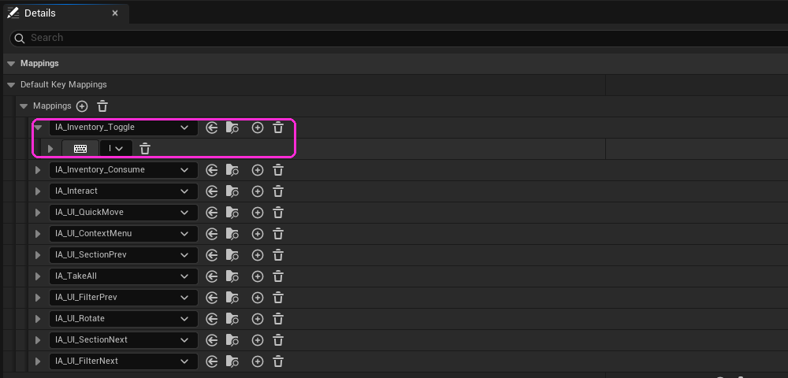

| Key | Does | Comes from |
|---|---|---|
| `I` | Opens and closes the bag | `IA_Inventory_Toggle` |
| `Tab` | Also opens and closes the bag | The `AdditionalToggleKeys` setting. To give `Tab` back, put `^AdditionalToggleKeys=` in your `DefaultGame.ini`. |
| The middle mouse button, held | Shows the cursor while held, without opening anything. The press is swallowed. | The `CursorPeekKey` setting. To turn it off, set `CursorPeekKey=None`. |
| `E` | Interacts with what the prompt names (held, where it says *Hold*) | `IA_Interact` |
| `U` | Uses the selected consumable | `IA_Inventory_Consume` |
| `R` | Turns the item being dragged | `IA_UI_Rotate` |
| `1` ... `9`, `0` | The hotbar's ten squares | `IA_Hotbar_Slot01` ... `IA_Hotbar_Slot10` |
| `Escape` | Closes the top window, or cancels a carry | The `Close` gesture row |
| D-pad | Hotbar squares 1-4 in play. Moves focus in a screen. | `IMC_SnapHotbar`; the engine's navigation |
| A / B | Picks up or puts down, and presses the focused button / Backs out and closes | The engine's accept and back |
| X | Quick-moves the focused item | `IA_UI_QuickMove` |
| Y | In play, opens the bag. In a screen, opens the focused item's menu. | The `GamepadOpenKeys` setting (to give `Y` back to your game during play, put `^GamepadOpenKeys=` in your `DefaultGame.ini`); `IA_UI_ContextMenu` |
| LB / RB | The bag screen's previous / next section. RB takes everything from an open loot window. | `IA_UI_SectionPrev` / `IA_UI_SectionNext`, `IA_TakeAll` |
| LT / RT | The bag's previous / next filter tab. RT turns a carried item. | `IA_UI_FilterPrev` / `IA_UI_FilterNext`, `IA_UI_Rotate` |

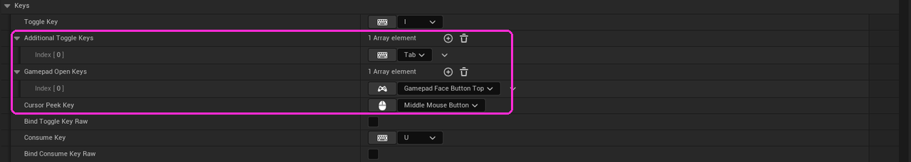

- **On a pad:** **Y opens the bag** during play. Inside the bag, Y is the item menu again, and B closes.
- **With the mouse:**
  - Drag to move.
  - Right-click for the item menu.
  - Shift + click to quick-move.
  - Double-click to open a pouch or use an item.
  - Hold Ctrl or Shift while dragging a stack to split it.
  - The full table is in the [README](../README.md#mouse-and-key-gestures-one-table).
- **If your project already uses one of these keys:** The README explains which context wins, and how to make yours
  win always (`InventoryMappingContextPriority`).

---

## The interaction outline

The focused interactable gets an outline. That needs one renderer setting.

1. Open **Project Settings > Engine > Rendering > Postprocessing**.
2. Set **Custom Depth-Stencil Pass** to **Enabled with Stencil**.

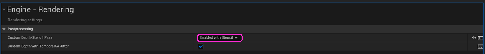

That setting is this line:

```ini
; <YourProject>/Config/DefaultEngine.ini
[/Script/Engine.RendererSettings]
r.CustomDepth=3
```

**Why it is needed:**

- The focused interactable is outlined by a post-process pass that reads the custom-depth **stencil**.
- The renderer clears and writes that stencil only with **Custom Depth-Stencil Pass** set to **Enabled with Stencil**.

**If it is not 3 (the engine default is 1):**

- The prompt still appears, and nothing is outlined.
- The plugin leaves its outline pass off, and logs one line naming the setting. That is because at any value but 3,
  the stencil holds whatever memory it was given.
- The **Setup Check** warns about it at editor start.
- See [loot and interaction](reference/loot-and-interaction.md).

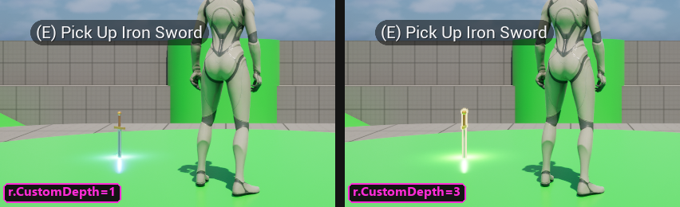

The outline's own switch, color and thickness are in **Project Settings > Plugins > Snap Inventory System - Interaction >
Interaction > Outline**.

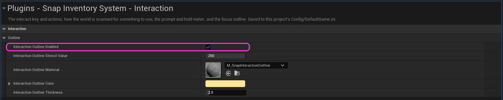

---

## Before you package

**Why:** The plugin's default asset paths are *soft paths* (references stored as a path) with no referencer. The
cooker, which picks what goes into a package, cannot discover them.

- **In the editor:** Everything resolves off disk and works.
- **In a package:** The assets are simply absent.

**What to do:**

1. **Add the cook rule.** You need one `DirectoriesToAlwaysCook` line, `/SnapInventorySystem/Core`: every default the
   plugin ships points into that folder.
   - The table under [Required setup in the README](../README.md#required-setup--the-cook-rules) says what points into
     each part of it.
   - That line is not the demo: see **Important** below.

   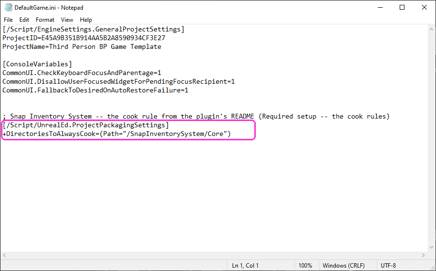
2. **Untick Enable Example Item Spawner** (**Project Settings > Plugins > Snap Inventory System - World > Examples**). It is a
   cheat key.

   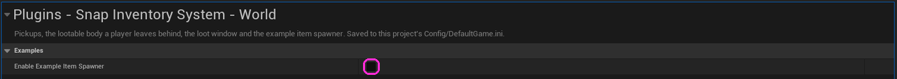
3. **Run the Setup Check:** **Tools > Snap Inventory Setup Check**. It lists every plugin folder a setting still
   points into that nothing cooks.
   - You should see the **Snap Inventory Setup** message log open.
   - Each cook warning ends with the `+DirectoriesToAlwaysCook=` line that fixes it.
   - With only the Core line, `/SnapInventorySystem/Demo` and `/SnapInventorySystem/Examples` show as notes, not
     warnings, while only the demo's own classes and the switched-off spawner point into them. Those notes are expected
     when you do not ship the demo.

   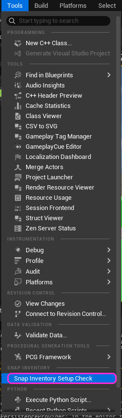

   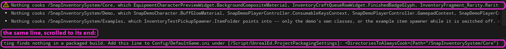
4. **Go through the full packaging checklist.** It is in the [README](../README.md#packaging-checklist).

**Important: The Core line is not the demo.**

- **The other folders:** `Examples` holds the example items and actors (their icons, models and sounds), `Demo` the demo
  map and what only it uses, and `DemoArt` the demo's art.
- **Leave all three out:** Your build then ships none of the examples or the demo.
- **Leave out the Core line too:** Then it ships none of the plugin. Its defaults are soft paths the cooker does not
  follow.
- **No fallback:** The engine's cook-everything fallback does not run in a project whose engine plugins name their own
  folders for the cook. A new project's do.

---

## Where to go next

- **Make your own item:** [Items and fragments](reference/items-and-fragments.md).
- **Reskin the UI:** [UI and theming](reference/ui-and-theming.md). Nothing in the plugin requires the example
  widgets. Each is named by a setting you can re-point.

  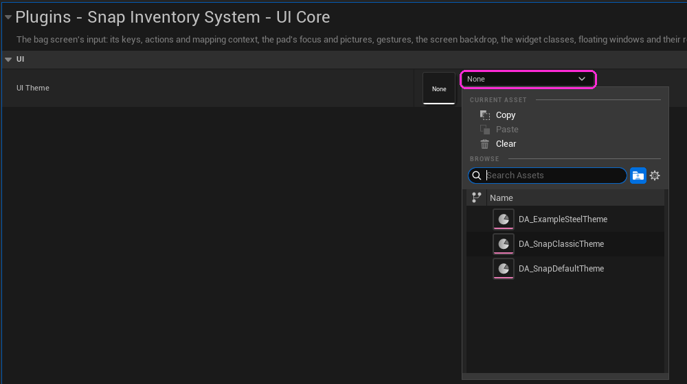
- **Everything you can configure:** [Appendix: settings](reference/appendix-settings.md).
- **Every other page:** The [documentation index](README.md).
