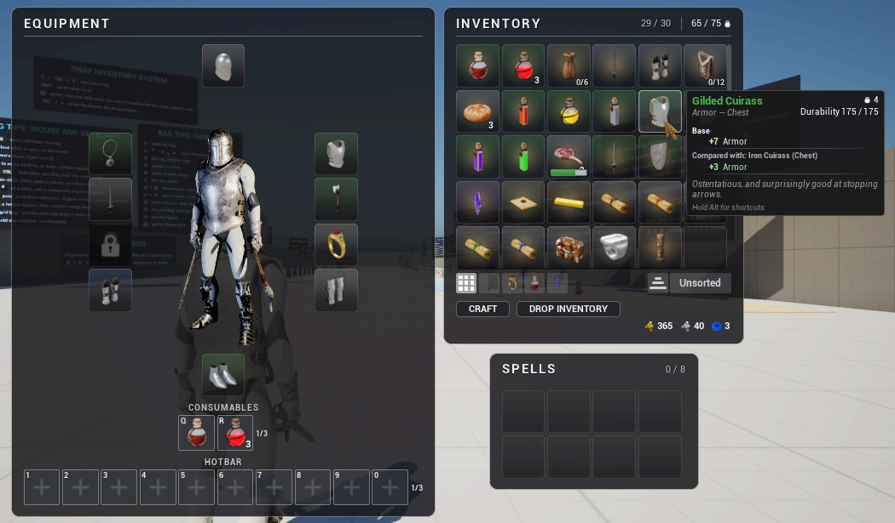

# Snap Inventory System — documentation

Use this page to find what you need: where to start, the page for a common task, and every page by topic.

- **What the plugin is:** Replicated grid inventory, equipment, vendors, trade, crafting, loot and a hotbar for Unreal
  Engine 5.8.
- **How it is built:** Server-authoritative throughout, data-driven through composable item fragments, and dependent
  on no game module.

**On this page:** [Start here](#start-here) · [I want to ...](#i-want-to-) ·
[Every page, by topic](#every-page-by-topic) · [Where these pages come from](#where-these-pages-come-from) ·
[Conventions used throughout](#conventions-used-throughout)

## Start here

1. **Put it in your project:** Follow the [Quickstart](QUICKSTART.md). It takes under ten minutes, in Lyra or a blank
   template.
2. **Or play it first:** See [the demo map](reference/demo-map.md). You open one map and press Play.

## I want to ...

| I want to ... | Read |
|---|---|
| Play it before I set up my own project | [The demo map](reference/demo-map.md): open one map, press Play |
| Get an inventory on screen | [Quickstart](QUICKSTART.md): under ten minutes, Lyra or a blank template |
| Make my own item | [Items and fragments](reference/items-and-fragments.md) |
| Make an item several squares big | [Make a grid item](reference/make-a-grid-item.md) |
| Add storage of my own beside the bag | [Custom containers](reference/custom-containers.md) |
| Let players wear items | [Equipment](reference/equipment.md) |
| Change how the screens look | [UI and theming](reference/ui-and-theming.md), then [Customizing the UI](reference/customizing-the-ui.md) |
| Change or rebind the keys | [Input](reference/input.md) |
| Set up the hotbar | [Hotbar](reference/hotbar.md) |
| Add a shop | [Vendor](reference/vendor.md) and [Currency and prices](reference/currency-and-prices.md) |
| Add crafting | [Crafting](reference/crafting.md) and [Crafting stations](reference/crafting-stations.md) |
| Put loot and pickups in the world | [Loot and interaction](reference/loot-and-interaction.md) and [Loot tables](reference/loot-tables.md) |
| Let players trade | [Trade](reference/trade.md) and [Trading with NPCs](reference/npc-trade.md) |
| Save and load what players carry | [Persistence](reference/persistence.md) |
| Translate or reword the plugin's text | [Localizing and rewording](reference/localization.md) |
| Use it with Lyra or the Gameplay Ability System | [GAS and Lyra](reference/gas-and-lyra.md) |
| Check what my project has not set up yet | [Editor tools](reference/editor-tools.md) (the Setup Check) |
| Find out why an action was refused | [Refusals](reference/refusals.md) |
| Test or debug it | [Testing and diagnostics](reference/testing-and-diagnostics.md) |
| Package my game | [Quickstart: Before you package](QUICKSTART.md#before-you-package), then the [README](../README.md)'s packaging checklist |
| Understand one subsystem | The [reference](reference/) page for it, below |
| Look up a setting | [Appendix: settings](reference/appendix-settings.md): every one, generated |
| Know which widget names the plugin looks for | [Appendix: widget contracts](reference/appendix-widgets.md): every one, generated |
| React to something in Blueprint | [Appendix: events](reference/appendix-events.md): every one, generated |
| Know why something is built the way it is | [Design notes](design-notes/) |
| See what changed between versions, and the deprecation policy | [CHANGELOG](../CHANGELOG.md) |

## Every page, by topic

### Getting started

| Page | Covers |
|---|---|
| [Quickstart](QUICKSTART.md) | Getting an inventory on screen, in Lyra or a blank template |
| [The demo map](reference/demo-map.md) | The playable example, its five classes, and the recipe for a non-Modular project |
| [GAS and Lyra](reference/gas-and-lyra.md) | Ability system integration, and what Lyra gives you free |

### Items

| Page | Covers |
|---|---|
| [Items and fragments](reference/items-and-fragments.md) | `USnapItemDefinition`, every shipped fragment, per-instance state |
| [Make a grid item](reference/make-a-grid-item.md) | A walk-through: an item several squares big, its shape, its turns, trying it in the demo |
| [Affixes](reference/affixes.md) | Rolled per-instance modifiers, the affix table, how a roll is shown and priced |
| [Item sets](reference/item-sets.md) | Set bonuses, cumulative tiers, what counts as a worn piece |
| [Durability, spoilage, weight](reference/condition-and-weight.md) | Wear, breaking, repair, shelf life, carry weight |
| [Restrictions and marks](reference/restrictions-and-marks.md) | Locking, favorites, junk, the seven removal doors, bulk verbs |
| [Tooltips and stats](reference/tooltips-and-stats.md) | What an item says it does, the stat display table, comparing against what is worn |

### Containers, equipment and the hotbar

| Page | Covers |
|---|---|
| [Inventory and containers](reference/inventory-and-containers.md) | The grid, slots, stacking, pouches, counters, capacity |
| [Custom containers](reference/custom-containers.md) | Your own storage beside the bag (Spells, Shards, anything) as a data-only Blueprint: tag, name, capacity, abilities while held |
| [Equipment](reference/equipment.md) | Slots, equipping, granted abilities and effects, visuals |
| [Hotbar](reference/hotbar.md) | Consumable and ability bars, pages, binding, persistence |

### Screens, input and sound

| Page | Covers |
|---|---|
| [UI and theming](reference/ui-and-theming.md) | The screen, panels, slot widgets, tooltips, how to reskin |
| [Customizing the UI](reference/customizing-the-ui.md) | The example Widget Blueprint behind each surface, its parts, moving and restyling them |
| [The buff row](reference/buff-row.md) | A player's running buffs and debuffs as translucent squares on the HUD, on both routes: the widget, the source interface, the rows |
| [Input](reference/input.md) | The mapping context, the gesture table, raw bindings, rebinding |
| [Sounds](reference/sounds.md) | Item, container, action and interface sounds: the type rows, per-item overrides, the theme's sounds, the switch |
| [Localizing and rewording](reference/localization.md) | Gathering the plugin's text, translating it, rewording the English, identifier fallbacks |

### Shops, money, trade and crafting

| Page | Covers |
|---|---|
| [Vendor](reference/vendor.md) | Shops, buying, selling, upgrades, repair, stock ledgers |
| [Currency and prices](reference/currency-and-prices.md) | What money is, per-shop currencies, the price hooks, paying |
| [Trade](reference/trade.md) | Player-to-player escrow trade |
| [Trading with NPCs](reference/npc-trade.md) | Any actor a player trades with in the trade window: the trade-partner component, its offer, the auto-confirm |
| [Crafting](reference/crafting.md) | Recipes, dismantling, discovery, timed queues |
| [Crafting stations](reference/crafting-stations.md) | A forge that is not a shopkeeper, the station session, one station-tag derivation |
| [Quest givers](reference/quest-givers.md) | Any actor that takes in items for rewards and slot unlocks: the quest asset, the giver component, the "!" |

### The world

| Page | Covers |
|---|---|
| [Loot and interaction](reference/loot-and-interaction.md) | Pickups, world drops, containers, bodies, the interact key |
| [Loot tables](reference/loot-tables.md) | Shared loot assets, nesting, guaranteed rows, seeded rolls |
| [Pickup modes and the collect feed](reference/pickup-modes-and-the-collect-feed.md) | Walk or press to collect, the collect seam, the stacking feed, the presentation fragment |
| [Death and loss](reference/death-and-loss.md) | What a death drops, the death-drop policy, the doors for a project without GAS |

### Tools, saving and the internals

| Page | Covers |
|---|---|
| [Editor tools](reference/editor-tools.md) | The Snap Inventory New menu, item thumbnails, registering items with the Asset Manager |
| [Testing and diagnostics](reference/testing-and-diagnostics.md) | The automation tests, the gameplay debugger page, the console commands, the stats group |
| [Refusals](reference/refusals.md) | `ESnapRefusal`, how a refused action explains itself |
| [Networking](reference/networking.md) | Authority, replication, what a client may ask for |
| [Persistence](reference/persistence.md) | Saving inventories, hotbars, window layout and world state |
| [Extending the plugin](reference/extending.md) | Subclassing, admission policies, fragment hooks |

### Generated appendices

| Page | Covers |
|---|---|
| [Appendix: settings](reference/appendix-settings.md) | Every setting, generated |
| [Appendix: widget contracts](reference/appendix-widgets.md) | Every widget name the plugin looks for, generated |
| [Appendix: events](reference/appendix-events.md) | Every event you can react to in Blueprint, generated |

### Outside this folder

| Page | Covers |
|---|---|
| [README](../README.md) | The long-form single document, at the plugin root |
| [CHANGELOG](../CHANGELOG.md) | What changed between versions, and the deprecation policy |
| [Design notes](design-notes/) | Why something is built the way it is |

## Where these pages come from

- **The long-form document:** The [README](../README.md) at the plugin root is the long-form single document.
- **The source of these pages:** Everything here is drawn from it and from the headers.
- **If the two disagree:** The headers win, and that is a bug worth reporting.

## Conventions used throughout

- **Every path is real.** A `/SnapInventorySystem/...` path in these documents resolves to an asset in
  the plugin's `Content/`. That is checked mechanically; see [design notes](design-notes/README.md).
- **Nothing is required.** Every widget contract, every example asset and every key binding can be
  cleared, and the feature behind it switches off rather than breaking.
- **The server decides.** A client predicts and asks; the server re-derives and answers. Where the two
  can disagree, the client's answer is the permissive one.
