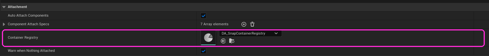
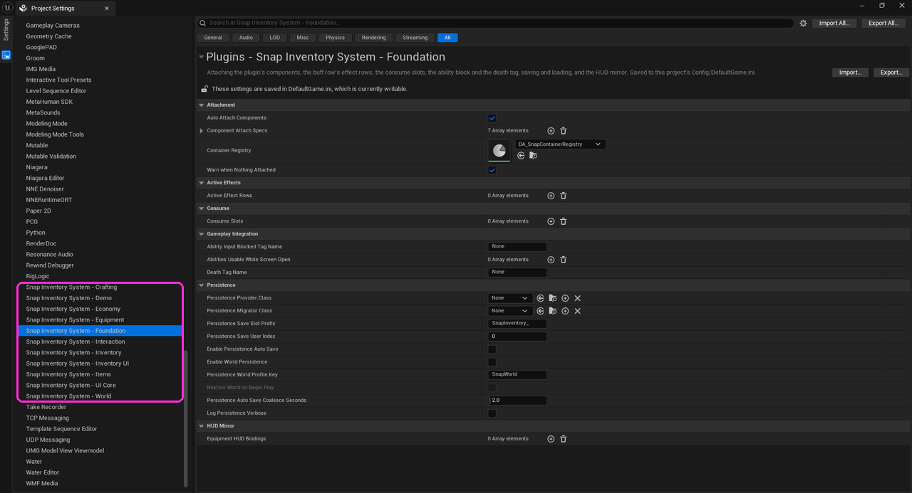
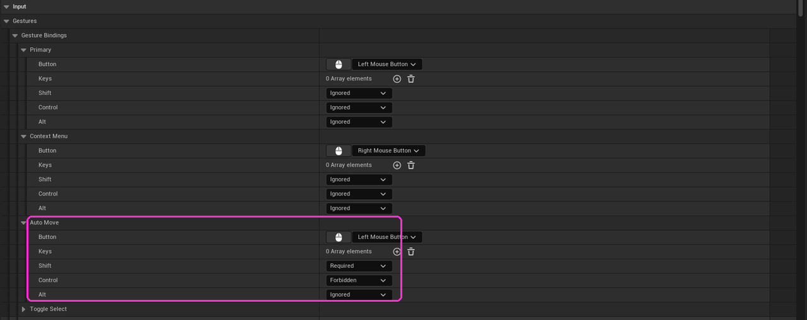
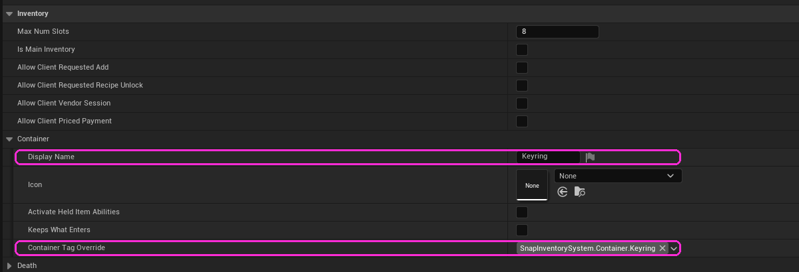

# Snap Inventory System

A replicated, server-authoritative grid inventory and equipment system for Unreal Engine 5.

This page covers what the plugin does, how to install and set it up, and what it does not do yet. The
[appendices](#appendices) at the end hold the full detail behind each section.

## Start here

- **Try it first.** Open `/SnapInventorySystem/Demo/Maps/L_SnapInventoryDemo` and press Play.
  - [The demo map](Docs/reference/demo-map.md) answers "does it do what it says?" in about a minute.
  - In its FEATURES wing you switch the plugin's features on and off by walking onto pads.
- **Put a working bag in a project of your own, with no C++:** Follow [the quickstart](Docs/QUICKSTART.md).
- **Find any topic:** The [documentation index](Docs/README.md) has one reference page per subsystem.
- **Look up a setting:** [Appendix: settings](Docs/reference/appendix-settings.md) lists every one.
- **Before you rely on a dedicated server or a gamepad:** Read [Known limitations](#known-limitations).

## Contents

- [Start here](#start-here)
- [What it does, at a glance](#what-it-does-at-a-glance)
- [Requirements and compatibility](#requirements-and-compatibility) ·
  [Without GameplayAbilities](#without-gameplayabilities)
- [Install](#install) · [How the components reach your player](#how-the-components-reach-your-player)
- [Where the settings live](#where-the-settings-live) ·
  [Required setup — the cook rules](#required-setup--the-cook-rules) ·
  [Optional, and each fails quietly until you fill it in](#optional-and-each-fails-quietly-until-you-fill-it-in)
- The systems, one by one:
  - [The demo map and the example content](#the-demo-map-and-the-example-content)
  - [Items and fragments](#items-and-fragments)
  - [Containers and storage items](#containers-and-storage-items)
  - [The spatial grid](#the-spatial-grid)
  - [Vendors (shops)](#vendors-shops)
  - [Currency and the wallet](#currency-and-the-wallet)
  - [The item menu (right-click)](#the-item-menu-right-click)
  - [Keys and input](#keys-and-input) · [Mouse and key gestures: one table](#mouse-and-key-gestures-one-table)
  - [Playing with a gamepad](#playing-with-a-gamepad)
  - [Optional screen features](#optional-screen-features)
  - [Saving: players and the world](#saving-players-and-the-world)
  - [Durability, weight and spoilage](#durability-weight-and-spoilage)
  - [Consumable items](#consumable-items)
  - [Loot, crates and world timers](#loot-crates-and-world-timers)
- [Extending the plugin](#extending-the-plugin)
- [Known limitations](#known-limitations): [Networking verification](#networking-verification) · [Gamepad](#gamepad) ·
  [A build without GameplayAbilities](#a-build-without-gameplayabilities) ·
  [A precompiled copy](#a-precompiled-copy-a-storefronts-install-to-engine) · [Setup and content](#setup-and-content)
  · [Verified but not exercised, and known rough edges](#verified-but-not-exercised-and-known-rough-edges) ·
  [Behavior worth knowing](#behavior-worth-knowing)
- [Packaging checklist](#packaging-checklist)
- [License](#license) · [Support](#support)
- [Appendices A–O](#appendices): the full detail behind each section, in the same order as the main body.

## What it does, at a glance

- **Items are data, not classes.** A `USnapItemDefinition` is a `UPrimaryDataAsset` carrying a list of composable
  **fragments** (stacking, rarity, equippable, granted abilities/effects, container routing, pickup amount, UI data).
  - Most items need zero C++ — you add a fragment, not a subclass.
- **Server-authoritative throughout.** Every mutation goes through a `Server_*` RPC on a manager component and is
  re-validated there; the UI only ever makes *requests*.
  - Clients never mutate inventory state locally.
- **Depends on no game module.** The plugin's C++ includes no project header, and every project-specific value — the
  screen widget, the rarity table, the counter icon, slot tags, the gameplay tags it reacts to — is named from config
  as a *path* or an *FName*, never as a package reference.
  - Disabling the plugin leaves your project loading.
- **Multiple containers.** A main bag plus containers beside it — the default setup attaches Spells with
  `GameplayAbilities`, and one line attaches the Shards example — each with its own capacity, routed by a fragment on
  the item.
  - A further container is a data-only Blueprint and one registry row, no C++ — see
    [Adding a container of your own](#adding-a-container-of-your-own--no-c-required).
- **Two layouts.** A container is a numbered bag or a spatial grid in which an item covers the cells its shape needs,
  drawn by `USnapInventorySpatialPanel` with a drop preview and item turning.
  - It is set per container, and nothing changes until you ask — see [The spatial grid](#the-spatial-grid).
- **Magic items.** An item can roll modifiers from an affix table, decided once on the server: which ones, how often
  it is magic at all, how many and how strong are set per item, and its name says what it rolled — "Sturdy Iron Sword
  of Fury" — see [Affixes](Docs/reference/affixes.md).
- **Also in the box**, each with a section below: [vendors](#vendors-shops),
  [a multi-currency wallet](#currency-and-the-wallet), [storage items](#containers-and-storage-items),
  [saving players and the world](#saving-players-and-the-world),
  [durability, carry weight and spoilage](#durability-weight-and-spoilage), [consumables](#consumable-items),
  [loot and world timers](#loot-crates-and-world-timers), [gamepad play](#playing-with-a-gamepad), and
  [floating windows and item filters](#optional-screen-features).
- **On reference pages of their own:** [Trade](Docs/reference/trade.md), [crafting](Docs/reference/crafting.md), the
  [hotbar](Docs/reference/hotbar.md) and [equipment](Docs/reference/equipment.md). The
  [documentation index](Docs/README.md) lists every page.

## Requirements and compatibility

- **Engine:** UE 5.8.
  - Developed and verified on 5.8 only — earlier versions are untested, not merely unsupported.
  - The shipped content is saved with 5.8.2 and 5.8.3 from the Epic Games Launcher and marked compatible with 5.8.0:
    it loads with no warning on those and on a 5.8.0 built from source; a 5.8.0 or 5.8.1 install from the launcher was
    not tested.
- **Required plugins:** `ModularGameplay` and `EnhancedInput` — engine plugins, both declared in the `.uplugin`.
  - `ModularGameplayActors` (a Lyra sample plugin) is **not** required: the shipped attachment rows name its classes
    by path and are simply inert without it — see [Install](#install).
- **Optional plugins:** `GameplayAbilities` and `CommonUI`. Neither is declared in the `.uplugin`, so the plugin never
  turns either on for you.
  - Enable `GameplayAbilities` in your own `.uproject` for what equipment grants, consumables that run an ability or
    an effect, equip requirements, abilities while held (the Spells container), the hotbar's ability squares and the
    demo's GameplayAbilities route (its spells, attack abilities and the effects behind worn items' stats and the
    potions). Without it the plugin still builds — see [Without GameplayAbilities](#without-gameplayabilities) for
    what it keeps and what it loses.
  - ⚠ The choice is made when the plugin is **compiled for your project**, so a copy precompiled by
    `RunUAT BuildPlugin` is the build without it, and a storefront's *Install to Engine* copy is expected to be one —
    see [Known limitations → A precompiled copy](#a-precompiled-copy-a-storefronts-install-to-engine). Such a copy
    says so: a C++ project's build prints a warning, and a project that enables `GameplayAbilities` gets one `Warning`
    at startup and a Setup Check note.
  - When your project enables `CommonUI`, the optional `SnapInventoryCommonUI` module compiles its activatable screen
    — see [If your project uses CommonUI](#if-your-project-uses-commonui).
- **Networking:** Client–server. Verified on listen-server host and standalone, and on a dedicated server in a project
  without Lyra (opt-in tests, a separate uncooked server process, and a packaged server that two packaged clients
  joined and played through: a pickup, a drop, a trade); see [Known limitations](#known-limitations).

### Without GameplayAbilities

- **What decides it:** The runtime module asks your `.uproject` whether `GameplayAbilities` is enabled and defines
  `WITH_SNAP_GAS` as `1` or `0` accordingly.
  - Everything that names an ability system type sits behind that switch, or in the
    `Source/SnapInventorySystem_RequiresGAS/` folder, which is compiled only when it is on.
  - A project that leaves it off therefore still builds.
- **The copy you install decides it as well as your `.uproject`.** The switch is set when the plugin is compiled for a
  project.
  - The one `RunUAT BuildPlugin` makes, which a storefront's *Install to Engine* copy is expected to be, is the build
    without `GameplayAbilities` (and without `CommonUI`) whatever your project enables.
  - For what is under **Lost** below, put the plugin in your project's own `Plugins/` folder, where it is compiled
    with the project — a Blueprint-only project's too.
  - ⚠ **Enabling `GameplayAbilities` after that copy was compiled reaches it only through a build.** Restarting the
    editor does not.
  - What each kind of project does about it: [Appendix A](#appendix-a--without-gameplayabilities-in-detail).

**Kept, unchanged:** The bag and its sibling containers, equipment slots, the vendor, trading, crafting, loot, storage
items, the spatial grid, saving and loading, interaction, durability, carry weight and its speed penalty, the death
drop, and the hotbar's `Consumable` and `Event` squares. The crafting, interaction, persistence, vendor and
world-lifecycle source has no such switch in it at all.

**Lost, and what to use instead:**

- **What equipment grants.** Abilities and effects applied on equip and removed on unequip, a rarity tier's
  `GrantedEffect`, and an item set's tier effects: `USnapItemFragment_GrantedAbilitySet` is not compiled. A set still
  counts its worn pieces (`GetWornPieceCountForSet`), so a project can reward them its own way.
- **Consumables that run an ability or an effect** (`ConsumeAbilities`, `ConsumeEffectClasses`), and routing a consume
  through the ability `ConsumeAbilityTag` names. A recipe scroll, a capacity upgrade and a fragment of your own that
  implements `DeclaresConsumeGrant` and `ApplyConsumeGrantTo` still consume — see
  [Items and fragments](Docs/reference/items-and-fragments.md#a-fragment-that-makes-its-item-a-consumable).
- **Abilities while held, and the Spells container.** A custom container's `bActivateHeldItemAbilities` grants nothing
  (one Log line says so) — it still makes the container one the Ability bar draws from, for an `Event` item that ticks
  `bAllowOnAbilityBar` — and the shipped Spells container, `BP_Example_SpellsContainer`, is not attached.
  - The shipped container registry is one asset for both builds and still names it; that row attaches nothing, is
    reported at Log each time the plugin meets it, and never draws a Warning or a Setup Check note.
  - With it go the hotbar's `Ability` squares, which do nothing.
  - The default cooldown and charge counts read Gameplay Effects, so they are zero and no overlay draws; override
    `GetSlotCooldown` and `GetSlotCharges` to supply your own.
- **Equip requirements, except what your stat source answers.** Required and blocked tags are read off an ability
  system, so they are not in force.
  - An attribute minimum or `MinLevel` asks the owner's stat source first (`ISnapStatSource`, see
    [Equipment](Docs/reference/equipment.md)) — the demo's stats layer is one, so without `GameplayAbilities` the
    Warrior's Signet is refused at Attack Power 10 and worn at 20 after the Elixir of Might.
  - With no stat source nothing is in force: a gated item equips freely, and one Warning per player and item says so.
- **A slot unlocked by a tag.** A locked slot with an `UnlockTag` stays locked until `UnlockSlot` unlocks it.
- **Wear from damage.** Nothing listens for a fall in health; call `USnapDamageWearComponent::ApplyDamageWear` (made
  beside the equipment component on the server) from your own damage code.
- **The opt-in overweight Gameplay Effect** (`OverweightGameplayEffect`, empty by default). The default penalty, the
  direct speed scale, is unaffected.
- **Death by tag.** No death tag is watched.
  - Run the drop with `NotifyOwnerDied`, and say who is dead by overriding `IsOwnerDead`, whose default answers no.
  - An inventory screen that is already open is not closed on death — close it yourself.
  - See [Death and loss](Docs/reference/death-and-loss.md#without-the-gameplay-ability-system).
- **`LooseTag` screen blocking**, and `AbilitiesUsableWhileScreenOpen`. `LooseTag` stops nothing, and one Warning per
  player says so: choose `ConsumeClicksAtScreen` or `None` (see
  [What a screen does to input](#what-a-screen-does-to-input)).
- **Tooltip stat and grant lines read from effects.** Both come from the granted-ability fragment, so neither draws.
  Affix lines are unaffected, and **stat lines from an item's own data still draw**: give it a `StatContributions`
  fragment, whose rows also feed `GetEquippedStatTotal` — see
  [Equipment](Docs/reference/equipment.md#stats-an-item-declares-itself).
- **The demo classes.** They are compiled either way. They read health and stats through one layer,
  `USnapDemoStatsComponent`, with two backends: the ability system and `USnapDemoAttributeSet` in a copy with
  `GameplayAbilities`, plain replicated numbers in one without.
  - **Without it the whole demo plays** on that built-in route, and the FEATURES area's DEMO RUNS ON pad says the
    route is fixed.
  - With it, that pad switches the whole demo between its two routes
    ([The demo's two routes](Docs/reference/demo-map.md#the-demos-two-routes)).
  - The list of demo classes, and of everything that plays on the built-in route, is in
    [Appendix A](#appendix-a--without-gameplayabilities-in-detail).

How far this was checked is under [A build without GameplayAbilities](#a-build-without-gameplayabilities) in
[Known limitations](#known-limitations). The feature-by-feature detail is in
[GAS and Lyra](Docs/reference/gas-and-lyra.md).

## Install

1. Copy the `SnapInventorySystem` folder into your project's `Plugins/` directory.
   - ⚠ A storefront's *Install to Engine* puts it in the engine instead, where it is expected to be the build without
     `GameplayAbilities` and `CommonUI` — see [Without GameplayAbilities](#without-gameplayabilities).
   - A project that wants those features — a Blueprint-only one too — keeps its copy in its own `Plugins/`, and
     enables `GameplayAbilities` before that copy is first compiled.
2. Enable **Snap Inventory System** in **Edit > Plugins** (it does **not** enable itself by default), and restart when
   prompted.
3. Do the [required setup](#required-setup--the-cook-rules).
   - The plugin works in the editor with no configuration — its defaults point at its own examples — but a packaged
     game needs the cook rules.
   - See [Required setup](#required-setup--the-cook-rules) for why, and what happens if you skip it.

- **Step by step, for Lyra or for a blank template:** [The quickstart](Docs/QUICKSTART.md).

### How the components reach your player

- The plugin's components (the containers, equipment, hotbar, HUD and interaction) are attached by the rows in
  **Project Settings → Plugins → Snap Inventory System - Foundation → Attachment** (`ComponentAttachSpecs`).
- Each row is one component plus the actor class that receives it, registered with the engine's
  `UGameFrameworkComponentManager` when the game starts.
- Untick a row to leave that component out.



- ⭐ **Those rows come from a container registry asset.** `ContainerRegistry`, on the same settings page, names a
  `USnapContainerRegistry`, and the plugin ships one holding the seven default rows.
  - **Precedence is total: when that asset loads, its rows are the whole truth and `ComponentAttachSpecs` is not
    consulted at all** — an empty registry attaches nothing.
  - Clear `ContainerRegistry` to go back to editing rows on the Foundation page instead.
  - A path that is *set* but will not load is the one case that is neither: the settings rows stand in so your players
    still get their components, and a Warning names the path, because that is the one time the components come from
    somewhere other than what you authored.

- **Lyra-derived project** (player state / controller / character derive from `AModularPlayerState`,
  `AModularPlayerController`, `AModularCharacter`): the shipped rows already name those classes — there is nothing to
  add to any Blueprint.
- **Any other project**: Those base classes are not Modular Gameplay *receivers*, so the automatic rows attach nothing
  (they are matched by path and stay inert; nothing errors). Do one of:
  1. Call **`Ensure Snap Inventory Components`** (`USnapFoundationLibrary`) from your GameMode's
     `PostLogin`, your PlayerController's `BeginPlay` and your Character's `BeginPlay`, passing whatever actors you
     have — it reads the same rows, adds each component once, and creates replicated ones on the server only (the
     Character call is what reaches the pawn-hosted interactable row; the pawn does not exist yet at `PostLogin`).
     - ⚠ Make the Character call on **every machine, for every pawn** — no authority check.
     - That interactable is local-only, so a client that does not add its own to other players' pawns never sees an
       option on them, Trade included; or
  2. Add the components to your PlayerState / PlayerController / Character Blueprints by hand and set
     `bAutoAttachComponents` off; or
  3. Point the rows' `ReceiverClass` at your own base classes, if they call `AddGameFrameworkComponentReceiver`
     themselves.

- If a player logs in without the components the enabled rows meant to give them, the plugin logs one Warning per
  session saying so and naming the fixes above (`bWarnWhenNothingAttached`).
- The check runs one tick after `PostLogin`, so anything you attach during login — a C++ `PostLogin` override, a
  `BeginPlay` — counts.

> - The rows are edited on the Foundation page, which saves the whole list.
> - Hand-writing `+ComponentAttachSpecs=(...)` into `DefaultGame.ini` **replaces** the built-in list rather than
>   adding to it, so write every row you want there; untick `bEnabled` to disable a row rather than deleting it.

- **To add a container of your own** (no C++): see
  [Adding a container of your own](#adding-a-container-of-your-own--no-c-required).

## Where the settings live

**Project Settings → Plugins**, on eleven pages named **Snap Inventory System -** **Foundation**, **- UI Core**,
**- Items**, **- Interaction**, **- Inventory**, **- Equipment**, **- Crafting**, **- Economy**, **- World**,
**- Inventory UI** and **- Demo**.



- Each page is one settings class, saved to your own `Config/DefaultGame.ini` under that class's section —
  `[/Script/SnapInventorySystem.SnapFoundationSettings]`, `[/Script/SnapInventorySystem.SnapInventoryUISettings]` and so on.
  [The settings appendix](Docs/reference/appendix-settings.md) lists every setting with its class and section.
- Nothing needs to be hand-written.

- Some values are **not** on those pages, because they belong to classes of their own (the components the plugin makes
  at run time, an item fragment, a world subsystem) and each needs its own config section — the bag's (`MaxNumSlots`,
  `LayoutMode`, `GridWidth` / `GridHeight`, `CounterItemDefinitions`, `DropActorClassByItemDef`,
  `MaxCarryWeightKilograms`, the death keys and more, all under `[/Script/SnapInventorySystem.SnapInventoryComponent]`),
  `AvailableSlots` on the equipment component, `RarityTable` on the rarity fragment, and the test spawner's.

Those go in the same **`<YourProject>/Config/DefaultGame.ini`**, each under its own section:

```ini
[/Script/SnapInventorySystem.SnapItemFragment_Rarity]
RarityTable=/Game/Path/To/DA_MyRarityTable.DA_MyRarityTable
```

> ⭐ **`DefaultGame.ini` is the place for every setting, and that is a promise.**
>
> - A plugin's own `Config/Game.ini` is not a low-priority default.
> - The engine installs it as a **dynamic layer at priority 30**, applied *on top of* your project's config hierarchy,
>   so anything it assigned would silently beat your `DefaultGame.ini` — no error, no warning.
>
> - This plugin's `Config/Game.ini` therefore **assigns nothing except `AvailableSlots`**, and it will stay that way:
>   an automation test (`SnapInventory.Config.PluginGameIniAssignsOnlyAvailableSlots`) fails if any other key appears
>   there.
> - So whatever you write in `DefaultGame.ini` — or on the plugin's settings pages, which save there — wins.
> - Config is imported into CDOs at class load, so **restart the editor** after editing it by hand.
>
> - ⚠ **`AvailableSlots` is the one exception.** Its ten slots ship in the plugin's `Game.ini`, so your own
>   `+AvailableSlots=` lines **add** to the ten (yours first).
>   - To choose the slots outright, name an **Equipment Slot Set** asset (**Snap Inventory System - Equipment → Equipment →
>     Equipment Slot Set**), which replaces the list entirely.
>   - See [Equipment](Docs/reference/equipment.md).
>
> - The engine also reads `<YourProject>/Config/PluginOverrideGame.ini` at priority 49, above any plugin.
> - This plugin needs it for one thing only — the config route for replacing `AvailableSlots` above — and otherwise it
>   is there for a value you want no plugin to be able to outrank.

### Required setup — the cook rules

- The plugin ships **working defaults** that point at its own core content, so it functions in the editor with no
  configuration at all.
- Every one is a C++ member initializer rather than a line in the plugin's `Config/Game.ini` — a member value sits at
  *no config layer*, so anything you write in your own `DefaultGame.ini` (or on the Project Settings page) beats it
  normally.
- A default put in the plugin's ini would be a dynamic layer at priority 30 applied *on top of* your hierarchy and
  would silently out-rank you.

| Value | Ships as |
|---|---|
| `InventoryScreenClass` | `WBP_ExampleInventoryScreenCharacter_C` (in `/SnapInventorySystem/Core/UI`) |
| `StackSplitWidgetClass` | `WBP_ExampleStackSplit_C` |
| `StorageWindowWidgetClass` | `WBP_ExampleStorageWindow_C` |
| `VendorScreenClass` / `SellWindowClass` | `WBP_ExampleVendorScreen_C` / `WBP_ExampleVendorSell_C` |
| `DebugVendorStock` / `DefaultRecipeSet` | **Empty** — the example stock and recipes are demo content, which the demo map's session sets for itself |
| `RarityTable` (on `USnapItemFragment_Rarity`) | `DA_ExampleRarityTable` (in `/SnapInventorySystem/Core/Data`) |
| `CounterItemDefinitions` (on `USnapInventoryComponent`) | **Empty** — the example coins are demo content; list your own currency's item |
| `CounterTag` / `VendorCurrencyTag` | `SnapInventorySystem.Counter.Currency` (a **native** tag) |
| `ToggleKey` + `bBindToggleKeyRaw` | `I`, **off** — every raw bind now ships off; `I` reaches the bag through `IA_Inventory_Toggle` in the mapping context the plugin applies for you |
| `bAddInventoryMappingContext` | **On**, priority `0` — applies and registers `IMC_SnapInventorySystem`, which is what makes this plugin's keys appear in a rebinding screen |

- **The one thing you must still do** is a cook rule, because a soft path named only from a C++ default has no
  referencer and the cooker cannot discover it — in the editor everything resolves off disk and works, and in a
  package the assets are simply absent.
  - Every one of those defaults points into `/SnapInventorySystem/Core`, so one line covers them all:

```ini
; <YourProject>/Config/DefaultGame.ini
[/Script/UnrealEd.ProjectPackagingSettings]
+DirectoriesToAlwaysCook=(Path="/SnapInventorySystem/Core")
```

This table is the one list of what that line carries; every other page points here:

| Folder | What points into it | Needed while |
|---|---|---|
| `/SnapInventorySystem/Core/UI` | The widget classes on the plugin's settings pages — `InventoryScreenClass`, `StackSplitWidgetClass`, `StorageWindowWidgetClass`, `VendorScreenClass`, `SellWindowClass`, `LootWindowClass`, `TradeScreenClass`, `HotbarWidgetClass`, `HotbarSlotWidgetClass`, `ConfirmWindowWidgetClass`, `ThemedTooltipWidgetClass`, `TradeNoticeWidgetClass`, `CollectFeedWidgetClass`, `ContextMenuWidgetClass`, `SortMenuWidgetClass`, `DropOutlineWidgetClass`, `FocusedTooltipWidgetClass`, `InteractionPromptWidgetClass`, `InteractHoldWidgetClass` and `CraftWaitingWidgetClass` —; `BackgroundCompositeMaterial` on `USnapEquipmentCharacterPreviewWidget`; `SquareWidgetClass` on `USnapActiveEffectsWidget`; `MarkerWidgetClass` on `USnapQuestGiverComponent`; and the widgets those embed | Any of those defaults still points into it |
| `/SnapInventorySystem/Core/UI/Textures` | `WeightUnitIconTexture`, `NewItemShineTexture`, `UnboughtSquarePicture` and the icons of the four shipped `ItemFilters` rows on the plugin's settings pages; `FinishedBadgeGlyph` on `USnapInventoryCraftQueueRowWidget`; and the pictures the default widgets draw | Any of those defaults still points into it |
| `/SnapInventorySystem/Core/Audio` | The plugin's default sounds — `DefaultItemSounds`, `ActionSounds` and the other sounds on the plugin's settings pages, the interface sounds, and the containers' open, close and break sounds | Any of them keeps its default |
| `/SnapInventorySystem/Core/Data` | `StatDisplayTable` and `StatEffectMap` on the plugin's settings pages and `RarityTable` on `USnapItemFragment_Rarity`; `Data/Abilities` holds the GameplayAbilities classes the two stat tables name | Any of those defaults still points into it |
| `/SnapInventorySystem/Core/Input` | `InventoryMappingContext`, `HotbarMappingContext`, `ToggleInputAction`, `ConsumeInputAction` and the other input actions on the plugin's settings pages, and `GamepadGlyphs` (the pad pictures, `Input/Glyphs`) | Those settings keep the plugin's defaults and nothing of yours references the mapping contexts or the pad pictures (an uncooked `GamepadGlyphs` only draws pad keys by their short names) |
| `/SnapInventorySystem/Core/Effects` | `InteractionOutlineMaterial` (`M_SnapInteractionOutline`); the pickups' rarity glow (`RarityHaloMaterial`, `RarityGlowMesh` / `RarityGlowMaterial` on `ASnapPickupActor`: `M_SnapRarityHalo`, `SM_SnapRarityGlow`, `M_SnapRarityGlow`) | Either keeps its default |
| `/SnapInventorySystem/Core/Attachment` | `ContainerRegistry` (`DA_SnapContainerRegistry`), and the Spells and Shards containers (`BP_Example_SpellsContainer`, `BP_Example_ShardsContainer`) the registries attach | That setting keeps its default |
| `/SnapInventorySystem/Core/Theme` | Nothing by default | `UITheme` names one of the shipped themes |

- ⭐⭐ **The Core line is not the demo.** `/SnapInventorySystem/Examples` holds the example items and actors you can
  copy — the items, chests, vendors, NPCs, spells and their models — `/SnapInventorySystem/Demo` the demo map and what
  only it uses (its character, HUD, signs, pads, training dummy and sounds), and `/SnapInventorySystem/DemoArt` the
  demo's own art.
  - With the Core line and none of those, your build ships no example or demo content.
  - Add `+DirectoriesToAlwaysCook=(Path="/SnapInventorySystem/Examples")` when a setting of yours names an example
    item (`CounterItemDefinitions`, `DebugVendorStock`, `DefaultRecipeSet`, a crate's `LootTable`, the test spawner's
    `ItemFolder`), and that line and `+DirectoriesToAlwaysCook=(Path="/SnapInventorySystem/Demo")` only to ship the demo
    map, with the map itself in **List of maps to include in a packaged build** (Project Settings → Packaging):
    `+MapsToCook=(FilePath="/SnapInventorySystem/Demo/Maps/L_SnapInventoryDemo")`. A cook folder line brings in the
    folder's assets, never a map in it.

- ⚠⚠ **A project with no cook lines of its own ships none of the plugin's content.** The plugin's defaults name its
  widgets, pictures, sounds and tables only as soft paths, which the cooker does not follow, so without the Core
  line a packaged build carries none of them and those settings find nothing there — while the editor, which loads
  them straight off disk, works as usual.
  - The engine's cook-everything fallback (`Cook.CookAllByDefault`) does not change that: it runs only when nothing at
    all is named for the cook, and NNEDenoiser, an engine plugin enabled by default, names its own folder.
  - Measured on a new blank project with this plugin and no cook lines: 579 packages cooked, all of them engine
    plugins' own content, none of this plugin's.
  - The Setup Check names each folder a setting points into that nothing cooks.

- ⭐ **There is deliberately no line for `/SnapInventorySystem/DemoArt`.** That folder holds the demo map's own art,
  and nothing references it: the demo names its art pack only as a path in its C++, which the cooker cannot follow.
  - So even the demo's `Examples` and `Demo` lines cook the example models and none of the demo's art, and a packaged
    copy of the demo map plays with the example models.
  - See [The demo's art pack](#the-demos-art-pack).

If you replace a default with your own content, point the setting at it; the Core line stays needed while any default
still points into `Core` — **Tools → Snap Inventory Setup Check** lists every plugin folder a setting still points into
that nothing cooks.

- ⚠⚠ **`Core/Effects` and `Core/Attachment` fail quietly.** Without the Core line the interaction outline works
  perfectly in the editor and its material is simply **absent** from a packaged build, and so is the glow under every
  item on the floor (one Warning says so); the way to do without `Core/Effects` is to clear
  `InteractionOutlineMaterial` — the documented "no outline pass" decision — AND switch the glow off
  (`bShowPickupRarityGlow`).
  - Without `Core/Attachment` a packaged build logs a Warning that `ContainerRegistry` did not load and falls back to the
    `ComponentAttachSpecs` rows; clear `ContainerRegistry` to use those rows on purpose.

- ⚠ **The interaction outline also needs one renderer setting:** *Custom Depth-Stencil Pass* = *Enabled with Stencil*
  (Project Settings → Engine → Rendering → Postprocessing), which is `r.CustomDepth=3` under
  `[/Script/Engine.RendererSettings]` in your `DefaultEngine.ini`.
  - The outline reads the custom-depth stencil, and the renderer clears and writes that stencil only at 3.
  - At any other value — the engine default is 1 — the prompt still appears, nothing is outlined, and the plugin
    leaves its outline pass off and logs one line naming the setting.
  - The example project the generator writes sets it.

- ⚠ **Turning one off** is a key with an empty value in your own `DefaultGame.ini` (`VendorScreenClass=`), which
  really does clear a soft path.
  - For an **array** property the correct "none" form is `^Key=`; a bare `Key=` yields a phantom one-element array.
  - That is why the array settings below are still empty.

### Optional, and each fails quietly until you fill it in

- All of these ship **empty**, so the feature they drive is simply off rather than pointing at another project's
  assets.
- Listed here because an empty one is silent by design.

| Setting | Where (page › category) | What does not happen until you set it |
|---|---|---|
| `EquipmentHUDBindings` | Foundation › HUD Mirror | The always-on HUD mirror does nothing. Name your own host widget class paths and the widget names inside them; see [The HUD mirror](Docs/reference/ui-and-theming.md#the-hud-mirror). |
| `ActiveEffectRows` | Foundation › Active Effects | The buff row (a widget you place on your HUD) shows no ability-system effect — only what your own `ISnapActiveEffectSource` lists. Name each GameplayEffect (by class or by a tag it grants) to show it; see [The buff row](Docs/reference/buff-row.md). |
| `ContainerRefreshBindings` | Inventory UI › HUD Mirror | Nothing pokes your hotbar (or whatever readout) to rebuild when a container changes. |
| `ConsumeSlots` | Foundation › Consume | The consume key does nothing — there are no slots for it to spend from. |
| `AbilityInputBlockedTagName` | Foundation › Gameplay Integration | Ability input is **not** suppressed while the bag is open. Because the screen runs in Game-and-UI input mode so the player can still walk, a click that no widget uses **also fires their weapon**. In a Lyra-derived project the tag is `Gameplay.AbilityInputBlocked`. |
| `DeathTagName` | Foundation › Gameplay Integration | The death gate never engages: the bag stays open and openable while dead. In Lyra, `Status.Death` — the **parent**, which covers both `.Dying` and `.Dead`. |
| `CounterIcon` | Economy › Counter Readout | The readout's icon is hidden (the number still shows). (`CounterTag`, on Inventory › Counter Readout, ships pinned to `SnapInventorySystem.Counter.Currency`; emptied, the readout follows the last counter that changed and a click to drop the balance refuses because no counter is pinned.) |
| `CounterItemDefinitions` | `DefaultGame.ini`, `[/Script/SnapInventorySystem.SnapInventoryComponent]` | Clicking the currency readout to drop it refuses by name. |
| `DropActorClassByItemDef` | `DefaultGame.ini`, `[/Script/SnapInventorySystem.SnapInventoryComponent]` | Dropped items use the plugin's own pickup actor, which is correct behavior — the map only exists to let a project substitute its own collectables. |
| `UITheme` | UI Core › UI | Nothing — the plugin paints in its own colors, a neutral look. See the `UITheme` note under the table. |

- **The `UITheme` note:** Point it at a `USnapInventoryTheme` (duplicate `DA_SnapDefaultTheme`, pick
  `DA_SnapClassicTheme` for gold headings and warm bronze frames, or try `DA_ExampleSteelTheme`) and one asset repaints
  every color and restyles every font the plugin's widget code draws.
  - The appearance colors a widget Blueprint authors keep their authored values unless `DefaultThemeUsage`, the
    widget's `ThemeUsage` or the color's own Source hands them to the theme.
  - See [UI and theming](Docs/reference/ui-and-theming.md).

> - The two tag names are `FName`s, not `FGameplayTag`s, deliberately — a config `FGameplayTag` is resolved at import
>   time, before the module declaring the tag has loaded, and would import **silently empty**.
> - They are resolved lazily on first use and the resolution is logged either way, so a typo and a deliberate blank
>   are distinguishable in the log.

## The demo map and the example content

- **The demo map:** Open `/SnapInventorySystem/Demo/Maps/L_SnapInventoryDemo` and press Play — see
  [The demo map](Docs/reference/demo-map.md). Its classes are compiled with or without `GameplayAbilities`; in a copy
  compiled with it, it plays the same in any project — it brings its own settings for the play session and puts yours
  back when it ends.
- **The core example content is already what the plugin uses.** The shipped defaults point at it, so there is nothing
  to set; to keep using it in a packaged build, add the cook line from
  [Required setup](#required-setup--the-cook-rules).
- **`/SnapInventorySystem/Examples` holds the example items and actors; `/SnapInventorySystem/Demo` holds the demo
  map** and what only it uses:

  | Folder | What it holds | Cooked by |
  |---|---|---|
  | `Core` | Everything the plugin's defaults use: the widgets (`Core/UI`, their pictures in `Core/UI/Textures`), the sounds, the tables, the input actions, the effects, the container registries and the shipped themes | The one line under [Required setup](#required-setup--the-cook-rules) |
  | `Examples` | The example items and actors you can copy, with their icons, models, materials and sounds | `/SnapInventorySystem/Examples`, when a setting of yours names one |
  | `Demo` | The demo map and what only it uses: its character, HUD and menu, signs and pads, training dummy, currency icons and combat sounds | `/SnapInventorySystem/Demo` and the demo map's `+MapsToCook` line, only to ship the demo |
  | `DemoArt` | The demo's own art, swapped in by its art pack | Nothing, unless you ship the demo with its art |
  | `EpicDemoContent` | Epic's mannequin and the demo character's animations | What references it |
  | `Tests` | The automated tests' fixtures; not shipped | — |

- **The demo's C++ is in the `Demo` folders of `Source`** — `SnapInventorySystem/Private/Demo` and `Public/Demo`, and
  `SnapInventorySystem_RequiresGAS`'s, compiled with `GameplayAbilities`: every `SnapDemo*` class. The rest of `Source`
  is the plugin.
- **Every widget the plugin and the demo draw is an example Widget Blueprint**, ready to open and restyle:
  [Customizing the UI](Docs/reference/customizing-the-ui.md) lists each one and its parts.
- **Your build does not ship the demo's art pack** (`/SnapInventorySystem/DemoArt`). **`Snap.Demo.ArtPack 0`** (in the
  console, before Play) plays the demo with the example models and sounds and the demo's own drink and swings, as your
  build would.
- **More:** [Appendix B](#appendix-b--the-demo-map-and-the-example-content) ·
  [The demo map](Docs/reference/demo-map.md).

## Items and fragments

- **Items are data, not classes:** A `USnapItemDefinition` carries composable **fragments**, so most items need
  zero C++.
- **Twenty-six fragments ship.** Sixteen are listed in [Extending it: fragments](#extending-it-fragments); all of them
  are in [Items and fragments](Docs/reference/items-and-fragments.md#the-twenty-six-shipped-fragments).
- **Rarity is rolled per instance** when an item is minted, or pinned with `FixedRarity`. **Magic items** roll
  modifiers from an affix table — see [Affixes](Docs/reference/affixes.md).
- **Every item has an `InstanceId`** (`FGuid`), assigned once and never changed: the key a save record or a trade log
  refers to an item by.
- **Per-instance state needs no new replicated field:** `TagStacks` carries per-instance stat tags, and a fragment can
  declare a typed **memory** for anything richer — see
  [Instance identity and per-instance data](#instance-identity-and-per-instance-data).
- **More:** [Appendix C](#appendix-c--items-fragments-and-per-instance-data) ·
  [Items and fragments](Docs/reference/items-and-fragments.md).

## Containers and storage items

- **A main bag plus containers beside it**, each with its own capacity. A `USnapItemFragment_ContainerRouting`
  fragment routes an item to a container, and a container with a tag **refuses** anything not routed to it.
- **A container of your own needs no C++:** A Blueprint whose parent is **Snap Custom Container**
  (`USnapCustomContainerComponent`), one registry row and a WBP whose `ContainerTag` matches — see
  [Adding a container of your own](#adding-a-container-of-your-own--no-c-required).
- **Storage items** — a pouch, a chest, a quiver — hold other items inside them: add `USnapItemFragment_ItemStorage`
  and set `StorageSlots`. **Double-left-click** one, or right-click it and choose **Open**; `StorageWindowWidgetClass`
  names the window, and clearing it is the off switch.
- **Shift+click** an item in the main grid while a storage window is open and it goes in there instead of equipping;
  Shift+click a stored item to take it back out. A full container refuses by name and stops: it never equips the item
  instead.
- **Pouches can nest**, up to `MaxStorageNestingDepth` (default **2**). A container can never contain itself, or
  anything it is already inside.
- **More:** [Appendix D](#appendix-d--containers-and-storage-items) ·
  [Inventory and containers](Docs/reference/inventory-and-containers.md) ·
  [Custom containers](Docs/reference/custom-containers.md).

## The spatial grid

- **Two layouts, set per container by `LayoutMode`:** `Slots`, the default, is one item per numbered slot; `Spatial`
  is a `GridWidth` x `GridHeight` grid in which an item covers the cells its shape needs.
- **To turn it on**, set `LayoutMode=Spatial`, point `InventoryScreenClass` at a screen that embeds a
  `USnapInventorySpatialPanel`, and give each item that takes more than one cell a `Footprint` fragment — see
  [Turning it on](#turning-it-on).
- **A drag shows where the item would land** — green where a release would be accepted, red where it is blocked —
  asking the same function the server asks on release.
- **`R` turns the item you are dragging**, if its footprint sets `bCanRotate` and a turn changes it. Only a drag
  within one container can carry a turn.
- **Several selected items move as one rigid shape**, and if any one of them would not fit, the whole move is refused.
- **More:** [Appendix E](#appendix-e--the-spatial-grid) ·
  [The spatial panel](Docs/reference/inventory-and-containers.md#the-spatial-panel) ·
  [Make a grid item](Docs/reference/make-a-grid-item.md).

## Vendors (shops)

- **A three-column shop screen:** Stock on the left, the **buy/sell panel** in the middle, the player's own inventory
  on the right, with SHOP, REPAIR/UPGRADE and CRAFT tabs.
- **`Vendor Screen Class` turns it on** (**Snap Inventory System - Economy → Vendor**; it ships set to `WBP_ExampleVendorScreen`;
  empty means the feature is off).
  Nothing opens a shop until something calls `OpenVendor`.
- **The server decides:** A buy sends a **row index and nothing else**, and the server re-derives the price, the
  stock, the balance and the room for itself.
- **To sell, click the item, then press SELL.** A double-click or Shift+click on a bag item sells that item at once,
  its whole stack — a container is never sold this way: a double-click opens it and a Shift+click does nothing.
  `Confirm Vendor Sales` (the same page, off by default) opens the sell window first.
- **More:** [Appendix F](#appendix-f--vendors-and-currency) · [Vendor](Docs/reference/vendor.md).

## Currency and the wallet

- **Ships off:** `Currencies` (**Snap Inventory System - Inventory → Currencies**, not the Economy page) is empty. Each row names
  a slotless counter, an icon, a display name and **what one unit
  is worth in base units**.
- **Worth is a single integer scale, not pairwise ratios**, with no floats anywhere in currency arithmetic. ⚠ **Nothing
  auto-converts on gain:** 340 silver stays 340 silver.
- **One decision function:** `BuildCurrencyPaymentPlan` plans a payment without mutating anything, and
  `PayCurrencyPrice` applies that same plan — largest denomination first, with change.
- ⚠ **The price is a parameter of `Server_PayCurrencyPrice`, and that is a stated limit.** The RPC is refused unless
  `bAllowClientPricedPayment` is on.
- **More:** [Optional: multi-currency wallet with denominations](#optional-multi-currency-wallet-with-denominations) ·
  [Currency and prices](Docs/reference/currency-and-prices.md).

## The item menu (right-click)

- **Right-click opens an action menu** on the item under the cursor — on the inventory grid, on equipment slots and
  inside a pouch's window. On a multi-selection it acts on the whole selection (`Drop (3)`).
- **An entry is live if and only if its action would succeed:** One predicate per action decides it
  (`InventoryContextMenu::CanPerform`).
- **Nine entries can be drawn and yet be unusable:** `Repair`, `Upgrade`, `Unpack`, `Move to <container>`, `Equip`,
  `Sell`, `Dismantle`, `Drop` and `Consume` (a capacity upgrade the bag cannot take). Every other action is shown
  only when it would succeed.
- **Right-click does not equip** — that is Shift+click.
- **More:** [Right-click, in full](#right-click-in-full) ·
  [Restrictions and marks](Docs/reference/restrictions-and-marks.md#the-context-menu).

## Keys and input

- **Every raw key binding ships disabled.** The plugin's keys reach you through its own `InputMappingContext` instead,
  which is what makes them appear in a rebinding screen.
- **Option A — Enhanced Input (the default; nothing to configure):** `I` opens the bag, `U` consumes, `E` interacts.
  `Tab`, `Y` on a gamepad and the middle mouse button are settings rather than mappings (`AdditionalToggleKeys`,
  `GamepadOpenKeys`, `CursorPeekKey`).
  - ⚠⚠ **Priority `0` is a tie, not a loss.** For "my project always wins" *guaranteed* rather than usual, set
    `InventoryMappingContextPriority` to `-1` — and if your game uses `Y` on a pad during play, empty
    `GamepadOpenKeys` too.
- **Option B — raw keys (no Enhanced Input at all):** Pick `Toggle Key` / `Consume Key` and tick `bBindToggleKeyRaw` /
  `bBindConsumeKeyRaw` (**Snap Inventory System - UI Core → Input | Keys**), and pick `Interact Key` and tick
  `bBindInteractKeyRaw` (**Snap Inventory System - Interaction → Interaction | Input**).
  - ⚠⚠ **If you clear an action row, tick the matching raw-bind flag in the same edit.** Raw bind off plus an empty
    action row leaves the bag **closable but never openable**.
- **What a screen does to input** is five settings rows, `ScreenInputMode` (`GameAndUI` by default) first — see
  [What a screen does to input](#what-a-screen-does-to-input).
- **More:** [Appendix H](#appendix-h--keys-input-and-the-gamepad) · [Input](Docs/reference/input.md).

### Mouse and key gestures: one table

- Every mouse and key gesture the plugin's UI understands lives in **one settings row**, `GestureBindings`, and
  `USnapGestureLibrary` is the only thing that reads it.
- Each row is a button (or a list of keys) plus a requirement per modifier: **Ignored**, **Required** or
  **Forbidden**.



| Row | Default | Meaning |
|---|---|---|
| `Primary` | Left | Click, select, and arm a drag |
| `ContextMenu` | Right | The item action menu |
| `AutoMove` | Left + Shift, not Ctrl | Quick-transfer |
| `ToggleSelect` | Left + Ctrl | Add/remove one slot |
| `RangeSelect` | Left + Shift, not Ctrl | Extend the selection |
| `OpenContainer` | Left double-click, no modifier | Open a storage item |
| `PreviewOrbit` | Left | Orbit the 3D character preview |
| `SplitSingle` | Ctrl | Ask how many: the split window, or a currency's amount window. With `StackSplitWidgetClass` empty, a bag drag takes one unit |
| `SplitHalf` | Shift (Ctrl **ignored**) | Take half, floored |
| `Close` | Escape, gamepad back | Dismiss the focused screen or window, or cancel a gamepad carry |
| `Confirm` | Enter, Space | Commit a modal |
| `Activate` | Enter, Space, gamepad accept | Activate the focused element |
| `UseItem` | Left double-click, no modifier | Use the item (the menu's Consume); a pouch opens instead |
| `ShowShortcuts` | Left Alt, held (either Alt) | Item tooltips list the item's shortcuts |

**Nothing about the defaults changed.** Every row reproduces exactly what the call sites did before.

- ⚠⚠ **Read [Mouse and key gestures: the details](#mouse-and-key-gestures-the-details) before you edit it.** It covers
  bare `FKey` values, why `AutoMove` and `RangeSelect` share a chord, why `Primary`'s modifier fields are only
  partially honored, why `SplitHalf` deliberately does not forbid Ctrl, and the separate `Confirm` and `Activate`
  rows.

## Playing with a gamepad

- **A controller moves items without a drag.** Two features together do it, and **neither claims a key or adds a
  mapping**.
  - **Focus navigation:** Every slot in the bag and the other grids, the equipment column, an open storage or loot
    window and the hotbar is a focus target. The arrow keys, the D-pad and the left stick move between squares; on the
    bag screen the bumpers step between sections and the triggers through the filter tabs.
  - **Carry mode:** **Accept** on a focused occupied slot picks the item up, **Accept** on another slot puts it down,
    and **Escape / gamepad back** cancels. A pick-up builds **the same drag operation a mouse drag builds**.

These rows are on **Snap Inventory System - UI Core → Input | Focus**:

| Row | Default | What it does |
|---|---|---|
| `bEnableFocusNavigation` | `true` | Slots become focusable; the arrow keys start doing something |
| `GamepadAutoFocusPolicy` | `WhenGamepadConnected` | Whether opening a screen places focus by itself |
| `FocusEdgeRule` | `HandOff` | What a direction does when it runs out of grid |
| `bEnableGamepadCarry` | `true` | Whether Accept picks an item up and puts it down |

- **What it does not do yet:**
  - ⚠ **The item menu's own OPEN action is pad-only.** The vendor, craft and trade screens, the item menu and the
    confirm windows all navigate on the direction keys — but `IA_UI_ContextMenu`, which opens the item menu on the
    focused slot, ships mapped to `Gamepad_FaceButton_Top` and to no keyboard key, so on a keyboard that one menu is
    opened with a right-click.
  - ⚠ **Focus is only placed on open when the auto-focus policy says so**, and its shipped value is
    `WhenGamepadConnected` — so with no pad attached a screen opens with nothing focused and the first direction key
    does not enter the grid. Deliberate, so a mouse-and-keyboard player is never handed a highlighted row they did not
    ask for; set `GamepadAutoFocusPolicy` to `Always` if you want the keyboard to navigate with no pad attached.
  - ⚠ **No gamepad "drop to world" verb.** A world drop is a release on the screen backdrop, which is a pointer
    gesture.
- **How far the gamepad was tested:** [Known limitations → Gamepad](#gamepad). **With CommonUI:**
  [If your project uses CommonUI](#if-your-project-uses-commonui).
- **More:**
  [Playing with a gamepad: focus navigation, and moving an item](#playing-with-a-gamepad-focus-navigation-and-moving-an-item)
  · [Input](Docs/reference/input.md#gamepad-and-keyboard-navigation).

## Optional screen features

- **Floating windows** — off by default. Tick **`bAllowWindowDragAndClose`** (**Snap Inventory System - UI Core → Floating
  Windows**) and every window on the inventory screen can be dragged, brought to the front and closed with a small round × — a window nested inside
  another has no × and does not drag on its own. Positions are saved with the player's profile (`bPersistWindowLayout`, on by
  default) — see [Optional: floating windows](#optional-floating-windows).
- **The stack-count plate.** A stack count is drawn as a number over the item's icon. `bShowStackCountBackground`
  (**Snap Inventory System - UI Core → Stack Count Badge**, **off by default**) draws a filled plate behind it; while it is
  off the plate's fill is made clear and the number stands alone.
- **Item filters.** A row of buttons under an inventory grid; picking one shows only the matching items. Two
  independent switches, and **neither does anything alone**: `ItemFilters` (**Snap Inventory System - Items → Item
  Filters**; the plugin ships four) and `bShowFilterBar` on the panel (off by default).
- **A theme** repaints the plugin's colors and restyles its fonts from one asset — see the `UITheme` note under
  [Optional, and each fails quietly](#optional-and-each-fails-quietly-until-you-fill-it-in).
- **More:** [Appendix I](#appendix-i--optional-screen-features) ·
  [UI and theming](Docs/reference/ui-and-theming.md#floating-windows).

## Saving: players and the world

- **One record, two calls:** `USnapPersistenceSubsystem` writes a player's inventory out as a **record** with
  `SaveActorInventory`,
  and `USnapActorInventorySubsystem` puts it back with `LoadActorInventory`. Both are also available as Blueprint nodes.
- **Loading is server-authoritative and re-validated:** A save loaded into a **smaller** bag refuses the overflow and
  tells you. Import is additive, and an identity guard makes a repeat import bring back nothing that is still held.
- **The world can be saved too** — dropped pickups, looted chests, broken crates and lootable bodies. It is **off by
  default**: **Snap Inventory System - Foundation > Persistence > Enable World Persistence**.
- **Auto-save is off by default.** Turn on **Enable Persistence Auto Save** (the same page and category), then opt an
  actor in.
- **The storage is yours to replace:** By default a local `USaveGame` slot; implement `ISnapPersistenceProvider` to
  store inventories somewhere else.
- **More:** [Appendix J](#appendix-j--saving-players-and-the-world) · [Persistence](Docs/reference/persistence.md).

## Durability, weight and spoilage

- **Carry weight ships ON:** Going over a character's capacity (**75 kg** as shipped) slows you down. Set
  `bEnableCarryWeight` (**Snap Inventory System - Inventory → Carry Weight**) to `false` and the whole feature goes inert. The character's cap is **soft**; a pouch's cap is
  **hard**.
- ⚠ **The penalty covers walking and falling, not every movement mode**, and does nothing at all if your movement
  component overrides `GetMaxSpeed()` and ignores `MaxWalkSpeed` — see
  [The overweight penalty](#the-overweight-penalty-and-what-it-actually-moves).
- **Equipment wears down when you take damage** — this ships ON too, through the owner's ability system. With no
  ability system at all, drive `USnapDamageWearComponent::ApplyDamageWear` from your own damage code.
- **Repair costs depend on where you are and what you carry** (**vendor → kit → field**). **Capacity upgrades:** The
  highest tier wins; upgrades do not stack.
- **Perishables** decay over `SpoilDurationSeconds` and then transform. When two stacks with different clocks merge,
  `SpoilageMergePolicy` decides; `Average` ships.
- **More:** [Appendix K](#appendix-k--durability-weight-and-spoilage) ·
  [Durability, spoilage, weight](Docs/reference/condition-and-weight.md).

## Consumable items

- **An item is consumable when it declares something to do when a unit is spent** — a consume payload, which needs
  `GameplayAbilities`, or a consume grant from a fragment. There is deliberately no separate "is consumable" flag.
- **Two ways to consume:** From an equipment slot you nominate in `ConsumeSlots`, with the consume key, or from the
  bag — right-click any item with a payload and choose *Consume*.
- **The unit is spent only if the payload actually ran.** A refused activation — a cooldown, a blocking tag, no
  ability system — changes nothing at all.
- **More:** [Appendix L](#appendix-l--consumable-items) ·
  [A fragment that makes its item a consumable](Docs/reference/items-and-fragments.md#a-fragment-that-makes-its-item-a-consumable).

## Loot, crates and world timers

- **Breakable crates:** `ASnapDestructibleContainer` drops **pre-damaged equipment**, and
  `BP_Example_DestructibleCrate` is a ready-made Blueprint subclass. It breaks when walked into (`bBreakOnOverlap`,
  **on by default**), when damaged, or from a Blueprint call.
- **Things that expire and things that come back are all off by default**, each one number away: a pickup's lifespan,
  a container's respawn and a placed pickup's respawn. **Every timer here is armed and read on the SERVER only.**
- **A destroyed body no longer loses what it was holding:** `EndPlayPolicy` defaults to **`Scatter`**. One loss path
  remains: if the scatter itself fails, the contents go with the body.
- **More:** [Appendix M](#appendix-m--loot-crates-and-world-timers) ·
  [Loot and interaction](Docs/reference/loot-and-interaction.md).

## Extending the plugin

- **New item behavior is a fragment:** Subclass `USnapItemFragment` and override the hooks you need, in C++ or
  Blueprint — see [Extending it: fragments](#extending-it-fragments). A fragment's own per-instance data is a typed
  memory — see [Instance identity and per-instance data](#instance-identity-and-per-instance-data).
- **Your own save back-end** implements `ISnapPersistenceProvider`, and a `USnapPersistenceMigrator` subclass handles
  older saves — see [Where the bytes go](#where-the-bytes-go) and [Older saves](#older-saves).
- **Your own screen input rules:** Override `ApplyScreenInputState` and `RestoreScreenInputState` as a pair — see
  [What a screen does to input](#what-a-screen-does-to-input).
- **Your own art for the same items:** A `USnapArtPack` swaps meshes, icons, sounds and animations — see
  [The demo's art pack](#the-demos-art-pack). A drop door you add in Blueprint asks **Is Release Of Another Button** —
  see [the gesture details](#mouse-and-key-gestures-the-details).
- **The class map** — which component does what — is [Architecture, briefly](#architecture-briefly), in Appendix O.
- **More:** [Extending the plugin](Docs/reference/extending.md) covers settings, admission policies, subclassing,
  context-menu actions, your own drop actor, interaction options and your own HUD;
  [Refusals](Docs/reference/refusals.md) covers `ESnapRefusal`.

## Known limitations

Stated plainly. Each of these is a real gap, not a caveat for form's sake.

- **How to read this section:** This section names what is verified, what is partially verified and what is not
  verified at all.
  - Where the evidence is long, the item links to [Appendix N](#appendix-n--how-it-was-tested), which has the full
    text.

### Networking verification

- **Verified**: Listen-server **host** and **standalone**, extensively, with read-back state — conservation across
  every transfer, split/merge/move/swap, custody, capacity refusals, world drops.
- **Partially verified**: A non-hosting **client**. Two-player PIE has been used for specific questions, not as a
  general pass.
  - One of them was measured with real mouse and keyboard input on the client of a two-player session in a Lyra-based
    project — [what was measured](#networking-verification-how-it-was-checked).
  - The host's own screen, the Activate key and a gamepad were not driven this way.
- **Dedicated server**: **Verified in a project without Lyra — in one editor process by the network tests, as a
  separate, uncooked server process by hand, and as a packaged server that two packaged clients joined.**
  - The network suite's dedicated-server arm carries every claim its listen-server arm does, and it is **opt-in and
    off by default** (`Snap.Tests.AllowDedicatedServerPIE`).
  - A dedicated-server play-in-editor instance needs an online subsystem that can create one, and starting it without
    that stops the editor outright — which is what Lyra's CommonUser session subsystem does, so leave it off in a Lyra
    project.
  - With it on, in projects generated by `Tools/New-ExampleProject.ps1` (no Lyra; with and without
    `GameplayAbilities`), every dedicated-server test started a real dedicated-server session and passed, and the same
    project with it off ran none.
  - Those projects replicate item objects through the engine's legacy subobject path; a project that turns on the
    registered subobject list, as Lyra does, has that path covered by the listen-server arm only.
  - Separately, the generated demo project was run as a separate dedicated-server process (`-server`, uncooked) with
    two game clients on one machine: a pickup, an automatic equip and a completed trade between the two clients, each
    seen by both.
  - Its packaged Development server target (`BuildCookRun -server -noclient`) cooked with no errors or warnings and
    ran with the `Null` online subsystem; two packaged Development clients joined it on one machine, each gave the
    other player's pawn its interactable, and the two were then played through it by hand with real input: a pickup
    granted on the server (the collected items vanished for the other client too), an item dropped to the world, and a
    trade completed between the clients (the item arrived in the receiver's bag).
  - That packaged build predates several of this release's last changes — among them the auto-save fix for quitting,
    the soft ability and effect references (which the pickup's automatic equip goes through), the latest interface
    fixes, and the demo content made after it — worn armor, the Spells and Shards containers, castable spells, the
    heal and damage pads, three currencies and the redrawn art.
  - Not tested: an item one player wears seen on the other (the walks never reached the Iron Sword at the far end of
    the pickup row), a Shipping server, a server on another machine, and Iris.
  - With the variable off the arm warns that it skipped; it still appears under `Success` — the automation framework
    has no state a test can report for "did not run" — so the warning naming the variable is the thing to read.
  - What was run, and how: [Networking verification: how it was checked](#networking-verification-how-it-was-checked).
- **The per-player stat total is checked on the owning client only.** The network suite reads `GetEquippedStatTotal`
  and hears `OnEquippedStatsChanged` on the owning client, after an equip and after an unequip, and with
  `GameplayAbilities` checks that the effects equipping applies through the Stat Effect Map arrive there with their
  definitions — against a listen server and, opted in, a dedicated server.
  - A client that does not own the equipment, and a worn item whose rarity or durability changes, were not tested on a
    client; `OnEquippedStatsChanged` is raised for those two changes on the server only.
  - Both tests need the test item under `Content/Tests`, so a packaged copy of the plugin skips them.
- **Automated tests.** The plugin's automation suite (706 tests with `GameplayAbilities`, 569 without) exercises
  server logic in a single-authority test world.
  - The network suite (eighteen tests with `GameplayAbilities`, sixteen without) checks replication in a play session
    with two clients: owner-only contents, Everyone contents, a trade's copy, a blocked slot, a rolled affix, the
    equipped stat total, a carry-limit change heard on the owning client and, with `GameplayAbilities`, the stat
    effects, against a listen server and, when opted in, a dedicated server.
  - Every test listed in the README's [Verified](#verified) table and in the testing reference was shown to fail
    against a deliberate break of the code it covers.
  - Neither suite covers Iris replication.
  - See [Testing and diagnostics](Docs/reference/testing-and-diagnostics.md).
- **Measured for the equipment list, reasoned about for the inventory list**: `FFastArraySerializer` **removal**
  ordering on clients.
  - Both fast arrays implement `PostReplicatedReceive` to resync after the erase (a listener that re-reads during
    `PreReplicatedRemove` sees removed entries as still present).
  - For the equipment list a network test measures it: with that resync removed, the last stat total a client's
    listener heard after an unequip stayed at the removed item's value.
  - The inventory list has no such test.
  - This class of bug is *structurally invisible* on a listen-server host, so "verified in PIE" covers server logic
    only.
- Drag-and-drop is verified at the **server-operation** level and by driving real drag operations; Slate's own routing
  of the mouse *release* is not covered by the automated harness.

### Gamepad

- **Verified**: A controller can **move an item** — pick up from a bag slot, put down on another bag slot, a worn slot
  or a pouch square, cancel with Back.
  - Proved by reading the inventory ledger either side of every gesture, with a refusal control each time.
  - A put-down on a **hotbar square** binds the item there (1.0.0; quick-looked through the carry's own function, a
    potion onto a consumable square), and Back is the `Close` row's gamepad key, so B cancels and closes as Escape
    does.
- **Played on a physical controller.** The plugin's developer played it with a physical Xbox-style controller, and the
  gamepad problems that found — in pouches and loot windows, every popup and amount window, the forge and the crafting
  menu, and canceling a spell's aim in the demo — are fixed in this release. Those fixes were checked with a simulated
  pad (the key events a pad sends, injected into a play session, with CommonUI on and off) and with real **keyboard**
  presses (Enter picks up, Escape cancels then closes); they have not been re-run on the physical controller.
  - Checked with a simulated pad, CommonUI on and off, not on the physical controller.
  - Renaming a set needs a keyboard on a PC: Windows shows no on-screen keyboard.
- **A chest or body item on a pad.** A picks it up like a bag item and A puts it down where you choose — a bag square
  or grid cell, a pouch square, a worn slot; A on the loot window puts it back, B cancels (it stays in the chest), X
  takes it straight into the bag and RB still takes everything. Checked with a simulated pad, CommonUI on and off, not
  on the physical controller.
- **These five surfaces ARE navigable** — the vendor screen, the craft panel, the trade screen, the item context menu
  and the confirm windows.
  - Each takes focus and steps through its own rows or cells on the four direction keys, with Accept acting on the
    focused one.
  - Measured with real key presses in a play session — [the presses](#gamepad-how-it-was-checked).
- **A confirm window answers Accept rather than refusing it, and needs no mouse.**
  - With a keyboard it opens with focus on the button that DECLINES, so Enter on a fresh window declines; Left moves
    focus onto CONFIRM and Accept there commits ([measured](#gamepad-how-it-was-checked)).
  - With a gamepad it opens on the ACTION instead, so A answers the question the player asked and B declines (a trade
    invite keeps the decline first, since it appears unasked during play); the press that opened it never answers it,
    and the D-pad cannot leave it.
  - The focused button draws the focus outline.
- **What is still limited here.** Focus is only *placed* on open when `GamepadAutoFocusPolicy` says so, and its
  shipped value is `WhenGamepadConnected` — so with no pad attached a screen opens with nothing focused and the first
  direction key does not enter the grid.
  - That is deliberate (a mouse-and-keyboard player should not be given a highlighted row they never asked for), but
    it means the paths above begin either with a pad connected or with the policy set to `Always`.
  - The item menu's own **open** action, `IA_UI_ContextMenu`, ships mapped to `Gamepad_FaceButton_Top` and to no
    keyboard key, so on a keyboard that menu is opened with a right-click.
  - And the measurements above are **keyboard** presses on the navigation path a pad drives — Slate routes the arrow
    keys and `Gamepad_DPad_*` to the same four directions — not presses on pad hardware; the trade screen was driven
    with no trade partner connected.
- **No device hot-swap.** Glyphs and the auto-focus policy read the current device when they refresh, not on a
  device-changed event.

### A build without GameplayAbilities

- **The whole demo, walked without it.** A project generated by `Tools/New-ExampleProject.ps1 -NoGameplayAbilities` on
  the installed 5.8.2 engine, with the plugin in its own `Plugins/` folder, built with no warnings, and the demo map
  was played through every stop of its tour ([the stops](#a-build-without-gameplayabilities-how-it-was-checked)).
  - Each stop was driven through its own entry point in Play in Editor — not yet with mouse and keyboard — and the map
    opened with the five expected load warnings.
  - An engine-installed copy is that same build; the demo has not yet been played with one.
- **Checked in generated projects.** A project generated from this plugin was built with `GameplayAbilities` off and
  then on: all four modules compiled and linked for the editor, and the suite found and passed every test it had in
  each build.
  - The network suite found fourteen tests without it and sixteen with it; with the test item under `Content/Tests`
    copied in and `Snap.Tests.AllowDedicatedServerPIE` at 1, every one of them ran and passed, the dedicated-server
    ones included.
  - As generated — no `Content/Tests`, like a packaged copy, and the variable at 0 — the stat tests and the
    dedicated-server ones warn that they skipped.
  - Its Development and Shipping game targets were built without it as well, from the packaged plugin installed into a
    generated project, with no warnings.
  - A packaged game was made without it too, Development and Shipping: the plugin in a generated project's `Plugins/`
    folder, the cook rules under [Required setup](#required-setup--the-cook-rules), and the demo map run by copies of
    the four demo classes with their ability system taken out — the map's own GameMode override could not load without
    `GameplayAbilities` then, so the project's default GameMode took over (the demo classes are compiled without it
    since; see [the demo's two routes](Docs/reference/demo-map.md#the-demos-two-routes)).
  - Driven with real mouse and keyboard in both: the bag, pickups, an equip, a drop to the world, a vendor purchase
    and sale, and an auto-save written during play all worked.
  - The cook reported no errors and 84 warnings, every one of them from the twelve example packages that needed
    `GameplayAbilities` then — the four `BP_SnapDemo*` Blueprints and the eight in `Examples/Abilities` — none of
    which was in the build; the same cook with it reports none.
  - Measured again on the installed 5.8.2 engine from the Epic Games Launcher, in C++ projects made from its own Blank
    template with the four cook lines [Required setup](#required-setup--the-cook-rules) named then: the same 84 without it,
    every one from those twelve packages, and none with it.
  - Both packaged games and both cooks predate that demo content and were not repeated after it.
  - No dedicated-server build was made without it.
  - The rest of this item — the reloaded save and the example screen's abilities panel — is in
    [A build without GameplayAbilities: how it was checked](#a-build-without-gameplayabilities-how-it-was-checked).
- **Three of the twenty `Death.*` tests are not compiled without it.** `Death.TagAndDoorDropOnce`,
  `Death.WhichDeathTagEachCheckReads` and `Death.AControllerHostedBagAsksThePlayerStatesAbilitySystem` raise or read
  the death tag through an ability system. The other seventeen run in both builds, the death door's own tests among
  them (`Death.AProjectCanSayItsPlayerIsDead` and `Death.TheScreenAsksTheSameDoor`).
- **The Warning a `LooseTag` screen logs when it has no ability system to block has no automated test.** It was seen
  in the packaged game above, once per launch when the screen first opened, and seen to stay silent when an ability
  system is present.

### A precompiled copy (a storefront's *Install to Engine*)

- **A copy precompiled by `RunUAT BuildPlugin` is the build without `GameplayAbilities` and without `CommonUI`.**
  - Both are decided when the plugin is compiled, from the project it is compiled for (see
    [Without GameplayAbilities](#without-gameplayabilities)), and `BuildPlugin` — the editor's *Package...* button,
    and the command Fab tells publishers to test a plugin with — compiles it inside a host project that enables only
    this plugin.
  - Fab distributes binaries Epic builds with its own toolchain; expect its *Install to Engine* copy to be this build.
  - Fab's own copy was not tested here. The installed engine's package was, placed where *Install to Engine* puts a
    plugin (`Engine/Plugins/Marketplace`): the next three items say what it did there.
  - How it was measured: [A precompiled copy: how it was checked](#a-precompiled-copy-how-it-was-checked).
- **A copy in a C++ project's own `Plugins/` folder ([Install](#install), step 1) is compiled with that project's
  settings** and gets everything its project enables.
  - Compiled this way, UBT also prints one `Plugin 'SnapInventorySystem' does not list plugin ... as a dependency`
    warning per module dependency on those plugins — four in an editor build with both enabled.
  - That is deliberate: a plugin on Fab cannot depend on another plugin, and listing them in the `.uplugin` would
    switch them on in every project that uses this one.
  - An installed engine uses an engine-installed copy precompiled and never recompiles it, so a project that wants the
    `GameplayAbilities` features or the CommonUI screen base needs the plugin in its own `Plugins/` folder, compiled
    with the project.
  - A Blueprint-only project compiles it too, when the editor offers to on opening the project — measured on the
    installed 5.8.2 engine in a project made from its own Blank Blueprint template: `WITH_SNAP_GAS 1`, and the demo
    map ran.
  - There, enabling `GameplayAbilities` after the copy was compiled left it without it when the editor was reopened
    (no rebuild prompt, the startup `Warning`), until the copy was replaced by one with no `Binaries` or
    `Intermediate` folder — the state deleting them leaves.
  - In a C++ project the next build of the editor target re-read the `.uproject`
    (`Creating makefile ... (.uproject file is newer)`) and compiled the plugin with `WITH_SNAP_GAS 1`.
- **A C++ project compiles against the build it links.** The `Build.cs` files set `WITH_SNAP_GAS` and
  `WITH_SNAP_COMMONUI` to `0` when the module is used precompiled — `bUsePrecompiled`, which the engine sets for a
  copy installed into an installed engine and for an engine plugin built with UBT's `-UsePrecompiled` — and print one
  warning each when your project enables the plugin anyway.
  - The rule applies only to a copy under the engine directory (`SnapInventorySystem.IsPrecompiledEngineCopy`): the
    engine also sets `bUsePrecompiled` for the plugins of an *installed project* (a mod kit, shipped with
    `InstalledProjectBuild.txt`), which that project compiled itself, and those keep the project's answer.
  - ⚠ An engine copy under `-UsePrecompiled` that the engine compiled with `GameplayAbilities` is not supported: there
    the rule answers `0` for a binary built with `1`, and the warning is wrong.
  - An installed project was not built.
  - With neither plugin enabled there is no warning.
- **A project that enables `GameplayAbilities` or `CommonUI` is told when the copy lacks it** — one `Warning` per
  plugin at startup, once per process, and a Setup Check note (`DependencyNotCompiled`), each naming the fix for where
  the copy is.
  - An engine-installed copy is pointed at a copy in the project's own `Plugins/` folder, and a copy already there at
    enabling the plugin in the `.uproject` and rebuilding it ([measured](#a-precompiled-copy-how-it-was-checked)).

### Setup and content

- The plugin ships **configured against its own examples** (see [Required setup](#required-setup--the-cook-rules)), so
  a fresh install has a working inventory, vendor, storage window and rarity table in the editor.
  - The asset-validation ERROR for an unset `RarityTable` is therefore unreachable in a default install; in its place,
    an item of your own that still rolls from the shipped example table raises a validation **warning** naming the
    setting, so "I am using the demo tiers" is visible rather than silent.
  - The plugin's own example items, which are authored against that table, are not warned.
- Example content is **not cooked** unless you opt in. See the cook line in
  [Required setup](#required-setup--the-cook-rules).
- **The demo character's mannequin is Epic Games demo content, with the smallest animation set that works.**
  `Content/EpicDemoContent/Mannequin/` holds Manny and six forward-only clips — idle, walk, jog, jump, fall and land —
  plus two of the template's attack clips (a punch and a left strike), beside the montages, weapon swings and poses of
  ours keyed on the same mannequin, which the demo's attacks play.
  - The demo character turns to face the way it moves, so it never needs a strafe or a backward clip; a project that
    drives the same mannequin with strafing needs Epic's full set from the Third Person template.
  - Outside the folder only the demo's own content names it: `BP_SnapDemoCharacter` (by soft pointer), the two example
    NPCs (`BP_Example_QuestGiverNPC`, `BP_Example_TraderNPC`) and their four material instances, and the demo's
    own art made on its skeleton — the three skinned worn pieces and the drink in `DemoArt`.
  - Deleting it leaves the demo character on the engine's cube in the editor and the two NPCs without their mannequin
    body (8 load errors name them; nothing else complains); a packaged build without the folder shows no body at all,
    because nothing cooks the cube — see [The demo map](Docs/reference/demo-map.md).
- **A container beyond those shipped is a Blueprint of its own, and needs no C++.** A registry row cannot hand the
  component it creates any data, so everything per-container lives on the component class: a new container is a
  data-only Blueprint of `USnapCustomContainerComponent` with its tag, name and capacity in its class defaults, one
  row in the container registry and a WBP whose `ContainerTag` matches — see
  [Custom containers](Docs/reference/custom-containers.md). A C++ subclass of `USnapInventoryComponent` with a
  native `GetContainerTag()` override works too.
- **The Spells container is attached to every player state and writes to their ASC** (with `GameplayAbilities`).
  - If your project has no use for it, it is still present, still binds to its own (empty) contents, and still runs a
    reconcile pass on `BeginPlay`.
  - Harmless when empty, but it is not inert: delete its registry row to go without it.
- **The character preview's composite material defaults into `/SnapInventorySystem/Core/UI`**
  (`USnapEquipmentCharacterPreviewWidget`, a C++ default).
  - If you use the live character preview and do *not* cook the UI folder, the preview's transparent background
    silently becomes opaque in a packaged build.
  - It is `EditAnywhere`, so a WBP subclass can point it at your own material.

### Verified but not exercised, and known rough edges

- **A stale number on screen is caught, not prevented.** The stack-split window, the currency readout and a drag all
  compute their amount from the client's copy of a balance or a stack, one replication round trip behind the server.
  - A second currency request made before the first one has landed is refused on the client (`RequestInFlight`) — also
    when income, or a spend smaller than the request, arrived in between.
  - When the source ran short — on the client while the window was open, or on the server inside the round trip — the
    player is told how much really moved, with both numbers (`NotEnoughLeft`); when the split window's amount was
    bounded by the destination instead, it says so (`NotAllFit`); and a merge the server refuses names why
    (`NoLongerThere` for a target that has gone).
  - A portion onto an EMPTY square that its stack no longer covers says `TooMany` — in the bag, out of or into a
    pouch, and off, onto or between worn stacks — and a trade offer `NothingToDo`.
  - The refused second Confirm, the server's notice and the refused second half-drop after income were measured on a
    two-player client with a real mouse, before and after, and the notice for a merge whose target had gone was
    measured the same way after the fix; the window's own notices and the other merge refusals are covered by headless
    tests.
  - One outcome is still only in the log:
  - **A drag onto a destination that filled up.** The move takes what fits and the rest stays where it was.
    - The server cannot tell this from the documented top-up (a stack released on a partial stack of its kind stops at
      the cap), which must stay silent; only the split window, which knows the amount chosen, says it.
    - Nothing is minted and nothing is lost, and none of this can happen on a listen-server host, whose own copy is
      never stale.
- **A refused split has no slot-widget hook**, and reaches the player through the ordinary refusal channel instead.
  - `ReportSplitRefusal` routes by the request's own source — an equipped subject on the equipment component,
    everything else (a grid item, a stored item, a currency counter) on the inventory component — so a bound
    `OnActionRefused`, or the plugin's own notice, names the reason.
  - What it still cannot reach is the *originating slot widget's* `OnDropRefused`, because the split request is a
    destination descriptor and carries no slot widget (which is what lets a currency click share the same window).
  - Reachable when the subject or its destination stops being splittable while the window is held open.
- **Four subsystems had their first adversarial review in this release** — the equipment panel, drag-and-drop, the
  held-item ability grants, and `MoveItemsByOffset` with the counter click — and every defect it confirmed is fixed,
  and so are all nine findings it left with two defensible designs each, once each was settled. The alt-tab fix has no
  automated test: an automation test cannot start a Slate drag.
- **The first drop of an item with a mapped drop actor pays a synchronous class load on the game thread**, and only
  the first.
  - The resolved class is held strongly on the component, in a `Transient` array beside the weak memo, and released
    when the component unregisters — so a later drop, including one after a garbage collection, reuses the class
    instead of reloading the Blueprint and its mesh and material chain inside the drop.
  - The cost that remains is residency: a class a project has mapped for dropping stays loaded for as long as the
    component that resolved it lives.
- **Stack fragmentation on drop-and-recollect.** Units are conserved exactly; *slot* occupancy is not. A 6-unit pile
  of a `MaxStackSize=2` item comes back as several stacks rather than one.
- **Refusal reporting is not uniform, and two surfaces are not the same thing.** The drag paths onto equipment and
  grid slots additionally raise `OnDropRefused`, a Blueprint hook on the slot widget — and **no shipped example WBP
  implements it**, so out of the box that surface shows nothing.
  - The refusal CHANNEL is the one that reaches a player: `ReportRefusal` → `Client_ReportRefusal` →
    `OnActionRefused`, or the plugin's own notice when nothing is bound.
  - Genuine server-only races cannot be pre-checked and are reported after the fact through it.
  - The doors on the channel are the table in `SnapInventory.Refusals.EveryWiredDoorReachesTheChannel`, which asserts
    each delivers its own code exactly once; `Docs/reference/refusals.md` points at that test rather than listing
    doors of its own.
  - ⚠ That test catches a door whose report is **dropped** or **renamed**, not a door newly **added** with no report —
    so the class is not closed.
  - It also asserts channel delivery rather than the notice appearing.
  - Still log-only by decision, not by omission: `TryStackItem`'s unit cap (its client-facing wrapper is refused by
    default, and its reachable caller tries it speculatively and falls back, which is the same rollback hazard that
    keeps `AddItem` silent), and three of `TakeFromLootContainer`'s branches that have no single honest reason — the
    viewer may not loot it, somebody else took it first, and it routes back to the container being looted.
  - ⚠ An earlier version of this bullet named "the grid's right-click quick-*equip*" as silent.
  - That gesture no longer exists: right-click opens the item context menu, quick-equip moved to shift+click, and
    shift+click does report — `Server_AutoMoveToEquipment` raises its one notice through
    `ReportEquipRefusalForAutoMove`.
- **The spatial grids' gestures are tested through their own handlers, not through Slate's routing.** The bag panel's
  drop preview and a turn of a held item are driven through the panel's own drag-over, key and drop handlers on a grid
  painted offscreen; the whole-item focus ring is driven through each cell's own focus handler on the bag's grid, and
  through the window's focus notification on a pouch's window. No test reaches which widget a real pointer is over or
  which one a real key press or focus change is delivered to, the plugin's Enhanced Input rotate action (the tests
  press the key the panel's own key handler reads), or a pouch window's drop preview, which no test paints.
- **The window float layer's re-measure was checked live only.** With window drag and close on, the layer that gives
  dragged windows a z-order is measured again when a panel it froze at no size is shown; it needs a viewport, which no
  test has, so it was measured in a host project's editor (the column went from 0 x 0 to its full width the frame
  after the panel was shown, the other columns unchanged). The re-parent waits while a window press is armed but not
  while an item drag is in flight, and a slot that held keyboard focus loses it when the windows are rebuilt — neither
  was exercised.
- **A shift+click unequip from a client a step behind the server was not driven live.** The server's check that the
  slot still holds the pressed item is covered by a headless test; that the equipment slot sends the requests carrying
  the item was read in the code, since a single-world test holds one copy of the slot.

### Behavior worth knowing

- `USnapTestPickupSpawner` is a **development aid** and ships disabled.
  - Enabling it binds a key that spawns a ring of every item definition in a folder — a cheat key.
  - Turn it off before packaging.
  - A Shipping build never creates it, and never binds the vendor, trade or durability debug keys either.
- A capacity refusal on world pickup leaves the item on the ground and **re-offers it where the player stands** as
  soon as their inventory changes — no stepping off and back on. Only a pickup whose last collect granted nothing is
  re-offered, so a pickup set to survive being collected is not taken again and again; and it still has to pass its
  own mode and auto-pickup filter, so an `Interact` pickup is never taken by standing on it.
- Cross-actor transfers between two players go through the **trade** screen, which is a separate, escrowed,
  double-confirmed flow, described in `Docs/reference/trade.md`. A *direct* drag from one player's grid into another's
  is refused with `NotOwned`: the base widget classes deliberately route every cross-actor move through trade rather
  than through a drop.
- A grid drop onto an occupied slot from a sibling container is refused (`WrongContainer`): the server re-resolves the
  main bag for itself, so honoring it would mis-route the item.
- **A footprint whose top-left cell is empty holds that cell anyway.** An item in a spatial grid is stored by the
  top-left cell of its box, so the grid reserves that cell for it even when the shape leaves it uncovered — as
  authored, or in a turn the item may take.
  - Nothing else can be placed there, so a packing that needs that exact cell is refused.
  - Asset validation warns about these shapes (they stay valid) and the footprint editor tints the empty corner.
  - Cover the top-left cell in every turn the item may take to avoid the unused cell.
  - The fifteen example items that carry a footprint are plain rectangles, so none of them is affected.
- **Two shaped items standing in each other's empty cells are both drawn whole — unless you turn the per-cell drawing
  off.** By default each cell of a multi-cell item draws that item for itself, so no widget is ever stretched over a
  cell it does not own and there is nothing to be underneath.
  - Turning `bDrawSpatialItemsPerCell` off restores the older drawing, in which a shaped item is one widget over its
    whole box and the one with the lower slot index is drawn on top; the placement is allowed and the data is correct
    either way, and only the drawing differs.
  - A slot class that names no icon widget at all falls back to that older drawing on its own, because there is no
    icon to give a cell its share of.

## Packaging checklist

Run through this before shipping a project that uses the plugin. **The first two cannot be caught in the editor** —
every path resolves off disk there.

1. **`RarityTable` resolves in your packaged build.** If it points at the plugin's own table (its default, in
   `/SnapInventorySystem/Core/Data`), the Core cook line below is required. If it points at your own `/Game` asset,
   confirm that asset is reachable from a cooked map or an asset-manager rule.
2. **`InventoryScreenClass` resolves.** Same test, same reasoning. It is a soft class path with no referencer.
3. **Cook rules.** Add the one `DirectoriesToAlwaysCook` line for `/SnapInventorySystem/Core` from
   [Required setup](#required-setup--the-cook-rules) to your project's `DefaultGame.ini`.
   - No default points into `Examples` or `Demo`, so a project that ships none of them needs neither line, and can
     delete those folders and `DemoArt` — nothing outside them hard-references any of them; only a setting you
     pointed at an example item still names one.
   - Without `GameplayAbilities`, the six classes in `Core/Data/Abilities` (the stat tables' effect classes) cannot load:
     the cook warns about them and leaves them out.
   - **The input assets can also come in by reference.** A Blueprint of yours that references
     `IMC_SnapInventorySystem` hard-references its actions and cooks them.
   - **The Core line applies even if you ship none of the demo.** Instead of cooking `Core/Effects` you may clear
     `InteractionOutlineMaterial` (an empty value is the documented "no outline pass" decision — at `r.CustomDepth=3`
     the custom-depth stencil is still written, so a project's own post-process material can read it); instead of
     cooking `Core/Attachment` you may clear `ContainerRegistry` and attach from the `ComponentAttachSpecs` rows.
4. **Untick `Enable Example Item Spawner`** (**Project Settings > Plugins > Snap Inventory System - World > Examples**). It
   ships unticked; confirm you have not turned it on and left it on.
5. **Run `Validate Assets`** over your item definitions. An unconfigured `RarityTable` is an error here and at cook.
6. **Verify the input actually fires in the packaged build.** Check the log for `SnapInventoryHUDComponent … bound` and
   for any `is ALSO claimed by the Enhanced Input action` warning.
7. **Confirm that the assets from steps 1–2 are in the build — by listing the IoStore container, not the pak.**
   - With the engine's default packaging (`bUseIoStore=True`) every package is in
     `Content/Paks/<Project>-<Platform>.utoc` and `.ucas`, and the `.pak` beside them holds only loose files, so
     `UnrealPak <pak> -List` names no `.uasset` at all and cannot confirm anything.
   - Run `UnrealPak -ListContainer=<Project>-Windows.utoc -csv=<out.csv>` and find the asset in the CSV's `Filename`
     column. This is the only direct test.
8. **If your project enables `GameplayAbilities` or `CommonUI`, confirm the plugin was compiled with it.** Search the
   log for `was compiled without it`.
   - It appears when the copy you use is the build without that plugin — as an engine-installed copy is expected to be
     — and names what is missing and the fix.
   - Measured in the log of a packaged Development game built on an installed 5.8.2 engine with an engine-installed
     copy.

## License

Distributed through Fab under the Fab Standard License — see [LICENSE.md](LICENSE.md), which also covers the example
content.

## Support

Questions, bug reports and requests: the [support page](https://snap-plugins.github.io/support/) lists the current ways to reach Snap Plugins. This documentation is also online at [snap-plugins.github.io/snap-inventory-system](https://snap-plugins.github.io/snap-inventory-system/).

---

## Appendices

The full detail behind each section above, in the same order as the main body.

- [Appendix A — Without GameplayAbilities, in detail](#appendix-a--without-gameplayabilities-in-detail)
- [Appendix B — The demo map and the example content](#appendix-b--the-demo-map-and-the-example-content)
- [Appendix C — Items, fragments and per-instance data](#appendix-c--items-fragments-and-per-instance-data)
- [Appendix D — Containers and storage items](#appendix-d--containers-and-storage-items)
- [Appendix E — The spatial grid](#appendix-e--the-spatial-grid)
- [Appendix F — Vendors and currency](#appendix-f--vendors-and-currency)
- [Appendix G — The item menu](#appendix-g--the-item-menu)
- [Appendix H — Keys, input and the gamepad](#appendix-h--keys-input-and-the-gamepad)
- [Appendix I — Optional screen features](#appendix-i--optional-screen-features)
- [Appendix J — Saving: players and the world](#appendix-j--saving-players-and-the-world)
- [Appendix K — Durability, weight and spoilage](#appendix-k--durability-weight-and-spoilage)
- [Appendix L — Consumable items](#appendix-l--consumable-items)
- [Appendix M — Loot, crates and world timers](#appendix-m--loot-crates-and-world-timers)
- [Appendix N — How it was tested](#appendix-n--how-it-was-tested)
- [Appendix O — How the plugin is built](#appendix-o--how-the-plugin-is-built)

## Appendix A — Without GameplayAbilities, in detail

The full text behind [Without GameplayAbilities](#without-gameplayabilities): what decides the build, which copy you
have, and the demo classes.

- The runtime module asks your `.uproject` whether `GameplayAbilities` is enabled and defines `WITH_SNAP_GAS` as `1`
  or `0` accordingly.
- Everything that names an ability system type sits behind that switch, or in the
  `Source/SnapInventorySystem_RequiresGAS/` folder, which is compiled only when it is on.
- A project that leaves it off therefore still builds.

- **The copy you install decides it as well as your `.uproject`.** The switch is set when the plugin is compiled for a
  project.
  - A copy used precompiled — installed into the engine — is used as it was compiled, and the one `RunUAT BuildPlugin`
    makes, which a storefront's *Install to Engine* copy is expected to be, is the build without `GameplayAbilities`
    (and without `CommonUI`) whatever your project enables.
  - Its `Build.cs` answers `0` for a precompiled copy, so a C++ project's own code is compiled against the build it
    links, and when your project enables either plugin anyway you are told: one warning in a C++ project's build, one
    `Warning` at startup in every project, and a Setup Check note.
  - Everything under [Kept](#without-gameplayabilities) works in that build.
  - For what is under [Lost](#without-gameplayabilities), put the plugin in your project's own `Plugins/` folder,
    where it is compiled with the project — a Blueprint-only project's too: the editor offers to build a copy there
    when the project opens, which needs the same C++ toolchain a C++ project does.
  - ⚠ **Enabling `GameplayAbilities` after that copy was compiled reaches it only through a build.** A C++ project's
    next build from your IDE re-reads the `.uproject` and compiles the plugin with it.
  - Restarting the editor does not: it checks only that the plugin's binaries match the engine, so it keeps the build
    without it and gives the startup `Warning`.
  - A Blueprint-only project has no build of its own, so enable `GameplayAbilities` before its first open, or close
    the editor, delete the plugin's `Binaries` and `Intermediate` folders, and reopen the project.
  - A Blueprint-only project using an engine-installed copy gets everything under [Kept](#without-gameplayabilities)
    and nothing under [Lost](#without-gameplayabilities), and the startup `Warning` says so if it enables
    `GameplayAbilities`.

- **The demo classes.** They are compiled either way: the game mode and its game state, player state, character and
  its movement component, controller, container host, the HUD and the menu, the heal and damage pads, the training
  dummy, the bank chest, the money changer and the spells' visuals (`ASnapDemoGameMode`, `ASnapDemoGameState`,
  `ASnapDemoPlayerState`, `ASnapDemoCharacter`, `USnapDemoMovementComponent`, `ASnapDemoPlayerController`,
  `ASnapDemoContainerHost`, `USnapDemoHUDWidget`, `USnapDemoMenuWidget`, `ASnapDemoHealthPad`,
  `ASnapDemoTrainingDummy`, ...).
  - They read health and stats through one layer, `USnapDemoStatsComponent`, with two backends: the ability system and
    `USnapDemoAttributeSet` in a copy with `GameplayAbilities`, plain replicated numbers in one without.
  - **Without it the whole demo plays** on that built-in route — health, damage, death and respawn, the HUD, the pads,
    `K`, the training dummies, the attacks and the shield, worn items' stats, the iron set's tiers and affixes, the
    potions, the ring's and amulet's passives and the five spells, which cast from a Spells container the demo
    attaches of its own — and the FEATURES area's DEMO RUNS ON pad says the route is fixed.
  - With it, that pad switches the whole demo between its two routes
    ([The demo's two routes](Docs/reference/demo-map.md#the-demos-two-routes)).
  - What is GameplayAbilities-only lives in `Source/SnapInventorySystem_RequiresGAS/` — the attribute set and the
    ability system's side of the layer, the spells' and attacks' abilities and effects, and the effect and ability
    classes the example items named before their numbers moved into stat rows and demo fragments.
  - The demo character's mannequin under `Content/EpicDemoContent/` loads either way: its animation class,
    `USnapDemoAnimInstance`, is compiled in both.

## Appendix B — The demo map and the example content

The full detail behind [The demo map and the example content](#the-demo-map-and-the-example-content).

### Using the shipped example content instead

- The plugin ships a complete working example — two inventory screens (one with a live 3D character preview that sets
  its own exposure to the character it shows), example items (the four Iron armor pieces are a set,
  `DA_ExampleItemSet_Iron` — see [Item sets](Docs/reference/item-sets.md)), a quest giver (`BP_Example_QuestGiverNPC`
  — see [Quest givers](Docs/reference/quest-givers.md)), a trader (`BP_Example_TraderNPC` — see
  [Trading with NPCs](Docs/reference/npc-trade.md)), a buff row for the HUD (`WBP_ExampleActiveEffects` — see
  [The buff row](Docs/reference/buff-row.md)), abilities, an icon rendered from its own model and a low-poly model for
  every example item and for every prop in the demo map.
- The example items, actors and their models are under `/SnapInventorySystem/Examples`, and the demo map and what only
  it uses under `/SnapInventorySystem/Demo`; the screens, widgets, pictures, sounds and tables the plugin's defaults use
  are under `/SnapInventorySystem/Core` (`Core/UI` with its pictures in `Core/UI/Textures`, `Core/Audio`, `Core/Data`,
  `Core/Input`, `Core/Effects`, `Core/Attachment`, `Core/Theme`).
- **The core part is already what the plugin uses:** The shipped defaults point at it — `InventoryScreenClass` at
  `WBP_ExampleInventoryScreenCharacter` (in `Core/UI`), `RarityTable` at `DA_ExampleRarityTable` (in `Core/Data`), and the rest
  in the table under [Required setup](#required-setup--the-cook-rules) — so there is nothing to set.
- To keep using it in a packaged build, add the Core cook line from that section; the example items and models need the
  `Examples` line as well, and the demo map the `Demo` line.
- Every widget the plugin and the demo draw is one of these example Widget Blueprints, ready to open and restyle:
  [Customizing the UI](Docs/reference/customizing-the-ui.md) lists each one and its parts.

> ⚠⚠ **The cook line is not optional, and the editor will not tell you.**
>
> Both paths above are **soft** and have **no referencer**, so the cooker — which walks package references from your
> maps and asset manager — cannot discover them. `DirectoriesToAlwaysCook` exists to bypass that graph.
>
> - In the **editor** every path resolves straight off disk, so everything works perfectly.
> - In a **packaged build** the assets are simply absent and the inventory key opens nothing.
> - This asymmetry cannot be caught by playing in the editor — only by running a package.
>
> ⚠ None of the folders in that table is the demo. Keep them even if you ship none of the demo, unless you clear the
> settings that point into one.

### The demo's art pack

- The demo map draws richer art than the example content: a model of its own for the example items
  and props — 31 models finished by script in the editor (the worn gauntlets, boots and shin guards
  as skinned meshes that bend with the body), and 12 color variants made as materials — and for each
  item an icon rendered from its model — and richer sounds: 64 sounds, each picked from several takes,
  in place of 46 of the plugin's 47 example sounds and all 18 of the demo's own spell, weapon and
  combat sounds — and five animations: the demo character's drink and four of its weapon swings,
  each finished by script.
- The pack is the demo's alone: the rest of this section says how a build leaves it out.
- That art lives in `/SnapInventorySystem/DemoArt`, which **nothing outside it references** — not an example item, not
  a Blueprint, not the demo map, not a setting.
- At the start of each demo play session, on the server and on every client, the demo's game state registers
  `DA_SnapDemoArtPack` (a `USnapArtPack`) by a path written only in its C++, and the plugin then draws every mesh and
  icon that pack names in place of the example one: an item on the ground or in a hand, a worn piece, a crate, a chest
  and its opened and emptied looks, a placed prop, and the icon in the bag, the bag's filter tabs, the hotbar, a
  tooltip, a shop, a craft list or the wallet — and plays every sound it names in place of the example one, and its
  drink and swings in place of the demo's own.

- **Your build does not ship it.** No cook line in this README reaches `DemoArt`, so a project that cooks the demo's
  `Examples` and `Demo` folders gets the example models.
  - To package the demo itself with its art, add `+DirectoriesToAlwaysCook=(Path="/SnapInventorySystem/DemoArt")`
    beside the `Examples` and `Demo` lines and the demo map's `+MapsToCook` line; nothing else should.
  - Measured on a fresh project made by that script: cooked with everything the script writes but the `DemoArt`
    line — it held no `DemoArt` package (and did hold the demo map, its FEATURES
    pads and their own pictures); with the `DemoArt` line it held every `DemoArt` package (379 then), the pads'
    art-pack pictures among them.
  - An earlier packaged build of it drew the demo's own models.
- **`Snap.Demo.ArtPack 0`** (in the console, before Play) plays the demo with the example models and sounds and the
  demo's own drink and swings, as your build would.
- **A replacement that is not in your build falls back to the original.** A mesh that does not load draws as authored
  (one Warning); an icon replacement whose package is not in the build is left out when the pack registers (one
  Warning naming it), so its old icon shows rather than a blank square — a project that deletes part of `DemoArt`
  keeps working; an animation that does not load, or is made for another skeleton, plays the authored one (one
  Warning). An item's Content Browser thumbnail always shows its AUTHORED icon, even while a Play session has a pack
  registered.
- **Deleting `Content/DemoArt` is safe: the demo then plays with the example models.** Measured on 5.8.3 with a fresh
  project made by that script, both ways — packaged without its `DemoArt` cook line, and run uncooked
  (`UnrealEditor -game`) with the folder moved out of its plugin copy: the demo map loaded with no error, the log said
  once that the art pack "is not in this build", and no other line named `DemoArt`.
- **The empty equipment slots' silhouettes are drawn from this art, but are not part of it.** The ten `T_Ghost_*`
  pictures an empty slot (and a shop's upgrade list) shows are flat silhouettes of these models' icon renders, kept in
  the plugin's core art (`Content/Core/UI/Textures`, and `Content/Examples/Art` for the head and the off hand) so every project
  shows them, with the pack or without it: flat pictures only, so they add none of the pack's models
  or textures to a build.
- **Size:** `DemoArt` is 412 files, 193.4 MiB (202.8 MB), of the plugin's 261.6 MiB (274.3 MB) as shipped (2,557
  files); the models' textures are 72 % of it, the three skinned worn pieces 13.6 MiB (14.3 MB), the 40 FEATURES pad
  pictures 5.3 MiB (5.6 MB), the 64 sounds 1.6 MiB (1.7 MB), the drink and the four swings 0.8 MiB (0.8 MB).
- **The same mechanism is yours to use.** Make a `USnapArtPack` — `Meshes`: an old mesh, its replacement and,
  optionally, the replacement's materials (one replacement can draw several items in different materials) and its
  `MaterialSwaps` (a material a placed prop carried as an override for the old mesh -> the material and slot the
  replacement draws instead, so one placed prop keeps its difference: the demo's gold bank chest stays gold on the new
  chest); `Icons`: an old icon and its replacement; `Sounds`: an old sound and its replacement; `SkinnedParts`: a
  rigid worn model a parts visual names and the SKINNED model drawn instead (made on the wearer's skeleton, a pair in
  one mesh, it follows the pose — so the frame rule below does not apply to it); `Animations`: a montage and the
  montage that plays instead, on the same skeleton (the demo character's use poses ask for theirs; your own animation
  code asks `USnapArtPackSubsystem::ResolveMontage`) — and register it with `USnapArtPackSubsystem::RegisterArtPack`
  from something that exists on every machine, before play begins: a game state's `PostInitializeComponents` does
  both. Everything already in that world is swapped, and so is everything spawned in it afterwards; a world's
  registrations end with that world.
- **Unregistering a pack does not swap anything back.** What it already swapped keeps the replacement; only what is
  drawn afterwards draws as authored. Register before play starts and nothing needs putting back.
- **Icons have no world.** An icon is answered from every world that has a pack registered, so two play worlds with
  different packs in one process (multi-client Play-in-Editor) both show the newest pack's icons. One pack per game is
  exact.
- **An `Animations` replacement must be on the same skeleton**, or the original plays (said once). A use montage is
  played faster or slower so its moment (`USnapDemoAnimInstance::UseMomentSeconds`, the sip) meets the use's own, so put
  the replacement's moment at the same point.
- ⚠ **Author each replacement in its old mesh's frame** — the same pivot, orientation and size, a weapon's grip where
  the old grip was. The pack swaps the mesh (and its materials) and nothing else, so every attach offset, ground scale
  and trigger made for the old mesh still fits. There is deliberately no per-entry transform: nearly every place these
  meshes are drawn is the root of a replicated actor, where a transform added on the server reaches the clients with
  the actor's movement and each client's own pack would add it a second time.
- ⚠ **One step, never a chain.** A replacement is never looked up again, so a replacement that is itself a key stops
  at the first swap (Validate Assets warns about it, and about a `SkinnedParts` model or an `Animations` replacement
  that is not in the project or, for an animation, made for another skeleton).
- **It loads in the background as it is registered, and stays loaded.** Every model and material a pack's `Meshes` and
  `SkinnedParts` name starts loading when the pack is registered and is held while it stays registered, so the first
  time a piece is drawn its model is already in memory: the demo's skinned gauntlets, boots and shin guards used to
  load the moment they were first put on (48-79 ms on the game thread in the editor — a visible hitch), now 6-18 ms,
  as with no pack (in a packaged game the cooked model loads in about 6 ms either way). A big pack costs its models'
  memory for the whole session and its loading happens as play starts; icons, sounds and animations still load when
  first used.

## Appendix C — Items, fragments and per-instance data

The full detail behind [Items and fragments](#items-and-fragments) and [Extending the plugin](#extending-the-plugin).

### Extending it: fragments

A fragment is an `Instanced` `UObject` on an item definition. To add behavior to items, subclass
`USnapItemFragment` and override the hooks you need:

```cpp
UCLASS(DisplayName = "Soulbound")
class USoulboundFragment : public USnapItemFragment
{
    GENERATED_BODY()
public:
    virtual void OnInstanceCreated_Implementation(USnapItemInstance* Instance) const override;
    virtual bool CanEquip_Implementation(const USnapItemInstance* Instance, const AActor* Owner) const override;
};
```

Hooks are `BlueprintNativeEvent`, so a fragment can also be authored entirely in Blueprint.

Sixteen of the twenty-six shipped fragments — all of them are in
[Items and fragments](Docs/reference/items-and-fragments.md#the-twenty-six-shipped-fragments):

| Shipped fragment | What it declares |
|---|---|
| `Stackable` | Max stack size, and an optional per-definition unit cap for the container |
| `Equippable` | Which slot **type** the item accepts (matched by tag hierarchy, so a "Ring" item fits "Ring.1") |
| `Rarity` | Roll a tier per **instance** when minted, or pin one with `FixedRarity`. The tier tints the slot background, the tooltip title and the dropped item's world mesh — see `RarityBackgroundOpacity` in [Architecture, briefly](#architecture-briefly) for how strongly. It is also the rank a `ScaledEquipEffects` magnitude scales by, and therefore the number an item's tooltip reports — see `Docs/reference/tooltips-and-stats.md`. |
| `GrantedAbilitySet` | Abilities and GameplayEffects applied while equipped, optionally scaled by rarity rank — plus `ConsumeEffectClasses` and `ConsumeAbilities`, the one-shot payload spent when a unit is consumed. See [Consumables](#consumables) |
| `ContainerRouting` | Which container the item belongs in — or that it is a slotless **counter** (currency) |
| `PickupAmount` | How many units a world pickup of this item is worth |
| `UIData` | Icon, flavor text, fixed color |
| `Weight` | What one unit weighs, in kilograms — see [Carry weight](#carry-weight-and-getting-slowed-down) |
| `ItemStorage` | Turns the item into a container (a pouch) — its capacity, and optionally a grid width, a weight limit for its contents and how fast they spoil |
| `Durability` | Wear points, a break threshold, and what a broken item may still do |
| `RepairKit` | Marks the item as a repair consumable and what it restores |
| `Spoilage` | A shelf life in real or game time, and what the item becomes when it spoils |
| `Upgradeable` | The definition this item upgrades into, and what the upgrade costs |
| `CapacityUpgrade` | How many extra grid slots consuming this item grants |
| `RecipeUnlock` | Which crafting recipes consuming this item teaches |
| `Hotbar` | Which hotbar the item may be bound to — consumable, ability, or neither |

**Per-instance state needs no new replicated field.** `USnapItemInstance::TagStacks` is an already-replicated
container of arbitrary per-instance stat tags; rarity rides on it, and so can yours. For anything richer than a number
per tag, declare a **memory** — see [the next section](#instance-identity-and-per-instance-data).

### Instance identity and per-instance data

- Every `USnapItemInstance` carries an **`InstanceId`** (`FGuid`), assigned once when
  `USnapInventoryComponent::CreateItemInstance` mints it and never changed.
- It is the same id after a move between the grid, a pouch, the body and trade escrow; after a trade or a loot take;
  and after a **whole-stack** world drop and its collection, which the pickup actor and every storage-manifest line
  carry it through.
- Look an item up with `FindInstanceById` on an inventory component (grid, stored contents and trade escrow), on the
  equipment manager, or with `USnapEquipmentLibrary::FindInstanceByIdOnActor` for "anywhere on this
  player".
- It is the key a save record or a trade log refers to an item by.

- **Dividing a stack does not divide the identity**, because an id names one item.
  - A **split** mints a new id for the split-off stack and the source keeps its own; a **partial drop** is the same
    thing through a different door, so that pickup carries no id and its units come back as a new item while the stack
    you kept holds the original; a **merge** keeps the surviving stack's id, and the exhausted stack's id then names
    nothing.
  - Per-instance **memories** follow exactly the same rule, so "same id" and "same memories" never disagree.

> The id is a **save key, not a credential**. No `Server_*` RPC accepts a GUID in place of the instance pointer, and
> every server door still re-validates custody for itself.

**Memories** are typed per-instance state beside `TagStacks`: at most one struct of each type, and only types that a
fragment on the definition declares from `GetMemoryStruct` — a `BlueprintNativeEvent`, so a Blueprint fragment can
declare a user-defined struct asset and never touch C++.

```cpp
USTRUCT(BlueprintType)
struct FEnchantMemory { GENERATED_BODY() UPROPERTY(BlueprintReadOnly) int32 Level = 0; };

UScriptStruct* UEnchantFragment::GetMemoryStruct_Implementation() const { return FEnchantMemory::StaticStruct(); }

// server, from anywhere that holds the instance:
Instance->ModifyMemory<FEnchantMemory>([](FEnchantMemory& M) { ++M.Level; });
if (const FEnchantMemory* M = Instance->FindMemory<FEnchantMemory>()) { /* read */ }
```

- There is no mutable accessor: `SetMemory<T>`, `ModifyMemory<T>`, `SetMemoryByStruct` and `ClearMemory` are the only
  writes, and each one is server-authoritative, replicates, raises the instance's `OnInstanceChanged` and repaints
  whichever component holds the item.
- A struct no fragment declares is refused with a Warning.
- From Blueprint, read with `GetMemoryByStruct` / `HasMemory` and write with `SetMemoryByStruct`.

A memory travels with the item through every move that keeps the same object (grid, pouch, body, escrow, a trade, a
loot take) and through a **whole-stack** world drop and its collection, riding the pickup or its storage-manifest line
beside the identity. It is not divided by a split or a partial drop, for the same reason the id is not.

- **`OnInstanceChanged`** fires for a change to the instance's own state: its stack count, a memory, or a tag stack
  (durability, a spoilage clock, charges).
  - On a client it fires from the property's OnRep, so the value has already arrived; on the authority it fires on the
    **next tick**, after the mutation that made the change has fully committed, and several changes in one tick
    coalesce.
  - A write that leaves the value exactly as it was announces nothing.
  - It does not fire for a slot move, a nest, an equip or a trade; the component delegates already report those.

- **Fragment state as one struct.** `CaptureFragmentState(FragmentClass)` asks a fragment to describe its per-instance
  state (`USnapItemFragment::CaptureState`), and `RestoreFragmentState` applies one back.
  - The default captures the declared memory; Durability and Spoilage keep their tag-stack storage and implement the
    pair over `FSnapDurabilityState` and `FSnapSpoilageState`, which the typed getters `GetDurabilityState` and
    `GetSpoilageState` also return — no offsets, no sentinels, a designer reads `Current` / `EffectiveMax` or
    `RemainingSeconds` / `bIsSpoiled` and is done.
  - Restoring a captured state is exact: a pristine durability capture applied to a damaged instance un-damages it.

**Records.** `GetEntrySnapshots` on the inventory (instance, slot) and on the equipment manager (slot, instance) copy
the entries out for record-building without touching the lists; stored contents are read through `GetStoredItems` and
`GetStorageOwnerOfItem`. `AddItem`, `CreateDetachedInstance` and `GrantItemToActor` take an optional
`InstanceIdOverride` so a restore hands an item its recorded id back; an id already held by that player is refused in
favor of a fresh one, with a Warning.

## Appendix D — Containers and storage items

The full detail behind [Containers and storage items](#containers-and-storage-items).

### Adding a container of your own — no C++ required

`UGameFrameworkComponentManager::AddComponentRequest` takes no per-request payload, so a row cannot hand a container
tag to the component it creates: everything per-container lives on the component **class**. A new container is
therefore three data assets and no code.

1. A **Blueprint** whose parent is **Snap Custom Container** (`USnapCustomContainerComponent`), with
   `ContainerTagOverride` and `DisplayName` set in its class defaults — plus `SlotCountOverride` if it wants a
   capacity of its own, and `bActivateHeldItemAbilities` if the abilities of what it holds should be active. Saving it
   reports a missing tag or name.

   
2. **One row** in the registry naming that class.
   - ⚠ Put it **after** the base `USnapInventoryComponent` row and leave `bAddUnique` **off**.
   - `bAddUnique` is an IsA test, so a subclass row applied first would satisfy the base row's uniqueness test and
     your players would get the new container and **no main bag**, with nothing logged.
   - The registry's validation refuses that ordering on save, so you are told rather than left to debug it.
3. A **WBP** whose `ContainerTag` matches, which is what binds that panel to that container. A player who has no such
   container does not see the panel: it hides itself rather than drawing an empty grid, and shows itself when the
   container is attached, even after the screen was built.

An item reaches it by carrying a `USnapItemFragment_ContainerRouting` fragment naming the same tag. A container with
a tag **refuses** anything not routed to it — that is what keeps a keyring a keyring rather than a second bag.

- The plugin ships a worked example of exactly this: `BP_Example_KeyringContainer` and `WBP_ExampleKeyringPanel` under
  `Examples/`, identified by `SnapInventorySystem.Container.Keyring` — a tag declared in the plugin's tag source
  rather than in C++, because an example of "no C++ required" cannot need C++ to name itself.
- Its registry row is deliberately **not** shipped enabled, so you do not acquire a container you never asked for: add
  the row to turn it on, which is the whole point.
- The container the default setup attaches with `GameplayAbilities`, `BP_Example_SpellsContainer` ("Spells"), and the
  Shards example one line attaches, `BP_Example_ShardsContainer` ("Shards"), are the same shape — see
  [Custom containers](Docs/reference/custom-containers.md).

### Optional: storage items (a pouch, a chest, a quiver)

An item that lives in the grid like any other item and holds **other items inside it**. Add one fragment to an item
definition and it becomes one:

| Fragment | Property | Meaning |
|---|---|---|
| `USnapItemFragment_ItemStorage` | `StorageSlots` | How many **slots** it holds. A stackable item folded into one stack takes one slot however many units are in it, exactly as in the main grid. |

Capacity is **per definition**, so a small pouch and a large chest are two data assets with different numbers — not
two classes and no C++.

> ⚠⚠ **"Storage" is not "container", and the two are different features.**
>
> This plugin already uses **container** for a per-**actor** component addressed by a tag — the main bag, a shard bag,
> an abilities bag — with `USnapItemFragment_ContainerRouting` deciding which one an item is admitted to. **Storage
> is a per-item space inside one of those.** The two routing systems are independent: an item can be routed to your
> shard container *and* be a storage item, and neither fact may be read as the other.

- **Opening it.** `StorageWindowWidgetClass` (**Snap Inventory System - Inventory → Screen | Storage**) names the window.
  - It ships pointing at `WBP_ExampleStorageWindow_C`; **clearing it** is the off switch, and with it unset a storage
    item is still a perfectly ordinary item — carried, dropped, picked up, contents intact — there is simply no way to
    look inside, and nothing is logged.
  - With it set, **double-left-click** the item in the grid, or right-click it and choose **Open**.

**Moving things in and out:**

| Gesture | Result |
|---|---|
| Drag an item **onto the storage item's slot** in the main grid | Goes inside, if there is room. Otherwise refused by name — it does **not** fall back to a swap. |
| Drag a **multi-selection** onto the storage item's slot | The whole selection goes inside, as many as fit. |
| Drag an item onto an **empty slot in the open window** | Lands in that slot. |
| Drag a **multi-selection** into the open window | Same rule — as many as fit, starting at the slot you released over. |
| **Shift+click** an item **inside** the window | Moves it back to the main grid. |
| **Shift+click** an item **in the main grid**, *while a window is open* | Puts it **in that container** instead of equipping it. See below. |
| **Take All** | Moves everything back. On a full bag it moves **what fits and leaves the rest** — the plugin's convention everywhere. |

#### Shift+click sends items **into** an open container

Shift+click normally auto-equips. While a storage window is open it means **put it in there** — the obvious reading of
the gesture once a container is on screen, and the reverse of the shift+click that already takes items back *out* of
the window.

- **Scoped to the window being open.** Close it and shift+click auto-equips again, unchanged. The window is checked at
  the moment you release the button, never remembered from the press.
- **Scoped to the container's own bag, too.** If the open pouch belongs to a *different* inventory container (a shard
  bag, say) the gesture keeps its ordinary auto-equip meaning, because that pouch could not have accepted the item
  anyway.
- **A full container refuses by name and stops.** It does **not** quietly equip the item instead — one gesture must
  not mean two different things depending on state you cannot see. Free a slot and the very next shift+click goes in.
- **Shift+clicking a pouch that will not fit refuses too** — the open pouch itself, or another pouch when nesting is
  off, already too deep, or would make a loop. Falling through for *some* items is the same two-meanings problem in a
  narrower disguise.
- Single item only — a multi-selection is the **drag** path, which is the row above.

#### Shift+click a **worn** item into an open container

The same override on the equipment panel: with a pouch open, shift+clicking an equipped item sends it **into the
pouch** instead of back into the bag. Every rule above applies unchanged — read at the release, scoped to the main
bag, refused by name rather than falling through, single item only.

- **A full bag refuses the whole gesture, even when the pouch has room.** A worn item cannot go straight into a pouch:
  it is held by the equipment component, and a container only accepts things that are in the grid — so the move is
  *unequip into the bag, then store*, and the bag step is real. It needs a genuinely free slot rather than a stack to
  merge into, because a merge would fold the worn stack into an existing one and there would be no item left to store.
  You are told `InventoryFull`; free one slot and the very next shift+click goes in.
- **A refusal leaves the item worn**, with its granted abilities and effects untouched. Both halves are checked before
  either is performed, so nothing is ever half-moved.
- **If the pouch stops accepting it after the unequip has already happened** — something filled or destroyed the pouch
  inside that instant — the item stays **in the bag** and a warning names both it and the pouch. It is deliberately
  not re-equipped: that would be a fresh grant, restarting duration effects and re-firing cues, which is loud, visible
  churn to undo a gesture that netted zero.

#### Shift+click moves items to and from a container open **beside the bag** (a bank)

A game that opens one of the player's own containers beside the bag — a bank, a stash — registers it with
`USnapInventoryHUDComponent::SetOpenTransferContainer` (or `SnapSetTransferContainer` on `ISnapScreenHost`) and
clears it with `ClearOpenTransferContainer` when its window closes. While one is registered:

- **Shift+click an item in the bag** — or in any other container of the same player — and it **moves into that
  container**. **Shift+click an item in that container** and it goes back where it belongs: the bag, or the container
  its routing names (an item routed to Spells goes back there). The gamepad quick-move button does the same.
- **It never equips.** A refused move — no room, the item's carry limit, a pouch that still holds something, an item
  in a container that keeps what enters it, or, for a container with the reach rule, standing away from it — says why
  and stops, exactly as with a pouch window open. An open pouch window still claims the gesture first.
- **The right-click menu offers `Move to <name>`** on those items and `Move to Bag` on the container's own; a
  selection going to one other home names it (`Move to Spells`). The row is drawn dimmed, with its reason, when the
  move would be refused for room. A selection larger than the room left still offers it live — each item fits on its
  own — and the server moves what fits and says why the rest stayed.
- A worn item's shift+click still takes it off into the bag. Items move whole, one per shift+click, placed wherever
  they fit.
- The plugin clears the registration itself when the bag screen closes (a death closes it) and when the player's pawn
  changes, so a game registers it again whenever it shows the container. The example demo's bank does exactly that.

#### Drops, selections and the storage window

> **Dropping an item onto a storage item stores it rather than swapping with it.** That is a real change to what a
> drop onto an occupied slot means, and it applies only to storage items. To move a pouch's grid position, drag **the
> pouch**; it moves like any other item.

**A selection fills what it can and leaves the rest.** Five items dropped onto a pouch with room for three puts three
in and leaves two exactly where they were — the same "what fits, and the rest stays" rule as Take All, the pickup
router and every merge path. It never refuses the whole gesture, which is the one outcome a player cannot recover from
by trying again.

- **Arity changes nothing.** One item and a selection of twenty follow the identical rule.
- **Which ones get in is by grid index, lowest first**, and the server derives that order for itself — so a partial
  fill is reproducible rather than dependent on the order the player happened to click.
- **Members the pouch cannot take are simply left behind**, not treated as a failure: another storage item in the
  selection (no nesting), and the pouch itself if you rubber-banded over it. The pouch never moves — only the rest of
  the selection goes in.
- **Letting go where you picked up is still a cancel.** If the drag *started* on the pouch and you release on the
  pouch, nothing is stored — otherwise changing your mind would quietly perform a transfer. Start the drag anywhere
  else in the selection and the release stores as normal.
- A selection where **nothing** can go in is refused by name, exactly as the single-item drop is.
- This is about a grid selection arriving. A pouch window has a selection of its own too, by the grid's rules — see
  [The pouch window](Docs/reference/inventory-and-containers.md#the-pouch-window).

**The window is not a dialog.** Unlike the stack-split window it is a small panel with no scrim, because the player
has to be able to drag items out of the main grid and into it. Consequently:

- Everything outside it stays live, and **a click outside does not close it**;
- **Escape** closes the pouch windows (all of them when several are open) — a second Escape closes the bag; the X on a
  window closes just that one;
- It is **movable and closable regardless of `bAllowWindowDragAndClose`**. That setting governs whether *your own
  authored panels* become floating windows; this one is created by the plugin, on top of everything, with no layout of
  yours to disturb.

**The window looks like the bag, on purpose.** The two grids are on screen together, so a container that draws its
slots differently reads as an unrelated widget rather than as part of the same inventory:

- **It is titled after the item** — a pouch's window says *Leather Pouch*. `WindowTitle` ("Container") is the fallback
  for a definition with no `DisplayName` yet, not the title.
- **Stored items show their rarity** exactly as grid slots do: a tint on a separate layer *under* the icon, never a
  wash over the art. `RarityBackgroundOpacity` matches the grid's; keep the two equal unless you want a pouch to
  annotate rarity differently.
- **Its slots are sized from your grid's**, measured off a real slot rather than copied from a number, so restyling
  the grid slot restyles these with no second setting. `bMatchGridSlotSize` turns it off and returns the slots to
  `USnapInventoryStorageSlotWidget::SlotSize`. A themed slot subclass is resized too, through the `USizeBox` named by
  `SlotSizerName` (default `SlotRoot`, which the example slots use); clear that name to keep your authored square.

- **`bDestroyEmptiedStorageItems`** (**Snap Inventory System - Inventory → Screen | Storage**, default **off**) decides what happens to a storage item whose last stack is taken
  out: destroyed, or left in the bag.
  - It fires only on a genuine "held something → holds nothing" **transition**, so an empty pouch you pick up off the
    floor is never touched.
  - ⚠ It applies to pouches **in the grid only** — a *nested* pouch that empties is never auto-destroyed.
  - Its purpose is to save you tidying up your bag, and a pouch inside a pouch is not in the bag; deleting one would
    silently free a slot inside a container you may not even have open, and take with it a pouch you deliberately put
    there to fill later.

### Containers inside containers

A pouch can go **inside** another pouch, up to a configured depth. Two settings decide it, and they are one rule
expressed twice rather than two rules that could disagree:

- **`bAllowNestedStorageItems`** (default **on**).
- **`MaxStorageNestingDepth`** (default **2**).
- Both are on **Snap Inventory System - Inventory → Screen | Storage**.
  - A container in the grid is depth 1; one inside it is depth 2.
  - So the default reads "a pouch may hold a pouch, and that inner pouch holds ordinary items".
  - **Setting it to 1 is exactly the same as switching the flag off.**

What that buys, and what it costs:

- **Open a nested pouch** the same way you open any other — right-click or double-click it inside its parent's window.
  There is one storage window, so opening the inner one replaces the outer.
- **Everything else works unchanged on it**: Drag in and out, shift+click, Take All, drop to the world, sell. **Take
  All is one level** — an inner pouch comes out of its parent *still loaded*, which is what "empty this bag into mine"
  means.
- **The depth is measured on the result, so what you are moving counts.** A pouch that already contains a pouch cannot
  go into a third one at depth 2 — that would be a depth-3 result. Checking only the destination would let one drag
  smuggle a whole tree past a cap that then only applied to players who nested one level at a time.
- **A container can never contain itself, or anything it is already inside**, at any depth or setting. That is
  structural rather than a policy: a loop is a ledger nothing can finish walking.
- **A whole tree survives a world round trip.** Drop a loaded pouch-of-pouches and pick it up and every level comes
  back, with each item's rolled rarity intact. The pickup carries a flat manifest in which a line may only name an
  *earlier* line as its parent, which is what makes a tampered or hand-authored manifest unable to describe a loop.
- **Turning nesting off later does not unmake what is already nested.** The settings govern *admission* — new stores,
  and restores from a pickup. A pouch that is already nested keeps working: its window opens and its contents come
  out. What stops is putting anything new in, so an over-deep state is always recoverable by hand.
- ⚠ **Raising the depth is safe but not free.** Every walk over a tree terminates on a visited set rather than on the
  cap, so a deeper setting (or a save from one) can never hang; what grows is the dropped manifest and the number of
  windows between you and the innermost item.

**Rules that are structural, not configurable:**

- **Storage items are not equippable.** They live in the grid.
- **A storage item must not be stackable.** Two of them merging into one stack would leave one set of contents held by
  nothing. `IsDataValid` fails such a definition on save and at cook.
- **Contents survive a world round trip.** Dropping a full pouch and picking it back up restores what was inside,
  including each item's rolled rarity tier — carried on the pickup actor as a manifest, the same way a loose item's
  own tier is. Each manifest line also carries what a loose drop carries: the item's `InstanceId`, its durability, its
  spoilage clock and each fragment's memory. ⚠ A tag stack that no fragment carries (one your own code added with
  `AddTagStack`) is lost across a drop, for a stored item exactly as for a loose one.
- **`RemoveItem` refuses a storage item that still holds something**, by name. Empty it first
  (`CollectAllFromStorage`), or harvest its contents (`BuildStorageManifest` + `ClearStorageContents`) if you are
  dropping it. The alternative is deleting a player's items to satisfy a call that did not know they existed.

- **Where the contents live.** A stored item is rooted and replicated by the **component**, in a ledger separate from
  the grid's — the storage instance is the *address*, not the owner.
  - That is not a shortcut: the engine's replicated-subobject registry only accepts registrations on an Actor or an
    ActorComponent, so a stored item must be registered on a component whatever the ledger looks like.
  - It is also exactly how equipment already works.
  - The consequence you can rely on: a stored item is **genuinely absent from the grid**, so `GetAllItems`,
    `GetItemInSlot` and `GetSlotIndexForItem` all answer "not here" and every existing mutator rejects it at its own
    ownership check.

## Appendix E — The spatial grid

The full detail behind [The spatial grid](#the-spatial-grid).

### A spatial grid, and the panel that draws it

- A container arranges what it holds in one of two layouts, set per container by `LayoutMode`.
- **`Slots`**, the default, is one item per numbered slot, drawn by `USnapInventoryPanel`.
- **`Spatial`** is a `GridWidth` x `GridHeight` grid in which an item covers the cells its shape needs, drawn by
  **`USnapInventorySpatialPanel`**.
- Both are permanent, and one actor can carry a container of each.
- A project that sets nothing gets `Slots`.
- A container that already holds items changes layout through `SetLayoutMode`, which re-places them all or refuses and
  changes nothing.

#### Turning it on

| What | Set |
|---|---|
| The container | `LayoutMode=Spatial`, and `GridWidth` / `GridHeight` (10 and 6 by default) — in `DefaultGame.ini` under `[/Script/SnapInventorySystem.SnapInventoryComponent]`, or on a placed container |
| The screen | `InventoryScreenClass` → a screen that embeds a `USnapInventorySpatialPanel` — beside its squares panel, so the bag area follows the layout (the example paper-doll screen does), or on its own (`WBP_ExampleSpatialScreen`, a grid-only example) |
| An item that takes more than one cell | A `Footprint` fragment (`USnapItemFragment_Footprint`): a `Width` x `Height` box, an optional `CellMask` for an L or a T, and `bCanRotate`. An item without one is one cell |

- Fifteen of the example items carry a footprint, all of them plain rectangles: the helmet, gloves, boots, greaves,
  shield and cooler 2 x 2; the iron and gilded cuirasses 2 x 3; the iron sword and axe 1 x 3; the greatsword 1 x 4;
  the gold bar 2 x 1; the carved totem 1 x 2; the sealed letter and the repair kit 1 x 1.
- Every one that is not square can be turned (`bCanRotate`; the letter's and the repair kit's footprints set it too,
  but a 1 x 1 never turns).
- To make your own, see [Make a grid item](Docs/reference/make-a-grid-item.md).
- `ID_Example_Pouch` takes one cell and authors a grid of its own (`StorageWidth` 3: 3 x 2 = 6 slots), and the cooler
  holds 12 in a grid 4 wide (4 x 3).
- Their icons are drawn for the grid: an item that is not square has its picture rendered at its footprint's shape in
  the middle of a square texture, and the example spatial panel and pouch window draw that region filling the item's
  box (`IconDrawing` `FootprintRegion`), so a sword stands upright in its three cells — and, in a square slot,
  letterboxed.
- A grid of your own draws an icon `Fit` by default: the whole texture at its own aspect, never stretched.

#### What the panel does

- **Every cell of an item draws that item.** With `bDrawSpatialItemsPerCell` **on** (the default), each cell draws its
  own share of the item's icon and clips it to its own bounds, so nothing is stretched over a cell it does not own and
  two shaped items that interlock are both drawn whole. Hover, the tooltip, a click, a selection, the context menu and
  a drag all work from any of an item's cells.
- **A drag shows where the item would land** before the button is released: the cells it would cover are washed green
  where a release would be accepted — it fits, or it would **swap** with the one item in the way — and red where it is
  blocked; the drag picture's corner badge says which (two arrows for a swap). The preview asks the same function the
  server asks on release, so the two cannot disagree. The colors are `PlanFitColor` and `PlanBlockedColor` on the
  panel, and each can follow a theme.
- **`R` turns the item you are dragging** between upright and sideways (a quarter turn, then back), if its footprint
  sets `bCanRotate` and a turn changes it (`IA_UI_Rotate`, mapped to `R` in `IMC_SnapInventorySystem`). Only a drag
  within one container can carry a turn: an item dragged in from a pouch, a vendor or a trade lands unturned, so turn
  it after it lands. A turn is applied only when you change it during that drag: any other release of an item already
  turned is handled as an upright item's is (a turned stack merges onto its own kind), and one turned back upright
  lands upright.
- **Several selected items move as one rigid shape**, and if any one of them would not fit, the whole move is refused.
- **The pad walks the grid at the width it is drawn**, in the bag and in a pouch that packs, whatever `GridColumns` or
  a window's `SlotsPerRow` says.
- **The container owns the width.** The panel draws the container's own `GridWidth` and ignores its own `GridColumns`,
  logging the difference once, because the server bounds every placement against the container. `MaxVisibleRows` caps
  the rows on screen before the grid scrolls.
- **A pouch packs too.** A pouch whose storage fragment sets `StorageWidth`, held by a `Spatial` container, is drawn
  as a grid of its own in its window, with the same preview, drawing and turning.

#### Turning per-cell drawing off

- `bDrawSpatialItemsPerCell` (Project Settings → Plugins → Snap Inventory System - Inventory → Spatial Grid) ships **on**, and
  `false` is a supported choice rather than a leftover.
- It restores the older **drawing** — one widget stretched over an item's whole box — and nothing else: ⚠ it does
  **not** restore an older column count, and the pad keeps walking the grid at the width it is drawn.
- A slot class whose icon the plugin cannot slice falls back to that drawing on its own.
- [Known limitations → Behavior worth knowing](#behavior-worth-knowing) says what the older drawing does with two
  interlocked shapes.

The full reference is [Inventory and containers](Docs/reference/inventory-and-containers.md#the-spatial-panel).

## Appendix F — Vendors and currency

The full detail behind [Vendors (shops)](#vendors-shops) and [Currency and the wallet](#currency-and-the-wallet).

### The vendor

A three-column shop screen — stock on the left, the **buy/sell panel** in the middle, the player's own inventory on
the right.

- The middle column has two modes and one action button.
- Selecting a shop row puts it in **BUY**; clicking an item in the player's own grid puts it in **SELL**, showing what
  that item — or the whole selection — would fetch.
- *The mode follows the last click*, both ways.

#### The REPAIR/UPGRADE tab

- The second tab lists what you are **wearing** down the left, and its middle column now describes whatever you last
  clicked — a worn row **or an item in your own grid on the right**.
- Bag items were not repairable or upgradable from here before this release; they are now, and the two surfaces are
  **mutually exclusive**: clicking either clears the other's highlight, so exactly one thing is ever selected and the
  price on the button always belongs to the item shown above it.
- Deselecting blanks the column rather than leaving the last item standing.

The middle column shows the item's picture, name, description and sub-description, and an action line reading which
tier upgrades to which (`Uncommon → Rare`).

⚠ A **pouch's** contents are still sell-only — clicking inside an open pouch window puts the panel in SELL mode and
cannot make that item the repair subject.

⚠ Two knobs decide whether the tab appears at all, and they are **OR**ed: `bEnableEquipmentUpgrades` (Snap Inventory System - Economy → Vendor | Upgrades)
**or** `bEnableDurability` (Snap Inventory System - Items → Durability). Both ship on, so the tab is there by default; switching upgrades off leaves the tab with its
repair half working, which is the case that OR exists for.

**It ships set to the plugin's own example screen** (`WBP_ExampleVendorScreen`, in the table under
[Required setup](#required-setup--the-cook-rules)), and nothing opens a shop until something calls `OpenVendor` — your
NPC interaction, or the debug key, which is disabled by its own separate flag. Leave `Vendor Screen Class` empty and
none of it exists: `OpenVendor` returns false with nothing built.

- **It stands on its own.** The vendor no longer opens the player's bag underneath itself, and it does not dim or
  black out the game behind it: the three columns float over the world.
  - Its root is still a full-viewport hit-testable widget, so the screen is still modal and a press cannot reach the
    game — Slate hit-tests on geometry and visibility, never on alpha.
  - The cursor, the Game-and-UI input mode and the suppression of camera look and ability input are established by the
    vendor itself (`USnapInventoryHUDComponent::ApplyScreenInputState`, shared with the bag) rather than borrowed from an
    inventory screen behind it.

**Three tabs, inside the shop panel.** SHOP, REPAIR/UPGRADE and CRAFT sit directly beneath the left column's heading,
equal width and equally spaced, and the heading's own text follows the active tab. The player's inventory column is
present on both.

#### Turning it on

Most of these are on **Snap Inventory System - Economy → Vendor** (the upgrade rows under **Vendor | Upgrades**).
`Sell Price Fraction` is on **Snap Inventory System - Inventory → Vendor**; the durability rows, and
`bEnableDurability`, are on **Snap Inventory System - Items → Durability** (and its **Sell Price** and **Appearance**
categories).

| Setting | What it does |
|---|---|
| `Vendor Screen Class` | The screen. Subclass `USnapInventoryVendorScreenWidget`. **Empty = the feature is off.** |
| `Sell Window Class` | The sell window a shop sale asks in, with `Confirm Vendor Sales` on (the item menu's Sell, and the double-click and Shift+click at a shop) — see [Selling](#selling) below. Subclass `USnapInventoryVendorSellWidget`. |
| `Confirm Vendor Sales` | **Off.** The item menu's Sell, and a double-click or Shift+click on a bag or pouch item at a shop, sell at once. On: they open the sell window first. |
| `Vendor Currency Tag` | Which counter prices are denominated in. Usually the same one the readout uses. |
| `Sell Price Fraction` | What a vendor pays, as a fraction of its own asking price. 0.25 by default. This is the **base**; the freshness and durability factors below multiply on top of it, so a worn or stale item fetches less than this row alone suggests. |
| `Durability Affects Sell Price` | **On.** A damaged item sells for less: `price x (Floor + (1 - Floor) x Current/Max)`. Off restores the flat behavior. |
| `Durability Sell Value Floor Fraction` | What a **fully broken** item still fetches, as a fraction of its undamaged price. 0.25 by default — a broken item is worth noticeably less but is **still sellable**, never refused. |
| `Durability Broken Text Tint` | The color a **broken** item's durability line is drawn in on the item tooltip. Deep red by default, measured at 4.80:1 against the shipped tooltip plate. Separate from `Broken Dim Tint`, which dims the item's ICON. |
| `Enable Equipment Upgrades` | **On since this release** (it used to ship off). Puts tier upgrades on the REPAIR/UPGRADE tab. That tab is reachable on shipped defaults anyway, because repair lives there too — so leaving upgrades off meant arriving at a visible tab with half its controls silently inert. Set it to `false` and the upgrade rows collapse exactly as before. |
| `Base Upgrade Cost` | Price of one rarity upgrade: `BaseUpgradeCost x (CurrentRank + 1)`. 250 by default. **It needs a ranked rarity table** — an unmigrated one makes every row refuse rather than guess a tier. `0` makes upgrades **free**, not disabled. |
| `Bind Vendor Key Raw` / `Vendor Key` / `Debug Vendor Stock` | A DEV AID that opens a shop on a keypress. **Ships disabled**, and a Shipping build never binds it. |

Then open one:

```cpp
// From your NPC interaction, SERVER-SIDE (the trust boundary -- see below):
if (USnapVendorClientComponent* Vendor = USnapVendorClientComponent::FindOrAddFor(*Inventory))
{
    Vendor->BeginVendorSession(MyStockAsset);
}
// ...and on the owning client:
HUD->OpenVendor(MyStockAsset);                 // also opens the session if it has authority
```

A vendor's stock is a `USnapVendorStockDataAsset`: rows of (item, price, stock). **Stock 0 means unlimited**; a positive
count is finite, decrements on purchase and refuses at zero.

#### What is authoritative, and what is not

- A buy sends a **row index and nothing else**.
- The server resolves that row against the asset **it** recorded when the session opened, and re-derives the price,
  the stock, the balance and the room for itself.
- No price, stock count or asset reference crosses the wire at purchase time.

> **Which shop is server-decided too.** `Server_BeginVendorSession` would let a client name *which* asset to open, so
> it is refused unless `bAllowClientVendorSession` is on. A shop in the world opens through
> `Server_BeginVendorSessionAt`, which takes the vendor interactable and checks reach on the server.

**A vendor trades with exactly one container** — the one its session was opened on, which is the main bag. An item
routed elsewhere by `USnapItemFragment_ContainerRouting` (a shard, a currency pickup) can never be bought there, and
is refused by name as `WrongContainer` rather than as a full bag.

#### Selling

- **Click the item, then press SELL** — the middle column's button, a labeled control showing the amount.
  - Two quicker routes sell at once: **double-click or Shift+click** an item in the bag (or in an open pouch window)
    to sell that item alone, its whole stack — a container is never sold this way, it opens — and the item menu's
    **Sell**.
  - `Confirm Vendor Sales` (off by default) makes those two open the sell window first.

1. **Click** an item in the grid with a shop open. The middle column switches to SELL and describes it: icon, name,
   unit price, and an amount you can dial down for a stack.
2. **Multi-select** (ctrl-click, shift-range) and every member is listed with its own price. The icon becomes the same
   multi-item ghost the drag visual draws — fanned siblings and an `xN` badge — because it *is* that widget, built
   from the class the grid's own slots drag with.
3. **SELL** commits it. The number on the button is the number credited: it is computed by `CalculateSellTotal`, the
   same function the server pays from, run again on the server before paying.
4. Clicking a **shop row** returns the column to BUY. Clicking empty grid space clears the selection and also returns
   it to BUY.
5. **Items inside an open container can be selected and sold in place.** A container window has its own selection with
   the grid's exact rules — plain click, ctrl-toggle, shift-range — and shift+click on a *stored* item still means
   "take it out", exactly as it did before the selection existed (an empty selection, or a selection that is only this
   slot, is the auto-move; anything else is a range). The two selections are **mutually exclusive**: choosing in one
   clears the other, so "what is being sold?" has one answer at every moment.

**A mixed selection sells what it can and lists the rest.** A member with no price on this vendor's shelf, or a pouch
that still has something in it, is shown with a **reason** where its value would be, is excluded from the total, and
**does not block the sale of the others**. The client narrows the selection (`FilterSellableInstances`) and sends the
server a list it will accept in full — the server's sale stays all-or-nothing, which is the property that stops half a
sale committing and then aborting.

When **nothing** in the selection can be sold the SELL button is **disabled** — a press that could never succeed — and
the reason is still named on the item's own line. That holds for a single item too: a lone unsellable item gets a
one-row list purely so it can say why, because its unit-price row is collapsed (there is no price) and a dimmed button
with no explanation is the silent refusal this plugin keeps having to fix.

##### Selling a container, and what is inside it

Clicking a **pouch** lists the pouch **and every item in it**, and SELL sells them together for one total that
includes the pouch's own price. That needs a real plan rather than a widened filter, because `ReleaseInstance` refuses
to let a non-empty storage item leave the grid at all — `USnapVendorClientComponent::PlanSellBundle` is the one place
it is decided, and the server re-runs it on whatever a client sends:

| The plan's answer | What happens |
|---|---|
| Priced contents | Sold with the pouch, **contents first** — a pouch cannot be removed until it is empty |
| Unpriced contents | **Moved to the grid as a precondition of the sale**, never afterwards: afterwards the pouch is already gone and would have taken them with it |
| A pouch whose evictions do not fit | The **pouch alone** is refused, its priced contents still sell, and the pouch and its unsellable items are left exactly as they were. Its line says `no room to empty it`, which is a different instruction from `not empty` |
| A pouch **this vendor has no price for** | Refused the same way — and it is **exempted from `Destroy Emptied Storage Items` for the duration of the sale**, or selling its own contents would empty it and delete it for nothing. A vendor that does not stock pouches is the ordinary case, not an edge one |
| A non-empty pouch *inside* the pouch | Always evicted, whatever it is worth — a bundle that recurses is a room budget and an ordering that have to be right at every depth |

- Room is counted **cumulatively across pouches** and asked through `CanAdoptInstance`, the whole admission test
  (routing, a free entry, the per-definition unit cap).
- It is deliberately conservative: an evicted item that would have merged into an existing stack consumes no entry and
  is still charged one, so a sale can be refused that would in fact have fitted.
- Refusing a sale that could have worked is recoverable; selling a pouch whose contents had nowhere to go is not.

> ⚠ A pouch being sold is exempted from `Destroy Emptied Storage Items` **for the duration of the sale**. Without
> that, emptying it — which the sale does on purpose, one step before removing and paying for it — would delete it and
> the player would be credited for the contents and not for the container.

#### The standalone sell window

`USnapInventoryVendorSellWidget` and `WBP_ExampleVendorSell` are the window a shop sale asks in when
`Confirm Vendor Sales` is on: the item menu's Sell opens it with its top-left where the menu's was, and a double-click
or Shift+click at a shop opens it on that one item. `USnapInventoryHUDComponent::OpenSellWindow` is `BlueprintCallable` as
well, for a project that wants a modal sale on a gesture of its own.

- It is **modal**, like the stack-split window and unlike the container window: a full-viewport hit-testable scrim
  behind a small body.
- Click-outside-to-cancel and Escape-to-cancel are both properties of that scrim, so a small point-anchored panel
  could not provide either.
- Its WBP's root must be a **CanvasPanel with the scrim and the body as siblings** — nesting the body inside the scrim
  makes the body inherit the scrim's full-viewport rectangle, and click-outside then never fires.

#### Escape

Four layers, closed topmost-first: **sell window → container window → vendor screen → bag**.

#### What a vendor screen's WBP must provide

- The screen embeds an ordinary `WBP_ExampleInventoryPanel` as its right-hand column and points it at the player's
  components in C++, so **no Blueprint graph is required**.
- It does call one Blueprint entry point by name — `PanelBuildGridFunctionName`, default `BuildGrid` — because
  `USnapInventoryPanel` owns no layout by design and the loop that fills a grid lives in the panel's own WBP.
- Clear that name if your panel builds itself.

- **⚠ The middle panel's body must be a FIXED FRAME, and this is a layout rule rather than a preference.** An
  `AutoWrapText` TextBlock's desired size is a function of its allotted *width*, which Slate only knows after the
  first **paint** — so a description drives the panel's size on the frame it appears, and drives it *differently* for
  every item.
  - Measured on the shipped example before it was fixed: an 82-character description measured as one unwrapped line
    **549.3** wide and pushed the panel root to **593.3** on the open frame, then settled at **281.5 × 253.5** once a
    wrap width was cached; a 59-character description settled at **256.5 × 237.4** instead.
  - The panel visibly resized one frame after opening, and was a different size per item.

- `WBP_ExampleVendorBuyPanel` therefore puts the description **and** the per-member sell list inside `BuyBodySizer` —
  a `SizeBox` with both overrides set (236 × 96) wrapping a `ScrollBox` — so long content scrolls instead of growing
  the panel.
- `BuyItemDescription` also carries an explicit `Wrap Text At` (236), which makes the *first* prepass already correct
  so there is no visible reflow at all.
- The header's name and subtitle are wrapped at 164 for the same reason: an item with a long display name is the other
  content-driven width in that column.

| Widget the middle panel looks up | What it is |
|---|---|
| `BuyIconSizer` | The single-child container the icon lives in. The multi-selection ghost is swapped into it via `SetContent`, reversibly — so this feature needs no new art and no WBP change. |
| `BuySelectionList` | A multi-child container the per-member sell lines are built into natively. |
| `BuyButtonLabel` | The action button's text: BUY or SELL. |
| `BuyCostRow` / `BuyCostLabel` | The unit-price row, and its label ("COST PER UNIT" / "SELL PRICE"). The whole row collapses for a multi-item sale, which has no single unit price. |
| `BuyCancelButton` | Dismisses the whole vendor. Never a mode, never disabled, never relabeled: it buys nothing, sells nothing and upgrades nothing. The UPGRADE tab's middle panel carries its own (`VendorUpgradeCancelButton`) because the two tabs have two different middle columns. |
| `BuyBodyFrame` | A rounded `Border` around the body scroll, drawn in the same outline color as the panel frames. Zero padding, so the fixed 236-wide body — and therefore `BuyItemDescription`'s explicit `Wrap Text At` — is unchanged. |

| Widget the SCREEN looks up | What it is |
|---|---|
| `VendorShopPane` / `VendorUpgradePane` | The two list halves of the left column. Named by `Shop Tab Root Name` / `Upgrade Tab Root Name`, which default to `VendorShopTabRoot` / `VendorUpgradeTabRoot`: these two names are the example WBP's own settings, so a WBP made straight from `USnapInventoryVendorScreenWidget` either uses the defaults or sets the two names. |
| `VendorBuyDetail` / `VendorUpgradeDetail` | The two halves of the **middle** column, named by `Shop Detail Root Name` / `Upgrade Detail Root Name`. A second pair is needed because the tab bar now lives inside the shop panel's frame, so that frame can no longer be the thing that collapses. Both are optional: a WBP naming neither behaves exactly as it did before they existed. |
| `VendorShopHeading` | The heading above the tabs. Its text follows the active tab (`Shop Tab Heading Label` / `Upgrade Tab Heading Label`). |
| `Upgrade Slot Ghost Icons` | A tag → texture map on the screen, the same shape and the same lookup as `USnapEquipmentPanel::SlotGhostIcons`. An **empty** equipment slot keeps its row in the upgrade list and shows this silhouette, outlined and dimmed. Unmapped slots simply draw no ghost. |

- **Rows that dim, and rows that go.** A shop row the player cannot afford — for *one* unit, the cheapest purchase it
  offers — is grayed out and refuses its own press.
  - An upgrade row for an **empty** slot stays and shows a ghost; an upgrade row whose worn item has **no upgradable
    tier** (a potion, or any item at all when no rarity table is configured) is **removed from the list entirely**.
  - Those are deliberately opposite: an empty slot is a slot you could still fill, a locked-rarity slot is not.

> ⚠ Every dimmed row stays **enabled** and refuses in its own handler. `SetIsEnabled(false)` truncates Slate's bubble
> path at the disabled widget and the press then reaches the screen root, which reads it as a backdrop click and
> clears the player's selection — on a vendor screen, the multi-item sell selection.

### Optional: multi-currency wallet with denominations

Ships **off**. `Currencies` is empty, and empty means no row is built, no balance is pushed, no delegate is bound and
nothing new replicates.

Each currency names a slotless counter, an icon, a display name and **what one unit is worth in base units**:

```ini
[/Script/SnapInventorySystem.SnapInventorySettings]
+Currencies=(CounterTag=(TagName="Game.Currency.Copper"),DisplayName=INVTEXT("Copper"),Icon="/Game/UI/T_Copper.T_Copper",BaseUnitValue=1)
+Currencies=(CounterTag=(TagName="Game.Currency.Silver"),DisplayName=INVTEXT("Silver"),Icon="/Game/UI/T_Silver.T_Silver",BaseUnitValue=10)
+Currencies=(CounterTag=(TagName="Game.Currency.Gold"),DisplayName=INVTEXT("Gold"),Icon="/Game/UI/T_Gold.T_Gold",BaseUnitValue=100)
```

The demo's generated project is a worked example: three rows — gold, silver and gems, each the money of one shop — see
[Gold, silver and gems](Docs/reference/demo-map.md#gold-silver-and-gems).

- **The balance is not a second number.** A currency *names* the replicated counter ledger the plugin already had
  (`USnapWalletComponent::Counters`) — server-authoritative, written only on the server, by the payments and the
  `BlueprintAuthorityOnly` `AddToCounter`, with no client-reachable form. So an item that already routes to a counter through
  `USnapItemFragment_ContainerRouting` feeds the wallet with no change.
- **Worth is a single integer scale, not pairwise ratios.** Every price is one `int64` of base units. Pairwise "10
  silver = 1 gold" ratios admit cycles, ordering ambiguity and float drift; a single scale admits none. **There are no
  floats anywhere in currency arithmetic.**
- **⚠ Nothing auto-converts on gain.** 340 silver stays 340 silver. The scale exists so a *price* can be expressed
  across denominations and paid from the mix — the purse never changes shape behind the player's back.
- **The row replaces the single readout**, rather than sitting beside it. Any panel that names a
  `CounterValueTextWidgetName` gets the row in that widget's place and the legacy number and icon are collapsed; the
  authored visibility is captured first. **That is the opt-in — there is no separate boolean and no asset to edit.**
  Panels that never drew a readout get nothing.
- **The row has a line of its own, wraps, and never widens the panel.** In a horizontal readout line that sits in a
  vertical box — the example panel's shape — the row goes on a NEW line directly under that line
  (`bCurrencyRowOnOwnLine`, on), so the buttons a screen puts there (CRAFT, DROP) keep the readout line to themselves;
  the row is right-aligned, so a growing wallet grows to the left.
  - Its `WrapBox` sits in a host that asks for no width and is arranged at the panel's width, so entries keep their
    size and overflow onto a second row; the panel grows taller, never wider.
  - Off, the row shares the buttons' line as before.
  - The amounts are drawn in the theme's `CurrencyAmount` typography role (Bold 12), and each coin picture is
    hit-testable, so pointing at it shows the same tooltip as pointing at its number.
  - In any other readout parent it is pinned to the grid's own wrap width instead.
  - `CurrencyRowSpacing` is the gap on both axes, so it is also the gap between wrapped rows.
- **The numbers snap; they do not count up.** The legacy readout's count-up is driven by one set of tween members plus
  a tick, and N currencies would need N of each — for an animation whose value is drawing the eye to a *single*
  changing number.

**Paying a price across denominations**

```cpp
USnapWalletComponent* const Wallet = USnapWalletComponent::FindOrAddFor(*Bag);   // the main bag's wallet, on the server
const FSnapCurrencyPaymentPlan Plan = Wallet->BuildCurrencyPaymentPlan(143);      // 1 gold, 4 silver, 3 copper
if (Plan.bCanPay) { Wallet->PayCurrencyPrice(143); }
```

- **One decision function.** `BuildCurrencyPaymentPlan` answers "can this be paid, and with which units?" without
  mutating anything, and `PayCurrencyPrice` applies *that same plan* — so a UI that says "you can afford this" and the
  server that then refuses cannot disagree.
- **The spending rule is largest denomination first, with change.** The planner takes as many of each denomination as
  fit, largest first; if the price is still unmet — you have the value but not the small change — it breaks the
  *smallest* unit big enough to close the gap and returns the overpayment as change. **Trade-off:** this minimizes the
  number of units moved, which is what makes a transaction legible; the cost is that large denominations empty before
  small ones, so a player who buys often accumulates change.
- **Conservation is stated in VALUE.** `sum(Spend × worth) − sum(Change × worth)` equals the price exactly. A test
  that counts *units* will not balance whenever change was given, and that is correct.
- **`Server_PayCurrencyPrice` sends only the price.** Which units leave, and which come back, are re-derived
  server-side. A client that could choose its own denominations could pay in copper while holding gold — or name a
  split that nets it value — and **every such transaction would look completely legitimate in the ledger**.
- **⚠ The price itself is a parameter, and that is a stated limit.** `Server_PayCurrencyPrice` is a payment with
  nothing attached, so there is nothing for the server to re-derive a price *from*.
  - (The plugin's own vendor does not use it: it looks its stock row's price up on the server and charges one
    counter.)
  - A project whose prices are worth lying about must call `PayCurrencyPrice` from its own server-side purchase flow,
    having looked the price up itself.
  - The RPC is refused unless `bAllowClientPricedPayment` is on, exactly like `bAllowClientRequestedAdd`.
- **A price of zero succeeds** with an empty plan (a free transaction is not an error). A **negative** price is
  refused: that is a grant wearing a payment's clothes, and `AddToCounter` deliberately has no client-reachable form.
- **`CannotMakeChange` is distinct from `NotEnoughCurrency`.** With worths of 10 and 100 and no denomination worth 1,
  a price of 15 cannot be settled exactly even by a rich wallet. Configure a currency worth 1 base unit if every price
  should be payable.

**Validation.** Three failure conditions stay distinguishable and each is logged by name: a `CounterTag` that is not a
registered gameplay tag (it imports as *nothing*, silently — the usual cause), a `BaseUnitValue` that is not positive,
and a tag a previous row already claims. `ClampMin` only guards the Project Settings spinner; a hand-edited `.ini` is
clamped at runtime.

## Appendix G — The item menu

The full detail behind [The item menu (right-click)](#the-item-menu-right-click).

### Right-click, in full

- Right-click opens an **action menu** on the item under the cursor — on the inventory grid, on equipment slots, and
  inside a pouch's window.
- Its top-left corner appears at the cursor, on the first frame it is drawn.
- Y on a focused square (`IA_UI_ContextMenu`) opens it with its top-left at the middle of that square instead.
- If the item under the cursor is part of a **multi-selection**, the menu acts on the whole selection and says so in
  its labels (`Drop (3)`); right-clicking *outside* the selection clears it first and acts on that one item, exactly
  as a left-click would.

1. Which entries appear is decided by **one predicate per action**, `InventoryContextMenu::CanPerform`, and by nothing
   else. An entry is live if and only if the action would succeed, because `Perform` re-asks the same function before
   committing; a few are also drawn dimmed when the player could fix what blocks them (4 below). There is no
   per-screen list to keep in step.
2. The entries are `Open`, `Lock`, `Mark Favorite`, `Mark Junk`, `Repair`, `Upgrade`, `Move to <container>`, `Unpack`,
   `Consume`, `Equip`, `Unequip`, `Split Stack`, `Sell`, `Dismantle`, `Drop` — drawn in that order, least destructive
   first.
   - The three marks read `Unlock`, `Clear Favorite` and `Clear Junk` when pressing them would clear the mark
     ([Restrictions and marks](Docs/reference/restrictions-and-marks.md#the-context-menu)).
   - Everything before `Consume` leaves the item in your possession: `Open` inspects it, a mark labels it, `Repair`
     restores it, `Upgrade` raises its rarity tier (or turns it into its upgraded item) for a price,
     `Move to <container>` moves it into a container open beside the bag or back out of it (see
     [Optional: storage items](#optional-storage-items-a-pouch-a-chest-a-quiver)), and `Unpack` just moves it out of a
     pouch into the main grid.
   - Everything after them consumes, moves, divides, gives away or destroys it.
   - A row your project adds with a `USnapInventoryContextAction` goes after `Unpack`, or before `Drop` when its
     `bCostsTheItem` is set.
   - **`Unpack` moves a stored item into the main grid**, and `Drop` now throws one straight to the ground from inside
     its container — so a stored item has two exits rather than one.
   - `Drop` used to be structurally unavailable in a pouch (it asked for a grid slot index, and a stored item has
     none); it now routes to the container door instead, and is offered under exactly that door's own conditions, so
     an item that could never be dropped is never offered the row.
   - `Sell`, `Repair` and `Upgrade` all need a live vendor **session**, not merely an open shop, so they are absent on
     the craft panel and present in a shop; `Repair` additionally needs the item to be damaged and to belong to you.
3. Over a multi-selection an entry is offered only if it is legal for **every** member — the intersection — and
   `Split Stack` is refused outright for more than one item. `Repair` buys as many of the selected items as your
   balance covers, cheapest first, and the confirmation states exactly how many that is.
4. **Eight entries can be drawn and yet be unusable — `Repair`, `Upgrade`, `Unpack`, `Move to <container>`, `Equip`,
   `Sell`, `Dismantle` and `Drop`.** Every other action is shown only when it would succeed.
   - `Upgrade` is drawn dimmed, its reason on the row, when a shop would upgrade one item but your bag would not take
     what it becomes: the wrong container, a policy refusal, no room, or its carry limit.
   - `Move to <container>` is drawn dimmed, its reason on the row, when the other container has no room for the item,
     the item is at its carry limit there, or it is a pouch that still holds something.
   - `Sell`, `Dismantle` and `Drop` are drawn dimmed when a lock or a restriction blocks them, and `Equip` when every
     selected item is kept off the body by its requirements — each with its reason on the row (`Drop -- <reason>`).
   - `Repair` is drawn **dimmed and unclickable** when the item is damaged but you cannot pay for it — no field-repair
     material configured, or not enough of it — so a damaged item never looks as though it simply cannot be repaired.
   - The row carries the price either way (`Repair — 80`, `Repair (3) — 9 Iron Ingot`), and which currency it quotes
     depends on whether a shop is open — see
     [Repairing it again](#repairing-it-again--three-cost-models-chosen-by-where-you-are-and-what-you-carry), in
     Appendix K.
   - `Unpack` dims when the main grid has no room for the item.

   - ⚠ **A dimmed row can now be the ONLY row, and that is the change.** Previously a menu opened only if at least one
     entry was actually pressable: a dimmed row was drawn when the menu opened anyway, but it could never be the
     reason it opened.
     - So an item whose every action was refused produced *no menu at all* — a right-click that did nothing and
       explained nothing, which reads as a broken control.
     - Now a dimmed row is enough to open the menu, so the player always gets an answer.
     - ⚠ **The rule gates whether a menu *opens*, not whether a dimmed row is *drawn*.** A damaged item with an
       unpayable repair still shows its dimmed `Repair` alongside the live entries, exactly as before — only subjects
       that previously yielded *no menu at all* open one because of this rule.
     - ⚠ `Unpack` becoming dimmable is a separate change and it *does* affect menus that already opened: a stored item
       on a full bag now shows a dimmed `Unpack` beside its live `Drop`, where it previously showed `Drop` alone.
     - That is the cost of making the entry explicable rather than absent.
     - ⚠ For `Repair` and `Unpack` the reason itself is logged (Verbose), not drawn: a disabled widget is removed from
       Slate's hit path, so a tooltip on it is structurally unreachable.
     - The other six draw theirs inline.
5. **`Consume` works on a bag item.** Until this release it appeared only on something you were wearing, because the
   only door took an equipment slot. It is offered on any item with a consume payload, wherever it is, and there is no
   equip step. Consumable equipment slots still exist and are still the quick-access route; the two are independent.

   - ⚠ **On a WORN item the row now honors `ConsumeAbilityTag`, like the consume key already did.** With that setting
     empty the spend is instant and silent, which is the shipped behavior.
     - With it set, the named ability owns the gesture — animation, effects and the spend itself — and the key routes
       through it.
     - The menu did **not**: it went straight to the slot door, so the same potion animated when drunk with the key
       and vanished instantly when drunk from the menu.
     - It now takes the same route, but only when the slot you right-clicked is the one the ability would actually
       spend from (`ResolveConsumeSlot`, the first occupied non-broken non-spoiled entry in `ConsumeSlots`);
       right-clicking any *other* consumable slot still spends that slot directly, because the ability re-resolves the
       drain order for itself and would otherwise consume something you did not click.
     - **A BAG item takes the same route.** The menu's Consume calls `USnapInventoryHUDComponent::ConsumeInventoryItem`,
       and the ability's call to `ConsumeEquippedItemDirect` spends the bag item the gesture targeted — see
       [A consume animation](#a-consume-animation-consumeabilitytag).
     - An item definition's own `ConsumeAbilities` are separate: `ApplyConsumePayload` activates them on every route.
6. The press is consumed whether or not a menu opens. An unconsumed right-click reaches the game viewport underneath
   and fires whatever the right mouse button is bound to.
7. Right-click does **not** equip — that has been Shift+click since the storage pass.

> **Only instance-backed surfaces can host it.** `FSnapInventoryContextSubject` is built around a live
> `USnapItemInstance`, so a vendor **shop row** and a **craft chip** — which describe a *definition* the player
> does not own yet — cannot. The vendor screen's own player-side column is an ordinary embedded `USnapInventoryPanel`, so
> it has the menu already.

## Appendix H — Keys, input and the gamepad

The full detail behind [Keys and input](#keys-and-input) and [Playing with a gamepad](#playing-with-a-gamepad).

### Input

**Every raw key binding ships disabled.** The plugin's keys reach you through its own `InputMappingContext` instead,
which is what makes them appear in a rebinding screen. A raw `FInputKeyBinding` is registered directly on the
PlayerController's `UInputComponent`, which is the right mechanism for a plugin that must work with zero setup and the
wrong *default* for one dropped into a project that already owns its input:

1. **A key can be claimed twice, and the bind still reports success.** If an applied `InputMappingContext` maps the
   same key to an action that consumes input, you have two mechanisms competing for one press — yet `BindKey` succeeds
   and the plugin still logs `'<key>' bound to ...`.
   - The log *affirms a binding whose behavior is not what it says*, which actively misdirects anyone debugging it.
   - ⚠ **Which way it breaks depends on where your project binds its actions.** Enhanced Input is commonly described
     as consuming a mapped key before raw bindings run, which would make the raw binding a dead key — but
     `APlayerController::BuildInputStack` pushes the *pawn's* InputComponent before the *controller's* and the stack
     is evaluated in reverse, so a raw bind on the controller can instead run **in addition** to a pawn-hosted action:
     one press, two actions.
   - The plugin reports the conflict and names both possibilities rather than asserting one.
2. A raw binding is invisible to a rebinding UI, and a player who rebinds some other action onto that key silently
   kills yours.

> **The plugin detects (1) and warns.** It reads the player's live flattened Enhanced Input mappings and, if the key
> is claimed by an action that **consumes input**, logs a warning naming that action. It deliberately does not warn on
> a non-consuming mapping — that is not a conflict, and warning on it told a working keybind it was dead.
>
> The check runs from a retry pump for ~10 seconds after binding, **not** at bind time: when the keys are bound no
> mapping contexts have been applied yet, so a check there could only ever answer "I cannot tell". If it never gets a
> chance to look, it says so at `Log` level rather than going quiet — "I did not measure this" is not "the answer is
> no".

#### Option A — Enhanced Input (the default; nothing to configure)

- **This is what happens if you change nothing.** The plugin applies and registers `IMC_SnapInventorySystem` itself
  (`bAddInventoryMappingContext`, on, priority `0`), and `ToggleInputAction` / `ConsumeInputAction` /
  `InteractInputAction` all ship populated.
  - `I` opens the bag, `U` consumes, `E` interacts — and all three appear in a rebinding screen, because registering
    the context is what creates the rows.
  - Three more keys are settings rather than mappings, so they are on no rebinding screen: `Tab` also opens and closes
    the bag (`AdditionalToggleKeys`; write `^AdditionalToggleKeys=` in your `DefaultGame.ini` to give it back), `Y` on
    a gamepad opens the bag during play and closes nothing — inside the bag it is the item menu again
    (`GamepadOpenKeys`; `^GamepadOpenKeys=` gives it back to your game), and holding the middle mouse button shows the
    cursor while it is held, so the HUD can be pointed at, and the press is swallowed (`CursorPeekKey`;
    `CursorPeekKey=None` turns it off) — see [Input](Docs/reference/input.md).

> - ⚠⚠ **Priority `0` is a tie, not a loss.** Contexts are ordered by a `TMap` `ValueSort` on priority alone, and the
>   **first** context processed that maps a key with *Consume Input* wins it outright — every later context's mapping
>   for that key is dropped entirely.
>   - Unreal's own `FInputMappingContextAndPriority` and `GameFeatureAction_AddInputContextMapping` **both default to
>     `0`**, so a typical project's contexts sit at the same priority this one does, and which of them claims a shared
>     key is an ordering accident rather than a design.
>   - If you need "my project always wins" *guaranteed* rather than usual, set `InventoryMappingContextPriority` to
>     `-1` — and if your game uses `Y` on a pad during play, empty `GamepadOpenKeys` too: its own small context sits
>     one priority above this one.

- To use your own context instead, set `bAddInventoryMappingContext` to false and add `IMC_SnapInventorySystem` from
  your own pawn/controller, or copy its twelve mappings into a context you already apply: `I`, `U`, `E` and `R` (which
  turns a dragged item) on the keyboard, and eight on six gamepad buttons — quick-move, the item menu, the bag
  screen's sections (LB / RB; RB also takes all from a loot window) and its filter tabs (LT / RT; RT also turns a
  carried item) — [Input](Docs/reference/input.md) lists which button is which.
- The hotbar keys are in a second context, `IMC_SnapHotbar`.
- The pad's open button (`GamepadOpenKeys`) needs `bAddInventoryMappingContext`, so with it off map a pad button to
  `IA_Inventory_Toggle` in your own context if you want one.
- The actions stay bound and simply never trigger until something maps them — and the plugin logs that specific fact
  rather than leaving you with a dead key.

- **Eight more actions ship populated but *unmapped*:** `Drop`, `InteractCycle`, the two hotbar page steps, the two
  consumable hotbar slots, `Split` and `Sort`.
  - Each is bound and fires the moment you map it.
  - On a pad split is in the item menu and sort is the sort control, which focus reaches.
  - `TakeAll` claims no keyboard key either: like `Drop` it was an on-screen button only, and guessing keyboard keys
    for your project is what this plugin refuses to do.
  - It is mapped only to a gamepad button.

> ⚠ **An unmapped action produces no rebinding row.** Rows are built per *mapping*, not per action
> (`UEnhancedInputUserSettings::RegisterKeyMappingsToProfile`), so "ship it unmapped and the player can bind it in the
> keybinding screen" is false. Map it first.

#### Option B — raw keys (no Enhanced Input at all)

Pick `Toggle Key` and `Consume Key` and tick `bBindToggleKeyRaw` / `bBindConsumeKeyRaw` on **Snap Inventory System - UI Core →
Input | Keys**; `Interact Key` and `bBindInteractKeyRaw` are on **Snap Inventory System - Interaction → Interaction |
Input**.

> ⚠⚠ **If you clear an action row, tick the matching raw-bind flag in the same edit.** Raw bind off plus an empty
> action row leaves the bag **closable but never openable** — the screen handles `ToggleKey` itself while it is up, so
> the key still closes the bag and nothing opens it.

> - ⚠ **If you hand-edit an `FKey` in an .ini instead, write it bare** — `ToggleKey=I`, never
>   `ToggleKey=(KeyName="I")`.
>   - `FKey` has a custom text serializer, so the struct form does **not** error: it silently imports a key literally
>     named `(` and the binding never fires, with nothing logged.
>   - A settings page's key picker cannot get this wrong, which is now the best reason to use it.

Both options can be live at once without double-firing; the two routes share one per-press latch.

> ⚠⚠ **That is exactly why the deciding argument against a raw bind is *not* double-firing.** It is that **a raw
> binding is invisible to a rebinding UI**: rebind the toggle to `B` in a settings screen and a leftover raw bind
> keeps opening the bag on `I`, with nothing logged. A raw bind left on by default would make the rebinding surface a
> lie, which is why every one of them now ships off.

Regardless of the flags, both keys are always honored **while the screen is open**
(`USnapInventoryScreenWidget::NativeOnKeyDown`) — under UI-focused input a raw binding is not processed at all. So
`bBindToggleKeyRaw=False` narrows the key to "closes the bag" rather than disabling it.

#### Mouse and key gestures: the details

The [gesture table](#mouse-and-key-gestures-one-table) itself is in the main body. This is the rest of that section.

Every mouse and key gesture the plugin's UI understands lives in **one settings row**, `GestureBindings`, and
`USnapGestureLibrary` is the only thing that reads it. Before this, the answer to "is this a quick-transfer?" was
recomputed at each call site — 79 hardcoded gesture tests across 22 files (measured with comments and string literals
excluded) — so rebinding a gesture meant finding all of them, and two of them disagreeing was invisible to the
compiler.

Each row is a button (or a list of keys) plus a requirement per modifier: **Ignored**, **Required** or **Forbidden**.
Three states rather than two, because "Shift is held" and "Shift is *not* held" are both load-bearing here — that is
what turns an `if`/`else if` chain into independent predicates that can be read in any order.

Five things are worth knowing before you edit it:

- ⚠ **An `FKey` in config must be written BARE.** `Button=RightMouseButton`, never
  `Button=(KeyName="RightMouseButton")`. `FKey` overrides `ImportTextItem`, so the struct-literal form is *accepted* —
  it imports a key literally named `(`, the gesture then matches nothing, and nothing is logged. The plugin warns
  about this at startup, which is the only symptom you will get.
- ⚠ **`AutoMove` and `RangeSelect` ship with the same chord on purpose.** They are told apart by selection state, not
  by keys, and the auto-move rule is consulted first. Give them different chords if you want them separated.
- ⚠⚠ **`Primary`'s modifier fields are only partially honored — set its button, leave its modifiers alone.** Eighteen
  press/release *pair* gates test only this row's **button**, because a modifier can change between a press and its
  release and a pair that can arm but not disarm leaks the mouse capture.
  - All eighteen replaced a bare left-button test, so this is what the plugin has always done rather than something
    that changed.
  - The consequence is a split: with `Shift = Required` here, the loot and storage slots would honor it and the main
    grid's selection would not, and a window drag would still arm on a plain click.
  - **`PreviewOrbit` is the row to rebind for a modified drag** — its press tests the whole chord, because that gate
    is the only place it is ever read.
  - `AutoMove`, `ToggleSelect`, `RangeSelect` and `OpenContainer` are fully honored too; `Primary` is the exception,
    precisely because it is the one that gates the pairs.
- ⚠⚠ **`SplitHalf` deliberately does *not* forbid Ctrl, and restoring that would lose currency.** Holding both
  resolves to `SplitSingle` (the split window, or one unit with it off) because `SplitSingle` is asked **first** — the
  order is the only rule, in both consumers. Making the row forbid Ctrl as well looks like belt and braces and is not: the counter click reads the two
  rows as independent booleans, so a `SplitHalf` that answered false under Ctrl+Shift made its fall-through drop the
  **whole balance** where it used to drop half.
- ⚠ **`Confirm` and `Activate` are separate rows with different key sets, deliberately.** The modal confirmations
  answer to Enter and Space; the trade offer square also answers to gamepad accept, matching what Slate treats as a
  click. Unifying them is a one-line override — give both rows the same `Keys` — and is not the shipped default,
  because widening a gesture is a behavior change.

- A gesture is read at one of two *times*, and which one is a property of the gesture rather than a choice at the call
  site.
- `Primary` and its neighbors are resolved from the click that made them, which is what the selection model needs.
- `SplitSingle` and `SplitHalf` are resolved from the **live** keyboard, because a drop has no click to read and the
  player can press or release a modifier mid-drag — the gesture they believe they are completing is the one their
  hands are making at release.
- Only the button-less rows can match at a drop. Give `SplitSingle` or `SplitHalf` a `Button` and they never match
  during a drag, while a press with that button still matches them; the startup check warns about it.

- A drag ends only on the release of the button that started it — the `Primary` row's.
- Releasing any other mouse button while the drag button is still held **cancels** the drag wherever the cursor is:
  nothing moves, nothing is dropped, and the source keeps its selection.
- Slate itself would complete the drag on either button, so every drop door in the plugin asks
  `USnapInventoryDragDropOperation::IsReleaseOfAnotherButton` first.
- It is a Blueprint node too (**Is Release Of Another Button**, pure), so a drop door you add in Blueprint follows the
  rule by asking it in its **On Drop**: wire the event's Pointer Event and Operation into it and return false when it
  answers true.
- A door that does not ask it is not covered.
- What the node tests: for one of the plugin's drags, the event's **Get Effecting Button** is a valid key that is not
  **Get Gesture Button** (`Primary`).

#### Playing with a gamepad: focus navigation, and moving an item

A controller cannot produce the press-move-release a drag is made of, so a pointer-only inventory is unplayable on
one. Two features together fix that, and **neither claims a key or adds a mapping** — both are built out of the
[gesture table](#mouse-and-key-gestures-one-table) and Slate's own navigation.

- **Focus navigation** makes every slot in the bag and in every other inventory grid the screen shows, the equipment
  column, an open storage or loot window and the hotbar a focus target, and generates explicit navigation rules from
  each panel's own column count.
  - The arrow keys, the D-pad and the left stick move between squares, and at a grid edge focus hands off to whichever
    panel is on that side.
  - Several grids on one screen are linked by where each is drawn: Down from the bag's last row reaches a grid drawn
    under it (the example Character screen's Spells panel), and Up comes back to the square above.
  - On the bag screen the bumpers step from section to section (an open pouch window and a loot window are sections
    too) and the triggers through the bag's filter tabs.
  - The focused slot draws its `FocusedGlow`.
  - The hotbar a pad reaches is the one on screen: the bars the open screen draws itself (the example Character
    screen's Ability bar and its two consumable squares), all of them as one strip; a screen that draws none reaches
    the HUD's bars that are shown.

- **Carry mode** is how a controller moves an item.
  - **Accept** on a focused occupied bag slot picks it up — a loot window's square too: a chest's or a body's item;
    **Accept** on another slot puts it down — a chest item onto the bag square or grid cell you chose (Accept on its
    own loot window puts it back), and on a hotbar square that binds the item there, as a mouse drop does; **Escape /
    gamepad back** cancels, and a chest item then stays in the chest.
  - On a spatial grid the focused cell shows the drop plan a mouse drag would show there, a put-down the plan shows
    refused keeps the item in hand and sends nothing, and the right trigger turns the carried item.

These rows are on **Snap Inventory System - UI Core → Input | Focus**:

| Row | Default | |
|---|---|---|
| `bEnableFocusNavigation` | `true` | Slots become focusable; the arrow keys start doing something |
| `GamepadAutoFocusPolicy` | `WhenGamepadConnected` | Whether opening a screen places focus by itself |
| `FocusEdgeRule` | `HandOff` | What a direction does when it runs out of grid |
| `bEnableGamepadCarry` | `true` | Whether Accept picks an item up and puts it down |

⭐ **A project sees nothing change until a player presses a direction.** `bEnableFocusNavigation` on its own adds no
visible state; it is `GamepadAutoFocusPolicy` that decides whether a highlight appears on open, and the shipped value
only does that when a controller is actually plugged in. Set it to `Never` and navigation still works — the player
just enters the grid by pressing a direction.

##### What a carry actually does

A pick-up builds **the same drag operation a mouse drag builds**, from the same function (each slot class's own
`BuildDragOperation`: a bag slot, a worn slot, a pouch square or a loot square), and a put-down hands it to **the
target widget's own `AcceptDroppedOperation`** — the same function a real drop calls. There is no second dispatcher
and no second copy of any rule, so the pad and the mouse cannot disagree about what a move means, what a
multi-selection does, or what is refused.

The carried item's source slot is marked **in flight**, exactly as it is mid-drag, because it is the same state —
which draws nothing by default: `OnDragInFlightChanged` is a Blueprint hook for a project that wants an indicator.
There is no separate ghost, because a ghost is a Slate visual anchored to a cursor that a controller does not have.

Three things follow from reusing the drop path, and they are the answers to the questions you are about to ask:

- ⚠ **A refused put-down ends the carry**, because a refused *drop* ends a drag.
  - Both slot classes report every release as handled on purpose — that is what stops an unconsumed release bubbling
    to the backdrop and throwing the items on the floor — so Slate routes a potion released on a Ring slot down the
    same ending an accepted drop takes.
  - Nothing is lost either way: a refused put-down moves no item, so the stack is still where it was picked up.
  - Keeping the carry alive on a refusal would feel better and would make the two paths mean different things, which
    is the one property this is built not to spend.
- ⚠ **Escape cancels the carry before it closes the screen.** A slot is the leaf of the focus path and Slate bubbles
  keys leaf-to-root, so the slot sees Escape first — but it claims it **only while carrying**. One Escape abandons the
  carry, a second closes the screen. Closing the screen any other way (the mouse, dying, a project's own menu button)
  also abandons it: a carry never survives a screen being closed and reopened.
- ⚠ **A put-down re-checks the ledger first.** If the item left the source slot between the two presses — a
  server-side consume, a trade, another panel's auto-move — the put-down is refused by name and the carry is
  abandoned, rather than appearing to work and quietly doing nothing a round trip later. That is an affordance on top
  of the authoritative refusal, not instead of it: every branch of `HandleDrop` issues a server RPC that re-validates
  from scratch.

##### What it does not do yet

- ⚠ **The item menu's own OPEN action is pad-only.** The vendor, craft and trade screens, the item menu and the
  confirm windows all navigate on the direction keys — but `IA_UI_ContextMenu`, which opens the item menu on the
  focused slot, ships mapped to `Gamepad_FaceButton_Top` and to no keyboard key, so on a keyboard that one menu is
  opened with a right-click.
- ⚠ **Focus is only placed on open when the auto-focus policy says so**, and its shipped value is
  `WhenGamepadConnected` — so with no pad attached a screen opens with nothing focused and the first direction key
  does not enter the grid. Deliberate, so a mouse-and-keyboard player is never handed a highlighted row they did not
  ask for; set `GamepadAutoFocusPolicy` to `Always` if you want the keyboard to navigate with no pad attached.
- ⚠ **No gamepad "drop to world" verb.** A world drop is a release on the screen backdrop, which is a pointer gesture.

##### If your project uses CommonUI

The plugin ships an **optional second module**, `SnapInventoryCommonUI`, holding `USnapInventoryActivatableScreen` — a
`UCommonActivatableWidget` you can reparent an inventory screen WBP to. It declares the menu input config and, more
usefully, answers `NativeGetDesiredFocusTarget` with the plugin's first navigable slot, so CommonUI routes focus there
itself instead of the two racing.

- The core plugin **does not depend on it**: the dependency runs one way, and the inventory opens, navigates, carries
  and closes with the module compiled to nothing.
- Whether it compiles is decided from your `.uproject`'s own plugin list, not from whether the CommonUI folder exists
  on disk — disabling a plugin leaves its folder exactly where it was, so a folder check answers "enabled" for the
  very case it is meant to detect.
- That decision is made when the plugin is compiled for your project: a copy `RunUAT BuildPlugin` made (a storefront's
  *Install to Engine* copy is expected to be one) is the build without CommonUI, `USnapInventoryActivatableScreen` is
  absent there, and a project that enables CommonUI gets a startup `Warning` and a Setup Check note saying so.

#### What a screen does to input

Opening a full-screen widget is not just `AddToViewport`. Five settings rows decide what it does, and every default is
what the plugin did before they existed:

| Row | Default | |
|---|---|---|
| `ScreenInputMode` | `GameAndUI` | Also `UIOnly`, `Pause` |
| `ScreenMouseLockMode` | `DoNotLock` | Lock the cursor to the viewport |
| `bSuppressLookInputWhileScreenOpen` | `true` | Stop the camera spinning under an open bag |
| `bShowCursorWhileScreenOpen` | `true` | |
| `ScreenAbilityBlockMode` | `LooseTag` | Also `ConsumeClicksAtScreen`, `None` |

These rows are on **Snap Inventory System - UI Core → Input | Screen**.

`GameAndUI` keeps movement alive while the bag is open; camera look and abilities are stopped separately, by the two
rows below it, not by the mode. `UIOnly` stops everything reaching the game while the screen is up, movement included:
every key binding and Enhanced Input action on the player controller.

- ⚠ **What an unhandled Escape reaches depends on CommonUI.** Without CommonUI, `UIOnly` also keeps an unhandled
  **Escape** from the game. With CommonUI (as in Lyra), Escape still reaches CommonUI and can open the pause menu.
  - `UCommonGameViewportClient` (Lyra's viewport client derives from it) offers each key to CommonUI's action router
    before the viewport's ignore-input check, so Lyra's pause menu binding (`UI.Action.Escape`) sees an unhandled Escape
    in all three modes.
  - Read from the engine source, not measured in play.

- `ScreenAbilityBlockMode` decides *how* abilities are stopped.
- `LooseTag` puts a loose gameplay tag on the player's ability system and leaves movement alone.
- `ConsumeClicksAtScreen` instead stops input at the viewport (with more than one local player, only the input of the
  player whose screen is open), for a project with no ability system or whose abilities ignore a blocking tag; it stops
  movement too, and that is the whole difference.
- `None` does nothing — with `GameAndUI` that leaves abilities live under an open screen, so choose it deliberately.
- ⚠ `LooseTag` needs an ability system.
- In a project built without `GameplayAbilities`, or whose player has no ability system component, it stops nothing,
  and the HUD component logs one Warning per player naming `ConsumeClicksAtScreen` and `None` — pick one of
  those to make the choice deliberate.

**Abilities that keep working under an open screen** (`AbilitiesUsableWhileScreenOpen`, on **Snap Inventory System - Foundation
→ Gameplay Integration**, empty by default):

- Lyra's `ProcessAbilityInput` drops all ability input while `AbilityInputBlockedTagName` is on, with no per-ability
  exemption. So this list is a separate route: each row binds a raw key that drives the ability's input (the press, and
  the release for a hold ability) while a plugin screen is open.
- It acts only while the ability block is really applied. With `AbilityInputBlockedTagName` empty the game's own
  Enhanced Input still delivers, and both routes would fire.
- No Enhanced Input triggers, modifiers or chords apply. Under `UIOnly`, `Pause` or `ConsumeClicksAtScreen` the keys
  cannot fire at all: the viewport ignores input (with more than one local player, the opener's input is blocked).
- The ability's graph must act on activation. Measured in a Lyra project: its jump ability (GA_Hero_Jump) activates but
  does not jump unless the game's Enhanced Input path drove it.
- Do not pick LeftShift. It is the plugin's quick-equip modifier and would fire on every Shift+click.
- `AbilityTagName` is an `FName`, resolved on the first press and logged once.

- ⚠⚠ **`Pause` needs `bPauseable` on your game mode.** `AGameModeBase::AllowPausing` returns
  `bPauseable || NM_Standalone`.
  - The engine default is true, but a game mode that clears it makes this mode degrade silently to
    UI-only-without-pause — the screen is still modal, the world clock keeps running.
  - Measured here, not anticipated: this plugin's own host project clears it, which is how the refusal was found.
  - ⚠ It is not a property of being multiplayer — an engine-wide sweep finds no assignment anywhere but
    `AGameModeBase`'s own `bPauseable = true` — so check your own game mode.
  - The component logs a warning naming the game mode.
  - A paused world also stops the timer manager, which this plugin uses to place its windows, so prefer `UIOnly`
    unless you are single-player.

⚠ **`Pause` is also refused in multiplayer.** `SetPause` is server-authoritative and pauses the whole world, so one
player opening a bag on a listen server would freeze everyone. The component counts player controllers, degrades to
`UIOnly`, and warns.

`ApplyScreenInputState` and `RestoreScreenInputState` are both `virtual`. Override the **pair** if the rows cannot
express what you need — the restore is what undoes the pause, the viewport consume and the cursor capture, so
overriding only the first leaves whichever it applied stuck on.

#### Split screen

With more than one local player and the viewport split, each player's screens are laid out in that player's own part of the
screen. With one local player nothing here applies, and nothing changes.

- **Where things go.** The bag screen and everything the plugin draws over it or beside it (the vendor, trade and loot
  screens, pouch windows, the item menu, the card beside an item, the split window, questions such as DROP?, the sell plate)
  go on the owning player's part. A join, a leave, or split screen turned on or off moves them, and a player who leaves takes
  their screens off with them.
- **The fit.** The bag's row and the vendor and trade screens are scaled down uniformly to fit the part, never up. The vendor
  and trade screens are laid out at their full size first, so a screen larger than the part is not cut off at its edge. At
  16:9, for two players top and bottom, the demo's bag row is 0.55 (for four players too), its shop 0.73 and its trade
  screen 0.59. Their text shrinks with them.
- **Pad focus.** Each player's pad moves focus only in that player's own screens: a screen takes focus for its owner's Slate
  user. This follows the number of local players, so it holds with split screen turned off too.
- **A pad stays in its part.** Each screen gets the same navigation stop the engine puts around a player's own widgets.
- **The collect feed** keeps its corner of each player's part.
- **Floating windows** ([Optional: floating windows](#optional-floating-windows)) stay in the part: a remembered place is
  shown inside it without changing what is saved, and a drag keeps the whole window inside it. There is one remembered layout
  for every screen size and split.

What every player shares (the engine has one viewport and one cursor):

- ⚠ **The mouse and the keyboard are the first player's** (Slate user 0). The cursor can point at and click another player's
  screen.
- ⚠ **Key settings are one file for every player.** Enhanced Input saves the key settings (the rows a key-binding screen
  edits) under one slot name, `EnhancedInputUserSettings`, and on Windows a save slot is one file whoever saves it, so after
  a relaunch every player has the keys of whichever player saved last. To keep them apart, give each player their own slot:
  override `UEnhancedPlayerInput::GetUserSettingsSaveFileName` in your player input class.
- ⚠ **One item menu and one game tooltip at a time.** A second player opening an item menu closes the first player's.
- ⚠ **The mouse's rules are the first player's.** The viewport's mouse capture, lock and input switch are one for every
  player, so with more than one local player only the first player's screens set them: another player's screen takes only
  that player's own focus, and the first player keeps turning with the mouse while it is open. A `UIOnly` screen stops only
  the player who opened it — its movement, its camera, and its bound game buttons and abilities (a key your game polls
  itself with `IsInputKeyDown` still reads as down) — instead of every player's input. `ConsumeClicksAtScreen` stops only
  that player's game input too, and `Pause` is refused with more than one player.
- The interaction prompt and the hold circle are drawn in each player's part by the engine already. Your own HUD and menus are
  yours to place: `UUserWidget::AddToPlayerScreen` puts one in its owner's part. The demo's HUD and menu go in each player's
  part the plugin's own way.

To try it, step on the demo map's **SPLIT SCREEN** pad: a second player joins on a controller.

## Appendix I — Optional screen features

The full detail behind [Optional screen features](#optional-screen-features).

### Optional: floating windows

Off by default. Tick **`bAllowWindowDragAndClose`** (**Snap Inventory System - UI Core → Floating Windows**) and every
window on the inventory screen —
each inventory container's panel **and** the equipment panel — can be:

- **Dragged by pressing anywhere on it** that is not a control (its header, its background, the gaps between slots).
  There is no title bar to aim at;
- **Brought to the front** by pressing anywhere inside it, including on an item;
- **Closed** with a small round × overlaid on its top-right corner.

Closing the last window still open dismisses the whole screen through the normal path, so the cursor, the input mode
and the ability-input block are released exactly as the toggle key would release them. A window nobody can see —
`Collapsed` or `Hidden` by anything but its close box, like the classic grid the spatial example screen keeps beside
its spatial one — does not count as open.

The chrome is **built in C++ at runtime**, so there is nothing to author: your screen and panel Blueprints need no
drag handle, no close button and no named widgets, and no asset is modified.

These rows are on **Snap Inventory System - UI Core → Floating Windows** and **Floating Windows | Close Button**:

| Setting | Default | What it does |
|---|---|---|
| `bAllowWindowDragAndClose` | `False` | The whole feature. Off means **inert**, not hidden: no close box is constructed, no render transform is written, no background is repainted, no z-order is set and no position is stored. One thing is built either way: the bag's **CRAFT** button. With this off the craft window starts closed, and **CRAFT** opens it beside the bag — on the example screens docked in the equipment panel's place (`CraftWindowDockName`, `CraftWindowDockReplacesName`), with no close box — and puts it away again (closing the bag does too). A screen with no panel of that name keeps the fixed spot at the top left; a screen with no CRAFT button opens its craft window with the bag, with this setting on or off, since nothing else could open it. |
| `WindowDragThreshold` | `5.0` | How far the cursor must move, **in screen pixels**, before a press becomes a drag rather than a click. This is what keeps "click empty space to deselect" and the currency-readout click working. Pixels rather than slate units on purpose — a slate threshold shrinks in real terms as the DPI scale falls (measured: 4 slate units is 2.2 physical pixels at a 0.5595 viewport scale, inside the jitter of an ordinary click). 5 matches Slate's own. |
| `WindowCloseButtonSize` | `20.0` | Side length of the close button, in slate units. The chrome also **reserves this much (plus the inset) of right padding on the window's top row**, so the button can never crowd whatever that panel already draws in its corner. That is the one layout change this feature makes, it is added to the authored padding rather than replacing it, and it happens once. |
| `WindowCloseButtonInset` | `6.0` | How far it sits in from the top-right corner. |
| `bWindowCloseButtonDrawsPlate` | `False` | Draw a filled plate behind the close glyph. **Off by default**: the shipped look is a bare `×` over the window's own background, and the GLYPH changes color on hover and press. Turn it on to get a filled round button instead — the three `WindowCloseButton*Color` settings below are its fills, and are ignored while this is off. |
| `WindowChromeForegroundColor` | Near-white | The close glyph at rest. |
| `WindowCloseGlyphHoveredColor` | Red | The **glyph** on hover — it is the control that removes a window. Used only when there is no plate. |
| `WindowCloseGlyphPressedColor` | Light red | The glyph while held. Used only when there is no plate. |
| `WindowCloseButtonColor` | 35 % black | The **plate** at rest. Ignored unless `bWindowCloseButtonDrawsPlate`. |
| `WindowCloseButtonHoveredColor` | Red | The plate on hover. Ignored unless `bWindowCloseButtonDrawsPlate`. |
| `WindowCloseButtonPressedColor` | Bright red | The plate while held. Ignored unless `bWindowCloseButtonDrawsPlate`. |
| `WindowOpaqueBackgroundAlpha` | `1.0` | Minimum alpha forced onto each window's own background. A floating window that is see-through shows the window behind it. The authored color is captured and restored, and only the alpha is raised, so a panel already authored opaque is untouched. `0` leaves every background exactly as authored. |
| `WindowMinVisiblePixels` | `48.0` | How much of a dragged window must stay inside the viewport. The failure this prevents is unrecoverable: a window dragged fully past an edge has nothing left to grab, and the position **is** remembered. The top edge is additionally pinned to the top of the viewport. |

- **Positions persist across a toggle; "closed" does not.** Re-opening the screen brings back every window, including
  ones the player closed, each at the position it was last dragged to.
  - A remembered "closed" would leave no UI to reopen that window from, so the player would have no way back.
  - The one exception is the craft window: it starts closed on every open, and the bag's **CRAFT** button opens it.
    - A bag screen with no **CRAFT** button opens it instead, since nothing else could.
  - Positions live in the HUD component's window manager (`USnapWindowManager`), not in the settings: they survive
    closing the bag and a respawn (the PlayerController outlives the pawn).
  - **They are saved**, while `bPersistWindowLayout` is on (the default): the positions of the bag screen's windows (the
    bag, the equipment panel, the craft window), keyed by widget name (the craft window by the fixed key
    `SnapCraftWindow`), go to the `WindowLayout` store under the player's profile key
    (`ResolveProfileKey`).
  - A move is written about `PersistenceAutoSaveCoalesceSeconds` (2 s) after it, and at once before a level travel or
    when the HUD component ends play. `SaveWindowLayoutNow` writes it on demand.
  - They are read back when the HUD component begins play, so travel that recreates the PlayerController keeps them.
  - The player's own machine writes them, not the server. "Closed" is never saved, and neither are pouch windows.
  - A stored layout that cannot be read turns saving off for that session, so it is never overwritten.

Worth knowing before you enable it:

- **The option is read as a class default**, i.e. straight from the UI Core page's saved value. The chrome is built
  when a panel widget initializes, before it has an owning player, so changing it mid-session does not retro-fit
  chrome to windows that already built.
- **⚠ Z-order needs a box.** To let a dragged window draw above its neighbors, the plugin converts the windows' shared
  parent into a `CanvasPanel` once, on the first open, seeding each child at the rectangle the box had just given it.
  - That conversion is attempted **only** when the parent is a `UHorizontalBox` or `UVerticalBox` and every top-level
    window shares it.
  - Anything else — a `WrapBox`, a `ScrollBox`, a `GridPanel`, or windows under different parents — is left exactly as
    authored and logs one `Verbose` line; dragging, closing and everything else still work, but a dragged window will
    draw behind a neighbor it overlaps.
  - The restriction is deliberate: freezing a container that reflows into fixed rectangles would be correct for one
    frame and wrong afterwards.
- **A window freezes at the size it settled at.** The layer reads the windows' rectangles on two consecutive frames
  and is built only when they agree, and the bag seeds its row clamp before its first paint, so a long bag is frozen
  at its clamped height rather than its first frame's.
  - When a showing window's size changes afterwards — a wallet that wraps onto a second row, rows a capacity upgrade
    adds — the layer is measured again on a quiet frame (no window pressed, no item in flight, no filter on).
  - Dragged windows keep their places; ⚠ the rebuild clears each panel's selection, as closing the screen does.
  - A window closing or opening is not a size change.
- **⚠ A window nested inside another has NO CLOSE BOX and is not DRAGGABLE**, and it always draws with its parent.
  - It cannot be lifted into the float layer, so it can never be raised above its parent's siblings, and it is not
    independently movable — the drag clamp measures against the viewport, so allowing it would let the player drag a
    nested panel clean out of the panel that contains it.
  - In the shipped example screen the Shards panel sits inside the equipment panel: dragging the equipment panel
    carries it along, pressing it brings the equipment panel forward, and it has no × of its own (a close box would
    leave a hole in its parent); a call to the HUD component's `CloseInventoryWindow` still closes it.
  - Closing a parent window also takes its nested window off screen — that counts as "not open" for the dismiss rule,
    so the screen still dismisses correctly.
  - A nested window's background is also never forced opaque (it cannot overlap anything on its own, and the shipped
    shard row is authored fully transparent, so filling it would paint a block over the panel containing it).
- **⚠ A press that drifts past the threshold is a drag, not a click.** "Click empty space to deselect" and the
  currency-readout click both need the cursor to stay within `WindowDragThreshold`; a wobbly press moves the window
  instead. That is inherent to grabbing a window by its body rather than by a title bar. The click's *position and
  modifier* are taken from the press, not the release, so a click that does stay within the threshold behaves exactly
  as it did before.
- **⚠ While a window press is held, the mouse wheel does not scroll the grid** (the panel holds capture, and the
  scroll box is below it in the path). Releasing restores it.
- **Your panel's root can be anything**; the close button is overlaid by re-rooting the window under an `Overlay`,
  which costs nothing in layout. A window with no root widget is logged by name at `Warning` and gets no chrome.

### Optional: the stack-count plate

A stack count is drawn as a number over the item's icon. `bShowStackCountBackground`
(**Snap Inventory System - UI Core → Stack Count Badge**, **off by default**) draws a filled plate behind it; while it is
off the plate's fill is made clear and the number stands alone.

- ⚠⚠ **THE PLATE IS USUALLY THE NUMBER'S PARENT, SO THIS HIDES ITS FILL AND NEVER ITS VISIBILITY.** The example badge
  is authored `SizeBox > Border > TextBlock`, and the example slot's own Blueprint graph drives that Border's
  *visibility* to show and hide the whole badge.
  - Collapsing it would take the number with it.
  - So the setting zeroes the Border's `BrushColor` alpha instead — the only mechanism that removes a parent's own
    painting while its child keeps drawing — and the authored color is captured first so turning the setting back on
    restores it exactly.

Point `StackCountBackgroundName` at a `UBorder` or a `UImage`. Anything else has no fill to zero and is refused with a
`Warning` rather than collapsed.

⚠ **It must not be the same widget as `StackTextContainerName`.** That container is the outer wrapper shown and hidden
*with* the number; naming one widget in both is refused with a `Warning`.

⚠ **On dark slot art the difference is subtle by nature.** The shipped plate is a 94 %-opaque near-black pill on an
already-dark slot, so hiding it changes the pixels by ~11 levels (measured). It is working; there is simply not much
contrast to remove.

**The example badge grows with its number.** Its box is a `MinDesiredWidth` of 22 rather than a fixed width, and its
plate has 5 units of padding at each end, so one digit is a 22-unit disc and two or more digits make a capsule, the
number centered in it both ways.

### Optional: item filters

A row of buttons under an inventory grid; picking one shows only the matching items, and the grid reflows so they pack
together.

Two independent switches, and **neither does anything alone** — but only one of them is still yours to set:

1. **`ItemFilters`** (**Snap Inventory System - Items → Item Filters**) — one entry per button. **The plugin ships four**: Weapons, Rings,
   Consumables, and an "Other" row that claims everything the first three do not. An empty array means no bar is built
   at all, not a hidden or empty one.
2. **`bShowFilterBar`** in the class defaults of the panel you want it on. **Off by default**, and it is the half you
   have to turn on. Set it on your main bag; leave it off for a container that has nothing to filter.

A filter matches the gameplay tags an item declares, from four sources:

| Where the tag comes from | Example |
|---|---|
| `USnapItemDefinition::ItemTags` | `Item.Type.Weapon`, `Item.Type.Armor` |
| `USnapItemFragment_Equippable::SlotTag` | `Equipment.Slot.MainHand`, `Equipment.Slot.Ring` |
| `USnapItemFragment_ContainerRouting::ContainerTag` | Your own container tags |
| The instance's rolled rarity tier | `<YourGame>.Rarity.Legendary` |

- ⭐ Only the first is *about* classification.
- The other three are tags an item already carries for another reason, which is why the shipped rows do useful work in
  a project that has never touched `ItemTags` — and why the two rows that could be expressed either way match a type
  tag **or** the old slot tag, so neither kind of project loses an item.
- The nine `Item.Type.*` names are listed in `Docs/reference/items-and-fragments.md`.

- Matching is **hierarchical, item-side**: an item matches when one of *its* tags is, or descends from, one of the
  row's `MatchTags`.
- So `Equipment.Slot` matches every equippable item, `Equipment.Slot.Ring` matches only the rings.
- Rarity being per-instance means "show me only my Legendary items" works without any new data.

These rows are on **Snap Inventory System - Items → Item Filters**:

| Setting | Default | What it does |
|---|---|---|
| `ItemFilters` | Four rows | The rows. Weapons, Rings, Consumables and an "Other" catch-all are the C++ default. Your own `+ItemFilters=` lines in `DefaultGame.ini` REPLACE the four (LoadConfig empties the array first), so list every row you want, shipped ones included. `^ItemFilters=` is the off switch (measured), and it also turns off what the rows drive: the vendor type column, the craft headings and the Category sort. `!ItemFilters=ClearArray` is not (measured on another C++-defaulted array: it removes nothing). |
| `ItemFilters[n].Icon` | *(None)* | Flat icon for the button, tinted with the three colors below. **Empty is supported** — the row draws its `Label` as text instead, which is how you add filters without commissioning art. |
| `ItemFilters[n].Label` | *(None)* | Always the button's tooltip; its visible content when `Icon` is empty. It is not drawn beside the icon — a bar has to fit in the panel's own width. |
| `ItemFilters[n].MatchTags` | *(Empty)* | The tags this row admits. |
| `ItemFilters[n].bMatchesUnfilteredItems` | `False` | The Misc/Other catch-all: "…and everything no row with tags claims". |
| `FilterButtonNormalColor` | Gray | Icon/label tint at rest, and the plate behind it. |
| `FilterButtonHoveredColor` | Near-white | Hover. Drives the **plate**, not the icon — a `UButton` expresses its states through style brushes and the icon inside it has no knowledge of them. |
| `FilterButtonSelectedColor` | White | The applied filter. Used for that button's hovered state too, so selected always beats hovered. |
| `FilterButtonPlateOpacity` | `0.18` | How solid the rounded plate behind a button is, as a fraction of the state color. `0` gives bare tinted icons. |
| `FilterBarHeight` | `36.0` | Button height in slate units, and its minimum width. |
| `FilterIconSize` | `30.0` | Icon side length in slate units. |
| `FilterButtonSpacing` | `4.0` | Gap between buttons. |
| `FilterBarTopPadding` | `6.0` | Gap between the grid and the bar. |

**"All" is built in, always first, and cannot be configured away.** It clears the filter rather than matching
anything, so it can never be re-ordered behind a row that hides items, and it never participates in the catch-all
rule. Its icon is a 3×3 of squares **drawn in C++**, so it takes your configured tints and the feature ships with no
art dependency.

**Where the bar goes.** By default the plugin constructs a `HorizontalBox` and inserts it immediately below the grid —
so a screen you have never touched gets a bar in the obvious place. To put it somewhere else, add any panel widget to
your WBP named **`FilterBar`** (or change `FilterBarContainerName` on the panel) and the buttons are added to that
instead; the plugin then leaves that container's layout entirely alone, including `FilterButtonSpacing` and
`FilterBarTopPadding`.

Worth knowing before you enable it:

- **A filter is a view and never a mutation.** Nothing is moved, reordered or renumbered — a slot widget's index is
  still the inventory index it always was, so every drop, split, merge, swap and quick-equip targets the slot you are
  pointing at. Item counts are unchanged by filtering.
- **An active filter hides empty slots too.** "Show only the matching items" is the request; a filtered grid padded
  out with the gaps between them would answer a different one.
  - The consequence is that while a filter is applied there is **nowhere visible to drop an item into free space**.
  - A split or a multi-item move still resolves through the model and lands in a real free slot — and because the item
    it places necessarily matches the filter that was showing it, it appears immediately.
  - What is not preserved is the on-screen *arrangement*, which is a property of the packed view rather than of the
    bag.
- **Shift-range selects over what is shown**, not through the hidden slots between two visible items — the same rule a
  file browser follows. Selecting an item and then applying a filter that hides it drops it from the selection,
  because the selection is what a drag carries.
- **The grid's height does not change as you filter.** While a panel has a filter bar its grid viewport is held at the
  shape you stated (`GridColumns` × `MaxVisibleRows`), so filtering down to one item leaves the grid the same size
  with that item in its top-left — and the bar underneath stays where your cursor left it. Only the scrollbars react.
  A panel *without* a filter bar is unaffected and still sizes itself to its content exactly as before.
- **The filter resets to All every time the screen opens.** It is screen-lifetime state, like the selection.
- **⚠ An item can arrive into a slot the filter is hiding, and nothing announces it.** Right-click an equipped item to
  unequip it while a filter that does not match it is applied and it goes into the lowest free slot — which, since
  every empty slot is hidden, is never on screen.
  - Nothing is lost; clearing the filter shows it.
  - But the gesture looks like the item vanished.
  - The same is true of any pickup that does not match.
  - This is inherent to a filtered view over a container other things can write to.
- **⚠ Splitting a stack is unavailable while a filter is applied.** A split needs an empty target slot to drop onto,
  and an active filter shows none — so the split modifier silently performs an ordinary merge or swap instead. Click
  **All** first.
- **⚠ Keeping the grid's height fixed needs a stated shape.** The hold above only works when `bEnableGridScrolling` is
  on and both `MaxVisibleRows` and `MaxVisibleColumns` are non-zero. With either at 0 — documented as "no bound of my
  own" — a floor derived from the granted geometry would latch the grid at whatever it measured once, so it is
  deliberately not applied and the grid shrinks as you filter. The bar logs a `Warning` naming the configuration when
  it builds into one of these.
- **⚠ The bar neither wraps nor scrolls.** It is a `HorizontalBox`, so a long filter list is drawn past the panel's
  edge or forces it wider. It warns when the buttons need more width than the grid above them has. Use fewer filters,
  a smaller `FilterBarHeight`, or supply your own wrapping container.
- **A container you supply must hold more than one child, and must not be inside the grid.** A `Border`, `SizeBox` or
  `Button` named `FilterBar` takes one child and refuses the rest — that is detected and warned about rather than
  silently dropping every filter but the first. A container placed *inside* the slot grid is refused outright: it
  would be measured as a grid slot and would scroll with the items.
- **The filter is per-panel; the filter LIST is global.** Two panels each get their own selection, but both draw the
  same `ItemFilters` rows — so rows aimed at your main bag would show nothing useful on, say, the Shards container.
  That is what `bShowFilterBar` defaulting off is for.
- **⚠ A mistyped tag in your config imports as nothing, silently** — `FGameplayTag`'s text serializer yields an empty
  tag rather than an error. The bar validates every row when it is built and logs a `Warning` naming any row that
  could only ever show an empty grid, plus one `Verbose` line per row listing the tags that actually resolved. If a
  button shows nothing, read the log before the code.
- **⚠ Icons are tinted, so full-color art reads as dimmed rather than themed.** The three colors are applied with
  `ColorAndOpacity`, which multiplies. That is what lets one flat icon take your palette; it also means a colored icon
  comes out darker at rest and shifted when selected. The four icons this plugin ships as examples are full-color, so
  they demonstrate the mechanism rather than the intent — supply flat white art for the themed look.

## Appendix J — Saving: players and the world

The full detail behind [Saving: players and the world](#saving-players-and-the-world).

### Saving and loading

An inventory can be written out as a **record** — a plain value with no live object references — and read back later.
Records survive a save slot, a level change and a reconnect, and they are deliberately ordinary structs so somebody
else's serializer can take them.

Everything goes through one door:

```cpp
USnapPersistenceSubsystem* Persistence = USnapPersistenceSubsystem::Get(this);
const FString Profile = Persistence->ResolveProfileKey(PlayerController);

Persistence->SaveActorInventory(PlayerState, Profile);          // write
const FSnapImportReport Report = USnapActorInventorySubsystem::Get(this)->LoadActorInventory(PlayerState, Profile);   // read back
```

- `SaveActorInventory` captures every inventory container on the actor (grid items, everything nested inside them at
  any depth, the wallet, unlocked recipes and the craft queue) plus every worn slot.
- `LoadActorInventory` puts it back.
- Both are also available as Blueprint nodes.

#### What a record holds

| | |
|---|---|
| Items | Definition (soft), stable instance id, count, rarity roll, slot index |
| Nesting | A flat array with a backward parent link — a pouch inside a pouch inside a bag |
| Per-instance state | Durability, spoilage clock, and any typed **memories** a fragment declares |
| Wallet | Every counter and its balance |
| Crafting | Unlocked recipe ids, and in-flight craft queue entries with their refund snapshots |
| Equipment | Every worn slot and the item in it |

Item **identity survives**: an item comes back carrying the same `InstanceId` it was saved with, so anything that
referred to it by id — a trade log, your own game code — still refers to it.

#### Loading is server-authoritative and re-validated

- An import never writes ledger entries directly.
- Every item is minted with the ordinary creation primitive and then admitted through the same `CanAdoptInstance` /
  `CanEquipInstanceInSlot` gates a pickup or an equip would face.

So a save loaded into a **smaller** bag refuses the overflow and tells you, instead of overflowing past the
component's own capacity:

```cpp
if (Report.HasRefusals())
{
    for (const FText& Message : Report.Messages) { /* show the player */ }
}
```

`FSnapImportReport` counts what happened: `ItemsImported`, `ItemsRefused`, `LinesWithMissingAsset`,
`DuplicateIdsRefused`, `EquipSlotsRefused`, `StoredLinesClamped`, `CraftQueueEntriesRestored`,
`CraftQueueEntriesRefused`, `UnitsLostToStackCap`, `ContentsDroppedWithParent`, `LinesRelocated` and
`WornLinesDivertedToBag`, beside `bSucceeded` and `bVersionRefused`.

Six behaviors worth knowing, because they are choices rather than accidents:

- **Import is additive and does not clear the target first.** A save system that destroyed items its record happened
  not to mention would be a loss path nobody asked for.
  - Importing the same record twice is made safe instead by an identity guard: a line whose instance id is already
    live on the actor is refused and counted, so a repeat import brings back nothing that is still held — never a
    duplicate set of items.
  - A pouch refused that way is still here, so the lines saved inside it are judged on their own ids: the ones still
    held count as already here, and the ones used up since the save go back into that pouch if they fit, as a loose
    item that is gone is brought back.
  - Two lines *within one record* sharing an id are caught the same way.
  - A line with **no** id cannot be guarded, so a record you assemble by hand should carry the ids of the items it
    describes; everything `ExportActorInventory` writes always does.
- **An occupied equipment slot is refused, not displaced.** Additive cuts both ways: a save that names a worn slot the
  character has already filled leaves the live item alone and reports the refusal, rather than unequipping gear the
  record says nothing about.
- **Earned bag capacity travels with the record.** A consumed capacity upgrade destroyed the item that granted it, so
  a save that dropped the upgrade would repossess something the player paid for and then refuse the items that no
  longer fit. It is restored before the items, through the same `ApplyCapacityUpgrade` rule the game uses, so a save
  can never grant more than the rules allow.
- **Items in an open trade are saved too.** Escrow is a third custody set, not a flag on a bag slot, so they are
  written as ordinary grid lines at the slot they came from. A trade cannot survive a save, and this is what a
  canceled trade would have done anyway.
- **The wallet is restored as a value, not added.** Currency is the one ledger with no per-instance identity, so an
  additive import would double a player's money.
- **The craft queue is restored only into an empty queue, and only once per export.** A queue entry's ingredients were
  spent when it was enqueued, so restoring it costs nothing — which means restoring the same export's queue twice
  would mint its outputs for free. Unlike an item, an entry has no lasting identity to match on, so each export
  carries an id (`FSnapActorInventoryRecord::RecordId`, copied to every container as `SourceRecordId`) and a component
  remembers which exports it has already drawn a queue from. Two refusals, both reported: crafts already in flight,
  and an export whose queue this character has already taken.

  - That memory is deliberately **not** persisted.
  - The case being guarded is loading a save onto a character that already holds it; a character just built for a new
    session holds nothing, so the same file landing there is a genuine first load and must work.
  - A record built by hand rather than by `ExportActorInventory` carries no id and falls back to a conservative check
    — it is refused when every identity it names is already live on the actor.

  - **What a player sees.** Because the id is claimed on every outcome and not only on success, loading the *same*
    file twice in one session restores the items and does **not** restore the queue.
    - The sequence that reaches it is: load a save, lose the items, load that same save again — the items come back,
      any crafts that were in flight do not.
    - A new session is unaffected, since the memory is not persisted.

#### The other stores, and which machine writes each

Two other stores go through the same provider, under the same profile key; a third id is reserved.

| Store id | Holds | Written by |
|---|---|---|
| `ActorInventory` | Grid, nesting, wallet, recipes, craft queue, worn slots | The **server** |
| `Hotbar` | The player's stored hotbar pages | The **owning client** |
| `WindowLayout` | Where the bag, equipment and craft windows were dragged to | The **owning client** |
| `SnapWorld_<level>` | Dropped pickups, loot chests, crates and bodies — see [World persistence](#world-persistence) | The **server** |
| `VendorStock` | *Reserved and unused* — see below | — |

⚠ **The world store is the one that is not under a player's profile key at all.** It uses a reserved key of its own,
because a chest one player emptied is emptied for everyone. See below.

- ⚠ **On a dedicated server that is two files under one profile name.** "One file per profile holding every store" is
  true in standalone and on a listen server, where one machine is both; a dedicated server writes the inventory and
  the player's own machine writes the hotbar and the window layout.
  - That is deliberate.
  - Hotbar pages and window positions are *profile* data — they belong to the person at the keyboard, not to the
    server simulating their character — so they are gated on a local-player test rather than on authority.
  - A cloud provider therefore carries all three, as long as it is installed on both machines.

- ⚠ **Vendor shelves are still not saved, and that is a requirement rather than a gap.**
  `USnapVendorStockLedgerSubsystem` remembers how much of a limited stock is left for as long as the game is running
  and resets on restart.
  - It is now *keyed* by the profile — which is what makes a shelf survive a level change, where it used to restock —
    but nothing writes it to disk.
  - The `VendorStock` store id is reserved so that a project which does want shelves in its save file has a name
    waiting for them.

#### World persistence

Everything above saves a *player*. This saves the **world**: dropped pickups where they lie, which chests have been
looted and what is left in them, which crates are broken and when they come back, and lootable bodies.

It is **off by default** — `Snap Inventory System - Foundation → Persistence → Enable World Persistence`. Then:

```cpp
USnapWorldPersistenceSubsystem* World = GetWorld()->GetSubsystem<USnapWorldPersistenceSubsystem>();
World->SaveWorld();                                  // server only
FSnapWorldRestoreResult Result = World->RestoreWorld();
```

Both are `BlueprintCallable`, so a save point, a quit handler or a level-start Blueprint can call them with no C++.
`DeleteSavedWorld()` removes the store without touching the live world, and `HasSavedWorld()` asks whether there is
one to load.

- There is also a third switch, `Persistence -> Restore World On Begin Play` (**off** by default).
- With it on, the subsystem calls `RestoreWorld()` for you one tick after the world begins play — one tick, because a
  world subsystem's `OnWorldBeginPlay` runs *before* any actor's `BeginPlay`, and restoring into a world whose actors
  have not started yet gets several things subtly wrong.
- Leave it off and call `RestoreWorld()` at the moment your game decides a world is being resumed.

**The server writes this store**, unlike the hotbar and the window layout, which the owning client writes. World state
is shared, so it belongs to the machine that simulates it.

##### Streaming and World Partition: observed regions

A restore derives every decision from one sweep of the actors that are **currently loaded**, so on a World Partition
map or any map with streaming levels, an actor in an unloaded level looks exactly like an actor that no longer exists.
The two want opposite treatment, and telling them apart is what `FSnapWorldRecord::ObservedRegions` exists for.

**A save records which levels it actually swept.** A restore then compares against that set:

* A live actor the save does not mention is destroyed **only if the save looked at its level**. If it did not, the
  actor's absence from the record carries no information and it is left completely alone.
* A saved object whose level is **not loaded right now** is neither restored nor treated as gone. It is counted in
  `FSnapWorldRestoreResult::RecordsSkippedRegionNotLoaded` and a warning names the number.

The practical effect is that the destructive half of a restore now works on a streaming map, and that a save taken
while part of the world was unloaded can no longer delete that part on the next load.

**A save keeps what it could not see.** A sweep walks resident levels only, so rebuilding the record from it alone
would drop everything already known about a region that has since streamed out — a chest you emptied, walked away
from, and then saved again would be full and re-rollable on every load afterwards. Records for unobserved regions are
carried forward verbatim instead, and those regions stay in `ObservedRegions`, so the next restore still reconciles
them.

- ⚠ **What is still not fixed.** Nothing revisits a skipped object *within one restore* when its level streams in
  later, so that level arrives holding whatever it authored rather than what was saved.
  - `RecordsSkippedRegionNotLoaded` being non-zero is how you detect it.
  - Call `RestoreWorld()` again with the content you care about resident, and prefer saving at moments when it is.
  - This matters most with `Restore World On Begin Play` on a World Partition map, where streaming may not have
    settled one tick after the world begins play — restore manually once your world is up if that applies to you.

⚠ **A carried region's record is not necessarily current.** Changes made after the previous save but before that
region unloaded were never recorded and are lost. Carrying the stale record is still strictly better than dropping it,
and a save taken while a region is resident is always exact.

⚠ **Content added to a level after a save is removed by the restore**, for a region the save observed — the restore
cannot tell a designer's new pickup from one the player collected. That has always been true for resident regions;
carrying regions forward widens it to regions observed by an earlier save.

**What counts as a region.** A region is a *level*, because that is the unit the save's own sweep walks. Four shapes
are treated as durably nameable, and everything else is refused:

* The world's persistent level — the save file is already named after its package;
* A **World Partition runtime cell**, whose level package is generated (`/Memory/...` in the editor, a real package
  once cooked) but generated the same way every run for a given map and grid;
* An ordinary level loaded from the package it is named after — an authored streaming sublevel;
* An **authored `ALevelInstance`**, identified by the instance guid serialized in the owning map.

⚠ **Runtime level instances are not persisted at all.** `ULevelStreamingDynamic::LoadLevelInstance` loads a level
under a generated package name that will not exist in the next session, and two instances of one level would answer
with identical actor keys. Objects in such a level are therefore refused a record rather than given an unfindable one,
and the refusal is logged.

⚠ **A region id is durable within one environment, not across a re-cook.** A World Partition cell's name embeds its
grid name and cell coordinates, so changing a runtime grid's cell size, renaming a grid, or moving an actor between
data layers renames the cell — and every record naming the old one is then skipped and counted rather than restored.
Cell package names also differ between the editor and a cooked build, so a store written in one is not portable to the
other.

- ⭐ A record written before this existed carries no region information at all.
- It still loads and still restores its contents, and its destroy pass is skipped rather than guessed at, with the
  reason logged.
- No save file is invalidated and no migration is required.

- ⚠ **Every one of those four does nothing on a client, including the read.** `SaveWorld`, `RestoreWorld` and
  `DeleteSavedWorld` refuse and say so in the log; `HasSavedWorld` answers **`false`** silently.
  - That last one is deliberate and worth stating, because "there is no saved world" is not literally what a client
    knows — it knows only that it is not the machine that would load one.
  - A client answering `true` would let a menu offer a **Load** button that `RestoreWorld` then refuses, so the useful
    reading of `HasSavedWorld` is *"should this machine offer a load?"* rather than *"does a file exist?"*.
  - Gate your UI on it directly and it behaves correctly on both.

##### One file for the world, not one per player

- The world store is written under a **reserved profile key** (`Snap Inventory System - Foundation → Persistence → Persistence World
  Profile Key`, default
  `SnapWorld`) with the level's name in the store id.
- One world file serves a dedicated or listen server.
- A game that genuinely wants per-player worlds — an instanced dungeon, a personal island — points that setting at
  whatever its own `ResolveProfileKey` override returns.

- ⚠ **A collision with a real player's key is not impossible, and this plugin does not pretend otherwise.** The
  shipped provider turns a profile key into a *file name* and replaces anything outside `A-Za-z0-9_-` with an
  underscore, so a punctuation prefix would be flattened on the way to disk; and `ResolveProfileKey` is an overridable
  seam returning any string you like.
  - What a collision costs is **file coupling, not data**: the stores inside one file are keyed separately and cannot
    overwrite each other, but deleting that player's save would delete the world with it.
  - The subsystem logs an error naming both keys when it sees one.

- ⚠ That check compares the **configured** keys, not the file names they become.
- A pair that differs only in characters the provider flattens — `Snap:World` and `Snap_World` both become
  `Snap_World` — collides on disk without being reported, because the sanitizer is private to the shipped provider.
- Keep the world key plainly distinct from anything `ResolveProfileKey` can return, rather than relying on
  punctuation.

##### Restoring is a *set*, not a top-up

After a restore, the world **equals** the save — not the save plus whatever this session already created. Four rules,
all derived from one sweep of what is actually in the level:

- Something in the save that is **already in the world** is updated in place;
- Something in the save that is **not there** is spawned;
- A **pickup** in the world that the save does not mention is destroyed (a placed chest is reported and left alone,
  because emptying it would be as wrong as leaving it full);
- A **crate** the save does not mention follows whichever of those two rules its own `bDestroyOnBreak` implies. Set,
  breaking it removes the actor, so its absence can mean "broken away before the save" and it is destroyed. Clear —
  the default — a broken crate stays put carrying `bBroken`, so it would be in the record, and its absence can only
  mean the level changed: it is reported and left alone.

That last rule is what stops an item you collected before saving coming back on load. It also makes a repeated restore
harmless: the second one finds everything already present, updates it, and spawns and destroys nothing.

⚠ **A loot chest is emptied before its saved contents are put back**, because a placed chest rolls its loot table as
the level starts, before any restore can run. Without the emptying you would get the rolled loot *and* the saved loot.

⚠ **A body created since the save is left alone.** Bodies are spawned during play, so one that appeared after you
saved is a death drop you have not seen yet rather than something stale.

##### Clocks resume rather than restart

A crate two seconds from coming back comes back two seconds from coming back; a pickup with forty seconds of life left
keeps forty. Saving and loading is invisible to the player.

The two differ when the clock ran out *while the game was saved*, and deliberately:

- A **crate** whose respawn fell due comes back **whole**, as it would have if you had kept playing;
- A **pickup** whose lifespan expired is spawned and then despawned through the normal path, so its despawn contents
  policy still runs. Skipping it would silently destroy whatever a dropped pouch was carrying.

##### A missing item does not break a world

- If an item definition named in the save no longer exists, that line is dropped, a warning names it, and the count
  comes back in `FSnapWorldRestoreResult::RecordsSkippedMissingAsset`.
- Everything else restores.
- Show the player "3 items could not be restored"; never fail the load.
- A pickup's *actor class* is treated more leniently still — a missing one falls back to the base pickup with a
  warning, because losing an item's appearance is recoverable and losing the item is not.

##### Lootable bodies: `Persist`

- `ESnapBodyEndPlayPolicy::Persist` now does something.
- A body destroyed under it writes its contents into the world store **as it dies**, rather than waiting for the next
  save — a body reaped by its own timer is gone immediately, and a player who then quits would otherwise lose the
  drop.
- `RestoreWorld` spawns it back.
- It needs `Enable World Persistence`; with the switch off the policy still does nothing and says so.

#### Deleting a profile

- `DeleteSavedInventory` removes the `ActorInventory` store.
- The hotbar and window-layout stores live in the same file and are **not** removed with it, because they are written
  by a different machine in the dedicated-server case and deleting a player's key bindings along with their character
  is rarely what is meant.
- Call `DeleteStore` with the ids above to remove those too.

#### An item whose asset is gone

Every asset reference in a record is a **soft** path, so a record still loads in a build where the item it names has
been deleted. That one line is dropped, counted in `LinesWithMissingAsset` and named in a warning; the rest of the
character loads normally.

#### Where the bytes go

By default a local `USaveGame` slot, named `PersistenceSaveSlotPrefix` + the profile key. Nothing else is required —
it works on a fresh install with no project code.

To store inventories somewhere else (Easy Multi Save, Savior, a platform cloud save, your own back-end), implement
`ISnapPersistenceProvider` and name your class in **Project Settings -> Plugins -> Snap Inventory System - Foundation ->
Persistence -> Persistence Provider Class**. It is four functions, keyed by a profile and a store id, with an opaque
`FInstancedStruct` payload:

```cpp
UCLASS()
class UMyCloudProvider : public UObject, public ISnapPersistenceProvider
{
    GENERATED_BODY()
public:
    virtual bool SaveStore_Implementation(const FString& ProfileKey, FName StoreId, const FInstancedStruct& Payload) override
    {
        return MyBackend::Put(ProfileKey, StoreId.ToString(), SerializeToBytes(Payload));
    }
    virtual bool LoadStore_Implementation(const FString& ProfileKey, FName StoreId, FInstancedStruct& OutPayload) override
    {
        TArray<uint8> Bytes;
        if (!MyBackend::Get(ProfileKey, StoreId.ToString(), Bytes)) { return false; }
        return DeserializeFromBytes(Bytes, OutPayload);
    }
    virtual bool DeleteStore_Implementation(const FString& ProfileKey, FName StoreId) override { ... }
    virtual bool DoesStoreExist_Implementation(const FString& ProfileKey, FName StoreId) override { ... }
};
```

A provider may also be written entirely in Blueprint — all four are Blueprint events.

The payload is opaque on purpose. The inventory is one **store** among several, so a project can persist its own state
through the same provider by picking its own store id, and a future version can add stores without changing this
interface or any implementation of it.

#### Which profile a player's data belongs to

- `ResolveProfileKey` is the fifth function on the provider, and its default prefers the player's unique net id, which
  is stable across a level change and meaningful for a remote player on a dedicated server.
- It falls back to the local player's controller id, and finally to `PlayerId` with a warning — that last one is
  **not** stable across travel.
- **A second player on the same screen is keyed by its controller id** (`Player1`): the engine logs only the first local
  player in to the online subsystem, so a player added during play has no net id. Measured in a packaged Development build
  with `DebugCreatePlayer 1`: two players, two profile files.
  - A second local player that your game does log in through the `Null` subsystem gets the first player's id when the
    game is the machine's first Unreal process or the id is forced stable (the engine adds a per-player part only with
    `bAddUserNumToNullId` under `[OnlineSubsystemNull]`), so outside the editor the default keys it by its controller id
    too.
- Override `ResolveProfileKey` if your game has its own account id; subclassing the shipped
  `USnapSaveGamePersistenceProvider` and overriding only that is enough to keep local files with your own keys.

- ⚠ **With no online subsystem, that id is stable only for the first Unreal process on the machine, so the default
  sets it aside for the others.** A project that configures none runs on the engine's `Null` subsystem.
  - Its id is the computer name plus the machine's login id when the game is the first Unreal process running and is
    not the editor — the engine decides the first part with one machine-wide mutex — and the computer name plus a new
    random GUID on every launch otherwise: a packaged build started while the editor is open, a second copy of the
    game, and every Play-in-Editor session, first process or not.
  - Outside the editor, for a local player in that case the default uses the controller id instead (`Player0` for the
    first player) and logs once why, so those launches share one profile.
  - The first instance, a Null id forced stable (`OSSNull.ForceStableNullId`, `bForceStableNullId` under
    `[OnlineSubsystemNull]`, or `-StableNullID`), a remote player and every other online subsystem keep the net id;
    `ISnapPersistenceProvider::ShouldSetNetIdAside` is the rule.
  - Measured with an example project started beside an open editor: before this rule two launches wrote two different
    profiles; with it both used `Player0`, and with the editor closed the login-id key was unchanged.
  - ⭐ **In the editor, every Play-in-Editor seat keeps its own profile.** There the Null id is new every session,
    first process or not — and forced stable it is the same id for every seat — so the default does not use it: a Null
    id is keyed by its seat, `Player<N>` for the seat in PIE instance 0 (the listen server's own seat, or the only
    one) and `PIE<k>-Player<N>` for the seat in PIE instance k, N being the local player's controller id.
  - A listen server keys a remote seat's save through the local player in the same editor process that carries its id,
    so the server's save of that seat and the stores the seat's own client saves share its profile; a seat that asks
    before its PlayerState has arrived — a client's HUD loads first — gets its seat too.
  - When it sets a Null id aside it logs, once per seat, which key it chose and how it found it.
  - ⚠ A client running in its own process (PIE with *Run Under One Process* off) is not the editor: it keeps the rule
    above, and the server cannot find its seat, so that seat's inventory is saved under its random id.
  - Measured in an example project with no online subsystem, two PIE sessions each: before this rule every session
    wrote new profiles and the second started empty, with one seat and with two; with it each seat had one profile —
    `Player0`, and `PIE1-Player0` for the second seat, which held both the inventory the listen server saved for it
    and the window layout its own client saved — and the second session restored each seat's own bag and worn items.
  - Override `ResolveProfileKey` if your keys must work some other way.

#### Older saves

- `FSnapActorInventoryRecord::SaveVersion` is compared on every load.
- A record from a **newer** build is refused and nothing is touched — reading it best-effort would silently drop
  fields this build cannot represent and then write the truncated version back over the good one.
- A record from an **older** build is handed to the class named in **Persistence Migrator Class** (Snap Inventory System - Foundation
  → Persistence); with none
  configured, it is refused rather than misread.
- Subclass `USnapPersistenceMigrator` and implement `Migrate`.
- A migrator that reports it handled a record must also stamp the new `SaveVersion` on it — a record that comes back
  still wearing its old number is refused, because otherwise it travels on and the next save writes the stale stamp to
  disk.

- `Migrate` takes a store id, and the inventory, hotbar, loadout, window layout and world stores are all
  version-gated, so one migrator can cover any of them.
- A payload you write through `SaveStore` is opaque to this plugin: it has no version to migrate *from*, so
  `LoadStore` hands it back as it was written.
- Put a version field in your own payload struct and check it after loading.

- ⚠ A version field must **never** default to a real version.
- Unreal writes only properties that differ from their class defaults, so a version equal to its own default is not
  written to the file at all and is reconstructed from the *loading* build's default — which makes every old save look
  current and every version gate unreachable.
- Default it to 0 and stamp it explicitly on write, exactly as `FSnapActorInventoryRecord::SaveVersion` does.

#### Auto-save

Off by default. Turn on **Enable Persistence Auto Save** (**Snap Inventory System - Foundation → Persistence**), then opt an
actor in:

```cpp
Persistence->EnableAutoSaveForActor(PlayerState, Profile);
```

- Changes are coalesced: the window opens on the first change and is **not** restarted by later ones, so a burst of
  inventory activity costs one write and a player who keeps playing still gets saved.
- A change still waiting when the game quits or travels is written as soon as the actor, the actor carrying its
  components, or the first of those components begins to end play — a Lyra-style PlayerState destroys its components
  before its own end play — while everything worn is still worn; what the components do after that (the equipment
  component unequips every slot as it ends play) is not saved.
- A save that finds no inventory or equipment component to export writes nothing: it never replaces a profile with an
  empty record.
- `FlushPendingAutoSaves` writes everything waiting at once.

## Appendix K — Durability, weight and spoilage

The full detail behind [Durability, weight and spoilage](#durability-weight-and-spoilage).

### Carry weight, and getting slowed down

**This ships ON.** Every item has a weight, every character has a capacity, and going over it slows you down. If you
want none of that, set `bEnableCarryWeight` to `false` and the whole feature — totals, readout, refusals and the
movement penalty — goes inert.

The weight settings are on **Snap Inventory System - Inventory → Carry Weight** (and its **Overweight** and **Readout**
categories), except `DefaultItemWeightKilograms` (**Snap Inventory System - Items → Carry Weight**).
`MaxCarryWeightKilograms` goes in `DefaultGame.ini` under `[/Script/SnapInventorySystem.SnapInventoryComponent]`.

**Kilograms are the only unit that is ever stored.** Every authored number, every sum, every capacity and every
comparison is in kg. `WeightUnit` converts at the readout and nowhere else, so switching a project to pounds cannot
make a limit and a total disagree.

| What | Where | Ships as |
|---|---|---|
| One unit's weight | `USnapItemFragment_Weight::UnitWeightKilograms` on the item definition | Unset |
| What an item with no weight authored weighs | `DefaultItemWeightKilograms` | **1.0 kg** |
| What a character may carry | `USnapInventoryComponent::MaxCarryWeightKilograms` (config) | **75 kg** |
| What a pouch's *contents* may weigh | `USnapItemFragment_ItemStorage::MaxContentWeightKilograms` | Uncapped |
| What being overweight costs | `OverweightSpeedMultiplier` | **×0.5 walk speed** (walking and falling only — see [below](#the-overweight-penalty-and-what-it-actually-moves)) |
| Flat, or slower the further over | `OverweightSlowdownMode` (+ `OverweightProportionalFloor`, `OverweightProportionalFullSlowdownAt`) | **Flat**; Proportional falls from ×1.0 just over capacity to ×0.25 at 50 % over |
| Metric or imperial *display* | `WeightUnit` | **Icon** — a glyph beside a bare number; `Kilograms` and `Pounds` append a unit word instead |
| Decimal places on the readout | `WeightReadoutDecimals` | **0** (whole numbers) |
| The glyph the `Icon` unit draws | `WeightUnitIconTexture` | The plugin's own `Core/UI/Textures/Weight_Symbol` |

- **An item with no `Weight` fragment is not weightless** — it weighs `DefaultItemWeightKilograms`.
  - That is the opposite of how every other fragment's absence reads, and it is deliberate: a system where the way to
    make an item free is to forget to say anything is one where every item authored before the feature existed is
    free.
  - **Weighing nothing has to be typed** (author `0.0`).

- **The character's cap is SOFT; a pouch's cap is HARD.** Exceeding `MaxCarryWeightKilograms` does not refuse items —
  it turns the readout red and applies the movement penalty.
  - A pouch has no movement to slow, so `MaxContentWeightKilograms` is enforced as a refusal at admission instead —
    and the player is told so: "Too heavy for Leather Pouch."
  - (`ESnapRefusal::TooHeavyForContainer`, naming the container).

- **Where the number is drawn.** The inventory panel's header, beside the existing capacity label.
  - Only the **main bag** draws it (the number is about the character — it includes worn equipment and drives the
    penalty), and this plugin's test for "the main bag" is a panel that sets `CounterValueTextWidgetName`.
  - **If your panel does not set that, you get no readout** and a player who goes over capacity is slowed with nothing
    on screen to say why — the plugin logs a Warning saying exactly that.
  - A pouch's own contents weight is shown on its **item tooltip** and on its open window.
  - (It was on the grid badge — a badge is the most width-starved text in the UI, and a second number on it read as
    clutter on the one surface a player scans rather than reads.)

**On a pouch's window the two numbers are now separate widgets with a rule between them**, matching the main bag's
header: the slot count on the left, a hairline divider, then the contents weight and its unit glyph. Each half has its
own switch — `bShowStorageSlotCount` for the count, `bShowStorageWeightReadouts` for the weight (both **on**) — and
they are independent, so a project can show either alone.

**The divider appears only when both numbers do.** That is deliberately stricter than hiding it when both are off: a
rule beside a single number separates one thing from nothing. (Until this release the two numbers shared one text
block and read as `0 / 8  12.5 / 40.0`, which is why there was nothing for a divider to sit between. A WBP that
re-worded `CapacityFormat` keeps its wording — it still owns the count.)

#### The overweight penalty, and what it actually moves

- `bEnableOverweightSlowdown` scales `UCharacterMovementComponent::MaxWalkSpeed` by `OverweightSpeedMultiplier` while
  a carrier is over capacity, and puts it back when they drop under.
- With `OverweightSlowdownMode` set to Proportional the multiplier follows the load instead — 1.0 just over capacity
  down to `OverweightProportionalFloor` at `OverweightProportionalFullSlowdownAt` over — and is re-applied from the
  captured speed whenever the load moves it.

Two things are worth knowing before you rely on it:

**It covers walking and falling, not every movement mode.** `UCharacterMovementComponent::GetMaxSpeed` reads
`MaxWalkSpeed` for `MOVE_Walking`, `MOVE_NavWalking` and `MOVE_Falling` — so the penalty holds across a jump — but it
reads `MaxWalkSpeedCrouched` when crouched, and `MaxSwimSpeed` / `MaxFlySpeed` / `MaxCustomMovementSpeed` otherwise.
An overloaded player who crouches, swims or flies is not slowed by this route.

**It does nothing at all if your movement component overrides `GetMaxSpeed()` and ignores `MaxWalkSpeed`.** That is
common — Lyra-derived, ALS and GASP movement components all substitute their own constants — and the failure is silent
in the worst way: the field really is written, it reads back, and nothing consults it. The plugin **detects** this (it
compares `GetMaxSpeed()` either side of its own write) and logs a Warning naming the fix.

The fix is two settings, both shipping empty because a plugin must not guess another project's API:

| Setting | Shape it must name |
|---|---|
| `OverweightSpeedScaleFunctionName` | A `UFUNCTION` on the **movement component** taking exactly one `float` (or `double`) and returning nothing. The plugin passes `OverweightSpeedMultiplier` on crossing over and the captured previous value on crossing back. |
| `OverweightSpeedScaleGetterName` | *Optional but strongly recommended* — a `UFUNCTION` taking no parameters and returning a `float`. Without it the plugin cannot observe the project's own scale: it assumes 1.0, re-asserts every sweep, and restores unconditionally instead of refusing to clobber another writer. |

Set them and the plugin drives your project's own speed scale instead of `MaxWalkSpeed`, which also removes the
walking-and-falling-only limitation for projects whose scale applies across movement modes.

> - ⚠ The direct `MaxWalkSpeed` route decides "is my value still there?" by comparing the number.
> - A sprint that writes an **absolute** speed can alias that comparison when
>   `sprintSpeed × OverweightSpeedMultiplier` happens to equal the base walk speed — a 2× sprint at the shipped 0.5.
> - If your project has a sprint, configure the two settings above.

**Ingredients parked in the craft queue are not counted.** A queued craft is a paid-for craft: its ingredients are
consumed at enqueue, so they have left your inventory. Items in **trade escrow** *are* counted, because those come
back if the trade is canceled.

### Equipment wears down when you take damage

**This ships ON too**, as part of durability. The plugin listens to the owner's ability system for a fall in
`DamageWearHealthAttributeName` (default `"Health"`, which is what Lyra and most GAS projects call it) and turns it
into ordinary durability damage — so every repair path you already have keeps working unchanged.

The knobs are on **Snap Inventory System - Items → Durability | Damage Wear**; `DamageWearBoneToSlot` is on
**Snap Inventory System - Equipment → Durability | Damage Wear**.

| Knob | Ships as |
|---|---|
| `bEnableDamageDurabilityWear` | **True** |
| `DamageWearHealthAttributeName` | `Health` — clear it to disable the listener |
| `DamageWearPointsPerHealthPoint` | **0.1** (a 40-point hit costs 4 durability off a 100-point item) |
| `DamageWearTarget` | `AllEquipped` |
| `DamageWearMultiplierBySlot` | Empty — every slot wears the same |
| `FSnapItemRarityEntry::DamageWearMultiplier` | Per rarity tier, on your rarity table |

- **`HitPiece` mode needs your project to say where the hit landed.** The plugin reads the `FHitResult` off the
  damaging effect's own context and maps its bone name through `DamageWearBoneToSlot`, falling back to the built-in
  UE5-Mannequin map.
  - **Most damage never carries a hit result.** Only sources that call `AddHitResult` do.
  - **The plugin sees a hit result only when the effect changed the watched attribute itself.** The engine hands over
    the effect's data (`FOnAttributeChangeData::GEModData`) only for the attribute a modifier or an execution wrote
    directly.
  - **So Lyra-shaped damage never reaches one piece, not even from the weapon trace.** Lyra's damage writes a `Damage`
    meta attribute, and its health set turns that into `Health`, so `Health` always arrives with no effect data.
  - For per-piece wear in such a project, call `USnapDamageWearComponent::ApplyDamageWear(HealthLost, BoneName)` from
    your own damage code, and take the listener's fallback out of the way: turn `bDamageWearFallsBackToAllEquipped` off,
    or clear `DamageWearHealthAttributeName`.
  - Otherwise the same hit also arrives through the listener with no bone, and wears every piece once more.
  - When the piece cannot be identified, `bDamageWearFallsBackToAllEquipped` (on by default) wears everything instead.
  - That is why `AllEquipped` is the shipped mode.
- **A fall from a lowered maximum counts as a hit.** When a smaller maximum clamps the watched attribute down, the
  plugin cannot tell that from damage, so it wears equipment.
  - The plugin's own equip changes are excluded: taking off an item that grants maximum health wears nothing.
  - A break's own clamp does not wear the set a second time.
  - A max-health debuff of your own does wear gear. Point `DamageWearHealthAttributeName` elsewhere, or turn the
    feature off, if that matters.

**If your project has no ability system at all**, drive
`USnapDamageWearComponent::ApplyDamageWear(HealthLost, BoneName)` from your own damage code — the listener is a
convenience, not the only door. The plugin logs a Warning if it never finds an ASC.

#### Repairing it again — three cost models, chosen by where you are and what you carry

- Right-click a damaged item and take *Repair*.
- **What it costs depends on whether a shop is open and whether you are carrying a repair kit**, not on a mode you
  pick.

Precedence is **vendor → kit → field**:

| Where | Cost | Knobs |
|---|---|---|
| **At a vendor** (a session is live) | Currency | `DurabilityRepairCostPerPoint` — **1** per missing point |
| **Carrying a repair kit** (no session) | One kit, consumed | The kit item's own `USnapItemFragment_RepairKit` (`RestoreAmount` **50**, `bFullRepair` **false**) |
| **In the field** (no session, no kit) | Units of one material item, taken from your bag | `FieldRepairMaterialItem`, `FieldRepairMaterialPerPoint` — **0.1** per missing point |

⚠ **The kit model is why the row can now say "Repair — 1 Repair Kit" instead of being dimmed.** Before, a damaged item
away from a shop with `FieldRepairMaterialItem` unset drew a *disabled* Repair row saying the repair needed a merchant
— while dragging a kit onto the item repaired it perfectly well. The predicate simply did not know kits existed.

⚠ **A default kit does NOT repair to full**, and the confirmation says so: `RestoreAmount` is 50 and `bFullRepair` is
false, so the prompt reads *"repaired for 1 Repair Kit"* rather than promising full restoration. A partial kit repair
still applies `RepairMaxWearFraction`, so the effective maximum drops exactly as a full repair would.

- **Field repair ships OFF**, because `FieldRepairMaterialItem` ships **empty** — a plugin cannot know what your
  repair material is called, and inventing one would put an item definition it owns into an economy it does not.
  - Name one and the field option appears.
  - The material cost is **rounded up**, the opposite convention to the currency one, because a material is
    indivisible: a repair that works out at 0.3 of an item costs 1, never 0.

**The menu entry is shown either way.** When the cost cannot be met the *Repair* row is drawn **dimmed and
unclickable** rather than omitted, so a damaged item never looks like it simply cannot be repaired. Setting either
per-point knob to `0` makes that repair **free** rather than disabling it; emptying `FieldRepairMaterialItem` is the
off switch for the field model.

#### Carrying more — purchasable capacity upgrades

An item carrying `USnapItemFragment_CapacityUpgrade` raises the carrier's slot count and carry weight when it is
consumed from the bag. Three fields: `Tier`, `BonusSlots`, `BonusCarryWeightKilograms`.

- **Highest tier wins; upgrades do not stack.** Applying tier N *replaces* the bonuses with tier N's grant.
  - A tier that is not strictly better is **refused, and the item is not spent** — you keep it.
  - **Using such an upgrade says why it is refused:** "Your inventory already has this upgrade or a better one." The item
    menu's Consume row is drawn dimmed with that sentence, and a double-click on it in the bag says it, naming the item.
  - **A shop does not sell an upgrade the bag already has, at that tier or a better one.** Its row is dimmed and BUY is
    grayed, and the server refuses the sale too (`USnapInventoryComponent::DescribeCapacityUpgrade`).
  - The shipped example ships three tiers in the vendor: `ID_Example_BagUpgrade_T1/T2/T3` at +6/+12/+18 slots and
    +15/+30/+50 kg, priced 400/900/1800 against a 30-slot / 75 kg base.
- **In a grid layout a bought slot is a whole row**, rounded up (`GetEffectiveGridHeight`): in a 10-wide grid +6 adds one
  row and +12 and +18 both add two. Give `BonusSlots` in multiples of the grid's width so every tier adds what it says.

| Read this | Not this | Why |
|---|---|---|
| `GetEffectiveMaxNumSlots()` | `MaxNumSlots` | A bare read silently ignores everything the player bought |
| `GetMaxCarryWeightKilograms()` | `MaxCarryWeightKilograms` | Same |

- `MaxNumSlots <= 0` still means **unlimited**, and a bonus never turns an unlimited bag into a finite one.
- The three bonus properties are replicated `COND_OwnerOnly`, so the owning client sees its own capacity and no one
  else's; a bare `config` value could not have been raised server-side at all without the two sides disagreeing
  permanently.
- The panel grows an authored WBP grid in C++ (`EnsureGridMatchesCapacity`), so **no `.uasset` edit is needed** to see
  the new slots.

**The bag can show the room an upgrade would add** (`bShowUnboughtBagSquares`, Project Settings > Snap Inventory System - Inventory UI > Screen > Unbought
Squares; off by default). List your upgrade items in `UnboughtSquareUpgradeItems` and the main bag also draws the squares
they could still add, each with a lock picture (`UnboughtSquarePicture`, the equipment slots' lock by default). Using an
upgrade opens its squares where they are.

- The room shown is the best `BonusSlots` among the listed items whose `Tier` is above the bag's current tier, less the
  bonus the bag has: upgrades replace each other, so it is never a sum, and a bag that has the best one shows none.
- **A locked square takes no input:** no highlight, card, selection, drag, drop, item menu or gamepad focus. A press on it
  does nothing, and a release over it is declined like one over the bag's frame.
- **On a pad or the keys, the last open row brings the locked rows in.** When focus reaches the last row of open squares,
  that row goes to the top of the view, so the locked rows below it show; the next Down leaves the bag as before. A mouse
  click never moves the view.
- **The main bag only**, in every view of it: the bag screen, One Panel, a shop's bag column and the trade screen. Pouches,
  the spells container, chests and bodies never show them, and neither does an unlimited bag.
- **In a grid layout the room is whole rows**, as a bought slot is there: in a 10-wide grid +12 and +18 both add two rows.
- The count above the bag stays what it holds and what it has (`3 / 30`), and `GetGridSlotCount()` is unchanged;
  `USnapInventoryPanel::GetUnboughtSlotCount()` says how many squares follow those.
- A path in the list is not a cook reference: an item no level or shop names needs its folder in
  `DirectoriesToAlwaysCook`.
- Turning the setting off while a bag is on screen leaves its extra squares empty until the screen is built again
  (`DiscardCachedScreens`).

### Perishables, and what happens when two of them stack

An item carrying `USnapItemFragment_Spoilage` decays over `SpoilDurationSeconds` and then transforms into
`SpoiledItemDef` (or simply goes inert). A container item can slow that down —
`USnapItemFragment_ItemStorage::SpoilRateMultiplier`, `0.25` on the shipped cooler — and a rate of `0` stops the clock
outright.

- The clock starts when the item first exists, not when it is picked up.
- A dropped item carries its own reading; a pickup that arrives with none — placed in a level, from a loot table, out
  of a crate, from a spawner — is given the item's full life when it appears, so food lying in the world is already
  spoiling when it is picked up.
- A placed pickup that respawns comes back fresh.
- See [Condition and weight](Docs/reference/condition-and-weight.md).

- **The tooltip shows two numbers and they answer two different questions.** `Fresh 62%` is how much life is left *as
  a proportion*, and it is deliberately rate-independent: a cooler makes food decay more slowly, it does not make it
  fresher.
  - The countdown beside it is **real seconds until this item spoils under whatever container it is in right now**, so
    it falls one per second and jumps outwards the moment you put the item in the cooler.
  - An item whose clock is fully stopped shows the percentage and **no** countdown, because there is no deadline to
    count down to.

#### Merging two stacks with different clocks

| `SpoilageMergePolicy` | What the merged stack gets |
|---|---|
| **`Average`** (ships) | The unit-weighted average of the two — a big fresh stack is barely moved by one old unit |
| `Lowest` | The shorter of the two. Nothing is ever fresher after a merge than before it, and old food cannot be laundered through new |
| `DoNotStack` | They do not combine at all. The gesture is refused with a visible reason and **both stacks are left exactly as they were** |

`Average` is what every release before this setting existed did, so leaving it alone changes nothing.

Under `DoNotStack`, stacks whose remaining times agree **still stack** — otherwise a batch of food crafted in one go
would not stack with itself. `SpoilageMergeToleranceSeconds` (**1**) is how close "agree" means; one second is the
resolution the clock is actually stored at.

⚠ `DoNotStack` refuses, it never discards. No units are lost, nothing is moved, and every surface that *offers* a
merge — the drag cursor, the stack-split window, the pouch — asks the same question the mutator does, so you are never
offered a merge that is then refused.

- ⚠ **One route refuses quietly.** A dragged release shows a notice saying why.
  - **Shift+click quick-equip** does not: it walks the destination stacks looking for room, skips any whose clock
    disagrees, and puts the item wherever it fits instead.
  - Nothing is lost and nothing is moved that should not be — but if *every* candidate is skipped the gesture appears
    to do nothing, with only a log line to say why.
  - Known limitation of the non-default policy; the drag is the route that explains itself.

## Appendix L — Consumable items

The full detail behind [Consumable items](#consumable-items).

### Consumables

An item is consumable when it declares something to do when a unit is spent: a **consume payload** — a non-empty
`ConsumeEffectClasses` or `ConsumeAbilities` on its `GrantedAbilitySet` fragment, which needs `GameplayAbilities` — or
a **consume grant** from a fragment: a recipe scroll, a capacity upgrade, or a fragment of your own that answers
`DeclaresConsumeGrant` (see
[Items and fragments](Docs/reference/items-and-fragments.md#a-fragment-that-makes-its-item-a-consumable)). There is
deliberately no separate "is consumable" flag: a thing that has nothing to do when you use it is not a consumable, and
a sword with neither can therefore never be offered as one.

| Field | When it fires | Handle kept? |
|---|---|---|
| `GrantedEffectClasses` | Applied on **equip**, removed on unequip | Yes, by handle |
| `ConsumeEffectClasses` | Applied **once** when a unit is spent | No — a spent item has nothing left to undo |
| `ConsumeAbilities` | **Activated** once when a unit is spent | Not needed — the engine removes it after one activation |

- All three are `TSoftClassPtr` arrays, and so is every other class the fragment names: `GrantedAbilityClasses`,
  `ScaledEffectClass` in each `ScaledEquipEffects` row and `ContainerAbilityClass` in each `ContainerAbilities` row.
- An item definition names each class without importing it, so an ability that lives in **your** project gives this
  plugin's package no reference to it, and a project without `GameplayAbilities` loads an item that names its classes
  here — the shipped examples included — with no warning about a class it cannot have.
- Each entry is loaded, synchronously, where it is used — equipping, spending a unit, holding an ability item in its
  container, the tooltip — so it still applies or grants inside that call; the class is no longer loaded along with
  the item definition, so its first use pays for that.
- An entry that does not resolve to a class of the right type is skipped with a `Warning` naming it, and the rest of
  the array still applies.

#### Two ways to consume, and the one rule they share

* **From an equipment slot** — the consumable slots you nominate in `ConsumeSlots` (**Snap Inventory System - Foundation →
  Consume**), spent with the consume key. Quick
  access; unchanged.
* **From the bag** — right-click any item with a payload and choose *Consume*. No equip step.

**The unit is spent only if the payload actually ran.** Abilities are activated first, effects are applied only if
that succeeded, and a refused activation — a cooldown, a blocking tag, no ability system — changes nothing at all: no
effect, no unit, no stack decrement. So an ability is a legitimate way to say *"not right now"*, and the item survives
to be used later.

**The shipped example.** `ID_Potion_Health` names no consume effect — its heal is its demo consumable fragment's,
which the demo's stats layer applies (50 Health at once) — and it names `GA_Example_Consume`, a do-nothing ability
whose only job is to demonstrate that gate: it lists `SnapInventorySystem.Consume.Blocked` in `ActivationBlockedTags`,
and nothing grants that tag, so the potion works out of the box. Give the owner the tag — a loose tag, an effect's
granted tags — and the potion refuses to be drunk, with nothing spent, until you take it away again.

#### A consume animation (ConsumeAbilityTag)

With `ConsumeAbilityTag` set (**Snap Inventory System - Inventory → Consume**), the consume key and the item menu's Consume activate that ability instead of spending at
once.

- The ability plays its animation and calls `USnapInventoryHUDComponent::ConsumeEquippedItemDirect` at the moment the unit
  should be spent.
- From the montage's `OnInterrupted` and `OnCancelled` pins, call `AbandonConsumeGesture` before End Ability. An
  external cancel arrives on `OnInterrupted`.
- An item whose whole payload is a grant (a recipe scroll, a capacity upgrade) skips the ability and is spent directly.

**A bag consume whose ability ends without calling back:**

- Ending on its activation frame (within two frames: full health, a cooldown, a blocking tag) is read as a decline, and
  spends nothing.
- Ending later spends the item. That is the remote-client case: an ability that gates its spend on `HasAuthority` calls
  back on the server's copy of the HUD.
- The `bSpendWhenConsumeAbilityEndsWithoutSpending` setting (**Snap Inventory System - Inventory → Consume**) spends even on an
  immediate decline.

## Appendix M — Loot, crates and world timers

The full detail behind [Loot, crates and world timers](#loot-crates-and-world-timers).

### Breakable containers

`ASnapDestructibleContainer` is a crate that drops **pre-damaged equipment** — the shipped example of durability
end to end. `BP_Example_DestructibleCrate` is a ready-made Blueprint subclass.

It breaks three ways, all going through one server-authoritative, idempotent `BreakContainer`: taking damage
(`TakeDamage`), being walked into (`bBreakOnOverlap`, **on by default** so the example works in a project with no
damage plumbing), or a direct Blueprint call.

- `BreakPieces` (empty by default: the crate just vanishes) names meshes it breaks into — pieces of its own model, cut
  in the frame of its mesh, each with simple collision.
- On a break a player sees, every machine that draws anything throws its own pieces out (`ASnapBreakPiecesActor`:
  local, not replicated), lets them tumble for `BreakPieceSeconds` and shrinks them away over
  `BreakPieceShrinkSeconds`; nothing can touch them, and a crate that arrives already broken shows none.
- The example crate breaks into eight.

Each loot row names an item, a pick weight, and a **durability band as a fraction** of that item's effective max — so
one crate can drop a beaten-up chestplate beside a nearly-pristine ring. The rarity is rolled first, so the band is
measured against the tier the pickup will actually hand over.

**The C++ class names no loot table.** `BP_Example_DestructibleCrate` points its `LootTable` at the example table
(`DA_ExampleCrateLoot`) itself, so the class every project loads never names demo content.

- A crate of the bare C++ class, or a Blueprint of your own, with no table logs a warning when it breaks and drops
  nothing.
- Point `LootTable` at your own table.

### World lifecycle: things that expire, and things that come back

- Everything in this section is **off by default**.
- A project that changes nothing keeps exactly the behavior it has always had: a dropped item waits on the floor
  indefinitely, a looted chest stays looted, and a broken crate stays broken.
- Each feature is one number away.

**Every timer here is armed and read on the SERVER only.** None of them replicates, so the `GetRemaining...` accessors
all answer `-1` on a client. The visible results — an item vanishing, a crate becoming whole — arrive as ordinary
replicated actor state.

#### Which machine owns which timer

| Timer | Lives on | Armed by | What it does when it fires |
|---|---|---|---|
| Pickup lifespan | `ASnapPickupActor` | `BeginPlay`, once the item is at rest | Applies the contents policy, raises `OnDespawned`, destroys the pickup |
| Container respawn | `ASnapLootContainer` | The first time it is **opened** | Restocks, closes the lid, raises `OnRespawned` |
| Container respawn | `ASnapDestructibleContainer` | Being **broken** | Makes it whole and breakable again, raises `OnRespawned` |
| Body despawn | `ASnapLootableBody` | `BeginPlay` | Scatters what it still holds, then removes the corpse |

#### Pickups can expire

Set `PickupLifespanSeconds` on `ASnapPickupActor` (or on your `DroppedPickupClass`). **0 means never**, and that
is the default.

The countdown starts when the item **comes to rest**, not when it spawns. An item thrown out of an inventory flies
through a short arc; it is given that flight — and a landing skid, when one is configured — on top of the lifespan, so
a five-second lifespan cannot expire while the item is still visibly in the air.

**A partial collect does not restart the clock.** If a nearly-full bag takes some of a stack and leaves the rest on
the floor, that remainder is the same units that have been lying there and it keeps its original deadline.

**A pickup carrying a pouch's contents is exempt by default.** `DespawnContentsPolicy` decides:

| Policy | What a despawn does with the contents |
|---|---|
| `ExemptFromLifespan` (default) | No timer is armed at all **for a pickup that is carrying something**. A plain dropped item still expires — that is what a lifespan is for. What this default guarantees is that switching one on cannot empty a container. |
| `ScatterContents` | Each thing inside becomes its own pickup, then the pouch goes. A pouch nested inside it stays a pouch. Nothing is destroyed. |
| `DestroyWithContents` | The contents go with it, logged as a warning naming the count. |

- Under `ScatterContents`, each scattered item arms its **own full lifespan** — so a pouch nested `N` deep buys
  `N × PickupLifespanSeconds` of floor time before the last of it expires.
- Inheriting the parent's remaining time is not the alternative it looks like: that time is zero at the moment the
  parent expires, so it would delete the contents on arrival.
- If the scatter cannot place everything, the pouch is **kept** and the timer retries rather than taking the remainder
  with it.
- ⚠ One exception, and it is the only thing a retry ever discards: a manifest line with **no item definition** names
  nothing and can never be placed, so keeping it would leave the pickup retrying forever.
- Such a line is dropped, at Warning, and anything nested under it is **promoted** rather than dropped with it — it
  lands loose on the floor instead of inside.
- Nesting is lost; no item is.

#### Containers can come back

Set `SpawnPolicy.RespawnSeconds` on a chest, a crate or a lootable body placed in the level. **0 means never**, and
that is the default.

- The countdown is **armed by consumption and does not repeat on its own**.
- A chest arms it the first time somebody opens it; a crate arms it when it breaks.
- When it fires, the container comes back and nothing is armed again until the next time it is looted.
- So an untouched container carries no timer, and a container that has come back and been left alone never restocks a
  second time.

A respawned **chest** re-rolls its loot table, closes its lid — the mesh and materials go back to exactly what they
were before it was first opened — and clears `HasBeenOpened()`. A respawned **crate** becomes visible, solid and
breakable again with its hit points restored; its loot is rolled fresh by the next break, because a crate stores
nothing.

Two flags apply to the chest only, since a crate holds no contents:

- **`bRepopulateWhenEmpty`** (on by default) skips the restock while anything is still inside, so respawning is safe
  to switch on for a chest a player might be using.
- **`bClearOnRespawn`** (off by default) is an **item-loss door**: it destroys everything in the container first,
  *including anything a player put there*, and logs a warning naming the count. If you want restocking without that,
  leave it off — or empty the container from your own code first.

`RespawnNow()` is `BlueprintCallable`, so a project that would rather drive resets from a day/night cycle or a wave
counter can leave `RespawnSeconds` at 0 and no per-container timer exists at all. ⚠ **It still honors
`bClearOnRespawn`.** That flag gates on nothing but itself, so on this route the checkbox alone is the item-loss door.

- A lootable body **placed in the level** is level content — its contents come from its loot table — so it follows
  `SpawnPolicy` exactly like a chest.
- ⚠ **A body a death dropped refuses both halves of this.** `SpawnPolicy` is inherited, so it appears in a corpse
  Blueprint's details panel — but that body's contents come from the player who died rather than from a loot table, so
  restocking one would mint loot nobody earned and `bClearOnRespawn` would destroy a dead player's gear on a timer
  nobody watched.
- Both `RespawnNow` and the timer log a warning and do nothing for it.

#### Pickups can come back

- Set `RespawnSeconds` on a pickup placed in the level and it comes back that many seconds after it is taken, holding
  what it was placed with.
- **0 means never**, and that is the default: a collected pickup is destroyed.
- While it waits it is hidden, cannot be collected and offers no prompt, on every machine; a player still standing on
  its spot when it comes back collects it at once.
- Only a pickup PLACED in the level, carrying nothing of its own (no stored contents, instance id or memories),
  respawns — a dropped item is that one item, and bringing it back would duplicate it, so a dropped pickup with
  `RespawnSeconds` set logs one warning and is destroyed as before.
- A collector with room for only part of the stack leaves the rest on the ground; the countdown starts when the last
  unit is taken.
- `GetRemainingRespawnSeconds()` and `IsAwaitingRespawn()` are there for a UI; `RespawnNow()` brings one back early.

⚠ **A respawned crate does not re-break for a player who never left its trigger.** Breaking it clears the trigger's
overlap set, so that player reads as a *new* entrant when it comes back — which would otherwise pay out again
immediately and loop. They have to step out and back in.

⚠ A crate with `bDestroyOnBreak` set cannot respawn — there is no actor left to bring back. It says so in the log
rather than arming a timer on an actor it is about to destroy.

⚠ `USnapLootInventoryComponent::OnOpenedChanged` **now fires in both directions.** It used to be a one-way "the lid came
off" edge. A listener that spawns a particle or plays a sound must read the bool.

#### A destroyed body no longer loses what it was holding

`ASnapLootableBody::EndPlayPolicy` decides what happens to a corpse's contents when it leaves play by any route
other than its own despawn timer. It defaults to **`Scatter`**, and it branches on *why* the body is leaving:

| Reason | `Scatter` (default) | `Destroy` | `Persist` |
|---|---|---|---|
| Something called `Destroy()` on it | Contents drop to the world | Contents go with it | Contents written into the world store as it goes — with **Enable World Persistence** (Snap Inventory System - Foundation → Persistence) on; off, they go with it and a Warning says so |
| Its level cell streamed out | Nothing — see the note below | Nothing | Nothing |
| Travel, PIE ending, the app quitting | Nothing | Nothing | Nothing |

- Only a genuine destruction scatters.
- The other four reasons all mean the *world* is going away rather than this actor, so spawning pickups there would be
  item destruction wearing the name of conservation.
- Before this, every one of those routes took the contents with it.

- ⚠ **One loss path remains and cannot be closed from `EndPlay`.** If the scatter itself fails — no
  `DroppedPickupClass`, a blocked spawn — the contents go with the body, because `EndPlay` cannot decline to end.
  - It is logged as an error naming the count.
  - The **despawn timer** has no such limit: when its own scatter comes up short it keeps the body and retries.

#### `WorldId`

`ASnapPickupActor`, `USnapLootInventoryComponent` and `ASnapDestructibleContainer` each carry a read-only
`FGuid WorldId`. It is the stable identity [world persistence](#world-persistence) keys on.

⚠ It is deliberately **not** editable in the details panel, matching the engine's own refusal on `AActor::ActorGuid`
and for the same stated reason: any edit specifier sets `CPF_Edit`, and *Reset to Defaults* would then clear an
identity.

You should never need to touch it. It is minted automatically, and the three cases are handled for you: a level
authored before this release gets one derived from the actor's own path the first time it loads — no re-save needed,
and the same value every time; copying or duplicating an actor in the editor mints a **new** one, so a duplicate
cannot collide; and entering Play does **not** mint new ones, so identities stay stable across sessions.

Asset validation reports a missing or duplicated `WorldId`. A full **Validate Assets** run over a map checks every
actor in it; saving a single World Partition actor can only check what is currently loaded.

- ⚠ **Two `ALevelInstance`s of one level share a `WorldId` per placed actor**, exactly as they share `ActorGuid`.
  - That is correct and is not what the save keys on: the save key combines the level instance's own identity with the
    `WorldId`, so the two instances get separate records.
  - The engine solves the same problem the same way, with `FActorInstanceGuid`.
  - The duplicate-`WorldId` validation warning still fires on such a level and cannot be acted on — both actors are
    one package loaded twice.

⚠ It is deliberately not `AActor::ActorGuid`, which is exactly this idea but is editor-only — a packaged game has none
at all — and it is deliberately not the actor's name, which World Partition suffixes with a generated `UAID_...`.

## Appendix N — How it was tested

The test suites, what each test pins down, and the evidence behind [Known limitations](#known-limitations).

### Verified

- The plugin ships **706 automation tests** and **eighteen network tests**.
- In a project built without `GameplayAbilities`, the 137 automation tests that need it are not compiled and the same
  command finds **569**; two network tests need it as well, so sixteen remain.
- On an installed 5.8.2 engine the suite also passed against an *Install to Engine* copy (the build without
  `GameplayAbilities`) — 468 of 468 on an earlier package of this release, which had fewer tests than this one, run
  with an off-screen renderer (`-RenderOffScreen`).
- Under `-nullrhi` an earlier build's `SnapInventory.Editor.ItemThumbnail.DrawsTheItemsIcon` failed there: without
  rendering the engine creates no thumbnail renderer at all, so that test now checks what it can and skips the drawing
  with a Warning; it passed that way under `-nullrhi` in a generated project.

#### Run them yourself

- **The 381 in the table below** were each shown to FAIL against a deliberate break of the code they cover before they
  were accepted.
  - The sixty-nine marked *(needs GameplayAbilities)* are among them.

A suite that passes whether or not the code works is a number on a listing, not evidence — so you can check this one
yourself, in about thirty seconds, from the editor console:

```
Automation RunTests StartsWith:SnapInventory
```

⚠ Type `StartsWith:` as shown. Without it the filter matches any test whose name *contains* `SnapInventory`, which
also starts the network tests below.

They are also listed under **SnapInventory** in *Window → Developer Tools → Session Frontend → Automation*, where you
can run them individually.

#### The 381 tests that were shown to fail first

| Test | What it pins down |
|---|---|
| `Smoke.AddItemFillsStacksToTheirCap` | Adding fills existing stacks to `MaxStackSize` before it opens a new slot |
| `Conservation.SplitMergeStoreTakeDropCollect` | Units are conserved across split, merge, store, take, drop and collect — nothing is created or lost |
| `Refusals.MoveItemNamesEachReason` | Every way a move can be refused returns its OWN reason, not a generic failure |
| `Refusals.SplitStackNamesEachReason` | The same, for splitting a stack |
| `Persistence.RecordRoundTripIsFieldEqual` | A saved record restores field for field |
| `AntiCheat.ClientVendorSessionIsShutUntilOpened` | A client cannot choose which vendor's stock to open |
| `AntiCheat.ClientPricedPaymentIsShutUntilOpened` | A client cannot drive a priced payment directly |
| `NetLimits.StoredSlotMoveBoundIsTheSharedLimit` | The bound the server validates against is the same constant the UI clamps to |
| `Validation.DuplicateContainerTagWarns` | Two containers answering one container tag is reported rather than silently splitting routed items |
| `Debugger.PageShowsTheSelectedPlayersContainers` | The gameplay debugger page describes the SELECTED player, not whoever is looking |
| `Stats.SweepScopesCountOnlyWhileSweeping` | The `stat SnapInventory` scopes count only while the spoilage sweep is running |
| `Theme.PrecedenceIsPropertyThenWidgetThenProject` | Who wins between an authored widget color and a picked theme, for every combination of the three levels |
| `Theme.NoPickedThemePaintsTheAuthoredColor` | With no theme picked, the authored color paints even where every level says Theme |
| `Theme.EffectivePaletteCarriesTheProjectDefault` | The palette a widget paints from carries the project's default theme usage |
| `Theme.SaveWarningNamesThemeSourcedRestyles` | Saving a widget Blueprint warns about exactly the restyled colors that still follow a picked theme |
| `Theme.EveryAuthoredColorSourceGovernsARealColor` | Every color Source on the shipped widgets names a real color beside it |
| `Theme.TypographyDefaultsAreTheShippedLiterals` | Every typography role's shipped default is the size, typeface and spacing that text used before roles existed |
| `Theme.TypographyBuildsTheShippedFontInfo` | Each role builds the identical font its text used to build |
| `Theme.EffectiveTypographyFollowsTheTheme` | The typography follows a picked theme, and the settings when none is picked |
| `Trade.OfferedContainerContentsAreCopiedWhileOffered` | The copy a trade makes of an offered container's inside exists exactly while it is on the table |
| `WidgetClass.ResolverRefusesWhatCannotWork` | A widget-class knob builds the configured class only when it can work: an unloadable, wrong-type or abstract class, or a designer-built tree where no parts are looked up by name, builds the plugin's own class with one warning per path |
| `WidgetClass.NamedPartDefaultsAreSafe` | Every named-part default on the confirmation window, themed tooltip, trade banner and feed row is set, unique in its class, and not the name of a property a widget could collide with |
| `Layout.CraftDerivedValuesFollowTheirInputs` | The crafting panel's derived widths follow its layout inputs, its defaults are the shipped layout, and only inputs are editable |
| `Layout.TradeDerivedValuesFollowTheirInputs` | The trade screen's offer grid width and height and status wrap width follow its layout inputs, its defaults are the shipped layout, and only inputs are editable |
| `Localization.EveryShownStringIsGatherable` | Every string the plugin shows is gatherable text in the plugin's one localization namespace, and every refusal reason has a sentence |
| `Localization.ShippedAssetTextIsKeyed` | Every text a player can see in the plugin's shipped assets is keyed; only the listed glyphs, placeholders and runtime-overwritten defaults stay culture-invariant, and an entry that no longer matches fails |
| `Localization.ShippedAssetTextScanFindsAPlant` | That scan finds culture-invariant text on a subobject, in an array of structs and in a map of structs, and ignores keyed, empty and transient text |
| `StackCounts.AnEquipmentSlotDrawsBareDigits` | A worn stack of 1234 reads `1234` on the example equipment slot, never `1,234` — in a culture that groups 1234, checked first |
| `StackCounts.AHotbarSquareDrawsBareDigits` | A bound stack of 1234 reads `1234` on a hotbar square |
| `StackCounts.APouchSquareDrawsBareDigits` | A stored stack of 1234 reads `1234` on a pouch square |
| `StackCounts.ALootSquareDrawsBareDigits` | A looted chest's stack of 1234 reads `1234` on the loot window's square |
| `StackCounts.TheCollectFeedDrawsBareDigits` | Collecting 1234 of an item reads `x1234` in the collect feed |
| `StackCounts.TheDragGhostDrawsBareDigits` | A dragged stack of 1234 reads `1234` on the drag ghost |
| `StackCounts.TheExampleGridSlotDrawsBareDigits` | A stack of 1234 reads `1234` on the example grid slot (its Blueprint's `ToText (Integer)` has grouping off) |
| `StackCounts.TheExampleShardSlotDrawsBareDigits` | A stack of 1234 reads `1234` on the example shard slot |
| `StackCounts.ATradeOfferSquareDrawsBareDigits` | An offered stack of 1234 reads `1234` on a trade offer square |
| `StackCounts.TheHUDEquipmentMirrorDrawsBareDigits` | A worn stack of 1234 reads `1234` on a project's own HUD readout mirrored through `EquipmentHUDBindings` |
| `StackCounts.ASellWindowLineDrawsBareDigits` | A two-item sale's line for a stack of 1234 reads `x1234` in the sell window, and the one-unit line reads no count |
| `StackCounts.ABuyPanelSellLineDrawsBareDigits` | Two squares selected in the example vendor screen's grid put the buy panel in its sell mode, and the stack's line reads `x1234` |
| `BadgeNumbers.HotbarChargesOfAMaxAreBareDigits` | An item with 1234 of 2000 charges reads `1234/2000` on its hotbar square, never `1,234/2,000` — in a culture that groups 1234, checked first |
| `BadgeNumbers.HotbarChargesWithNoMaxAreBareDigits` | 1234 charges with no limit read `1234` |
| `BadgeNumbers.HotbarCooldownSecondsAreBareDigits` | A cooldown with 1233.4 s left reads `1234` on the square |
| `BadgeNumbers.TheHotbarPageIndicatorIsBareDigits` | Page 1 of 1234 reads `1/1234` on the bar's page indicator |
| `BadgeNumbers.ThePromptOptionCountIsBareDigits` | Option 1234 of 2000 reads `1234/2000` on the interaction prompt |
| `BadgeNumbers.ACraftQueueTileCountIsBareDigits` | A queued batch of 1234 reads `x1234` on the native and on a themed craft queue tile, while the themed tile's name line keeps `x1,234` |
| `BadgeNumbers.ACraftRowOutputBadgeIsBareDigits` | A recipe that makes 1234 reads `x1234` on its recipe row |
| `BadgeNumbers.ACraftRowIngredientCountIsBareDigits` | A requirement of 1234 reads `1234` on the recipe row's chip |
| `BadgeNumbers.ACraftRowOverflowCountIsBareDigits` | A recipe row with 1234 requirements past its chip budget reads `+1234` on the overflow chip |
| `BadgeNumbers.TheCraftDetailOutputBadgeIsBareDigits` | A selected recipe that makes 1234 reads `x1234` on the detail pane's badge |
| `BadgeNumbers.ACraftDetailIngredientChipIsBareDigits` | 1234 held of 2000 needed reads `1234/2000` on the detail pane's requirement chip |
| `BadgeNumbers.AVendorStockBadgeIsBareDigits` | A shop row with 1234 left reads `1234` on its stock badge |
| `BadgeNumbers.AVendorBuybackBadgeIsBareDigits` | A buyback slot of 1234 reads `1234` on its row's badge |
| `Input.ShippedMappingNamesAreUnique` | No two shipped input actions share a key-rebinding row |
| `Commands.GiveItemArgumentsNameOneItemAndACount` | `Snap.GiveItem` gives exactly the item you named — refusing a name two folders share rather than guessing — and only a count from 1 to the per-request limit |
| `Editor.AssetDefinitions.EveryTypeIsNewUnderSnapInventory` | All thirteen authored asset types are under Snap Inventory in the New menu, and each entry creates exactly its type |
| `Editor.ItemThumbnail.DrawsTheItemsIcon` | An item's Content Browser thumbnail is its icon, redrawn only when the item changes, and an item with no icon keeps the default thumbnail; where nothing can render (`-nullrhi`) it still checks the registration and those rules, and skips the drawing with a Warning |
| `Editor.SetupCheck.KeysAndTagsFindOnlyRealMistakes` | The setup check reports an `FKey` written in the struct form and a gameplay tag name that is not registered, and stays silent on a bare key, an unset key, a registered tag and a deliberately blank one |
| `Editor.SetupCheck.SeverityIsTheRuledTable` | Every check code has the severity it is meant to have, only the two cook-gap codes and an interaction outline the renderer cannot draw warn, and a code added without a ruling fails this test |
| `Editor.SetupCheck.CookGapsWarnOnlyWhenPackagingWouldDrop` | A plugin folder is reported only when packaging really would drop it: an `AlwaysCook` entry, a parent entry, `bCookAll` or an outside referencer each silence it, and `NeverCook` beats `AlwaysCook` |
| `Editor.SetupCheck.ExampleDefaultsNameOnlyExampleContent` | Only settings pointing at the plugin's example content are called example defaults, one per property, and shipped content elsewhere in the plugin is not |
| `Editor.SetupCheck.AssetManagerIdsAndDuplicates` | An undeclared item type and two items sharing an asset name are both reported, and a clash the Asset Manager actually scans is worded differently from a latent one |
| `Editor.SetupCheck.NoWidgetNameContractClashesWithItsOwnClass` | No named-part contract asks for a name a property of its own class already holds — the shape that puts a Widget Blueprint into a permanent compile error; a contract naming a non-reflected member, an inherited contract, and the many part names shared across unrelated classes are correctly not counted |
| `EquipmentSlotSet.PrecedenceFollowsTheSetting` | The setting decides which source is in force and there is no third state: unset gives the component's slots, a set that loads gives its rows in its order, a set in force with no rows gives no slots, and one that cannot load falls back with a warning |
| `EquipmentSlotSet.RowOrderPicksTheFreeSlot` | Row order is the auto-equip tie-break — a set listing one ring slot first sends an auto-equip there, and the same item with the rows reversed goes to the other |
| `EquipmentSlotSet.NamesFallBackPerRow` | A slot set's own display name beats the name split out of the tag, a row left blank falls back to that split, and a slot the set never mentions is still named |
| `EquipmentSlotSet.WearMultiplierReplacesTheMap` | An in-force set's wear multiplier replaces the settings map rather than filling gaps in it, so a row left at 1.0 means the normal rate and not the map's value |
| `EquipmentSlotSet.ValidationRefusesUnusableRows` | An empty set, a duplicated tag, a tagless row and a row whose tag is a parent of another listed row are each refused, while two sibling leaf slots validate |
| `EquipmentSlotSet.GhostIconPrefersTheMapThenTheSet` | An empty slot's silhouette comes from the Widget Blueprint's own map first — by exact tag, and by a parent tag over a set row naming the leaf — then from the in-force slot set, then from nothing; and a map entry naming a texture that will not load draws nothing at all rather than quietly falling through to the set's art, asserted against a set that demonstrably had an answer to fall through to |
| `EquipmentSlotSet.VisualTakesTheItemSocketThenTheRowSocket` | A worn item that names its own attach socket keeps it, one that names none takes its slot row's, and whichever side supplies the socket supplies the offset too — measured on a rig whose two bones are first shown to resolve and a third shown not to, so no arm can pass by both of them falling back to the mesh origin |
| `EquipmentSlotSet.DroppingASlotChangesOnlyThatSlot` | A set that drops one slot makes that slot refuse the item that fits it and leaves that item nowhere to auto-equip, while every other answer in the whole item-by-slot table is unchanged; a set that adds a slot the config never had does the same in reverse; and clearing the setting restores the entire table |
| `EquipmentVisual.AnUnmatchedSocketsOffsetIsNotScaledByTheMesh` | A visual whose socket the wearer's mesh lacks lands its `AttachOffset` at the authored length from the mesh origin, not multiplied by the mesh's scale; a socket that resolves keeps the offset in its own scaled space, and on the scaled test rig the two really differ |
| `EquipmentPartsVisual.PinsEachPieceToItsBoneAndSkipsTheRest` | A parts visual tells the plugin it placed itself, draws one piece per entry whose bone the rig has and whose model is set, skips the others, and each piece follows its bone |
| `EquipmentPartsVisual.ARemoteMachineDrawsThePiecesFromTheReplicatedAttachment` | A machine that only receives the replicated attachment draws the same pieces on the rig, and a replicated detach removes them |
| `EquipmentPartsVisual.ThePluginLeavesItsPlacementAlone` | Equipped through the component, a parts visual is not moved onto the item's socket afterwards, and its pieces are drawn |
| `EquipmentPartsVisual.DestroyingTheVisualTakesEveryPieceWithIt` | The pieces belong to the visual, so destroying it — an unequip, a break — leaves none of them on the wearer's mesh |
| `ContainerLook.TheEmptiedMeshFollowsWhatIsLeft` | A chest shows its opened mesh while anything is left, its `EmptiedMesh` once the last item leaves, the opened mesh again when an item is put back, and its closed mesh after a respawn's un-latch |
| `ContainerLook.NoEmptiedMeshKeepsTheOpenedLook` | With no `EmptiedMesh` an emptied chest keeps its opened look, and `IsEmptied` still reports it |
| `ContainerLook.AnEmptyChestOpensStraightToEmptied` | A chest opened while it holds nothing shows its `EmptiedMesh` at once, not the opened mesh |
| `ContainerLook.ALateJoinerSeesTheEmptiedLook` | A chest that was already opened and emptied when it began play — what a player arriving later receives — shows its `EmptiedMesh` |
| `ContainerLook.ACrateTossesItsDropsAwayFromTheBreaker` | Every drop of a broken crate is thrown from above it, cannot be walked into until it lands, and lands on the far side of the crate at least `MinDropDistanceFromBreaker` from whoever broke it |
| `ContainerLook.AThrownPickupWaitsToLandOnlyWhenAsked` | A thrown pickup is held back from a walk-in only with `bCollectOnlyAfterLanding` set, and only until its toss has landed — the world drop's own pickups never wait |
| `Editor.SetupCheck.AnOutlineTheRendererCannotDrawWarns` | With the interaction outline on and `r.CustomDepth` below 3 the Setup Check raises one Warning on `r.CustomDepth`, naming the value, *Enabled with Stencil* and the other way out; it is silent at 3 and with the outline off, and its live row asks the outline pass's own question |
| `Interaction.PromptKey.NamesTheLiveKeyOfTheActionThePluginInteractsWith` | The prompt names the key mapped to the plugin's interact action — `(E) Forge` with the shipped settings — names the new key after a rebind, and shows the label alone when nothing is mapped |
| `Interaction.PromptKey.NamesTheButtonOfTheDeviceLastUsed` | The prompt names the button of the device the player used last and re-writes itself on its own when that device changes; a device with nothing mapped is told the other device's key |
| `Interaction.PromptKey.ThePrefixFollowsItsSettings` | `bShowInteractKeyInPrompt` off shows the label alone, a project's own `InteractPromptKeyPattern` is used, a pattern with no `{Label}` or an empty one is not obeyed, and the raw `InteractKey` is named only while its raw bind is on and no action maps one |
| `Interaction.Station.OpensOnlyTheCraftWindowWithTheSettingOff` | With `bCraftingStationOpensInventory` off a crafting station opens its craft window with no bag behind it, begins its session and arms its range watch — and with it on (the default) the bag opens first and the window opens with it |
| `Interaction.Station.AWindowThatCannotOpenCommitsNothing` | A HUD that cannot produce a craft window makes the press report that nothing opened, begin no session and open nothing; the HUD is asked before the session begins |
| `CraftWindow.Defaults.TheCraftButtonWorksWithFloatingWindowsOff` | With `bAllowWindowDragAndClose` off — the default — the bag screen still binds its CRAFT button, as it does with the setting on |
| `CraftWindow.Defaults.TheCraftWindowStartsClosed` | With the setting off the bag's craft window is closed once the screen is constructed, as it is with the setting on (after proving the rig can open it and open it again) |
| `CraftWindow.Defaults.TheCraftButtonOpensAndClosesIt` | The CRAFT button's handler opens the craft window and closes it again, with the setting on and off |
| `CraftWindow.Defaults.WithNoCraftButtonTheWindowStaysAsBefore` | A screen with no CRAFT button keeps its craft window present, with the setting on or off — nothing could open it otherwise |
| `Interaction.Station.ACraftWindowShownWithoutTheBagIsAlwaysClosable` | A craft window shown without the bag is movable and closable whatever `bAllowWindowDragAndClose` says, the one beside the bag still follows the setting, and the vendor tab's panel never is |
| `Hotbar.TheBarRepaintsWhenThePlayersMappingsAreRebuilt` | A hotbar listens to its player's Enhanced Input "mappings rebuilt" delegate, so a key changed from a key-binding screen shows on the square at once — and stops listening when re-pointed |
| `Hotbar.APlacementWaitingForItsHostKeepsThePumpRunning` | A `HotbarHUDPlacements` entry whose host has not appeared keeps the HUD component looking for it; a native host that does not exist, or an entry with no bar, does not |
| `Demo.HUD.HealthAndStatsFollowTheAbilitySystem` | The demo HUD's health, Armor, Attack Power and Attack Cooldown follow the ability system live with no refresh, and stop following once unbound *(needs GameplayAbilities)* |
| `Demo.HUD.TheHotbarAnchorSitsBottomCenter` | The demo HUD carries the anchor its hotbar placement names, at the bottom center of the screen, auto-sized *(needs GameplayAbilities)* |
| `Demo.Menu.EscapeOpensTheMenuOnlyFromGameplay` | Escape opens the demo menu only from gameplay and closes it again; a plugin screen keeps its own Escape, and a key from outside the player's viewport is never taken *(needs GameplayAbilities)* |
| `Demo.Menu.HoveringASquareAndPressingAFreeKeyRebindsIt` | A free key over a hotbar square rebinds it, another square's key swaps, and the square's own key, Escape, modifiers, mouse and controller buttons and keys other actions use never rebind *(needs GameplayAbilities)* |
| `Demo.Menu.HasResumeLeaveAndAKeyedControlsList` | The demo menu has Resume and Leave the demo, both bound, and a controls list a translator can reach *(needs GameplayAbilities)* |
| `Demo.Menu.TheWelcomePanelIsTheMenuInItsFirstTimeDress` | The demo's welcome panel is its Escape menu in a first-time dress — a welcome title, a short tour and **Start playing** where Resume is, with the same controls list — and the dress comes off again *(needs GameplayAbilities)* |
| `Demo.Menu.TheWelcomeShowsOnceAtTheStart` | The welcome panel shows the first time, for this machine's player, with nothing open — not again after a respawn, not with `bShowWelcomeOnStart` off, not for a listen server's copy of a client's controller, and never stacked on the menu or a plugin screen *(needs GameplayAbilities)* |
| `Demo.Menu.ButtonsLeaveRoomAroundTheirCaptions` | Both demo menu buttons leave room either side of and above and below their captions, pressed as well as at rest *(needs GameplayAbilities)* |
| `Demo.HUD.TheHotbarStepsAsideAndComesBackAsItWas` | The demo HUD finds the hotbar the plugin placed on it, hides it while a plugin screen is open, and gives it back the visibility it had, not a default *(needs GameplayAbilities)* |
| `CustomContainer.TwoContainersOnOneActorKeepTheirOwnTagAndCapacity` | Spells and Shards on one actor each answer their own tag and capacity, neither claims to be the main bag, a scroll and a shard each land in their own container and a plain item in the bag, and Shards refuses an eighth shard while Spells still takes a scroll |
| `CustomContainer.AnUntaggedCustomContainerRefusesEverything` | A custom container with no tag refuses an ordinary item and says `WrongContainer`, where the main bag takes it; given a tag, the same class takes what is routed to it |
| `CustomContainer.ADefinitionWithNoTagOrNameFailsValidation` | A custom container with no tag and no name fails validation with two errors, a missing tag or a missing name with one each, and a complete one passes |
| `CustomContainer.TheDefaultSetupAttachesSpellsAndTheShardsRegistryAddsShards` | The settings rows and the shipped registry attach Spells (with `GameplayAbilities`) after the main bag with `bAddUnique` off and no Shards; `DA_SnapContainerRegistry_WithShards` includes the shipped registry and adds Shards after the bag; without `GameplayAbilities` Spells has no settings row and the registry's row is excused before any load; both Blueprints carry the shipped tag, capacity, name and switch |
| `CustomContainer.AnOldSaveRestoresIntoSpells` | A container record saved under `SnapInventorySystem.Container.Abilities` comes back as Spells and restores its scroll there; a record under a name nothing redirects does not |
| `CustomContainer.TheOldAbilitiesTagRedirectsToSpells` | `SnapInventorySystem.Container.Abilities` imports, and is answered by name, as `SnapInventorySystem.Container.Spells`; the new name imports directly and a name nothing declares imports as nothing |
| `CustomContainer.APanelIsTitledByTheContainerItIsBoundTo` | The same panel class is titled Spells bound to Spells and Shards bound to Shards; bound to the main bag, its authored title stands |
| `HeldAbilities.TheContainersSwitchDecidesWhetherItsItemsGrant` | With `bActivateHeldItemAbilities` on, two held scrolls grant their ability at level 2 with the container as its source, and the readout agrees; off, the same container grants nothing and reads 0 *(needs GameplayAbilities)* |
| `DemoSpells.EachSpellLastsItsOwnDurationAndCoolsDownForItsOwnCooldown` | Haste and Ward each put their own state tag on the caster for their own duration and their own cooldown tag for their own cooldown — the ability locks both durations onto the spec *(needs GameplayAbilities)* |
| `DemoSpells.ASpellCannotBeCastAgainWhileItCoolsDownButAnotherCan` | A second cast of a spell while it cools down is refused and starts nothing; another spell still casts, and with the cooldown removed the first casts again *(needs GameplayAbilities)* |
| `DemoSpells.WardAddsArmorWhileItLastsAndTakesExactlyThatBack` | Ward raises the demo set's Armor by 25 while it lasts and lowers it by exactly that when it ends; Haste leaves Armor alone *(needs GameplayAbilities)* |
| `DemoSpells.AHeldScrollCastsFromTheHotbarWhichCountsDownItsCooldown` | A scroll in the Spells container casts its spell from an Ability-bar square, the square counts down that spell's cooldown and a second press is refused — and with the scroll taken out, the spell is no longer granted and the square casts nothing *(needs GameplayAbilities)* |
| `DemoSpells.TheDemoCharacterRunsFasterWhileHasteLasts` | The demo character runs 1.5 times as fast while Haste lasts — a scale on top of `MaxWalkSpeed` that composes with another writer of it — while Ward's state leaves the speed alone, starts hasted when it binds mid-spell, and lets go of the ability system when destroyed *(needs GameplayAbilities)* |
| `DemoDamage.ArmorSubtractsFromEachHitDownToTheFloor` | A hit through the demo's damage effect takes its size less the target's Armor, never less than 1 (or all of a hit smaller than 1): 20 takes 20 at Armor 0, 12 at 8, 6.5 at 13.5 and 1 at 30 *(needs GameplayAbilities)* |
| `DemoDamage.HealthStaysBetweenZeroAndMaxHealth` | A hit bigger than Health leaves 0, a heal stops at Max Health, raising Max Health does not lift Health, and lowering it brings Health down with it *(needs GameplayAbilities)* |
| `DemoDamage.TheLastHitRaisesTheDeathTagOnceOnTheNextTick` | The hit that takes Health to 0 puts the demo death tag on the player one tick later — not inside the hit — and a later hit at 0 starts no second death *(needs GameplayAbilities)* |
| `DemoDamage.ReviveEndsTheDeathAndRefillsHealth` | Reviving takes the death tag off, refills Health to Max Health, and lets the next lethal hit start a new death *(needs GameplayAbilities)* |
| `DemoDamage.APadTicksEachPlayerOncePerInterval` | A heal or damage pad ticks a player once on arrival and once per interval while they stay, ignores a second arrival, stops when they step off, does not tick early when they step straight back on, skips a dead player and ignores an actor with no demo Health *(needs GameplayAbilities)* |
| `DemoDamage.TheHUDLineNamesWhatTheArmorBlocked` | The demo HUD's line for a hit names what Armor blocked (`-12 (Armor blocked 8)`), and for a capped heal the Max Health it stopped at *(needs GameplayAbilities)* |
| `CurrencyGlyph.APriceGlyphIsItsOwnCurrencysIcon` | A price draws its own currency's icon — that currency's `Currencies` row's, else `CounterIcon` only when it is the readout's currency, else none — never another currency's coin |
| `CurrencyGlyph.NoPriceGlyphReadsTheReadoutIconDirectly` | No UI source outside the counter readout draws `CounterIcon` itself: every price glyph asks `ResolveCurrencyIcon` |
| `PreviewExposure.TheStatisticsReadOnlyTheSilhouette` | The character preview's exposure statistics count the figure's pixels only — the silhouette's alpha is inverse opacity, so a white background is ignored — and the median, the 99th-percentile highlight and the clipped share are the figure's |
| `PreviewExposure.TheHighlightGuardWinsOverTheMedianFloor` | A figure darker than the band is raised only until its brightest 1% reaches the highlight limit, and one whose highlights are already there is accepted as it is |
| `PreviewExposure.BrightAndDarkFiguresLandInTheSameBand` | Two stand-in figures 16x apart in albedo both land in the band, about 4 stops of exposure apart, and the exposure reaches the capture |
| `PreviewExposure.AFigureAlreadyInTheBandKeepsTheAuthoredExposure` | A figure already inside the band keeps the authored exposure exactly after measuring one frame; a brighter one is moved |
| `PreviewExposure.TheSettingOffKeepsTheAuthoredExposure` | With `bCalibratePreviewExposure` off the preview reads nothing and keeps `ExposureBias`; with it on the same figure is calibrated |
| `PreviewExposure.AFigureItCannotMeasureKeepsTheAuthoredExposure` | No render scene, no figure, or a readback that fails part-way: the preview keeps `ExposureBias`, leaves no probe exposure behind, and measures again on the next build |
| `PreviewExposure.ASecondBuildUsesTheStoredExposure` | Reopening the bag uses the stored exposure and measures nothing; a different key light is measured again |
| `CurrencyGlyph.TheSellButtonGlyphShowsTheSalesCurrency` | The example sell window builds its SELL glyph when any currency has an icon (not only the readout's), collapsed until a sale points it; a gem sale shows the gem's art, and with no art anywhere there is no glyph |
| `Equipment.AListCopiedFromATemplateReportsToItsOwnComponent` | An equipment component whose worn list was copied from a template — one that is part of a Blueprint actor — reports its own equips and unequips once it is registered, and nothing to the template |
| `Inventory.AListCopiedFromATemplateReportsToItsOwnContainer` | A container whose item list was copied from a template — the ledger of a Blueprint chest or body — reports its own adds and takes once it is registered, and nothing to the template |
| `Spatial.MaskedAnchorIsNeverShared` | A footprint whose top-left cell is empty — as authored, or after a turn — keeps that cell: a one-cell item added after it goes elsewhere, and no index or cell is ever held twice |
| `Spatial.MaskedShapeRefusedAnOccupiedAnchor` | A shape whose top-left cell is empty is refused a spot where something else holds that cell, and is placed at the next spot that fits |
| `Spatial.AddNeverDuplicatesAnIndex` | Even if the fit test were wrong, adding such a shape never leaves two items on one index |
| `Spatial.MaskedAnchorIsNeverSharedInAPouch` | The same, inside a pouch that packs |
| `Spatial.DrawOrder.NotchDrawsAboveTheShape` | An empty cell inside a shape's box, and an item standing in one, are drawn above the shape, so they can be seen and clicked |
| `Spatial.DrawOrder.InterlockIsReported` | Two shapes standing in each other's empty cells are reported and always drawn in the same order |
| `WorldLook.PickupSphereTakesItsRadius` | A pickup's collection sphere takes the `PickupSphereRadius` set on it before it begins play |
| `Footprint.TheFiveRefusalsKeepTheirWords` | Each malformed footprint is refused with exactly its own error, under the localization key it has always had, and two valid masks and a rectangle say nothing |
| `Footprint.AFlaggedShapeStaysValid` | A shape with an empty top-left cell gets exactly one warning and stays valid; a shape in two pieces is refused |
| `Footprint.UncoveredAnchorWarnsInEveryAllowedTurn` | The empty-top-left warning fires for exactly the shapes that leave that cell empty in a turn they may take — an L that only empties it when turned warns only when it may turn — and never for a ring or a rectangle |
| `Footprint.ResizeKeepsEachCellWhereItWas` | Changing a footprint's width keeps every painted cell at its (x, y), and a slider drag through a smaller width remaps once, from where it began |
| `Footprint.AFullMaskIsStoredEmpty` | Painting the last uncovered cell stores an empty mask — the rectangle — while a mask one cell short of full is kept as painted |
| `Editor.Footprint.OneUndoRestoresSizeAndShape` | Through a real Details row, a typed width and a slider drag each crop the shape by (x, y), and one Undo restores the width and the shape together |
| `Editor.Footprint.TheValidityLineIsIsDataValid` | The footprint editor's validity line carries IsDataValid's own words, from the same function |
| `Editor.SetupCheck.DurabilityOffListsNoDurabilityDebugKey` | With durability off, the durability debug key is not listed as a raw-bound key — it is never bound then |
| `Editor.SetupCheck.TheSpawnerKeyIsListedOnlyWhileTheSpawnerIsOn` | The test pickup spawner's key is listed with the raw-bound keys only while the spawner is on and a key is set, and a mapping that consumes it is reported as a raw-only key |
| `Editor.SetupCheck.UnfoundAttachClassesAreNotedPerField` | An attach row naming a class that is not there is reported per field, with a receiver described as inert and a component class as leaving its container uncreated, and a disabled row is not reported |
| `Editor.SetupCheck.AGameplayAbilitiesOnlyRowIsExpectedWithoutGameplayAbilities` | An attach row naming the plugin's `GameplayAbilities`-only container is not reported without `GameplayAbilities` — neither field — and is checked like any other row with it, while a misspelled plugin class in the same package is reported in both builds |
| `CounterDrop.LatchRefusesOnlyAnUnchangedBalanceStillInFlight` | The latch's refusal rule on its own (`ShouldRefuseCounterDropRequest`): the balance the latch holds, still inside the grace window, is refused — so two half-drops cannot empty the purse; any other balance, an expired window or a latch that was never armed is allowed. Which balance the latch holds (it follows income until the request lands) is `CounterDrop.UnrelatedIncomeDoesNotReopenTheLatch` |
| `FocusEntry.TheFirstFocusableCellSkipsWhatCannotTakeFocus` | Where a screen starts its focus skips a cell that is collapsed, hidden or missing — and one that is visible and enabled and was simply never made focusable, which looks available and is not |
| `FocusBag.TheMainInventorysGridGetsThePad` | On a screen with several inventory grids the pad starts on the first one bound to the main inventory, and to the first grid when none is — driven through the real collector, not a copy of its logic |
| `FocusColumns.ASpatialBagIsNavigatedAtTheWidthItIsDrawn` | A spatial bag drawn ten across is walked ten across — Down moves one drawn row and the tenth cell ends it — while the same panel drawn six across is walked six across; read off the rules the real collector builds, over a renderer the test first proves attached |
| `FocusColumns.APackedPouchIsNavigatedAtTheWidthItIsDrawn` | A pouch drawn six across in a window whose `SlotsPerRow` is 4 is walked six across — Down moves one drawn row and the sixth square ends it — while the same pouch flowing in a `Slots` container, and a pouch with no grid, are walked four across; read off the rules the real collector builds, over a canvas the test first proves was drawn six across |
| `FocusEntry.TheResolverWalksPanelsInOrderUntilOneOffersAFocusableCell` | The player's own grid is asked before a shop's rows, a grid whose cells are all filtered out does not end the search, and the search order still covers every panel the vocabulary has |
| `Affixes.ARetiredRowIsNeverRolledAndReturnsWhenItsWeightIsRaised` | An affix row with a weight of zero is never rolled, the rows that have a weight are, and the same row comes back the moment its weight is raised |
| `Affixes.AHeavierRowWinsMoreOften` | A heavier affix row wins more often than a light one, and the light one is still reachable — a skew rather than an exclusion |
| `Affixes.AnAffixIsNeverRolledOntoOneItemTwice` | One item never carries the same affix twice, tested against a table holding two rows of one affix — and the repeat does happen with the rule switched off |
| `Host.DefaultWalkReproducesTheShippedTopology` | The built-in walk from an owner to its controller, pawn and player state answers the same for a PlayerState host, a pawn host, a controller host and a bare actor as the casts it replaced |
| `Host.ImplementingNothingChangesNothing` | Declaring `ISnapInventoryHost` and overriding nothing resolves identically to never having declared it |
| `Host.ANonPlayerHostHoldsAndDropsItems` | A chest or NPC that is no player's holds items, drops them where it stands, and can name the player to report a refusal to |
| `Host.AGameStateHostedDropDoesNotPileAtTheOrigin` | An inventory on a GameState refuses to drop rather than piling every item at the world origin, and drops properly once it names an avatar |
| `Affixes.ASecondCreationHookDoesNotRerollButACleanOneDoes` | An item that has already rolled is never rolled over, so an item cannot be re-rolled by dropping and collecting it — and the same hook does roll when there is nothing to preserve |
| `Affixes.ARolledAffixShowsInTheTooltipAndAnUnaffixedItemShowsNone` | A rolled affix draws its own tooltip line, and three different kinds of item draw none — one with no affix fragment, one that rolled and got nothing, and a definition with no instance behind it |
| `Affixes.AnAffixLineIsFormattedFromItsRow` | The row decides how the number reads — decimals, a percent suffix and placement — and the SAME magnitude through a default row gets none of it |
| `Affixes.AnAffixTheTableDoesNotDefineIsDrawnFromItsTag` | An affix the item's table cannot name is still drawn, from its tag in words, rather than hidden |
| `Affixes.TwoEntriesOfOneAffixAreOneSummedLine` | Two entries of one affix read as ONE line carrying their sum, while two different affixes stay two lines |
| `Affixes.AnItemReadTwiceGivesIdenticalLines` | Nothing is re-rolled or re-derived for display: two reads of one item are identical, and the same reader follows the stored roll when it changes |
| `Affixes.ARollableRowWithNoDisplayNameIsNamedByValidation` | A rollable affix row with no Display Name is reported at edit time, because its label would fall back to an untranslatable one derived from its tag |
| `Affixes.ACompareBlockReportsAffixesBothWays` | Swapping reports the UNION of both items' affixes — an affix only the WORN item has is a loss of its whole magnitude — and an affix both tables define is named by the incoming item's row |
| `Affixes.ASwapThatChangesOnlyAffixesStillGetsAHeading` | A swap that changes only affixes still gets its compare heading, and one that changes nothing still gets none |
| `Affixes.ALowerIsBetterAffixColorsByMeaningNotSign` | A compare delta is colored by what the affix MEANS, so an affix that went down on a lower-is-better stat reads as an improvement |
| `Affixes.ARolledAffixChangesWhatAnItemSellsFor` | A roll moves an item's sell price, an affix worth nothing extra moves it not at all, and an affix the table cannot name contributes nothing rather than a guess |
| `Affixes.AffixPricingAnswersTheSameWithoutAuthority` | The price is the same number on a machine with no authority, which is what a client quoting it and a server charging it depends on |
| `Affixes.TheAffixPriceFactorCanBeSwitchedOff` | Switched off, an affixed item prices exactly as it did before affixes existed |
| `Affixes.ATransformKeepsARollOnlyWhenBothDefinitionsNameTheSameTable` | A definition change keeps a roll only while both definitions name the same affix table, and otherwise the replacement's own roll stands |
| `Affixes.ASpoilageTransformAppliesTheSameTableRule` | The same rule through the real spoilage sweep, which is what says the transform reaches it |
| `MissingDefault.ClassifyTellsAbsentFromWrongType` | An asset missing from the build and a path naming the WRONG asset are different answers — a typed load returns null for both, and they have different fixes |
| `MissingDefault.TheMessageNamesTheCauseTheCostAndTheFix` | A default that did not resolve names the likeliest cause, what stops working, what is NOT damaged and which config file to change — and the wrong-type verdict does not blame cooking |
| `MissingDefault.EveryShippedClassDefaultResolves` | Every class the shipped settings and the shipped container registry name resolves — both attach lists are walked, a receiver is held to the modules the project has, and a registry that could not be walked says so |
| `MissingDefault.GameplayAbilitiesOnlyClassesAreNamedExactly` | Only a class on the GameplayAbilities-only list may be absent from a build without `GameplayAbilities` — a near-miss spelling in the same package is never excused |
| `MissingDefault.ShippedContainerRegistryValidatesInThisBuild` | The shipped container registry validates with no error and no warning, with or without `GameplayAbilities` |
| `MissingDefault.EnsureComponentsHandlesTheSpellsRowInThisBuild` | `EnsureSnapInventoryComponents` meets the Spells container's row without a Warning: attached with `GameplayAbilities`, reported at Log without it |
| `MissingDefault.TheCookRuleIsSuggestedOnlyForPluginContent` | A cook rule is suggested for this plugin's own content and never for a project's own assets, which do not need one |
| `MissingDefault.TheExampleTableWarningSparesThePluginsOwnExamples` | The "you are rolling the example tiers" validation warning reaches an item of the project's own and never the plugin's own example items, which are authored against that table |
| `Death.AProjectCanSayItsPlayerIsDead` | A bag subclass that overrides `IsOwnerDead` decides who is dead with no tag and no ability system: a dead owner's trade is refused from both sides, a live one's opens, the trade path asks the override rather than going around it, and the plain component on the same rig answers alive |
| `Death.TheScreenAsksTheSameDoor` | The inventory screen's own dead check asks the main bag's `IsOwnerDead`: it reads alive and then dead as the override does, and alive for the plain component |
| `Death.WhichDeathTagEachCheckReads` | The screen's and the trade path's dead checks give one answer for every combination of the death-tag setting and the component's own death-tag member, and every row that moved when they began asking one door moved from alive to dead *(needs GameplayAbilities)* |
| `Death.AControllerHostedBagAsksThePlayerStatesAbilitySystem` | A main bag hosted on the controller, with the ability system on the PlayerState and no pawn, still reads a dead player as dead — through the screen and the trade path — and alive once the tag is gone *(needs GameplayAbilities)* |
| `Consume.AFragmentOfYourOwnMakesAConsumable` | An item whose only consume behavior is a fragment's `OnConsumed` is consumed: the hook runs exactly once, on the main bag, and exactly one unit is spent |
| `Consume.OnlyADeclaringFragmentIsOffered` | The bag menu's own row decision offers Consume only for an item whose fragment declares a grant; a hook that declares nothing, and an item with no payload at all, are not offered, and consuming the first is refused without running its hook or spending it |
| `Consume.ARefusedGrantCostsNothing` | A fragment whose `CanApplyConsumeGrant` says no refuses the whole consume: its grant never runs, the unit is kept, and the menu does not draw a Consume that could only refuse; the same item saying yes spends exactly one unit |
| `Consume.AHookJoinsTheEffectPayload` | With an effect payload as well, the effect still lands and the hook still runs once — the hook joins the payload rather than replacing it *(needs GameplayAbilities)* |
| `SoftEffectClasses.EquippingLoadsAnUnloadedGrantedEffectClass` | An equip-time effect nothing has loaded yet is loaded and applied inside the equip — AttackPower 10 -> 15 — and taken off by the unequip; the soft array applies exactly when the hard one did. It proves the LOAD only when its group runs alone in a fresh editor (`StartsWith:SnapInventory.SoftEffectClasses`); in a full run an earlier test has loaded the effect, and it says it skipped that premise *(needs GameplayAbilities)* |
| `SoftEffectClasses.ConsumingLoadsAnUnloadedConsumeEffectClass` | The consume side: an effect nothing has loaded is declared, then loaded and applied inside the spend — the load, again, only alone in a fresh editor *(needs GameplayAbilities)* |
| `SoftEffectClasses.AnUnresolvableGrantedEntryWarnsAndTheRestApply` | An equip entry that does not resolve to a GameplayEffect class is skipped with one Warning naming it, and the entry after it still applies *(needs GameplayAbilities)* |
| `SoftEffectClasses.AnUnresolvableConsumeEntryWarnsAndTheRestApply` | The same for a consume entry: one Warning, the real effect beside it still lands, and the unit is spent *(needs GameplayAbilities)* |
| `SoftEffectClasses.DeclaringAConsumeEntryLoadsNothing` | An entry naming a class nothing can load is a declared payload and Consume is offered for it, an entry left empty declares nothing, and asking loads nothing *(needs GameplayAbilities)* |
| `SoftEffectClasses.TheTooltipReadsBothArrays` | The tooltip's totals read the equip-time array for equip-time lines and add the consume array for the rest *(needs GameplayAbilities)* |
| `SoftEffectClasses.TheShippedExamplesCarryTheirEffectClasses` | The example swords and potion carry their effects in the soft arrays, read from disk — an example saved before the move reads empty and fails its row *(needs GameplayAbilities)* |
| `SoftEffectClasses.TheShippedPotionsTooltipNamesItsConsumeEffect` | The example potion's tooltip still carries the grant line the example display table words for its effect, read through the consume array; an item with an empty consume array has none *(needs GameplayAbilities)* |
| `SoftGrantClasses.AContainerEntryThatDoesNotResolveWarnsAndTheRestGrant` | A container ability that does not resolve to a GameplayAbility class grants nothing and a Warning names it; the real ability after it is still granted, at the held count *(needs GameplayAbilities)* |
| `SoftGrantClasses.AGrantedAbilityThatDoesNotResolveWarnsAndTheRestGrant` | An equip ability that does not resolve is skipped with one Warning naming it, and the ability after it is still granted *(needs GameplayAbilities)* |
| `SoftGrantClasses.AScaledEntryThatDoesNotResolveWarnsAndTheRestApply` | A scaled equip effect that does not resolve is skipped with one Warning naming it, and the effect after it still applies *(needs GameplayAbilities)* |
| `SoftGrantClasses.EquippingGrantsAnUnloadedGrantedAbilityClass` | An equip ability nothing has loaded yet (the example ring's passive) is loaded and granted inside the equip, with the worn item as its source, and cleared by the unequip. It proves the LOAD only when its group runs alone in a fresh editor (`StartsWith:SnapInventory.SoftGrantClasses`); in a full run it says it skipped that premise *(needs GameplayAbilities)* |
| `SoftGrantClasses.EquippingLoadsAnUnloadedScaledEffectClass` | A scaled equip effect nothing has loaded yet (the example armor effect) is loaded and applied inside the equip at Base + PerRank x the instance's rarity rank — measured against the same tier with no scaled row — and removed by the unequip; the load, again, only alone in a fresh editor *(needs GameplayAbilities)* |
| `SoftGrantClasses.HoldingGrantsAnUnloadedContainerAbilityClass` | A container ability nothing has loaded yet is loaded and granted inside the add, at the held count, with the container as its source, while an empty entry grants nothing; the load only alone in a fresh editor *(needs GameplayAbilities)* |
| `SoftGrantClasses.RepairingAWornItemGrantsItsAbilityAgain` | An item that breaks in place loses its equip ability, and repairing it while it is worn grants the ability again, through the repair's own loop *(needs GameplayAbilities)* |
| `WornDurability.ARestoreThatBreaksOrMendsAWornItemMovesItsAbility` | A restore that breaks a worn item takes its ability away and one that mends it gives it back once; a repair after a restored break grants it once, and taking it off leaves none *(needs GameplayAbilities)* |
| `WornDurability.ARepairCrossingThatRunsTwiceGrantsOnce` | A repair crossing on a worn item that already holds its grant leaves exactly one, however often it runs *(needs GameplayAbilities)* |
| `SoftGrantClasses.TheShippedExamplesCarryTheirClasses` | The six example armor pieces (the shield among them), the ring and the signet carry their base stat as one stat row (amount and rarity slope) and scale no effect, and only the shield grants an ability — its block, through the soft member — read from disk; an example saved before the move reads empty and fails its row *(needs GameplayAbilities)* |
| `SoftGrantClasses.TheShippedRingsTooltipNamesItsPassive` | An item granting the ring's passive ability carries the grant line the example display table words for it, read through `GrantedAbilityClasses`; an item with none has no such line (the shipped ring's own passive line is its demo fragment's now) *(needs GameplayAbilities)* |
| `SoftGrantClasses.TheStatValidatorReadsAScaledEffectClass` | A stat row beside a scaled effect that moves the same attribute is warned about at save, and a row that moves another attribute beside the same effect is not *(needs GameplayAbilities)* |
| `SoftGrantClasses.TheTooltipReadsAScaledEffectClass` | The tooltip's equip-time totals read a scaled effect through its soft class (Armor +3); an item with no scaled row names no Armor *(needs GameplayAbilities)* |
| `ContextAction.TheDefaultLabelIsTheEditorsDisplayName` | A context-menu row with no label of its own reads the same in a packaged build as in the editor — text and translation key, for every native class and for a Blueprint class — and differs only where it must: a class carrying `DisplayName` metadata, which a package does not have |
| `StatContributions.RowsResolveAndAreWhatTheTooltipAddsUp` | An item's own stat rows reach the tooltip in every build: two rows of one stat add, and an Armor line reading +7 is drawn — while a nameless row, a From Modifier Op row and a rarity-scaled row with no rank to scale by reach nothing, not even their flat amount |
| `StatContributions.ARowScalesByTheInstanceTierThenTheFixedTier` | A rarity-scaled stat row scales by the item's own tier, and by the definition's fixed tier when there is no item — with both ranks read from the project's live rarity table |
| `StatContributions.TheEquippedTotalSumsWhatIsWornAndIntact` | The per-player stat total adds up everything worn, drops an item that breaks while still worn, and is told about every equip, break and unequip — with no ability system at all |
| `StatContributions.GasBridgeMovesOnlyTheBoundAttributes` | With the example Stat Effect Map, equipping moves Armor by the Flat row and Max Health by the Percent row as a factor (100 to 115), leaves an unbound stat's attribute alone while still counting it, and unequipping puts all three back *(needs GameplayAbilities)* |
| `StatContributions.ABindingThatDoesNotMatchItsRowIsRefused` | A Stat Effect Map binding whose effect does not do exactly what its row says — another attribute, an op that does not fit the unit, another tag, two modifiers, no effect, no tag — is named as unusable, and the two correct example bindings are not *(needs GameplayAbilities)* |
| `StatContributions.OverlapWarnsAndADuplicateBindingIsAnError` | An item that moves one stat both from a row and from an equip effect is warned about at save, and a map that binds one stat twice is invalid — each beside a control that is not *(needs GameplayAbilities)* |
| `StatContributions.ARowTheDisplayTableCannotWordIsWarnedAbout` | A stat row the stat display table has no row for is warned about at save, once, naming the stat and the table, while a worded stat, a cleared setting and an unloadable table say nothing |
| `Rarity.ValidationWarnsAboutASetByCallerGrantedEffect` | A rarity tier whose Granted Effect takes a magnitude from SetByCaller — which contributes nothing, because a tier's effect is applied with no SetByCaller values — is warned about by name, and a Scalable Float tier is not *(needs GameplayAbilities)* |
| `Rarity.ValidationWarnsAboutAnInstantGrantedEffect` | A rarity tier whose Granted Effect is Instant — which unequipping cannot undo, because an Instant effect returns no handle to remove — is warned about by name, and Infinite and Has Duration tiers are not *(needs GameplayAbilities)* |
| `Settings.Honored.SpoilageOffHidesTheSpoilageBar` | With spoilage off, no slot draws a spoilage bar; with it on, a perishable item does and an item that does not perish does not |
| `Settings.Honored.AGatedSpoilageMergeNeverReportsAMissingGate` | Under `DoNotStack`, a merge that passed the spoilage gate — spoilage off, or two clocks inside the tolerance — logs no "missing gate" Warning, through both the bag's merge and the equipment's |
| `Settings.Honored.OutlineOffLoadsNothingAndSpawnsNoVolume` | With the interaction outline off, its material is not even loaded and no post-process volume is spawned; with it on, both happen |
| `Settings.Honored.OutlinePassNeedsTheCustomStencil` | The interaction outline pass is installed at `r.CustomDepth=3` and not at 1, where the renderer writes no custom stencil: nothing is spawned and one line names the setting |
| `Settings.PageModifier.TheFlagIsReadOnlyWhenBothKeysAreUnusable` | `bRequireHotbarPageModifier` decides only when neither page-modifier key is usable; with one usable key the chord is always required |
| `Settings.Shared.TheWindowLayoutSaveWaitsTheAutoSaveCoalesceWindow` | The window-layout save waits `PersistenceAutoSaveCoalesceSeconds`, floored so the save timer still fires |
| `Settings.Shared.CraftAffordabilityPaintsInTheSpoilageTints` | The craft panel's have/need readouts paint in `SpoilageFreshTint` and `SpoilageRedTint`, read back from a real panel's ingredient count |
| `Demo.AClientGivesAnotherPlayersPawnItsInteractable` | Another player's demo pawn, as a client holds it, gets its interactable when it begins play — the component is local-only, so a client that did not add its own never sees Trade on another player *(needs GameplayAbilities)* |
| `SpatialDrop.ARefusedReleaseOnACellIsConsumed` | In a spatial bag, a release the panel hands to a cell is consumed even when the cell refuses it, so a refused drop never reaches the screen's world drop; a legal move still lands |
| `SpatialDrop.ASwapCannotLeaveTwoItemsOnOneCell` | A swap in a spatial bag asks both new placements against one map, so a two-cell item moved onto a one-cell neighbor never leaves the two sharing a cell |
| `SpatialDrop.ATurnedStackStillMergesOntoItsOwnKind` | In a spatial bag, a stack turned before the drag and not turned during it merges onto its own kind, as an upright stack does |
| `SpatialDrop.TurningAHeldItemBackUprightLandsItUpright` | In a spatial bag, an item turned back upright while held lands upright, and one nobody turns keeps its turn |
| `SpatialDrop.ThePreviewPaintsWhereTheHeldItemWouldLand` | In a spatial bag, a held item over the grid paints the cells it would cover — in the fit color, over one item that fits where it came from too (a swap is green; the badge says it is one), and with the refusal drawn over the taken cell of a release that cannot land — through the panel's own drag-over handler at a real screen point; leaving the grid clears it |
| `SpatialDrop.TurningAHeldItemTurnsItsPreviewAndItsDrop` | The rotate key, pressed while an item is held, turns its preview at once and the release lands it turned; another key, or an item that may not turn, turns nothing |
| `Spatial.TheBagGridsFocusRingCoversTheWholeItem` | Focus landing on any cell of a multi-cell item in the bag's grid lights every cell of that item; an empty cell lights only itself, and a late release from the cell focus left does not clear the item it went to |
| `Storage.ATurnedStackInAPouchStillMergesOntoItsOwnKind` | The same merge rule in a spatial pouch's window |
| `Storage.TurningAHeldItemInAPouchBackUprightLandsItUpright` | The same turning rule in a spatial pouch's window |
| `Storage.ASpatialPouchSwapKeepsBothPlacementsLegal` | A swap inside a spatial pouch is refused when either item would not fit where the other was |
| `Storage.ASpatialPouchSwapCannotLeaveTwoItemsOnOneSquare` | A swap inside a spatial pouch reserves the first new placement before asking the second, so the two can never share a square |
| `Storage.ASpatialPouchReslotNeverCoversAnotherItem` | Re-slotting several items inside a spatial pouch is planned against the pouch's occupancy, so no member lands on a square another item covers |
| `Unequip.ASpatialBagMustFitTheShapeBeforeTheSlotEmpties` | Unequipping into a spatial bag with free cells but no region for the item's shape refuses and leaves the item worn; with a fitting region it moves |
| `Unequip.TheBagsAdmissionPolicyIsAskedBeforeTheSlotEmpties` | Unequipping into a bag whose admission policy refuses the instance refuses and leaves the item worn, rather than emptying the slot first |
| `Unequip.TheShiftClickUnequipReportsTheBagsRefusal` | The shift+click unequip reports that refusal exactly once, and nothing when the policy allows the move |
| `Unequip.ShiftClickFindsABagHostedOnThePawn` | With the equipment on the PlayerState and the bag on the Pawn, the shift+click unequip moves the worn item into the bag, as the right-click unequip already did |
| `WorldDrop.OnlyTheDragsOwnButtonDropsOnTheFloor` | The inventory screen drops a drag into the world only on the release of the drag's own button; any other button's release is answered "not handled", so the drag is canceled and nothing drops |
| `WorldDrop.MoreStacksThanOneRequestCarriesAllDrop` | A world drop of more stacks than one request may carry (a bag with more than 256 slots or no limit) is sent in chunks and every stack leaves the bag; a drag of exactly the cap is the control |
| `WorldDrop.MoreStoredStacksThanOneRequestCarriesAllDrop` | The same for a pouch's own selection thrown off the window: every stored stack leaves the pouch |
| `GroupMove.ARefusedGroupMoveTellsThePlayerWhy` | A group move the server refuses (a member's shape would cover another item) reports the reason once; a legal group move reports nothing |
| `HeldAbilities.AReLevelInsideAnAbilityLockTouchesOnlyItsOwnSpec` | A re-level a container makes for a held item inside an ability-system lock touches only its own spec, as the same adds do with no lock held *(needs GameplayAbilities)* |
| `HeldAbilities.AReLevelOfAServerOnlyAbilityIsSentToTheClient` | A re-level of a server-only ability a container grants for a held item is marked for replication, as a local-predicted one's is *(needs GameplayAbilities)* |
| `HeldAbilities.EndPlayLeavesNoGrantEvenWhenARemovalHookReentersIt` | A container whose held-item abilities are active ends play with no ability left granted, even when an ability's removal hook touches the container *(needs GameplayAbilities)* |
| `SplitRace.TheShortfallRuleNamesOnlyASourceThatRanDry` | A request is reported as having moved less than it asked only when its source could not cover it and all of it moved — never for a merge a full stack bounded, a refusal for another reason, or an exact request |
| `SplitRace.ASecondConfirmBeforeTheBalanceMovesIsRefused` | A split window's second currency Confirm, computed from a balance that has not moved yet, sends nothing and says why; the same Confirm after the balance moves is sent |
| `CounterDrop.OneLatchPerCurrencyThatClearsWhenTheBalanceMoves` | The in-flight drop latch is one per currency, clears when the balance falls (even when it later comes back to the same number), and expires |
| `SplitRace.ACurrencyDropThatRanShortSaysHowMuchMoved` | A currency drop larger than the balance says how much moved, and says none did when nothing was left |
| `SplitRace.AMergeThatRanShortSaysHowMuchMoved` | A merge whose source ran dry says how much moved; the top-up a full stack bounds says nothing |
| `SplitRace.AWorldDropThatRanShortSaysHowMuchMoved` | A floor drop of a portion larger than the stack says how much moved, and one of an item no longer held says none did |
| `SplitRace.APouchTakeThatRanShortSaysHowMuchMoved` | The same, for a portion taken out of a pouch |
| `SplitRace.APouchStoreThatRanShortSaysHowMuchMoved` | The same, for a portion put into a pouch |
| `SplitRace.AnEquippedDropThatRanShortSaysHowMuchMoved` | The same, for a portion of a worn stack dropped on the floor |
| `SplitRace.AnEquippedTakeThatRanShortSaysHowMuchMoved` | The same, for a portion of a worn stack taken into the bag |
| `SplitRace.AnEquipThatRanShortSaysHowMuchMoved` | The same, for a portion of a bag stack put onto a worn stack |
| `SplitRace.AnEquippedMergeThatRanShortSaysHowMuchMoved` | The same, for a merge between two worn stacks |
| `SplitRace.AWindowWhoseSourceShrankWhileOpenSaysHowMuchMoves` | A split window whose source shrank while it was open says how much of the chosen amount will move; one whose destination filled up says `NotAllFit` instead, because the rest is still in the source |
| `SplitRace.APouchTakeOfAWholeStackOntoAnEmptySlotSaysTooMany` | A portion taken out of a pouch onto an empty slot, which the stack no longer covers, moves nothing and says `TooMany`; an ordinary portion, and the same count onto a stack of its kind, say nothing |
| `SplitRace.APouchStoreOfAWholeStackOntoAnEmptySquareSaysTooMany` | The same, for a portion put into a pouch |
| `SplitRace.AnEquippedTakeOfAWholeStackOntoAnEmptySlotSaysTooMany` | The same, for a portion of a worn stack taken into the bag |
| `SplitRace.AnEquipOfAWholeStackOntoAnEmptySlotSaysTooMany` | The same, for a portion of a bag stack put onto an empty worn slot |
| `SplitRace.AnEquippedSplitOfAWholeStackSaysTooMany` | The same, for a worn stack split onto another empty slot |
| `EquipmentPanel.AnOffScreenComponentChangeRebuildsTheColumns` | An equipment panel pointed at another equipment component while off screen draws that component's own slots when it is shown again; shown again with no change, it keeps the very same slot widgets |
| `EquipmentPanel.AComponentChangeClearsSelectionArmAndInFlight` | A change of equipment component clears the panel's selection, its in-flight marks and its armed shift+click unequip; setting the same component again keeps the selection |
| `DragButton.AnotherButtonsReleaseOverASlotMovesNothing` | With the drag button held, another button's release over a bag slot is answered "not handled", so the drag is canceled and nothing moves; the drag's own button still moves the item |
| `DragButton.AnotherButtonsReleaseOverASpatialCellMovesNothing` | The same over a spatial grid's cell, through the panel's own drop handler at a real screen point on a painted grid |
| `DragButton.AnotherButtonsReleaseOverAHotbarSquareSwapsNothing` | Another button's release during a hotbar reorder swaps nothing; the drag's own button swaps the two squares |
| `DragButton.ALootDragReleasedByAnotherButtonStaysInTheChest` | A loot drag ended by another button's release spills nothing, whether a door consumed the release or none did; an ending with no button spills nothing, and the drag's own button released over the world still spills |
| `DragButton.EveryDropDoorAsksTheButtonFirst` | Every `NativeOnDrop` in the plugin's source asks `IsReleaseOfAnotherButton` before its first return — fourteen doors, found by a sweep of the source |
| `LootDrag.AReleaseOnPanelChromeLeavesTheItemInTheChest` | A chest item released on the bag or equipment panel's chrome, a pouch window's chrome or the standalone craft window stays in the chest, and a bag item released there does nothing; outside every window a chest item still spills |
| `LootDrag.AHotbarSquareDeclinesALootItem` | A hotbar square declines a chest item, one or several at once, and it stays in the chest; an item the player holds is still bound |
| `MultiDrag.AReleaseOnItsOwnStartSlotMovesNothing` | A group dragged by its second item and released on that item moves nothing and displaces nothing; a release on the lowest selected slot is refused as before, and a release elsewhere moves the group by the offset |
| `Spatial.AnOffEdgeFootprintPaintsItsInGridCellsRefused` | A held item whose footprint runs off a spatial bag's right or bottom edge paints its in-grid cells in the refusal color, and the release there moves nothing; one cell in, it paints its landing in the fit color |
| `QuickEquip.TheArmDropsWhenAnotherItemTookItsSlot` | A shift+click quick-equip is dropped when a different item has taken the pressed slot before the release; pressed and released with nothing in between, it is taken |
| `CounterDrop.UnrelatedIncomeDoesNotReopenTheLatch` | The in-flight drop latch stays armed through income and through a spend smaller than the request, and clears when the balance falls by the amount requested or when its grace window ends |
| `SplitRace.ASmallerSpendInsideTheRoundTripDoesNotReopenTheLatch` | The split window arms the latch with the amount it sends: an unrelated spend of 100 inside the round trip does not let a second Confirm through, and the landing of the whole 500 does |
| `RequestCap.AGroupMoveTooLargeForOneRequestIsRefusedOnTheClient` | A group move of more items than one request carries is refused on the client with `TooMany`, moves nothing and makes no request that would fail validation; exactly the cap moves and says nothing |
| `RequestCap.AStoreTooLargeForOneRequestIsRefusedOnTheClient` | The same for a selection released on a pouch in the bag |
| `RequestCap.ATakeTooLargeForOneRequestIsRefusedOnTheClient` | The same for a pouch's selection released on the bag's grid |
| `RequestCap.EveryClientSenderOfAnUnsplittableRequestAsksTheCapFirst` | Every sender of the four requests that cannot be split asks `ReportMultiItemRequestRefusal` first — seven senders, found by a sweep of the source; the chunked unpack is the one named exemption |
| `SplitRace.APortionThatMustKeepOneMoreBehindSaysHowMuchFits` | A portion onto an empty square whose stack shrank to exactly the chosen amount moves one less and says `NotAllFit`; a stack that shrank below the choice says `NotEnoughLeft`, and one that still covers it says nothing |
| `MergeRefusal.AStaleMergeTheServerRefusesSaysWhy` | A merge the server refuses names why, row by row — a target that has gone, one that no longer resolves, another item, another freshness, another tier, a loaded pouch source, a full target — while an ordinary merge and a stack onto itself say nothing, and a source that has gone still says `NotEnoughLeft` |
| `GroupMove.DisplacedItemsFollowTheHeadersRule` | A group move places the items it pushes out one at a time, lowest slot first: in a gapped drag each takes the slot its arriving item left; when the selection overlaps its destination they fill the freed slots in order (P Q A B C with A B C moved to slot 0 gives A B C P Q) |
| `HeldAbilities.AGrantNamesTheContainerAsItsSource` | An ability a container grants for a held item names the container as its spec's source object *(needs GameplayAbilities)* |
| `Hotbar.TheAbilityBarRunsTheContainersCopyOfAnAbility` | With an equipment grant of an ability made first and held scrolls granting it too, the Ability bar's key runs the scrolls' level-3 copy; with that copy removed, the equipment's *(needs GameplayAbilities)* |
| `Demo.TheDemoAttributeSetHasHealthAtMaxHealth` | The demo attribute set has `Health`, starting at `MaxHealth` *(needs GameplayAbilities)* |
| `Demo.DamageWearBindsToTheDemoHealth` | On the demo set, damage wear binds with no missing-attribute warning (an ability system with no set logs it, once), a 30-point drop in `Health` wears a worn chest, and a rise wears nothing *(needs GameplayAbilities)* |
| `HeldAbilities.APouchedScrollIsNotHeldByTheBar` | A scroll stored in a pouch inside the Spells container grants nothing, its Ability-bar square reads empty and it cannot be bound from there *(needs GameplayAbilities)* |
| `HeldAbilities.ABrokenScrollGrantsNothing` | A scroll broken through `ApplyDurabilityDamage` stops granting with no other change, and a repair grants it again *(needs GameplayAbilities)* |
| `HeldAbilities.ASpoiledScrollGrantsNothing` | A scroll spoiled in place by the spoilage sweep stops granting *(needs GameplayAbilities)* |
| `Persistence.ANullIdFromALaterInstanceIsSetAside` | The default profile key sets a `Null`-subsystem id aside only for a later Unreal instance, not forced stable, for a local player — every other combination keeps it |
| `Persistence.TheDefaultResolverKeepsTheIdsItCanTrust` | The shipped provider keeps another subsystem's id and a remote player's `Null` id as the key; in the editor a local player's `Null` id gives way to its seat, and outside it the id is kept wherever it is stable |
| `Persistence.AnEditorSeatKeepsItsKeyAcrossSessions` | In the editor a Play-in-Editor seat gets the same profile key in two sessions with two new `Null` ids, and neither is the id |
| `Persistence.TwoEditorSeatsNeverShareAKey` | The seat in PIE instance 0 is `Player<N>`, the seat in instance 1 `PIE1-Player<N>`, and a seat asking before its PlayerState arrives gets its own seat, not the host's |
| `Persistence.AServerKeysARemoteSeatByThatSeat` | A listen server keys a remote seat by the key that seat uses itself, found through its local player, the same in the next session |
| `Persistence.ASeatWhoseWorldIsGoneKeepsItsKey` | After a seat's local player is gone, the server still keys that seat by the key it had, not by its `Null` id |
| `Persistence.AQuitKeepsWhatIsWorn` | With auto-save on, ending play — a quit — does not save the equipment's own teardown: the saved profile still records the worn item |
| `Persistence.AChangeQueuedAtTheQuitIsSavedWorn` | A change still waiting in the auto-save window when the game quits is written while the item is still worn |
| `Persistence.AQuitAfterTheComponentsLeftKeepsTheProfile` | When the components end play before their owner — a Lyra-style PlayerState — a quit does not replace the saved profile with an empty record |
| `Persistence.AChangeQueuedWhenTheComponentsLeaveIsSaved` | A change still waiting when the first component begins to end play is written while everything is whole |
| `Persistence.WhenTheEquipmentLeavesFirstTheTeardownIsNotSaved` | When the equipment ends play first, what its teardown does is not saved over the intact record |
| `Persistence.APawnThatLetGoOfItsPlayerStateSavesItsInventory` | A pawn that opted in saves the PlayerState's inventory at its end play, after it has let go of that PlayerState |
| `DragButton.TheGateIsABlueprintNode` | `IsReleaseOfAnotherButton` is a static, pure Blueprint node whose pins take On Drop's own Pointer Event and Operation; called the way a Blueprint calls it, it answers true for another button's release of a plugin drag and false for the drag's own button, an ending with no button and a project's own drag |
| `QuickEquip.TheUnequipArmDropsWhenAnotherItemTookItsSlot` | The equipment panel's shift+click unequip is dropped when a different item is worn in the pressed slot before the release; pressed and released with nothing in between, it unequips |
| `QuickEquip.ThePouchArmDropsWhenAnotherItemTookItsSquare` | A pouch square's shift+click take-out is dropped when a different item sits in the pressed square before the release; pressed and released with nothing in between, it takes the item out |
| `Trade.TheInventoryColumnIsTheMainBagsPanel` | With the spatial example screen configured, the trade screen's inventory column is its bag panel, not the Spells panel that comes first in its tree (the default screen is the control) |
| `QuickEquip.TheTradeReturnArmDropsWhenAnotherItemTookItsSquare` | A trade offer square's shift+click return is dropped when the square shows a different offered item by the release; pressed and released with nothing in between, it takes the item back off the table |
| `Durability.AChangeThroughAnotherContainerRepaintsTheHolder` | Damage and a repair made through one container to an item another container on the same actor holds each make the holder broadcast `OnInventoryChanged`, naming the item; a change to the caller's own item is not the other container's to hear |
| `HeldAbilities.ADurabilityChangeThroughTheBagReachesTheGrant` | A scroll damaged but whole through the main bag keeps its grant, broken through it loses it, and repaired through it gets it back *(needs GameplayAbilities)* |
| `OptionalDependency.OnlyAnEnabledDependencyThisBuildLacksIsReported` | A plugin is reported as missing only when the project enables it and this build was compiled without it — not when the build has it, and not when the project does not enable it |
| `OptionalDependency.TheWarningNamesTheFixAndIsSaidOnce` | The startup Warning names the plugin, what is missing and the fix, is logged once per process, and a name that went through the silent cases is still reported once |
| `MissingContainerPanel.ABindToNothingHidesItAndABindGivesBackWhatItHad` | A panel bound to nothing hides by collapsing its root — never its own visibility — and a bind gives the root back exactly the value it had |
| `MissingContainerPanel.WhatSomebodyElseCollapsedStaysCollapsed` | A panel the designer collapsed, or whose root something else collapsed, stays collapsed when it is given a container |
| `MissingContainerPanel.AWriteMadeWhileHiddenIsNotUndone` | A value written to a hidden panel's root is kept when the panel comes back |
| `MissingContainerPanel.ATaggedPanelIsHiddenUntilItsContainerArrives` | A panel whose `ContainerTag` its owner lacks is hidden when built, and binds a container of that tag attached later — not one of another tag, and not another player's |
| `MissingContainerPanel.AHiddenPanelIsNotAWindow` | A hidden panel is not a window, so it cannot keep the screen open once every window the player can see is closed |
| `MissingContainerPanel.TheBagFocusSkipsAHiddenGrid` | Keyboard focus is not handed a hidden grid's cells, and finds the grid again when it comes back |
| `MissingContainerPanel.ItsContainerIsFoundBeforeTheControllerKnowsItsPlayerState` | In a client's order — the PlayerState and its containers begin play before the controller points at it — a hidden panel still binds its own container — not another player's of the same tag, nor one of another tag on its own PlayerState |
| `MissingContainerPanel.TheShippedContainerPanelFindsItsLateContainerByItself` | The shipped container panel names the Spells container by tag, so one attached while its screen is open brings it back by itself — and a host's explicit bind still wins |
| `ClosedWindow.TheBagFocusSkipsAClosedWindow` | With a window closed, keyboard focus starts in a window the player can still see, and goes back to the reopened one |
| `ClosedWindow.ClosingAWindowRebuildsTheNavigation` | Closing a window rebuilds the navigation, so the rules between panels stop pointing into it |
| `ClosedWindow.AWindowThePlayerCannotSeeDoesNotKeepTheScreenOpen` | A window nobody can see does not keep the screen open once every visible one is closed; one that can be seen does |
| `ClosedWindow.TheBagFocusSkipsACollapsedMainGrid` | Keyboard focus never starts in a grid whose own visibility is Collapsed or Hidden, even one bound to the main inventory |
| `MissingContainerPanel.TheShippedContainerPanelHidesWithItsHeading` | The shipped container panel, handed nothing as the example screens do without `GameplayAbilities`, hides together with its heading — no empty `0/0` |
| `MissingContainerPanel.TheExamplePanelsBuildTheirGridFromNoContainerWithoutAnError` | The four example panels, built by their screen with no container, raise no `Accessed None`; bound to one they still count their items and build every square |
| `Editor.SetupCheck.APluginThisBuildLacksIsANote` | The Setup Check notes, as Info and naming the fix, a plugin the project enables and this build lacks — and nothing for one the build has or the project does not enable |
| `MissingContainerPanel.AWindowHiddenAtTheOpenStillComesBack` | With window drag and close on, a panel hidden at an open, then shown and closed, comes back at the next open; one closed and then hidden is drawn when its container returns during the next open |
| `Unequip.AStaleShiftClickUnequipMovesNothing` | The shift+click unequip's requests name the pressed item: naming one the slot no longer holds moves nothing, to the bag or into a pouch; naming the worn item moves it |
| `Demo.AHealAtFullHealthDoesNotHideTheNextHit` | On the demo's attribute set a heal past full stops `Health`'s base at `MaxHealth`, so the next hit shows in full *(needs GameplayAbilities)* |
| `QuickEquip.LeavingAPouchSquareEndsItsShiftClick` | A pouch square's shift+click armed by a press ends when the pointer leaves the square; pressed and released on it, it still takes the item out |
| `QuickEquip.LeavingATradeSquareEndsItsShiftClick` | A trade offer square's shift+click return ends when the pointer leaves the square; pressed and released on it, it still takes the item back |
| `MissingContainerPanel.AnExamplePanelShownLateHasItsSquares` | Each of the four example panels, bound to nothing when its screen opens and to a container later, has every square once it is shown |
| `MissingContainerPanel.ATaggedPanelThatFindsItsContainerWhenBuiltListensOnce` | A panel whose `ContainerTag` finds its container when the panel is built listens to that container once, and not at all once it is off screen |
| `OptionalDependency.TheFixDependsOnWhereThisCopyIsInstalled` | The startup Warning names the fix for where the copy is — an engine-installed copy is told to use a copy in the project's own `Plugins/` folder, a copy already there to enable the plugin in the `.uproject` and rebuild it, and neither is told it needs a C++ project — and the Warning logged is the sentence for this copy |
| `OptionalDependency.WhereThisCopyIsInstalledMatchesItsFolder` | Where the plugin manager says this copy is installed agrees with the folder it was loaded from |
| `Editor.SetupCheck.ThePluginNoteNamesTheFixForWhereTheCopyIs` | The Setup Check note names the same fix for each location, and the check's live rows carry where this copy is |
| `Demo.AnimInstance.GroundSpeedIsThePawnsHorizontalSpeed` | The demo character's animation class reads its pawn's horizontal speed: moving at (300, 400, 250) reads 500, and rising straight up reads 0 |
| `Demo.AnimInstance.FallingIsTheMovementComponentsFallingMode` | It reads falling exactly when the pawn's movement component is in its falling mode, and not while walking |
| `Demo.AnimInstance.MovingStartsAboveAFewCentimetersPerSecond` | It reads moving at 50 cm/s, and not while settling at 2 |
| `Demo.AnimInstance.WithNoPawnEveryValueGoesBackToRest` | On a mesh with no pawn its three values go back to rest instead of keeping the last ones |
| `Demo.CharacterMesh.TheBlueprintDefaultIsWornWhenItsPackageExists` | With `DemoCharacterMesh` empty the demo character wears its Blueprint's own mesh and animation class, at the configured placement *(needs GameplayAbilities)* |
| `Demo.CharacterMesh.AMissingBlueprintDefaultFallsBackWithNoLoadWarning` | A Blueprint mesh whose package is not installed is never loaded — the engine records no failed load of it — and the character wears the engine cube; a real load of the same path is recorded, so the check can fail *(needs GameplayAbilities)* |
| `Demo.CharacterMesh.TheProjectSettingWinsOverTheBlueprintDefault` | `DemoCharacterMesh` wins over the Blueprint's own mesh *(needs GameplayAbilities)* |
| `Demo.CharacterMesh.TheBlueprintAnimClassNeverLandsOnTheProjectsMesh` | The Blueprint's animation class runs on the Blueprint's own mesh and is not put on the project's *(needs GameplayAbilities)* |
| `Demo.CharacterMesh.TheShippedBlueprintNamesTheMannequinAndCppNamesNothing` | `BP_SnapDemoCharacter` saves the shipped mannequin and its Animation Blueprint as its soft pointers, and the C++ class names neither *(needs GameplayAbilities)* |
| `Demo.CharacterMesh.TheEngineCubeFallbackStandsOnTheFloorAndFillsTheCapsule` | With no mesh configured the demo character's engine cube stands on the capsule's floor, reaches its top, is 55 cm across and centered, so an unmatched socket's fallback point is on the floor *(needs GameplayAbilities)* |
| `ClosedWindow.AWindowInsideAHiddenParentDoesNotKeepTheScreenOpen` | A window inside a Collapsed or Hidden parent does not keep the screen open once every visible window is closed, though its own visibility is untouched; one in a shown parent does |
| `ClosedWindow.AWindowDrawnAtNoSizeDoesNotKeepTheScreenOpen` | A window painted at 0 x 0 does not keep the screen open; one painted with a size does, and so does one not painted yet, which has only just opened |
| `HUDMirror.EachPlayersMirrorPaintsOnlyThatPlayersReadout` | In split screen each player's HUD mirror paints only that player's own readout, and a change to one player's equipment moves only that player's readout |
| `HUDMirror.AContainerRefreshCallsOnlyThatPlayersReadout` | In split screen a `ContainerRefreshBindings` row calls its function once on the readout of the player whose HUD fires it, and never on the other player's |
| `CraftQueueRecord.AnOldSaveRestoresTheMainBagsQueueFirst` | An older record with a craft queue on both the main bag's record and a tagged container's restores the main bag's queue and refuses the tagged one, in either record order — and the same for finished crafts waiting at stations |
| `CraftQueueRecord.EveryOtherQueueStillRestores` | A tagged container's queue alone in an older record, a container's own record imported by itself and a current record's crafting section each still restore their queue |
| `HUDInterface.AnArgumentOfAnotherClassIsRefused` | Each HUD-interface function that takes an engine base type refuses an argument of another class with its default answer and one warning, without calling the HUD; the class it takes goes through, and null still clears what is registered |
| `Sound.AnItemsOwnSoundResolvesThroughItsDataAssetBase` | Passed as a primary data asset, an item definition's own sound still resolves in the same order; an asset of another class, like null, resolves no sound and plays nothing |
| `Trade.TheEscrowCopyArrivingRaisesTheTradeSignalOnce` | The escrow copy arriving raises the trade component's `OnTradeChanged` once, beside the main bag's, as it does for the partner |
| `WindowManager.TheHUDsEndPlayStopsTheFloatLayerTimers` | The HUD's EndPlay stops its window manager's float-layer size watch, and a build queued for the next tick does nothing; another actor's manager keeps both |
| `SlotFocus.TheLootSquaresFocusFlagIsNotSetAgainAfterSuper` | A loot square whose focus moves away inside its focus handler keeps its motion-focus flag clear, so its picture does not stay grown; the pouch square still sets its flag after the base class's handler |
| `Notice.TheTitleTintIsWorkedOutOnlyForAWindowThatIsBuilt` | A notice's title tint is never asked for with a null or remote controller, an empty message or the line style; a notice window that is built asks once and gets the color |
| `UIHooks.AMissingRegistrarHookWarnsOnceAndFallsBack` | A UI registrar hook missing where it is used logs one Warning naming it and the registrar, once until the hooks are set again, and the call falls back as before |
| `ClosedWindow.TheBagFocusSkipsAMainGridInsideAHiddenParent` | The pad never starts in a main-inventory grid inside a Collapsed or Hidden parent: a grid the player can see gets it and carries the navigation rules, and no shown grid is left waiting for a paint |
| `WindowHooks.TheCloseStateHandlerIsTheWindowBasesAndReachesEachWindow` | The close box's state handler is declared once, on `USnapWindowWidget`, and found on all nine window classes; the shipped chrome binds it, and a hover re-tints the glyph through the base body and through an override |
| `Search.SetSearchQueryThroughTheGridHostNarrowsAsTheDirectCall` | `SetSearchQuery` called through a `USnapItemGridHost` pointer narrows the bag panel and the pouch window exactly as the direct call does |
| `CraftDelivery.TheWindowOpenHandsOverOnlyWithinTheServersReach` | With `CraftDeliveryMode` at `AtStation`, opening the craft window out of the server's reach leaves the finished crafts waiting, and opening it again in reach hands them over; in reach, and with `Immediate`, they are handed over as before |
| `ClosedWindow.TheEquipmentFocusSkipsAPanelInsideAHiddenParent` | The pad's equipment column and the screen's own hotbar bars come only from an equipment panel the player can see: one inside a Collapsed or Hidden parent is passed over, and with no other panel there is no equipment target |
| `Death.AFallBelowTheKillZDropsAtTheLastWalkablePlace` | A character that dies below the KillZ leaves its body and its drops at the last walkable place it stood on, above the KillZ, holding what it carried; with no such place nothing drops and the player keeps everything; a teleport into the air does not replace the place |
| `DemoMenu.EveryGamepadLineShowsWholeAt1920x1080` | Painted at 1920 x 1080, every row of the demo menu's Gamepad column ends inside the menu, on the welcome panel and on the Escape menu, for the demo's menu Widget Blueprint and the native menu |
| `Trade.TheWholeEquipmentPanelShowsAt1920x1080` | Painted at 1920 x 1080, the trade screen's bag column is as tall as the equipment panel in it, so the panel's consumable squares and hotbar show, and the column ends on the screen, for the shipped trade screen and the native one |

#### What the tests do not cover

⚠ **What they do not cover.** They run in a single-authority test world, so they exercise server logic and **not
replication** — a defect that only appears on a non-hosting client is outside their reach by construction. Ordinary
Play-in-Editor makes you the listen-server host, which is the same blind spot.

#### The network tests

- **The network tests cover what reaches a client.** `SnapInventoryNet.*` starts a real play session with a server and
  two clients inside the editor and checks what each client received: an owner-only bag reaches its owner and nobody
  else — its rows and capacity, and separately its item objects — an Everyone container reaches every client, and a
  trade partner can see inside an offered pouch only while it is offered.
  - Nine run against a listen server — those four, a fifth in which a client reads a slot taken up by a worn
    two-handed item as blocked, a sixth in which an item's rolled affixes reach their owner with the server's own
    magnitudes rather than ones the client worked out, a seventh in which the owning client's `GetEquippedStatTotal`
    matches the server's after an equip and after an unequip, and a listener that re-reads it on
    `OnEquippedStatsChanged` reads the new total, an eighth in which the owning client hears a change to its bag's
    carry limit — the bag's `OnInventoryChanged`, then the encumbrance component's `OnEncumbranceChanged`, once each,
    with the new limit already readable — and, with `GameplayAbilities`, a ninth in which the effects equipping applies
    through the Stat Effect Map reach the owning client with their definitions and come off it again.
  - The seventh and the ninth use a test item under `Content/Tests`, which a packaged copy of the plugin does not
    include, so there they warn that they skipped and check nothing.
  - **The same nine also run against a dedicated server** — eight without `GameplayAbilities` — but only when you set
    `Snap.Tests.AllowDedicatedServerPIE 1`, because a project whose online subsystem cannot create a dedicated-server
    instance crashes when that session starts (Lyra's does); otherwise they warn that they skipped and start nothing.
  - Set, in projects generated from this plugin without Lyra, every one of them started a real dedicated-server
    session and passed — see [Known limitations](#networking-verification) for what that covers.

```
Automation RunTests StartsWith:SnapInventoryNet
```

⚠ **Save your level first: they replace the editor's open level with a new, unsaved map.**

#### Measured by hand, not by a test

- **Measured by hand, not by a test: the example item set's bonuses.** In the generated example project
  (`Tools/New-ExampleProject.ps1`; `Tools/` is in the plugin's source repository, not in the packaged plugin), in
  Play, the example Iron armor set was read off the player's ability system one piece at a time.
  - Two pieces raised `MaxHealth` from 100 to exactly 110; the fourth piece added 5 `Armor` on top of the pieces' own;
    taking one piece off removed exactly that piece's armor plus the 5, and `MaxHealth` stayed at 110.
  - The example effects change `USnapDemoAttributeSet`, which only the demo game mode grants, so this is a measurement
    in that project rather than one of the tests above.

See [Known limitations](#known-limitations) for what all of this means in practice, and
[Testing and diagnostics](Docs/reference/testing-and-diagnostics.md) for the gameplay debugger page and the stats
group that ship alongside them.

### Networking verification: how it was checked

The full text of the [Networking verification](#networking-verification) items that Known limitations summarizes.

- **Partially verified**: A non-hosting **client**.
  - Two-player PIE has been used for specific questions, not as a general pass.
  - One of them was measured with real mouse and keyboard input on the client of a two-player session in a Lyra-based
    project: a shift+click on one of the client's own trade offer squares, held while the server took an offered item
    off the table and the change replicated, then released.
  - When another item had slid into the pressed square by the release, nothing came off the table; when the pressed
    item was still in it after the same kind of change, the pressed item came off; a plain shift+click took the
    pressed item.
  - With the check that the square still shows the pressed item removed, the same held gesture took the item that had
    slid under the cursor.
  - The host's own screen, the Activate key and a gamepad were not driven this way.
- **Dedicated server**: **Verified in a project without Lyra — in one editor process by the network tests, as a
  separate, uncooked server process by hand, and as a packaged server that two packaged clients joined.** The network
  suite's dedicated-server arm carries every claim its listen-server arm does, and it is **opt-in and off by default**
  (`Snap.Tests.AllowDedicatedServerPIE`): a dedicated-server play-in-editor instance needs an online subsystem that
  can create one, and starting it without that stops the editor outright — which is what Lyra's CommonUser session
  subsystem does, so leave it off in a Lyra project.
  - With it on, in projects generated by `Tools/New-ExampleProject.ps1` (no Lyra; with and without
    `GameplayAbilities`), every dedicated-server test started a real dedicated-server session and passed, and the same
    project with it off ran none.
  - Each of them fails against a deliberate break of what it covers.
  - Those projects replicate item objects through the engine's legacy subobject path; a project that turns on the
    registered subobject list, as Lyra does, has that path covered by the listen-server arm only.
  - Separately, the generated demo project was run as a separate dedicated-server process (`-server`, uncooked) with
    two game clients on one machine: a pickup, an automatic equip and a completed trade between the two clients, each
    seen by both.
  - Its packaged Development server target (`BuildCookRun -server -noclient`) cooked with no errors or warnings and
    ran with the `Null` online subsystem; two packaged Development clients joined it on one machine, each gave the
    other player's pawn its interactable, and the two were then played through it by hand with real input: a pickup
    granted on the server (the collected items vanished for the other client too), an item dropped to the world, and a
    trade completed between the clients (the item arrived in the receiver's bag).
  - That packaged build predates several of this release's last changes — among them the auto-save fix for quitting,
    the soft ability and effect references (which the pickup's automatic equip goes through), the latest interface
    fixes, and the demo content made after it — worn armor, the Spells and Shards containers, castable spells, the
    heal and damage pads, three currencies and the redrawn art.
  - Not tested: an item one player wears seen on the other (the walks never reached the Iron Sword at the far end of
    the pickup row), a Shipping server, a server on another machine, and Iris.
  - With the variable off the arm warns that it skipped; it still appears under `Success` — the automation framework
    has no state a test can report for "did not run" — so the warning naming the variable is the thing to read.

### Gamepad: how it was checked

The full text of the [Gamepad](#gamepad) items that Known limitations summarizes.

- **These five surfaces ARE navigable** — the vendor screen, the craft panel, the trade screen, the item context menu
  and the confirm windows. Each takes focus and steps through its own rows or cells on the four direction keys, with
  Accept acting on the focused one. Measured with real key presses in a play session: Left from the player's own grid
  enters the vendor's shop list and Down, Down, Accept moved its selected row 0 to 2; a run of Rights enters the craft
  panel's recipe list and Down x3 then Accept moved the selected recipe; the trade screen's partner-offer grid is
  reached the same way and steps on Up and Down; the item menu opens with its first row focused, Down steps it, and
  Back closes the menu without closing the bag.
- **A confirm window answers Accept rather than refusing it, and needs no mouse.** With a keyboard it opens with focus
  on the button that DECLINES, so Enter on a fresh window declines — measured on a DROP INVENTORY confirmation that
  dismissed with all three items still in the bag.
  - Left moves focus onto CONFIRM and Accept there commits: the same three items left the bag and three pickups
    appeared in the world.
  - With a gamepad it opens on the ACTION instead, so A answers the question the player asked and B declines (a trade
    invite keeps the decline first, since it appears unasked during play); the press that opened it never answers it,
    and the D-pad cannot leave it.
  - The focused button draws the focus outline.

### A build without GameplayAbilities: how it was checked

The full text of the [A build without GameplayAbilities](#a-build-without-gameplayabilities) items that Known
limitations summarizes.

- **The whole demo, walked without it.** A project generated by `Tools/New-ExampleProject.ps1 -NoGameplayAbilities` on
  the installed 5.8.2 engine, with the plugin in its own `Plugins/` folder, built with no warnings, and the demo map
  was played through every stop of its tour: the welcome panel, a walk-over and an `E` pickup, the bag and its paper
  doll, the sword and the iron set's tiers and an affix moving the stats, the five potions and a potion on `Q`'s
  square, the red and green pads and the shield's block, a punch and the sword, axe and greatsword on the training
  dummies, the five spells (a ground spell's ring, a click on red casting nothing, a right click canceling), the
  ring's restore and the amulet's regeneration, the bank (open, and the hold that deposits), the three shops and the
  money changer, the forge with two timed crafts, the loot chest and the crate, the Warrior's Signet refused below its
  Attack Power, every FEATURES pad (DEMO RUNS ON refusing), and a death, the respawn and the loot back from the body.
  Each stop was driven through its own entry point in Play in Editor — not yet with mouse and keyboard — and the map
  opened with the five expected load warnings. An engine-installed copy is that same build; the demo has not yet been
  played with one.
- **Checked in generated projects.** A project generated from this plugin was built with `GameplayAbilities` off and
  then on: all four modules compiled and linked for the editor, and the suite found and passed every test it had in
  each build.
  - The network suite found fourteen tests without it and sixteen with it; with the test item under `Content/Tests`
    copied in and `Snap.Tests.AllowDedicatedServerPIE` at 1, every one of them ran and passed, the dedicated-server
    ones included.
  - As generated — no `Content/Tests`, like a packaged copy, and the variable at 0 — the stat tests and the
    dedicated-server ones warn that they skipped.
  - Its Development and Shipping game targets were built without it as well, from the packaged plugin installed into a
    generated project, with no warnings.
  - A packaged game was made without it too, Development and Shipping: the plugin in a generated project's `Plugins/`
    folder, the cook rules under [Required setup](#required-setup--the-cook-rules), and the demo map run by copies of
    the four demo classes with their ability system taken out — the map's own GameMode override could not load without
    `GameplayAbilities` then, so the project's default GameMode took over (the demo classes are compiled without it
    since; see [the demo's two routes](Docs/reference/demo-map.md#the-demos-two-routes)).
  - Driven with real mouse and keyboard in both: the bag, pickups, an equip, a drop to the world, a vendor purchase
    and sale, and an auto-save written during play all worked.
  - The cook reported no errors and 84 warnings, every one of them from the twelve example packages that needed
    `GameplayAbilities` then — the four `BP_SnapDemo*` Blueprints and the eight in `Examples/Abilities` — none of
    which was in the build; the same cook with it reports none.
  - Measured again on the installed 5.8.2 engine from the Epic Games Launcher, in C++ projects made from its own Blank
    template with the four cook lines [Required setup](#required-setup--the-cook-rules) named then: the same 84 without it,
    every one from those twelve packages, and none with it.
  - Both packaged games and both cooks predate that demo content and were not repeated after it.
  - Reloading that save found the bag and the wallet, and found a defect that is not specific to that build, fixed in
    this release: quitting deleted every worn item from an auto-saved profile.
  - That build showed the example screen's abilities panel (now its Spells panel) empty, reading 0/0; it now hides
    itself, because the screen binds it to a container that does not exist (see
    [Inventory and containers](Docs/reference/inventory-and-containers.md)).
  - Measured in play in a generated project without `GameplayAbilities`, with no input: the panel and its heading
    collapsed and the panel not counted as a window, the row narrower by exactly the panel's width, and with
    `GameplayAbilities` the same screen showing it bound, with eight squares.
  - No dedicated-server build was made without it.

### A precompiled copy: how it was checked

The full text of the [A precompiled copy](#a-precompiled-copy-a-storefronts-install-to-engine) items that Known
limitations summarizes.

- **A copy precompiled by `RunUAT BuildPlugin` is the build without `GameplayAbilities` and without `CommonUI`.** Both
  are decided when the plugin is compiled, from the project it is compiled for (see
  [Without GameplayAbilities](#without-gameplayabilities)), and `BuildPlugin` — the editor's *Package...* button, and
  the command Fab tells publishers to test a plugin with — compiles it inside a host project that enables only this
  plugin.
  - Measured on this release, on a source-built engine: its log says so for the editor and both game targets; its
    binaries carry no ability-container, demo or CommonUI-screen code; and a Blueprint-only project with
    `GameplayAbilities` enabled that loads them has no `USnapDemoAttributeSet`, while the same project loading a build
    compiled with `GameplayAbilities` on has it.
  - Measured again with the `BuildPlugin` of an installed 5.8.2 engine from the Epic Games Launcher: its log says so
    for the editor and both game targets, its editor binary carries no held-item ability code (no
    `USnapContainerHeldAbilities` symbol in its PDB, where a build with `GameplayAbilities` has 102), and a
    Blueprint-only project with `GameplayAbilities` enabled that loads it has no `USnapDemoAttributeSet`.
  - Fab distributes binaries Epic builds with its own toolchain; expect its *Install to Engine* copy to be this build.
  - Fab's own copy was not tested here.
  - The installed engine's package was, placed where *Install to Engine* puts a plugin (`Engine/Plugins/Marketplace`):
    the next three items say what it did there.
- **A copy in a C++ project's own `Plugins/` folder ([Install](#install), step 1) is compiled with that project's
  settings** and gets everything its project enables — measured both ways on this release's package, installed into a
  project with `GameplayAbilities` and one without, on a source-built engine, and on the installed 5.8.2 engine: that
  package copied into a C++ project enabling both plugins was compiled with the project (`WITH_SNAP_GAS 1` and
  `WITH_SNAP_COMMONUI 1`), started without either of the plugin's startup `Warning`s, and had `USnapDemoAttributeSet`
  and `USnapInventoryActivatableScreen` — with the engine-installed copy still in the engine (the project's copy is
  the one built and loaded) and again with it removed.
  - Compiled this way, UBT also prints one `Plugin 'SnapInventorySystem' does not list plugin ... as a dependency`
    warning per module dependency on those plugins — four in an editor build with both enabled.
  - That is deliberate: a plugin on Fab cannot depend on another plugin, and listing them in the `.uplugin` would
    switch them on in every project that uses this one.
  - An installed engine uses an engine-installed copy precompiled and never recompiles it, so a project that wants the
    `GameplayAbilities` features or the CommonUI screen base needs the plugin in its own `Plugins/` folder, compiled
    with the project.
  - A Blueprint-only project compiles it too, when the editor offers to on opening the project — measured on the
    installed 5.8.2 engine in a project made from its own Blank Blueprint template: `WITH_SNAP_GAS 1`, and the demo
    map ran.
  - There, enabling `GameplayAbilities` after the copy was compiled left it without it when the editor was reopened
    (no rebuild prompt, the startup `Warning`), until the copy was replaced by one with no `Binaries` or
    `Intermediate` folder — the state deleting them leaves.
  - In a C++ project the next build of the editor target re-read the `.uproject`
    (`Creating makefile ... (.uproject file is newer)`) and compiled the plugin with `WITH_SNAP_GAS 1`.
- **A C++ project compiles against the build it links.** The `Build.cs` files set `WITH_SNAP_GAS` and
  `WITH_SNAP_COMMONUI` to `0` when the module is used precompiled — `bUsePrecompiled`, which the engine sets for a
  copy installed into an installed engine and for an engine plugin built with UBT's `-UsePrecompiled` — and print one
  warning each when your project enables the plugin anyway.
  - The rule applies only to a copy under the engine directory (`SnapInventorySystem.IsPrecompiledEngineCopy`): the
    engine also sets `bUsePrecompiled` for the plugins of an *installed project* (a mod kit, shipped with
    `InstalledProjectBuild.txt`), which that project compiled itself, and those keep the project's answer.
  - ⚠ An engine copy under `-UsePrecompiled` that the engine compiled with `GameplayAbilities` is not supported: there
    the rule answers `0` for a binary built with `1`, and the warning is wrong.
  - The rule was checked by compiling the real `Build.cs` files against UnrealBuildTool's assemblies and calling it on
    seven inputs, and measured twice: on an installed 5.8.2 engine with the packaged plugin in
    `Engine/Plugins/Marketplace`, a C++ project enabling both plugins still got one warning from each `Build.cs` and
    both switches `0`; and a project's own `Plugins/` copy built with UBT's `-UsePrecompiled` kept `WITH_SNAP_GAS 1`.
  - An installed project was not built.
  - Measured on this release, on a source-built engine, with the packaged plugin in `Engine/Plugins/Marketplace` and
    UBT's `-UsePrecompiled`, in a C++ project enabling both plugins: one warning from each `Build.cs`, the project's
    own module compiled with `WITH_SNAP_GAS 0` and `WITH_SNAP_COMMONUI 0`, and `sizeof` of
    `USnapInventoryComponent`, `USnapEquipmentComponent`, `USnapInventoryHUDComponent` and `USnapHotbarComponent` equal
    to the binary's.
  - The same project with the previous `Build.cs` compiled them with `1`, and three of the four came out larger than
    the binary (by 24, 96 and 24 bytes) — the mismatch this removes.
  - With neither plugin enabled there is no warning.
  - Measured again on the installed 5.8.2 engine with its own package installed there (no `-UsePrecompiled` needed):
    the same warnings and switches, and equal sizes in the editor and in a packaged game, and with the guard switched
    off in that copy the project compiled `1` again and the same three classes came out larger by the same 24, 96 and
    24 bytes; and there a C++ project also builds a Development and a Shipping game target against the
    engine-installed copy, which the source-built engine cannot do (UBT stops at
    `Missing precompiled manifest for 'Core'`, because that engine has no precompiled engine modules for a game
    target).
  - The first such game build found a link error, fixed in this release.
  - A packaged Development and a packaged Shipping game were made from that project and both ran; the Development one
    granted and equipped items from the console and, played by hand, opened the bag, picked up the example row and
    equipped a chest piece from the context menu.
  - The cook reported no errors; it left out the four `BP_SnapDemo*` Blueprints, whose parents are the demo classes,
    and it cooked the example abilities and effects, three of which warn that the attributes they change, on
    `USnapDemoAttributeSet`, are not in that build.
- **A project that enables `GameplayAbilities` or `CommonUI` is told when the copy lacks it** — one `Warning` per
  plugin at startup, once per process, and a Setup Check note (`DependencyNotCompiled`), each naming the fix for where
  the copy is: an engine-installed copy is pointed at a copy in the project's own `Plugins/` folder, and a copy
  already there at enabling the plugin in the `.uproject` and rebuilding it. Measured on this release's package in a
  Blueprint-only project: with both plugins enabled, one `Warning` each and two notes; with neither enabled, none;
  with both enabled and the plugin's binaries swapped for a build compiled with both, none. Measured again on the
  installed 5.8.2 engine with the package in `Engine/Plugins/Marketplace` — both enabled, one `Warning` each and two
  notes; neither, none — and in the packaged Development game above, whose log carries the same two `Warning`s once
  each.

## Appendix O — How the plugin is built

The class map, and the design rules behind the components.

### Architecture, briefly

| Class | Role |
|---|---|
| `USnapInventoryComponent` | The bag. Owns entries, capacity, split/merge/move and world drop; its counter and payment functions answer from the player's `USnapWalletComponent`. |
| `USnapCustomContainerComponent` | Every container beside the bag — Spells, Shards, a keyring, yours — as a data-only Blueprint whose class defaults are its tag, name, capacity and whether the abilities of what it holds are active ([Custom containers](Docs/reference/custom-containers.md)). With that switch on it grants, re-levels and clears `UGameplayAbility` specs on the owner's ASC from the items on its own grid. ⚠ The default setup attaches Spells, which has it on, to every player state — see [Known limitations → Setup and content](#setup-and-content). |
| `USnapEquipmentComponent` | The body. Holds equipped items in **exclusive custody** (see below). |
| `USnapWalletComponent`, `USnapTradeComponent`, `USnapVendorClientComponent`, `USnapCraftingComponent`, `USnapQuestLogComponent`, `USnapItemUseComponent`, `USnapEncumbranceComponent`, `USnapDeathDropComponent`, `USnapLoadoutComponent`, `USnapEquipmentVisualComponent`, `USnapDamageWearComponent`, `USnapHotbarSelectionComponent` | Wallet, trade, vendor client, crafting, quest log, item use, encumbrance, death drop, loadout, equipment visuals, damage wear and hotbar selection: one component each beside the bag, the equipment component or (hotbar selection) the hotbar, made by the server where needed (`USnapSetBonusComponent` too, with `GameplayAbilities`). |
| `USnapInventoryHUDComponent` | Input and the always-on HUD mirror; the screen's lifecycle, input mode and window stack are its `USnapInventoryScreenLifecycle`, `USnapInputModeController` and `USnapWindowManager`. |
| `USnapInventoryPanel` / `USnapInventorySlotWidget` | Grid UI, native scrolling, drag/drop, multi-select. |
| `USnapInventorySpatialPanel` / `USnapSpatialGridRenderer` | The spatial grid UI, opted into per screen: items drawn at their shape, a drop preview, turning a held item. The renderer is shared with a packed pouch's window. |
| `USnapEquipmentPanel` / `USnapEquipmentSlotWidget` | Equipment UI, authored in named columns. |
| `ASnapPickupActor`, `USnapCollectionLibrary` | World pickups, collection and drops. |

**Exclusive custody.** An equipped item is held by exactly one component. Equipping *moves* the item out of the grid
rather than leaving it in both places, which makes the classic "equip, then remove from the inventory so granted
effects outlive the item" exploit structurally unreachable instead of merely detected.

- **Rarity is a hint, not a fill.** The tier color is washed over the slot background at `RarityBackgroundOpacity`
  (default `0.15`), set on `USnapItemSlotWidget`, the base of the item squares that draw it (bag, equipment, hotbar, loot and
  storage), so any of their class defaults can change it.
  - Rarity palettes are usually authored fully saturated, so painting one at full alpha turns a slot into a solid
    block of color that drowns the icon it is meant to annotate.
  - Raise it if you want the tier louder; set it to `0` to turn the wash off entirely and drive the tint yourself from
    a Blueprint `RefreshSlot` override.

> ⚠ It is the **only** opacity knob for that image — the plugin also forces the glow's `RenderOpacity` to 1, because
> that is a second, invisible multiplier on exactly the same thing. Leaving both live is how the two panels once ended
> up painting the identical color at 0.13 and 1.0 respectively.

**The HUD mirror** paints equipped items into widgets **you** already own: the plugin finds a host widget by class
path and the images inside it by name, both from config. No Blueprint graph is edited, nothing is reparented, and no
project symbol appears in the plugin's C++.

**Refused drops have a reason.** Every refusal path reports an `ESnapRefusal` to Blueprint through `OnDropRefused`
(`SameSlot`, `NotOwned`, `IncompatibleWithSlot`, `InventoryFull`, `StackFull`, `WrongContainer`, and the rest of the
plugin's one refusal vocabulary — see [Refusals](Docs/reference/refusals.md)) as well as to the log. It is an opt-in
surface — a WBP that does not implement the event behaves exactly as before.
